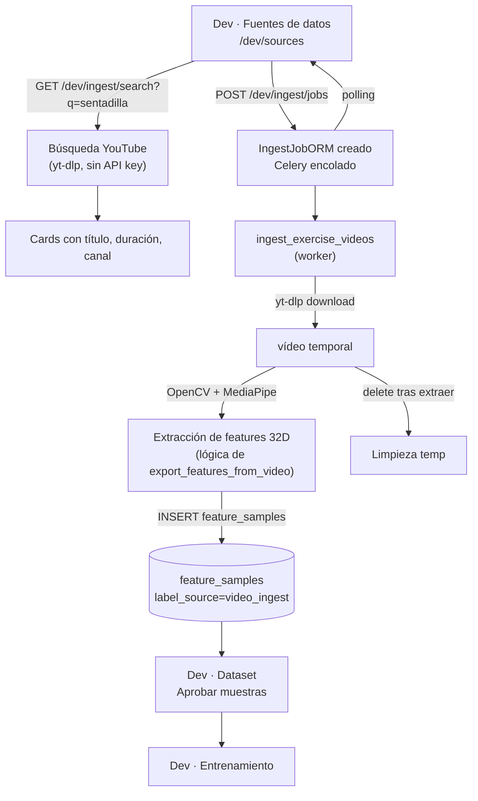

# Plan: Ingesta Automática de Vídeos — Bio-Motion Evaluator

## Flujo completo

## 1. Backend — Nueva tabla `ingest_jobs`

**Archivo:** [`backend/app/db/models.py`](backend/app/db/models.py) + nueva migración Alembic.

Campos:
- `id` UUID PK
- `status` String(32) — `pending | running | completed | failed`
- `celery_task_id` String nullable
- `exercise_label` String(64) — etiqueta a asignar a todas las muestras
- `source_type` String(32) — `youtube_search | youtube_url`
- `query` Text — término de búsqueda o URL
- `max_videos` Integer — cuántos vídeos como máximo
- `auto_approve` Boolean default False — marcar muestras como `approved` directo
- `videos_json` JSONB — lista de vídeos con `{title, url, youtube_id, duration_s}` (pre-búsqueda)
- `metrics_json` JSONB — `{frames_read, features_extracted, samples_inserted, videos_processed, per_video: [...]}`
- `params_json` JSONB — `{only_window_full, require_pose_ok, emit_every, max_frames_per_video}`
- `error_message` Text nullable
- `created_at`, `completed_at` DateTime

## 2. Backend — Tarea Celery `ingest_exercise_videos`

**Archivo nuevo:** `backend/app/workers/ingest_tasks.py`

Pasos de la tarea (recibe `job_id`):
1. Carga `IngestJobORM` desde DB, pone `status="running"`.
2. Si `source_type == "youtube_search"`: usa `yt_dlp.YoutubeDL` con URL `"ytsearch:{max_videos} {query}"` para obtener lista de vídeos (solo metadatos, sin descargar aún).
3. Guarda lista en `videos_json` para trazabilidad.
4. Por cada vídeo:
   a. Descarga a directorio temporal usando el servicio existente en [`backend/app/services/video/downloader.py`](backend/app/services/video/downloader.py).
   b. Extrae features con la lógica ya en [`backend/scripts/export_features_from_video.py`](backend/scripts/export_features_from_video.py) (reutilizar como función importable: `extract_features_from_file(path, label, cfg, model_path, params) → list[list[float]]`).
   c. Inserta `FeatureSampleORM` filas: `label_source="video_ingest"`, `source_file=titulo_video`, `review_status="approved" if auto_approve else "pending"`.
   d. Elimina el archivo temporal.
   e. Actualiza `metrics_json` incrementalmente.
5. Pone `status="completed"` / `"failed"` y `completed_at`.

La función de extracción se saca del script en una función importable `extract_features_from_file` dentro de `backend/scripts/export_features_from_video.py` (el script queda como envoltorio CLI).

## 3. Backend — API `/api/v1/dev/ingest`

**Archivo nuevo:** `backend/app/api/v1/dev/ingest.py`

| Método | Ruta | Descripción |
|--------|------|-------------|
| `GET` | `/ingest/search` | Query `q` + `limit` (max 10). Usa yt-dlp en hilo (`asyncio.to_thread`) para buscar y devuelve `[{title, url, youtube_id, duration_s, channel, thumbnail_url}]`. No descarga. |
| `POST` | `/ingest/jobs` | Body: `{label, query, source_type, max_videos, auto_approve, params}`. Crea `IngestJobORM` y encola Celery `ingest_exercise_videos.delay(job_id)`. |
| `GET` | `/ingest/jobs` | Lista jobs con métricas resumen. |
| `GET` | `/ingest/jobs/{id}` | Detalle: `videos_json`, `metrics_json` completo (por vídeo). |

Registrar en [`backend/app/api/v1/dev_router.py`](backend/app/api/v1/dev_router.py).

Añadir `"app.workers.ingest_tasks"` a `include` en [`backend/app/workers/celery_app.py`](backend/app/workers/celery_app.py).

## 4. Frontend — Nueva página `DataSourcesPage` (`/dev/sources`)

**Archivo nuevo:** `appWeb/src/pages/dev/DataSourcesPage.tsx`

Secciones:
- **Buscador**: campo de texto (ejercicio a buscar) + selector de etiqueta (clases del catálogo) + botón "Buscar en YouTube" → llama `GET /ingest/search`.
- **Resultados**: cards horizontales con thumbnail, título, canal, duración; checkbox por vídeo (o botón "Tomar todos").
- **Formulario de ingesta**: nº máx. de vídeos, checkbox "Aprobar automáticamente" (auto_approve), parámetros opcionales (only_window_full, require_pose_ok). Botón "Ingestar".
- **Historial de jobs**: tabla de `IngestJobORM`: status, etiqueta, query, samples_inserted, n vídeos, fecha. Polling cada 3 s cuando hay jobs en `running`.
- **Detalle por job**: expandible con lista de vídeos usados + métricas por vídeo (frames_read, features_extracted).

**Nuevos archivos relacionados:**
- `appWeb/src/hooks/useDevIngest.ts` — `searchYoutube`, `createIngestJob`, `listIngestJobs`, `getIngestJob` con polling.

**Modificaciones existentes:**
- [`appWeb/src/router.tsx`](appWeb/src/router.tsx) — añadir `{ path: 'dev/sources', element: <DataSourcesPage /> }`.
- [`appWeb/src/layouts/AppLayout.tsx`](appWeb/src/layouts/AppLayout.tsx) — añadir `Dev · Fuentes` en `devLinks`.
- [`appWeb/src/pages/HomePage.tsx`](appWeb/src/pages/HomePage.tsx) — añadir tarjeta en sección «Desarrollo».

## 5. Migración Alembic

Archivo nuevo con `revision` posterior a `20260404_0001`: crea tabla `ingest_jobs`.

## Archivos a crear/modificar

**Backend (nuevos):**
- `backend/app/db/models.py` — clase `IngestJobORM`
- `backend/alembic/versions/20260404_0002_ingest_jobs.py` — migración
- `backend/app/workers/ingest_tasks.py` — tarea Celery
- `backend/app/api/v1/dev/ingest.py` — router

**Backend (modificados):**
- `backend/scripts/export_features_from_video.py` — extraer función `extract_features_from_file` importable
- `backend/app/api/v1/dev_router.py` — registrar `ingest.router`
- `backend/app/workers/celery_app.py` — añadir `ingest_tasks` a `include`

**Frontend (nuevos):**
- `appWeb/src/pages/dev/DataSourcesPage.tsx`
- `appWeb/src/hooks/useDevIngest.ts`

**Frontend (modificados):**
- `appWeb/src/router.tsx`
- `appWeb/src/layouts/AppLayout.tsx`
- `appWeb/src/pages/HomePage.tsx`
