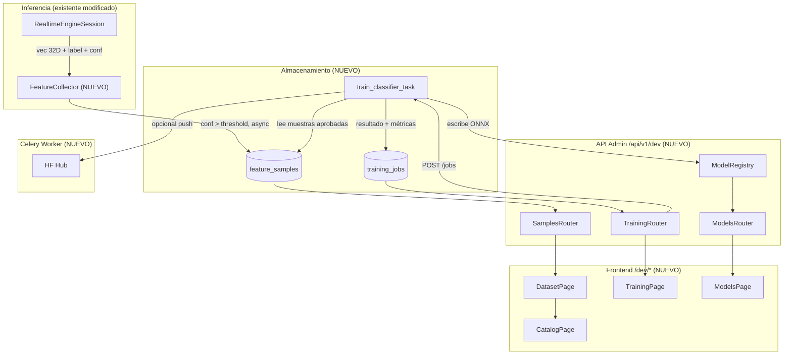

# Plan: Módulo de Aprendizaje Continuo — Bio-Motion Evaluator

## Contexto y decisiones de diseño

- **Entrenamiento local**: Random Forest sobre vector 32D corre en segundos en CPU. No se necesita GPU ni HF para entrenar. HF Hub se usa únicamente como registro de artefactos (ONNX + manifest versionados), no como compute.
- **Recolección automática**: al término de cada ventana (`window_full=True`, `confidence > umbral`), el motor guarda el vector 32D + etiqueta predicha en DB como "soft label". Un admin los revisa y valida antes de usarlos en entrenamiento.
- **Curación manual**: flujo explícito de revisión antes de entrenar: el admin aprueba, corrige o rechaza muestras desde la UI.
- **Celery reutilizado**: el worker de entrenamiento sigue el mismo patrón que `download_and_process_video` en [`backend/app/workers/tasks.py`](backend/app/workers/tasks.py).
- **Audiencia**: solo admins/devs. La sección "Dev Tools" no tiene autenticación dura en primera iteración (API key por header o variable de entorno).

## Arquitectura del módulo



## 1. Backend — Esquema de base de datos

**Archivo:** [`backend/app/db/models.py`](backend/app/db/models.py) + nueva migración Alembic.

Dos tablas nuevas:

**`feature_samples`**
- `id` UUID PK
- `label` String(64) — etiqueta ground truth (revisada) o soft label
- `label_source` String(32) — `"auto_soft"` | `"manual"` | `"video_export"`
- `review_status` String(32) — `"pending"` | `"approved"` | `"rejected"`
- `feature_vector` JSONB — 32 floats (`[f0...f31]`)
- `confidence_at_collection` Float — confianza del clasificador al recolectar
- `pose_ok` Boolean
- `session_id` UUID FK nullable → `sessions`
- `source_file` Text nullable — nombre del vídeo si viene de script
- `split` String(16) — `"train"` | `"val"` | `"test"` | `"unset"`
- `notes` Text nullable
- `recorded_at` DateTime

**`training_jobs`**
- `id` UUID PK
- `status` String(32) — `"pending"` | `"running"` | `"completed"` | `"failed"`
- `celery_task_id` String nullable
- `classes_json` JSONB — lista de clases usadas
- `sample_count` Integer
- `metrics_json` JSONB — `{accuracy, f1_per_class, confusion_matrix, n_train, n_val}`
- `model_key` String nullable — clave en manifest si se guardó
- `hf_commit` String nullable — SHA del commit en HF Hub si se hizo push
- `error_message` Text nullable
- `created_at` / `completed_at` DateTime

## 2. Backend — Feature Collector (vision layer)

**Archivo nuevo:** `backend/vision/feature_collector.py`

Clase `FeatureCollector`:
- Acepta un callback `save_fn(vector, label, confidence, pose_ok, session_id)` (inyectado desde la capa API).
- Umbral configurable (`auto_collect_min_confidence`, nuevo campo en `Settings`).
- Llama al callback con `asyncio.create_task` para no bloquear el loop de frames.

**Modificación mínima en** [`backend/vision/realtime_engine.py`](backend/vision/realtime_engine.py):
- `RealtimeEngineSession.__init__` acepta `collector: FeatureCollector | None = None`.
- En `_after_extract`, tras la clasificación, si `collector` is not None y `window_full` → `collector.collect(vec, label, confidence, pose_ok)`.
- Los WebSocket handlers (`video.py`, `live_pose.py`) instancian el collector solo si `analysis_enabled=True` y `AUTO_COLLECT` activo en settings.

## 3. Backend — Router de administración

**Directorio nuevo:** `backend/app/api/v1/dev/`

Tres módulos, prefijo `/api/v1/dev`:

**`samples.py`** — Dataset management
- `GET /samples` — lista con filtros: `label`, `review_status`, `split`, `label_source`, paginación
- `POST /samples` — carga manual (body: `{features: [32 floats], label, notes}`)
- `PATCH /samples/{id}` — corregir label o review_status
- `DELETE /samples/{id}`
- `POST /samples/bulk-approve` — aprobar lista de ids
- `GET /samples/stats` — conteos por label + review_status (para el catálogo)

**`training.py`** — Jobs de entrenamiento
- `POST /training/jobs` — body: `{classes, split_ratio, set_active, push_hf}` → encola Celery
- `GET /training/jobs` — lista con métricas
- `GET /training/jobs/{id}` — detalle completo (métricas, confusion matrix JSON)

**`models.py`** — Gestión de manifest
- `GET /models` — todas las entradas del manifest + cuál es active
- `POST /models/{key}/activate` — escribe `active` en manifest + reinicia classifier en memoria
- `GET /models/{key}` — detalle de la entrada manifest

Registrar el router en [`backend/app/main.py`](backend/app/main.py) bajo el `api_router` existente.

## 4. Backend — Celery Training Task

**Archivo nuevo:** `backend/app/workers/training_tasks.py`

Tarea `train_classifier_task(job_id)`:
1. Carga muestras `review_status='approved'` en `split IN ('train','val')` desde DB.
2. Divide train/val si aún no están asignados (`split='unset'`).
3. Llama a la misma lógica de `train_exercise_classifier_from_csv.py` pero como función importable (refactorizar el script a función `train_and_export_onnx(X_train, y_train, X_val, y_val, classes, out_path)`).
4. Calcula accuracy, F1 por clase y matriz de confusión en val.
5. Escribe ONNX en `vision/models/` y actualiza manifest (clave = `f"exercise_rf_{job_id[:8]}"`).
6. Opcionalmente (`push_hf=True`): llama a `HfHubService.push_model(onnx_path, manifest_entry)`.
7. Actualiza `TrainingJobORM` con métricas y status.

## 5. Backend — HF Hub Service (opcional)

**Archivo nuevo:** `backend/app/services/hf_hub.py` (amplía el ya existente en `services/inference/huggingface.py`).

`HfHubService`:
- Usa `huggingface_hub` Python SDK (ya existe `HF_API_TOKEN` en settings).
- `push_model(onnx_path, manifest_entry, repo_id)` — sube el `.onnx` + un `manifest_entry.json` como artefactos en el repo configurado.
- `list_versions(repo_id)` — devuelve commits con el ONNX (para el panel de modelos).
- Variable nueva en settings: `HF_MODEL_REPO_ID` (e.g. `"bio-motion/exercise-classifier"`).

## 6. Frontend — Estructura de páginas Dev Tools

**Nuevas rutas** en [`appWeb/src/router.tsx`](appWeb/src/router.tsx):
```
/dev/catalog    → CatalogPage
/dev/dataset    → DatasetPage
/dev/training   → TrainingPage
/dev/models     → ModelsPage
```

**Sidebar** en [`appWeb/src/layouts/AppLayout.tsx`](appWeb/src/layouts/AppLayout.tsx):
- Añadir separador visual `"— Dev Tools —"` tras los links existentes.
- 4 `NavLink` nuevos con los textos: `Catálogo de ejercicios`, `Dataset`, `Entrenamiento`, `Modelos`.

**Hooks** en `appWeb/src/hooks/`:
- `useDevSamples.ts` — fetch/mutate samples
- `useDevTraining.ts` — trigger job + polling de status (SSE o polling cada 2s)
- `useDevModels.ts` — fetch manifest + activate

## 7. Frontend — Páginas Dev (diseño con tokens existentes)

Todas las páginas usan el sistema de tokens `--bm-*` de [`appWeb/src/design/tokens.css`](appWeb/src/design/tokens.css).

### `CatalogPage` (`/dev/catalog`)
- Grid de cards, una por clase de ejercicio (idle, squat, lunge, …).
- Cada card: nombre, ícono/avatar, conteo de muestras aprobadas, último F1 entrenado, badge de estado del modelo activo.
- Fuente de datos: `GET /api/v1/dev/samples/stats` + `GET /api/v1/dev/models`.
- Acción: navega a `/dev/dataset?label=squat` para ver muestras de esa clase.

### `DatasetPage` (`/dev/dataset`)
- Tabla CSS grid (patrón `.frame-log__row` existente): columnas id-corto, label, review_status badge, source, confidence, fecha.
- Filtros en barra superior: label, status, split, source.
- Acciones por fila: corregir label (inline select), aprobar, rechazar.
- Acción bulk: "Aprobar seleccionados".
- Badge de distribución de clases (barras simples con CSS, sin Recharts).

### `TrainingPage` (`/dev/training`)
- Formulario de disparo: multiselect de clases, split ratio slider, checkbox "Activar al terminar", checkbox "Push a HF Hub".
- Botón "Entrenar" → POST job → muestra progreso en tiempo real (polling).
- Historial de jobs: tabla con status, n_samples, accuracy, fecha.
- Al hacer clic en un job: panel expandible con F1 por clase + confusion matrix visual (tabla HTML coloreada con `--bm-accent` por intensidad).

### `ModelsPage` (`/dev/models`)
- Lista de versiones del manifest: nombre, clases, fecha, accuracy stored.
- Badge "ACTIVO" en el modelo actual.
- Botón "Activar" por cada versión inactiva.
- Si HF está configurado: botón "Ver en HF Hub" (link externo).

## Archivos clave a crear/modificar

**Backend (nuevos):**
- `backend/vision/feature_collector.py`
- `backend/app/api/v1/dev/samples.py`
- `backend/app/api/v1/dev/training.py`
- `backend/app/api/v1/dev/models.py`
- `backend/app/workers/training_tasks.py`
- `backend/app/services/hf_hub.py`
- Migración Alembic (`feature_samples` + `training_jobs`)

**Backend (modificados):**
- `backend/app/db/models.py` — 2 nuevas ORM classes
- `backend/vision/realtime_engine.py` — inyección de collector
- `backend/app/main.py` — registro del dev router
- `backend/app/config.py` — `auto_collect_min_confidence`, `hf_model_repo_id`
- `backend/scripts/train_exercise_classifier_from_csv.py` — extraer lógica a función importable

**Frontend (nuevos):**
- `appWeb/src/pages/dev/CatalogPage.tsx`
- `appWeb/src/pages/dev/DatasetPage.tsx`
- `appWeb/src/pages/dev/TrainingPage.tsx`
- `appWeb/src/pages/dev/ModelsPage.tsx`
- `appWeb/src/hooks/useDevSamples.ts`
- `appWeb/src/hooks/useDevTraining.ts`
- `appWeb/src/hooks/useDevModels.ts`

**Frontend (modificados):**
- `appWeb/src/router.tsx` — 4 rutas nuevas
- `appWeb/src/layouts/AppLayout.tsx` — sección Dev Tools en sidebar
