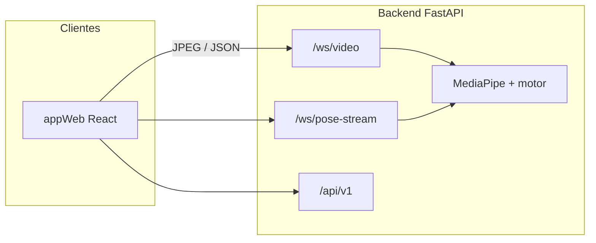

# Bio-Motion Evaluator

Sistema de software para la **valoración automática de movilidad articular** y detección de asimetrías mediante **visión artificial** (MediaPipe BlazePose en servidor). Trabajo de grado — Ingeniería en Software, Tecnológico de Antioquia (2026).

**Autor:** Mateo Londoño Toro  
**Alcance de este repositorio:** MVP de la tesis — goniometría digital de rodilla, análisis en vivo y por vídeo, e instrumentos de validación.

---

## Resumen

Bio-Motion Evaluator integra:

- **Cliente web** ([`appWeb/`](appWeb/)) — React 19 + Vite + TypeScript: análisis en vivo desde cámara, análisis de vídeo *gold standard*, panel de métricas e interfaz de sustentación (`/sustentacion`).
- **Backend** ([`backend/`](backend/)) — FastAPI (Python): inferencia de pose, goniometría digital de rodilla, clasificación de ejercicio en tiempo de ejecución, WebSockets y API REST.
- **Validación** ([`validacion/`](validacion/)) — experimentos de exactitud y latencia, y herramientas del Nivel 2 (video-goniometría manual con Tracker).

La inferencia corre en el **servidor**; el cliente captura fotogramas, envían por WebSocket y renderizan el esqueleto y las métricas en tiempo real. Evaluación de calidad alineada con **ISO/IEC 25010** (usabilidad, mantenibilidad, escalabilidad).

### Pregunta de investigación

> ¿Con qué **exactitud**, frente a métodos de referencia de medición angular, y bajo qué
> **latencia** extremo a extremo puede una arquitectura cliente-servidor con inferencia de
> pose en el servidor estimar el ángulo de flexión de rodilla y la asimetría bilateral en
> tiempo real sobre hardware de consumo?

El trabajo no se limita a construir el sistema: lo **mide**. Los instrumentos de validación
son ejecutables y reproducibles y viven en [`validacion/`](validacion/); el protocolo de
medición está en [`docs/guias/protocolo_validacion_exactitud.md`](docs/guias/protocolo_validacion_exactitud.md).

Documentación de tesis y specs: [`docs/`](docs/README.md) · Arquitectura: [`docs/arquitectura.md`](docs/arquitectura.md) · Borrador académico: [`docs/Formato_trabajo_de_grado.md`](docs/Formato_trabajo_de_grado.md)

---

## Arquitectura

| Capa | Tecnología | Carpeta | Rol |
|------|------------|---------|-----|
| **Frontend web** | React 19, Vite, TypeScript | [`appWeb/`](appWeb/) | HU-03 análisis en vivo, HU-04 vídeo, configuración, sustentación |
| **Backend** | Python 3.10+, FastAPI, MediaPipe | [`backend/`](backend/) | API REST, WebSockets, motor en tiempo real |
| **Persistencia** | PostgreSQL + Alembic (opcional) | `backend/app/db/` | Usuarios, sesiones y métricas, trabajos de descarga |
| **Validación** | Python (NumPy, pandas, matplotlib) | [`validacion/`](validacion/) | Experimentos de exactitud y latencia (evidencia de la tesis) |
| **Documentación** | Markdown | [`docs/`](docs/) | Specs, guías, bitácora, diagramas |
| **Pruebas** | pytest, vídeos locales | [`tests/`](tests/) | *Gold standard* (MP4 no versionados) |



---

## Funcionalidades principales (`appWeb`)

| Ruta | Descripción |
|------|-------------|
| `/live-analysis` | Cámara del navegador → `/ws/video` → overlay 2D + flexión bilateral de rodilla |
| `/video-analysis` | Vídeos en servidor (`tests/assets/videos`) → `/ws/pose-stream` |
| `/backend-status` | Diagnóstico de salud del API |
| `/settings/connection` | URL del backend y objetivo de repeticiones |
| `/sustentacion` | Interfaz de sustentación (tema claro): portada, demo en vivo y resultados |
| `/login`, `/sessions`, `/profile`, `/video-download` | Sprint 4 — auth, persistencia y descarga remota (opcional, según `VITE_MVP_*`) |

Detalle del cliente: [`appWeb/README.md`](appWeb/README.md). Contratos: [`docs/spec/`](docs/spec/README.md).

---

## Requisitos

| Componente | Versión |
|------------|---------|
| **Python** | 3.10+ (recomendado 3.11) |
| **Node.js** | 20+ (para `appWeb`) |
| **Git** | Cualquier versión reciente |
| **PostgreSQL** | Opcional (auth, sesiones, descarga de vídeo) |
| **Redis** | Opcional (Celery para la descarga remota de vídeo) |

Instalación detallada: [`docs/guias/SETUP.md`](docs/guias/SETUP.md).

---

## Inicio rápido (evaluadores / desarrollo)

### 1. Backend

```bash
cd backend
python -m venv .venv
# Windows:
.venv\Scripts\activate
# Linux/macOS:
# source .venv/bin/activate

pip install -r requirements.txt
copy .env.example .env    # Windows — editar variables
# cp .env.example .env    # Linux/macOS

python scripts/download_models.py
uvicorn app.main:app --reload --host 0.0.0.0 --port 8000
```

**Atajo (Windows, desde la raíz):** `.\scripts\start-dev-backend.ps1`

**macOS / Linux:** activa el entorno con `source .venv/bin/activate`, copia la configuración con `cp .env.example .env` y usa el mismo comando `uvicorn`.

| Recurso | URL |
|---------|-----|
| Salud | http://localhost:8000/api/v1/health |
| OpenAPI | http://localhost:8000/docs |
| WS cámara navegador | `ws://localhost:8000/ws/video` |
| WS vídeo en servidor | `ws://localhost:8000/ws/pose-stream` |

Más endpoints y PostgreSQL: [`backend/README.md`](backend/README.md).

**Celery** (opcional, solo para la descarga remota de vídeo en `/video-download`):

```bash
celery -A app.workers.celery_app worker --loglevel=info
```

### 2. Cliente web (`appWeb`)

En **otra terminal**, desde la raíz:

```bash
cd appWeb
npm install
npm run dev
```

Abre la URL que indique Vite (p. ej. http://localhost:5173). En **Configuración** define `http://localhost:8000` si no es el valor por defecto.

**Build de producción / demo jurado:**

```bash
npm run build
npm run preview
```

Variables MVP y menú reducido: [`appWeb/README.md`](appWeb/README.md) y [`appWeb/.env.example`](appWeb/.env.example).

### 3. Flujo mínimo de prueba (HU-03)

1. Backend en marcha (`GET /api/v1/health` → 200).
2. `appWeb` → **Análisis en vivo** → Conectar cámara → Iniciar transmisión.
3. Comprobar overlay de esqueleto y ángulos de rodilla en el panel (RX/s típico **8–20** según hardware).

Pruebas alineadas al spec: [`docs/spec/live-camera-analysis.md`](docs/spec/live-camera-analysis.md).

---

## Estructura del monorepo

```
bio-motion-evaluator/
├── appWeb/          # Cliente React
├── backend/         # FastAPI + visión (goniometría, motor en tiempo real)
├── validacion/      # Experimentos de exactitud y latencia (evidencia de la tesis)
│   ├── experimentos/   # Scripts ejecutables y reproducibles
│   ├── analisis/       # Estadística de acuerdo (MAE, Bland-Altman, ICC) y Nivel 2 (Tracker)
│   ├── datos/          # Mediciones de referencia (los fotogramas PNG no se versionan)
│   └── resultados/     # CSV, figuras e informes generados
├── docs/            # Tesis, specs, guías, arquitectura
├── tests/           # Pruebas y assets de vídeo (MP4 en .gitignore)
└── scripts/         # Atajo PowerShell para arrancar el backend
```

### Reproducir la validación

```bash
cd backend && PYTHONPATH=. python ../validacion/experimentos/exp1_verificacion_geometrica.py
cd backend && PYTHONPATH=. python ../validacion/experimentos/exp3_estabilidad_temporal.py
```

Los informes y datos crudos se regeneran en `validacion/resultados/`. Las pruebas automáticas se ejecutan desde la raíz con `python -m pytest -q`.

---

## Documentación para evaluadores

| Documento | Contenido |
|-----------|-----------|
| [`docs/Formato_trabajo_de_grado.md`](docs/Formato_trabajo_de_grado.md) | Memoria: objetivos, sprints, diseño, pruebas, bitácora |
| [`docs/spec/live-camera-analysis.md`](docs/spec/live-camera-analysis.md) | Análisis en vivo (cámara + `/ws/video`) |
| [`docs/spec/websocket-pose-stream.md`](docs/spec/websocket-pose-stream.md) | Streaming pose por archivo/cámara servidor |
| [`docs/spec/api-v1-rest.md`](docs/spec/api-v1-rest.md) | API REST v1 |
| [`docs/guias/protocolo_validacion_exactitud.md`](docs/guias/protocolo_validacion_exactitud.md) | Protocolo de validación de exactitud (niveles, criterios, amenazas a la validez) |
| [`validacion/resultados/`](validacion/resultados/) | Resultados numéricos, figuras e informes de los experimentos |
| [`presentacion.md`](presentacion.md) | Guion de sustentación (si aplica) |

---

## Seguridad al clonar

- **No** subas `backend/.env` ni claves reales; usa [`backend/.env.example`](backend/.env.example).
- Los vídeos de prueba van en `tests/assets/videos/` (ignorados por Git).
- Si rotaste tokens tras hacer el repo público, revisa que no queden secretos en el historial de Git.

---

## Licencia

Pendiente de definición según política institucional del trabajo de grado. Contacto del autor vía el repositorio en GitHub.

---

## Referencia académica (extracto)

> *Bio-Motion Evaluator implementa y **evalúa** la goniometría digital de rodilla mediante visión artificial (MediaPipe BlazePose) sobre una arquitectura cliente-servidor con inferencia en servidor, separando captura, inferencia y visualización. El trabajo caracteriza la exactitud de la medición angular frente a métodos de referencia y su latencia extremo a extremo sobre hardware de consumo.*

Palabras clave: visión artificial, estimación de pose, goniometría digital, FastAPI, React, WebSocket, biomecánica, ISO/IEC 25010.
