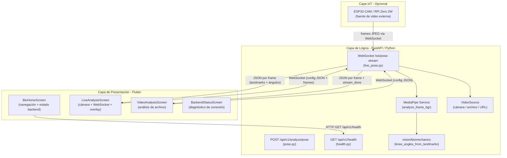

**BIO-MOTION EVALUATOR: SISTEMA DE SOFTWARE PARA LA VALORACIÓN AUTOMÁTICA DE MOVILIDAD ARTICULAR Y DETECCIÓN DE ASIMETRÍAS MEDIANTE VISIÓN ARTIFICIAL**

Mateo Londoño Toro

**DIRECTOR:**

**NOMBRE DEL DIRECTOR DEL TRABAJO DE GRADO**

**CODIRECTOR:**

**NOMBRE DEL CODIRECTOR DEL TRABAJO DE GRADO**

![]()

Tecnológico de Antioquia - Institución Universitaria

Ingeniería en Software

Medellín, Colombia.

AÑO

# DEDICATORIA

# AGRADECIMIENTOS

# RESUMEN

El presente trabajo de grado describe el diseño y desarrollo de **Bio-Motion Evaluator**, un sistema de software multiplataforma que automatiza la valoración de la movilidad articular y la detección de asimetrías físicas en usuarios de entrenamiento de fuerza. El problema central radica en que las evaluaciones biomecánicas de calidad —como el Functional Movement Screen (FMS)— son costosas, subjetivas y dependen de profesionales especializados, lo que las hace inaccesibles para el deportista promedio.

La solución propuesta integra tres capas tecnológicas: un frontend desarrollado en **Flutter** (con soporte para web, Android e iOS), un backend asíncrono basado en **FastAPI** (Python) que concentra la lógica de inferencia, y la integración opcional de dispositivos IoT (ESP32-CAM / Raspberry Pi) como fuente de video. El núcleo del sistema utiliza **MediaPipe BlazePose**, un modelo de estimación de pose que detecta 33 puntos clave del cuerpo humano en tiempo real a través de redes neuronales, permitiendo el cálculo de ángulos articulares (goniometría digital) sin sensores físicos.

La comunicación entre el frontend y el backend se realiza mediante el protocolo **WebSocket**, lo que posibilita el streaming bidireccional de métricas biomecánicas (ángulos de rodilla, estado de detección de pose, marcas de tiempo) con una latencia mínima. El sistema implementa la arquitectura cliente-servidor con separación clara de responsabilidades: el backend realiza la inferencia con MediaPipe y expone los resultados como mensajes JSON por fotograma, mientras que el frontend renderiza la superposición del esqueleto de pose y el panel de métricas en tiempo real.

Los primeros sprints de desarrollo validaron la viabilidad técnica del sistema, logrando el análisis en vivo desde cámara, el análisis de videos previamente grabados (gold standard), y la visualización de ángulos de flexión de rodilla con indicadores semánticos de estado (dentro de rango, límite, compensación). El producto se evalúa bajo los atributos de calidad definidos por la norma **ISO/IEC 25010**, con énfasis en usabilidad, mantenibilidad y escalabilidad.

# PALABRAS CLAVE

Visión artificial, estimación de pose, MediaPipe BlazePose, movilidad articular, goniometría digital, Flutter, FastAPI, WebSocket, biomecánica, análisis en tiempo real, ISO/IEC 25010, Functional Movement Screen (FMS), entrenamiento de fuerza, detección de asimetrías.

# TABLA DE CONTENIDO

[DEDICATORIA 2](#_Toc174698952)

[AGRADECIMIENTOS 3](#_Toc174698953)

[RESUMEN 4](#_Toc174698954)

[PALABRAS CLAVE 4](#_Toc174698955)

[TABLA DE CONTENIDO 5](#_Toc174698956)

[ÍNDICE DE FIGURAS 8](#_Toc174698957)

[ÍNDICE DE TABLAS 9](#_Toc174698958)

[ABREVIATURAS 10](#_Toc174698959)

[1\. INTRODUCCIÓN 11](#_Toc174698960)

[2\. MARCO DEL PROYECTO 12](#_Toc174698961)

[2.1. DEFINICIÓN DEL PROBLEMA 12](#_Toc174698962)

[2.2. JUSTIFICACIÓN 12](#_Toc174698963)

[2.3. ANTECEDENTES 12](#_Toc174698964)

[3\. OBJETIVOS 13](#_Toc174698965)

[3.1. OBJETIVO GENERAL 13](#_Toc174698966)

[3.2. OBJETIVOS ESPECÍFICOS 13](#_Toc174698967)

[4\. MARCO METODOLÓGICO 14](#_Toc174698968)

[4.1. DEFINICIÓN DE LA METODOLOGÍA 14](#_Toc174698969)

[4.2. DEFINICIÓN DEL ALCANCE 14](#_Toc174698970)

[4.3. RECURSOS 14](#_Toc174698971)

[4.4. CRONOGRAMA DE ACTIVIDADES 14](#_Toc174698972)

[5\. MARCO CONCEPTUAL 15](#_Toc174698973)

[6\. DESARROLLO DEL PROYECTO 16](#_Toc174698974)

[6.1. CONTEXTO DEL SOFTWARE 16](#_Toc174698975)

[6.1.1. Descripción del Negocio 16](#_Toc174698976)

[6.1.2. Áreas por Intervenir 16](#_Toc174698977)

[6.1.3. Actores y sus Roles 16](#_Toc174698978)

[6.2. PROPUESTA DE SOLUCIÓN 16](#_Toc174698979)

[6.2.1. Product backlog 16](#_Toc174698980)

[6.3. PLANIFICACIÓN DEL SPRINT 1 18](#_Toc174698981)

[6.3.1. Historias de usuario 18](#_Toc174698982)

[6.3.2. Revisión 18](#_Toc174698983)

[6.3.3. Tareas asociadas y ejecutadas. 18](#_Toc174698984)

[6.4. PLANIFICACIÓN DEL SPRINT 2 19](#_Toc174698985)

[6.4.1. Historias de usuario 19](#_Toc174698986)

[6.4.2. Revisión 19](#_Toc174698987)

[6.4.3. Tareas asociadas y ejecutadas. 19](#_Toc174698988)

[6.5. PLANIFICACIÓN DEL SPRINT N 19](#_Toc174698989)

[6.5.1. Historias de usuario 19](#_Toc174698990)

[6.5.2. Revisión 19](#_Toc174698991)

[6.5.3. Tareas asociadas y ejecutadas. 19](#_Toc174698992)

[6.6. DISEÑO DEL SISTEMA 19](#_Toc174698993)

[6.6.1. Especificación de la arquitectura. 19](#_Toc174698994)

[6.6.2. Diagrama de clases. 19](#_Toc174698995)

[6.6.3. Diagrama entidad relación. 19](#_Toc174698996)

[6.6.4. Evaluación del Frontend Flutter Web y Migración a React 19](#_TocFlutterReact)

[6.7. PLAN DE PRUEBAS 19](#_Toc174698997)

[6.7.1. Plan de pruebas funcionales 19](#_Toc174698998)

[6.7.2. Pruebas de usabilidad 19](#_Toc174698999)

[6.8. DESPLIEGUE DEL SISTEMA 19](#_Toc174699000)

[6.8.1. Manual de Usuario 20](#_Toc174699001)

[6.8.2. Manual de Instalación 20](#_Toc174699002)

[6.8.3. Resumen técnico del software 20](#_Toc174699003)

[7\. RESULTADOS Y DISCUSIÓN 22](#_Toc174699004)

[8\. IMPACTO ESPERADO 23](#_Toc174699005)

[9\. CONCLUSIONES 24](#_Toc174699006)

[10\. RECOMENDACIONES FUTURAS 25](#_Toc174699007)

[REFERENCIAS 26](#_Toc174699008)

[ANEXOS 27](#_Toc174699009)

# ÍNDICE DE FIGURAS

# ÍNDICE DE TABLAS

# ABREVIATURAS

_\[Una abreviatura es una convención ortográfica que acorta la escritura de cierto término o expresión. Ejemplo: UML: Unified Modeling Language\]_

# INTRODUCCIÓN

El crecimiento sostenido de la industria del fitness y el entrenamiento de fuerza ha traído consigo un incremento paralelo en la incidencia de lesiones músculo-esqueléticas asociadas a patrones de movimiento deficientes. La biomecánica del ejercicio establece que la falta de movilidad articular en tobillos, caderas y zona torácica, así como las asimetrías corporales no detectadas, son precursores directos de compensaciones lesivas que derivan en lesiones crónicas (Cook et al., 2006). Sin embargo, las herramientas de evaluación funcional validadas —como el Functional Movement Screen (FMS)— permanecen fuera del alcance de la mayoría de los deportistas por su costo elevado y su dependencia de profesionales certificados.

La irrupción de la inteligencia artificial en el campo de la visión por computador, y en particular el desarrollo de arquitecturas de estimación de pose como **MediaPipe BlazePose** (Google, 2020), ha abierto una ventana de oportunidad para democratizar el acceso a este tipo de valoraciones. Estos modelos permiten detectar con precisión los puntos clave del cuerpo humano directamente desde la cámara de un dispositivo móvil, sin necesidad de sensores físicos ni equipamiento especializado, habilitando la goniometría digital en tiempo real.

**Bio-Motion Evaluator** nace como respuesta a esta brecha tecnológica. Este proyecto de grado de Ingeniería en Software propone el diseño y desarrollo de un sistema de software multiplataforma que automatiza la valoración de la movilidad articular mediante visión artificial, entregando al usuario un diagnóstico biomecánico personalizado previo al entrenamiento. La solución se articula en tres componentes: una aplicación móvil y web desarrollada en **Flutter**, un servidor de análisis construido con **FastAPI** (Python) que ejecuta el modelo de estimación de pose en tiempo real, y la integración opcional de dispositivos IoT como fuentes de video externas.

La arquitectura del sistema prioriza la comunicación en tiempo real mediante el protocolo **WebSocket**, lo que permite transmitir métricas de ángulos articulares fotograma a fotograma con latencia mínima. El backend extrae los landmarks del cuerpo del usuario, calcula los rangos de movimiento (ROM) de las articulaciones de interés —comenzando por la rodilla como articulación pivote en el squat— y los envía al frontend, donde se visualizan sobre la imagen del usuario junto con indicadores semánticos de calidad del movimiento.

El presente documento detalla el proceso completo de ingeniería del sistema: desde la definición del problema y la revisión de antecedentes, pasando por la arquitectura de la solución y la metodología ágil empleada, hasta los resultados de cada sprint de desarrollo y la evaluación del producto bajo la norma **ISO/IEC 25010**. Se espera que este trabajo represente un aporte tanto al campo de la ingeniería de software aplicada a la salud deportiva, como a la comunidad académica del Tecnológico de Antioquia, posicionándose como un referente en la integración de computación visual e interfaces móviles para la prevención de lesiones.

# MARCO DEL PROYECTO

En este apartado se contextualiza la problemática que motiva el desarrollo del software, se exponen los argumentos que validan la necesidad de su ejecución y se revisan los trabajos previos que sirven como base científica y técnica para la propuesta.

# DEFINICIÓN DEL PROBLEMA

En el contexto actual del fitness y el entrenamiento de fuerza de alta intensidad, se ha evidenciado un incremento en las lesiones músculo-esqueléticas debido a la ejecución de patrones de movimiento disfuncionales. La literatura biomecánica establece que la falta de movilidad articular (en tobillos, cadera y zona torácica) y las asimetrías corporales son los principales precursores de compensaciones lesivas.

A pesar de existir protocolos validados como el Functional Movement Screen (FMS), la implementación de estas evaluaciones enfrenta tres barreras críticas:

- **Costo y Accesibilidad:** Una valoración funcional profesional requiere la contratación de un fisioterapeuta o un profesional certificado, lo que supone un costo elevado y recurrente para el usuario promedio de gimnasio.
- **Subjetividad del Observador:** La evaluación manual depende del "ojo humano", lo que introduce un margen de error significativo y variabilidad entre diferentes evaluadores (falta de precisión cuantitativa).
- **Desconexión de los Datos:** El deportista común suele omitir la fase de valoración y realiza calentamientos genéricos que no abordan sus limitaciones específicas, debido a que no tiene herramientas que traduzcan sus deficiencias biomecánicas en planes de acción inmediatos.

Desde la perspectiva de la Ingeniería de Software, el problema radica en la ausencia de herramientas tecnológicas accesibles y automatizadas que utilicen visión por computador para objetivizar la medición del rango de movimiento (ROM) en tiempo real. Actualmente, los usuarios cuentan con aplicaciones de rutinas, pero no con sistemas de "diagnóstico preventivo" basados en datos biométricos precisos que permitan una prescripción personalizada del ejercicio.

**Pregunta Problema:**  
¿Cómo automatizar la valoración de la movilidad articular y la detección de asimetrías mediante técnicas de visión por computador para generar recomendaciones personalizadas de preparación al movimiento en usuarios de entrenamiento de fuerza?

# JUSTIFICACIÓN

La realización de este proyecto se justifica desde tres dimensiones fundamentales:

1\. Relevancia Social y en Salud:

La prevención de lesiones es un tema de salud pública en el ámbito deportivo. Al democratizar el acceso a valoraciones biomecánicas a través de un smartphone, se empodera al usuario para que conozca sus limitaciones antes de cargar peso, reduciendo el riesgo de lesiones crónicas y mejorando la longevidad en la práctica física.

2\. Innovación Tecnológica (Ingeniería de Software):

Este proyecto aplica el estado del arte en Inteligencia Artificial, específicamente en la estimación de pose (Pose Estimation). El uso de librerías como MediaPipe o OpenCV para el cálculo de ángulos articulares representa un reto técnico en términos de optimización de algoritmos, procesamiento en tiempo real y precisión de datos. Además, la integración de estos modelos de IA bajo la norma ISO/IEC 25010 garantiza un producto de software con altos estándares de calidad, mantenibilidad y usabilidad.

3\. Impacto en la Productividad y el Rendimiento:

Para el sector fitness, esta herramienta permite optimizar el tiempo de entrenamiento. En lugar de realizar rutinas de movilidad de 20 minutos "a ciegas", el software permite una "activación dirigida" basada en las necesidades reales del día. Esto aporta un valor agregado diferenciador: la hiper-personalización basada en evidencia biométrica.

Finalmente, para el Tecnológico de Antioquia, este trabajo de grado demuestra la capacidad de sus estudiantes de Ingeniería en Software para resolver problemas del mundo real mediante la integración de arquitecturas modernas y computación visual, cerrando la brecha entre la ciencia del ejercicio y la tecnología.

# ANTECEDENTES

Para el desarrollo de esta propuesta, se han analizado referentes en tres niveles: global, nacional y local, permitiendo identificar la evolución desde sistemas de alta complejidad hasta soluciones basadas en inteligencia artificial.

**2.3.1. Referentes Internacionales y Tecnológicos**

El marco de referencia para la evaluación funcional es el sistema FMS (Functional Movement Screen) propuesto por Cook et al. (2006), el cual establece los protocolos de movimiento que este software busca automatizar. En la dimensión tecnológica, el hito más relevante es el desarrollo de MediaPipe BlazePose (Google, 2020), una arquitectura de red neuronal capaz de detectar 33 puntos clave del cuerpo humano en tiempo real, superando las limitaciones de modelos previos que solo detectaban puntos gruesos, permitiendo ahora una goniometría digital precisa en dispositivos móviles.

**2.3.2. Antecedentes Nacionales y Regionales (Colombia y Medellín)**

En el contexto colombiano, se identifican esfuerzos significativos por objetivizar el análisis del movimiento:

- Perspectiva Académica**:** Un antecedente crítico es el trabajo de Salazar**,** Castrillón y Prieto (2008), presentado en el III Congreso Colombiano de Computación en Medellín. Su investigación sobre una herramienta de asistencia para el diagnóstico de movilidad articular en 3D sentó las bases locales para el uso de visión artificial como alternativa a los costosos sistemas de sensores físicos. Este estudio es pionero al argumentar que la visión por computador es la vía más viable para democratizar la evaluación biomecánica en el país.
- Perspectiva Empresarial**:** En el ámbito industrial, la empresa Biomec Limitada (con presencia activa en Medellín) representa el estado del arte en Colombia. Su sistema BioFree utiliza inteligencia artificial y redes neuronales para la captura de movimiento sin marcadores (_markerless_). La existencia de este producto comercial valida la demanda del mercado local por soluciones que eliminen la fricción de los sensores físicos, aunque su enfoque actual es primordialmente clínico y de alto costo.
- Capacidad Investigativa Local**:** Medellín cuenta con una robusta capacidad técnica instalada. Instituciones como el ITM, a través de su Laboratorio de Visión Artificial y Fotónica, y la Universidad EAFIT, con su Grupo de Bioingeniería (GIB), han desarrollado modelos matemáticos y de procesamiento de imágenes para entender la biomecánica humana. Estos grupos confirman que el ecosistema de I+D de la ciudad posee el conocimiento necesario para soportar desarrollos de computación visual aplicada a la salud.

**2.3.3. Contexto Institucional (Tecnológico de Antioquia)**

Tras una revisión en el repositorio institucional del Tecnológico de Antioquia, se observa un vacío en el desarrollo de aplicaciones de ingeniería de software orientadas específicamente a la visión artificial aplicada al fitness. Si bien existen trabajos en la Facultad de Educación Física sobre evaluación funcional manual (usando herramientas como Kinovea), el presente proyecto se posiciona como una propuesta pionera en la Facultad de Ingeniería. Busca cerrar la brecha entre los métodos de observación manual tradicionales y la automatización inteligente, integrando las necesidades de las ciencias del deporte con las capacidades de la ingeniería de software moderna.

# OBJETIVOS

# OBJETIVO GENERAL

Desarrollar un sistema de software basado en visión artificial para la valoración automática de la movilidad articular y detección de asimetrías físicas, que permita la generación de reportes biomecánicos y la prescripción personalizada de rutinas de preparación al movimiento para usuarios de entrenamiento de fuerza.

# OBJETIVOS ESPECÍFICOS

- 1. Levantamiento y Análisis: Definir los requerimientos funcionales y técnicos del sistema, integrando protocolos biomecánicos validados (como el FMS o goniometría digital) para establecer los parámetros de medición de movilidad en los principales complejos articulares (tobillo, cadera y hombro).
  - Diseño de Arquitectura: Diseñar la arquitectura del software y la interfaz de usuario (UI/UX) bajo estándares de usabilidad, asegurando un flujo de captura de video intuitivo que facilite la obtención de datos precisos en entornos de gimnasio.
  - Desarrollo del Módulo de Inteligencia: Implementar un núcleo de procesamiento de imágenes utilizando algoritmos de estimación de pose (Pose Estimation) para la extracción de coordenadas articulares y el cálculo de rangos de movimiento (ROM) en tiempo real.
  - Lógica de Prescripción: Construir un motor de inferencia que interprete los hallazgos biomecánicos (como falta de rango o asimetrías bilaterales) para asignar automáticamente ejercicios correctivos específicos desde una base de datos técnica.
  - Validación y Calidad: Validar la precisión de las mediciones del software mediante pruebas comparativas con métodos tradicionales (goniometría manual) y evaluar la calidad del producto final bajo la norma ISO/IEC 25010.

# MARCO METODOLÓGICO

Este capítulo describe la metodología de desarrollo adoptada para el proyecto, define el alcance del sistema, detalla los recursos humanos y tecnológicos disponibles, y presenta el cronograma de actividades planificado.

# DEFINICIÓN DE LA METODOLOGÍA

El proyecto adopta la metodología ágil **Scrum** como marco de trabajo, dado que se trata del desarrollo de un producto de software con requerimientos que evolucionan a lo largo del proceso y que se beneficia de ciclos cortos de retroalimentación. Scrum permite iterar sobre el producto en sprints de duración fija, entregando funcionalidades verificables al final de cada ciclo y adaptando el alcance según los hallazgos técnicos.

**Lugar de investigación:** El desarrollo se realiza en el entorno académico del Tecnológico de Antioquia – Institución Universitaria, Facultad de Ingeniería, con validaciones en contextos de entrenamiento físico real.

**Enfoque:** Aplicado-tecnológico, con componentes de investigación en biomecánica computacional e ingeniería de software. El proyecto combina:
- Investigación bibliográfica sobre protocolos de evaluación funcional (FMS, goniometría) y state-of-the-art en estimación de pose.
- Desarrollo iterativo de software mediante sprints Scrum.
- Validación técnica de la precisión del sistema comparada con métodos de referencia.

**Herramientas metodológicas:**
- **Gestión del backlog y sprints:** Historias de usuario con criterios de aceptación, estimadas en puntos de historia.
- **Control de versiones:** Git con repositorio en GitHub (monorepo con carpetas `app/`, `backend/`, `iot/`, `docs/`, `tests/`).
- **Documentación continua:** Archivos Markdown bajo `docs/spec/` para especificaciones técnicas (contratos de API, decisiones de arquitectura, incidencias resueltas), generados en paralelo al código para garantizar trazabilidad con el Capítulo 6.
- **Pruebas:** Vídeos de referencia (*gold standard*) almacenados en `tests/assets/videos/`, usados para validación reproducible del pipeline de análisis.

# DEFINICIÓN DEL ALCANCE

El sistema **Bio-Motion Evaluator** abarca, dentro del presente trabajo de grado, las siguientes funcionalidades:

**Dentro del alcance:**
- Aplicación cliente multiplataforma (Flutter) con soporte para **web** (navegador), **Android** e **iOS** desde un único código base.
- Módulo de **análisis en vivo** desde la cámara del dispositivo: captura de video en tiempo real, estimación de pose con MediaPipe BlazePose y visualización de ángulos articulares sobre la imagen.
- Módulo de **análisis de video pregrabado**: carga de archivos de video en el servidor (*gold standard*) para análisis diferido con métricas por fotograma y resumen de sesión.
- Cálculo de **ángulos de flexión de rodilla** (bilateral: izquierda y derecha) como métrica biomecánica principal de la primera fase.
- **Superposición de esqueleto de pose** (*pose overlay*) sobre la vista previa en tiempo real.
- Panel de **métricas en tiempo real** con indicadores semánticos: `BUENO` (dentro de rango), `ADVERTENCIA` (límite), `CRÍTICO` (compensación detectada).
- Comunicación frontend-backend mediante **WebSocket** con protocolo definido y documentado.
- Backend **FastAPI** con soporte para múltiples fuentes de video: cámara del servidor, archivo local, URL de stream (RTSP/HTTP) y dispositivos IoT.
- Integración opcional de **ESP32-CAM / Raspberry Pi Zero 2W** como fuente de video externa inalámbrica.
- Pantalla de **diagnóstico de conexión** al servidor con indicador de estado en tiempo real.

**Fuera del alcance (versión actual):**
- Evaluación de articulaciones distintas a la rodilla (tobillo, cadera, hombro) — contempladas para fases futuras.
- Motor de prescripción automática de ejercicios correctivos (lógica de inferencia de recomendaciones).
- Módulo de historial de sesiones persistente con base de datos.
- Autenticación de usuarios y perfiles múltiples.
- Despliegue en producción en la nube.

# RECURSOS

**Recursos Humanos:**

| Rol | Nombre | Dedicación |
|-----|--------|-----------|
| Desarrollador principal / Investigador | Mateo Londoño Toro | Tiempo completo (trabajo de grado) |
| Director de trabajo de grado | Por definir | Asesoría periódica |

**Recursos Tecnológicos (Hardware):**

| Recurso | Especificación | Uso |
|---------|---------------|-----|
| Computador de desarrollo | Windows 10, CPU moderno, GPU opcional | Backend, frontend, pruebas |
| Dispositivo Android | Android 10+, cámara trasera ≥ 8 MP | Pruebas de la app móvil |
| ESP32-CAM | Módulo con OV2640, WiFi 802.11b/g/n | Fuente de video IoT (opcional) |
| Raspberry Pi Zero 2W | ARM Cortex-A53, cámara Pi | Fuente de video IoT alternativa (opcional) |

**Recursos Tecnológicos (Software):**

| Tecnología | Versión | Rol |
|-----------|---------|-----|
| Flutter SDK | Stable (3.x) | Framework frontend multiplataforma |
| Dart | 3.x | Lenguaje del frontend |
| Python | 3.11 | Lenguaje del backend |
| FastAPI | 0.11x | Framework del servidor REST/WebSocket |
| MediaPipe | 0.10.x | Librería de estimación de pose |
| OpenCV (cv2) | 4.x | Procesamiento de video |
| Uvicorn | 0.x | Servidor ASGI para FastAPI |
| Git / GitHub | — | Control de versiones y colaboración |
| pytest | 7.x+ | Pruebas automatizadas del backend |

**Recursos Bibliográficos:** Acceso a bases de datos académicas (Google Scholar, IEEE Xplore, ScienceDirect), repositorio institucional del Tecnológico de Antioquia, documentación oficial de MediaPipe, Flutter y FastAPI.

# CRONOGRAMA DE ACTIVIDADES

_\[Completar con las fechas reales de inicio y cierre de cada sprint una vez finalizados. La siguiente tabla refleja la planificación general de actividades por fase.\]_

| Fase | Actividades principales | Sprint(s) asociado(s) |
|------|------------------------|----------------------|
| **Análisis y diseño** | Levantamiento de requerimientos, definición de arquitectura, diseño del sistema de diseño UI/UX | Sprint 1 |
| **Infraestructura base** | Setup del monorepo, configuración backend FastAPI, primera conexión WebSocket Flutter–backend | Sprint 1 |
| **Módulo de estimación de pose** | Integración MediaPipe BlazePose, cálculo de ángulos de rodilla, streaming por fotograma | Sprint 2 |
| **Módulo análisis en vivo** | Pantalla de análisis en vivo con cámara, overlay de pose, panel de métricas en tiempo real | Sprint 2 |
| **Módulo análisis de video** | Análisis de archivos gold standard, resumen de sesión, log de frames | Sprint 3 |
| **IoT** | Integración ESP32-CAM como fuente de video, pruebas de latencia y estabilidad | Sprint 3 – Sprint 4 |
| **Pruebas y validación** | Plan de pruebas funcionales, pruebas de usabilidad, comparación con goniometría manual | Sprint 4 |
| **Documentación y cierre** | Documentación técnica final, manual de usuario, manual de instalación, evaluación ISO/IEC 25010 | Sprint 4 – Sprint 5 |

# MARCO CONCEPTUAL

Este capítulo presenta los conceptos y tecnologías fundamentales sobre los que se sustenta el desarrollo de Bio-Motion Evaluator, organizados en tres ejes temáticos: biomecánica y evaluación funcional, visión por computador e inteligencia artificial, e ingeniería de software.

## 5.1 Biomecánica y Evaluación Funcional del Movimiento

**Biomecánica:** Disciplina que estudia las fuerzas mecánicas que actúan sobre el cuerpo humano y los efectos que producen en el movimiento. En el contexto del entrenamiento de fuerza, la biomecánica analiza la alineación articular, los rangos de movimiento y los patrones de activación muscular para determinar la eficiencia y seguridad de cada ejercicio.

**Rango de Movimiento (ROM — Range of Motion):** Medida del grado de movimiento disponible en una articulación, expresado en grados (°). El ROM se mide mediante goniometría y sirve como indicador de la salud articular y la presencia de restricciones de movilidad. En el squat, por ejemplo, un ROM de flexión de rodilla menor a 90° señala una limitación que puede derivar en compensaciones lumbo-pélvicas.

**Goniometría:** Técnica de medición de los ángulos articulares. La goniometría manual utiliza un goniómetro físico y requiere un evaluador entrenado. La **goniometría digital** —implementada en este proyecto— calcula los ángulos a partir de las coordenadas de los puntos de referencia anatómicos detectados por visión artificial, eliminando la subjetividad del observador.

**Functional Movement Screen (FMS):** Protocolo de evaluación funcional del movimiento desarrollado por Cook et al. (2006), compuesto por siete pruebas estandarizadas que identifican limitaciones de movilidad, asimetrías y patrones de movimiento disfuncionales en individuos activos. Constituye el referente biomecánico más validado en el ámbito del fitness de rendimiento y sirve como marco conceptual para los parámetros de evaluación de este sistema.

**Asimetría Bilateral:** Diferencia significativa (generalmente > 10–15%) en el ROM o la fuerza entre el hemicuerpo derecho e izquierdo. Las asimetrías son predictoras de lesión y, en el contexto de este sistema, se detectan comparando los ángulos calculados para articulaciones homólogas (rodilla izquierda vs. rodilla derecha).

## 5.2 Visión por Computador e Inteligencia Artificial

**Visión por Computador (Computer Vision):** Rama de la inteligencia artificial que permite a los sistemas extraer información significativa de imágenes y videos digitales. Incluye tareas como detección de objetos, segmentación semántica, reconocimiento facial y estimación de pose.

**Estimación de Pose (Pose Estimation):** Tarea de visión por computador que consiste en localizar las partes del cuerpo humano (articulaciones y puntos anatómicos de referencia) en una imagen o secuencia de video. Los enfoques modernos, basados en redes neuronales convolucionales (CNN), permiten detectar múltiples personas y sus poses en tiempo real en dispositivos de consumo.

**MediaPipe BlazePose:** Arquitectura de red neuronal desarrollada por Google (2020) para la estimación de pose de cuerpo completo. Detecta **33 puntos clave (landmarks)** del cuerpo humano —incluyendo caderas, rodillas, tobillos, hombros, codos y muñecas— con coordenadas normalizadas (x, y, z) y un valor de visibilidad por punto. Se ejecuta en tiempo real en dispositivos móviles y supera a modelos previos (como PoseNet) en la cobertura de puntos distales del cuerpo. En este proyecto se utiliza a través de la librería **MediaPipe Tasks** de Python, en modo de inferencia por imagen individual (`RunningMode.IMAGE`).

**Landmark / Punto Clave:** Coordenada normalizada (en el rango [0, 1] para x e y) que representa la posición de una articulación o punto anatómico específico en el frame de video. El índice de cada landmark sigue la convención de MediaPipe (ej. índice 25 = rodilla izquierda, índice 26 = rodilla derecha).

**Ángulo Articular (cálculo vectorial):** El ángulo de flexión de una articulación se calcula utilizando los vectores formados por tres landmarks consecutivos: el segmento proximal (de la articulación hacia arriba, ej. cadera→rodilla), el punto de pivote (la articulación misma, ej. rodilla), y el segmento distal (de la articulación hacia abajo, ej. rodilla→tobillo). El ángulo se obtiene mediante el producto punto de los vectores normalizados: `θ = arccos(v₁·v₂ / |v₁||v₂|)`.

**OpenCV (cv2):** Librería de visión por computador de código abierto, ampliamente utilizada para la captura, decodificación y preprocesamiento de frames de video. En este proyecto se usa para capturar frames desde cámara, archivo MP4 o URL de stream (RTSP), y para la codificación JPEG de las vistas previas enviadas al cliente.

## 5.3 Ingeniería de Software y Tecnologías del Stack

**Flutter:** Framework de desarrollo de interfaces de usuario multiplataforma creado por Google, basado en el lenguaje **Dart**. Permite compilar una única base de código para web (navegador), Android, iOS, desktop (Windows, macOS, Linux) y dispositivos embebidos, con rendimiento nativo gracias a su motor de renderizado propio (Impeller/Skia). En este proyecto se utiliza como capa de presentación para todas las plataformas objetivo.

**FastAPI:** Framework web moderno para Python, basado en los estándares **OpenAPI** y **JSON Schema**, diseñado para construir APIs REST y WebSocket con alto rendimiento. Utiliza `async/await` para operaciones de I/O concurrentes y **Pydantic** para la validación automática de datos de entrada y salida. Su servidor ASGI de referencia es **Uvicorn**.

**WebSocket:** Protocolo de comunicación full-duplex sobre TCP, estandarizado en RFC 6455, que permite una conexión persistente y bidireccional entre cliente y servidor. A diferencia de HTTP, no requiere que el cliente realice peticiones periódicas (polling): el servidor puede enviar datos en el momento en que están disponibles. Es el protocolo elegido para el streaming de métricas biomecánicas en tiempo real entre el backend y el frontend.

**Arquitectura Cliente-Servidor:** Patrón de diseño en el que las responsabilidades del sistema se distribuyen entre un componente que solicita servicios (cliente — Flutter) y uno que los provee (servidor — FastAPI). El servidor concentra la lógica de inferencia computacionalmente costosa (MediaPipe) y expone los resultados a través de una API documentada, mientras que el cliente se ocupa de la captura de video y la presentación de resultados.

**Pydantic:** Librería de Python para la validación y serialización de datos mediante anotaciones de tipo. Se usa en este proyecto para definir los contratos de datos del WebSocket (`PoseStreamConfig`, `PoseResult`) con validación automática, incluyendo reglas de coerción para valores opcionales (ej. `include_preview: null → true`).

**ISO/IEC 25010:** Norma internacional que define el modelo de calidad del producto software. Establece ocho características de calidad principales: adecuación funcional, eficiencia de rendimiento, compatibilidad, usabilidad, fiabilidad, seguridad, mantenibilidad y portabilidad. Este proyecto toma como referencia especialmente las características de **usabilidad** (facilidad de uso en entornos de gimnasio), **mantenibilidad** (arquitectura modular extensible por ejercicio) y **portabilidad** (soporte multiplataforma desde un único código base).

**Patrón de Diseño Data-Driven UI:** En el contexto del panel de métricas de este proyecto, los widgets de interfaz son agnósticos al tipo de ejercicio: reciben una lista de objetos `LiveMetric` (con campos `label`, `value`, `status`, `sublabel`) y los renderizan sin conocer su semántica biomecánica. Esto permite agregar nuevos ejercicios (sentadilla búlgara, press de banca, peso muerto) extendiendo únicamente la lógica de cómputo, sin modificar los componentes visuales.

**IoT (Internet of Things):** Paradigma tecnológico que integra dispositivos físicos con capacidad de cómputo y conectividad de red. En este proyecto, dispositivos como el **ESP32-CAM** (microcontrolador con módulo de cámara y WiFi) o la **Raspberry Pi Zero 2W** actúan como fuentes de video externas, transmitiendo frames al backend mediante WebSocket, lo que desacopla la cámara del dispositivo que ejecuta la app.

# DESARROLLO DEL PROYECTO

# CONTEXTO DEL SOFTWARE

# Descripción del Negocio

El área de intervención es el **sector fitness y de entrenamiento de fuerza**, específicamente el proceso de preparación pre-entrenamiento que actualmente se realiza de forma genérica y sin información biomecánica personalizada. El contexto se enmarca en los gimnasios y espacios de entrenamiento donde los usuarios realizan ejercicios de alta carga (sentadillas, peso muerto, press, etc.) sin una valoración previa de su movilidad articular y sin herramientas que les permitan conocer sus restricciones específicas antes de cargar peso.

Desde una visión holística, el proceso de entrenamiento se compone de tres fases: **valoración funcional** (diagnóstico de movilidad), **preparación al movimiento** (calentamiento dirigido) y **ejecución del entrenamiento**. Actualmente, la primera fase —que es la más crítica para la prevención de lesiones— es omitida por la mayoría de los usuarios debido a su alto costo y complejidad. Bio-Motion Evaluator interviene precisamente en esta brecha, digitalizando y automatizando la fase de valoración funcional mediante visión artificial, de forma que sea accesible, objetiva y ejecutable en cualquier momento sin la presencia de un profesional.

La solución no reemplaza al fisioterapeuta ni al entrenador certificado; actúa como una herramienta de **diagnóstico preventivo de primera línea**, similar a como una pulsera de actividad física complementa (sin reemplazar) la consulta médica. Su propósito es informar al usuario sobre sus limitaciones del día para que pueda adaptar su calentamiento y ejecución con base en datos reales.

# Áreas por Intervenir

El sistema interviene en el siguiente proceso de negocio:

**Proceso principal: Valoración Funcional Pre-Entrenamiento**

```
[Usuario llega al gimnasio]
        ↓
[Apertura de app Bio-Motion Evaluator]
        ↓
[Selección de tipo de análisis]
   ├── Análisis en vivo (cámara)
   └── Análisis de video pregrabado
        ↓
[Posicionamiento del dispositivo frente al usuario]
        ↓
[Ejecución del movimiento de evaluación (ej. squat)]
        ↓
[Backend analiza frames en tiempo real con MediaPipe]
        ↓
[Frontend muestra ángulos articulares y estado semántico]
        ↓
[Usuario recibe diagnóstico: ROM, asimetrías, alertas]
        ↓
[Decisión: adaptar calentamiento según hallazgos]
```

Las **áreas específicas intervenidas** son:
- **Valoración del rango de movimiento (ROM):** Medición automatizada de los ángulos de flexión de articulaciones clave, comenzando con la rodilla bilateral durante el squat.
- **Detección de asimetrías:** Comparación en tiempo real entre el hemicuerpo derecho e izquierdo.
- **Retroalimentación visual inmediata:** Superposición del esqueleto de pose sobre la imagen del usuario con indicadores de color por estado (verde: bueno, amarillo: advertencia, rojo: crítico).
- **Registro de sesión:** Almacenamiento temporal del resumen de la última sesión para comparación futura.

# Actores y sus Roles

| Actor | Tipo | Responsabilidades principales |
|-------|------|------------------------------|
| **Usuario final (Deportista)** | Humano | Ejecuta los movimientos de evaluación frente a la cámara. Interpreta los indicadores biomecánicos mostrados en la app. Toma decisiones sobre su calentamiento basado en los resultados. |
| **App Bio-Motion (Cliente Flutter)** | Sistema software | Gestiona la interfaz de usuario. Captura video desde la cámara del dispositivo. Establece la conexión WebSocket con el backend. Renderiza el overlay de pose y el panel de métricas en tiempo real. |
| **Backend FastAPI (Servidor)** | Sistema software | Recibe los frames de video. Ejecuta el modelo MediaPipe BlazePose. Calcula los ángulos articulares. Transmite los resultados fotograma a fotograma al cliente vía WebSocket. |
| **Dispositivo IoT (Opcional)** | Hardware | ESP32-CAM o Raspberry Pi Zero 2W. Actúa como cámara externa independiente. Transmite frames al backend vía WebSocket desde una posición óptima para la captura del movimiento (ej. plano sagital lateral). |
| **Director / Evaluador** | Humano | Rol académico/clínico. Puede revisar los reportes de sesión para validar la precisión del sistema frente a métodos tradicionales de goniometría manual. |

# PROPUESTA DE SOLUCIÓN

**Bio-Motion Evaluator** es un sistema de software distribuido, multiplataforma y orientado a tiempo real, que automatiza la valoración biomecánica del movimiento humano mediante visión artificial. La propuesta resuelve las tres barreras identificadas en la definición del problema:

| Barrera | Solución propuesta |
|---------|-------------------|
| **Costo y accesibilidad** | App gratuita ejecutable desde la cámara del smartphone; no requiere hardware especializado |
| **Subjetividad del observador** | MediaPipe BlazePose calcula ángulos articulares con precisión numérica reproducible |
| **Desconexión de los datos** | Retroalimentación visual inmediata (overlay + métricas) que traduce ángulos en estados accionables |

La arquitectura de la solución se organiza en **tres capas independientes** que se comunican mediante protocolos estándar:

**1. Capa de presentación — Flutter (Cliente)**
Aplicación multiplataforma desarrollada en Flutter/Dart que opera en navegador web, Android e iOS desde un único código base. Sus módulos principales son:
- **Pantalla de análisis en vivo:** Captura video desde la cámara del dispositivo, lo transmite al backend y superpone el esqueleto de pose detectado sobre la imagen en tiempo real. Muestra el panel de métricas con los ángulos calculados y su estado semántico.
- **Pantalla de análisis de video:** Permite seleccionar un archivo de video almacenado en el servidor para su análisis diferido, con visualización del progreso y resumen final de la sesión.
- **Pantalla de diagnóstico:** Comprueba la conectividad con el backend, muestra latencia y estado del servidor.
- **Sistema de diseño consistente:** Paleta oscura biomédica, tipografía DM Sans + DM Mono, tokens de color semánticos para estados biomecánicos (verde/amarillo/rojo).

**2. Capa de lógica e inferencia — FastAPI (Backend)**
Servidor asíncrono Python que centraliza la inteligencia del sistema:
- Expone un endpoint WebSocket (`/ws/pose-stream`) que acepta configuración de fuente de video y transmite resultados por fotograma.
- Ejecuta **MediaPipe BlazePose** para la detección de 33 landmarks del cuerpo humano.
- Calcula los **ángulos de flexión de rodilla** (bilateral) usando álgebra vectorial sobre las coordenadas de los landmarks de cadera, rodilla y tobillo.
- Soporta múltiples fuentes de entrada: cámara local (`camera`), archivo de video (`file`) y URL de stream (`url`), seleccionables mediante el campo `source` de la configuración inicial.
- Codifica y transmite vistas previas JPEG opcionales (`include_preview`) para visualización en el cliente cuando la cámara está en el servidor.

**3. Capa IoT — ESP32-CAM / Raspberry Pi (Opcional)**
Dispositivos de bajo costo que actúan como fuentes de video externas, transmitiendo frames al backend via WebSocket desde una posición geográfica desacoplada del dispositivo del usuario (ej. plano sagital a 2 m de distancia). Esto permite una captura ortogonal ideal para la goniometría sin que el usuario sostenga su teléfono.

**Flujo de datos del sistema:**

```
[Cámara: App móvil / IoT / Video archivo]
        ↓ frames (JPEG / RGB)
[Backend FastAPI]
    → MediaPipe BlazePose → 33 landmarks
    → Cálculo ángulos articulares (vectores)
    → Payload JSON por frame
        ↓ WebSocket (JSON / frame)
[App Flutter]
    → Pose Overlay (CustomPaint)
    → Panel de métricas (LiveMetric list)
    → Log de eventos
    → Gráfica histórica de ángulos
```

# Product backlog

_\[La pila de productos priorizada o product backlog contiene la lista de historias de usuario priorizada para la planificación de los sprints. La estimación de prioridades se debe realizar empleando la escala alta, media y baja y el formato que se debe seguir es el siguiente:\]_

Tabla x. _Product backlog: xxxxxx._

| **Historias de Usuario** | | **Estimación** | | | | | | **Ejecución** | | |
| --- | | --- | | | | | | --- | | | --- | --- | --- | --- | --- | --- | --- | --- |
| **Id HU** | **Nombre HU** | **Sprint** | **Prioridad** | **Hrs Definición** | **Hrs**<br><br>**Desarrollo** | **Hrs**<br><br>**Pruebas** | **Hras**<br><br>**totales** | **Fecha Inicio** | **Fecha**<br><br>**puesta en producción** | **Observación** |
| | | | | | | | | | | |
| | | | | | | | | | | |
| | | | | | | | | | | |
| | | | | | | | | | | |
| | | | | | | | | | | |
| | | | | | | | | | | |
| | | | | | | | | | | |
| | | | | | | | | | | |
| | | | | | | | | | | |
| | | | | | | | | | | |
| | | | | | | | | | | |
| | | | | | | | | | | |
| | | | | | | | | | | |
| | | | | | | | | | | |
| | | | | | | | | | | |

Fuente: Elaboración propia (año).

# PLANIFICACIÓN DEL SPRINT 1

# Historias de usuario

_\[Las historias de usuario son descripciones cortas de una funcionalidad redactadas desde la perspectiva del cliente. El modelo de las historias de usuario debe seguir la siguiente estructura: Yo_ **_como_** _(rol),_ **_necesito-quiero_** _(descripción de la funcionalidad) con la finalidad de_ **_(para)_** _(descripción del objetivo). Las historias de usuario deben incluir la lista de criterios de aceptación_ **_(Cuando, espero)_**_.\]_

Tabla x. _Historia de usuario: xxxxxx._

| **NOMBRE DE LA HISTORIA** | | |
| --- | | --- |
| **ID HISTORIA** | | |
| **PUNTOS DE LA HISTORIA** | | |
| **Como:** | | |
| **Quiero:** | | |
| **Para:** | | |
| **CRITERIOS DE ACEPTACIÓN:** | | |
| **Cuando:** | | |
| **Espero:** | | |
| **Cuando:** | | |
| **Espero:** | | |

Fuente: Elaboración propia (año).

# Revisión

# Tareas asociadas y ejecutadas

_\[Se debe incluir las pantallas realizadas con la realización de las HU, incluir los casos de prueba realizados para la aprobación de las HU y sus respectivos criterios de aceptación, mostrar la base de datos resultado de la ejecución de cada sprint\]_

# PLANIFICACIÓN DEL SPRINT 2

# Historias de usuario

# Revisión

# Tareas asociadas y ejecutadas

# PLANIFICACIÓN DEL SPRINT N

# Historias de usuario

# Revisión

# Tareas asociadas y ejecutadas

# DISEÑO DEL SISTEMA

# Especificación de la arquitectura

## Arquitectura Lógica

El sistema sigue un patrón **cliente-servidor de tres capas** con comunicación orientada a eventos mediante WebSocket. La separación de responsabilidades garantiza que cada componente pueda evolucionar, probarse y desplegarse de forma independiente.



## Arquitectura Física

| Nodo | Tecnología | Responsabilidad |
|------|-----------|----------------|
| **Dispositivo usuario** | Smartphone Android/iOS o navegador web | Ejecuta la app Flutter; captura video desde cámara propia |
| **Servidor de análisis** | PC / laptop con Python 3.11 y MediaPipe | Ejecuta FastAPI + MediaPipe; procesa frames; expone WebSocket y API REST |
| **Dispositivo IoT (opcional)** | ESP32-CAM o Raspberry Pi Zero 2W | Fuente de video externa; transmite frames al servidor por WiFi |

## Arquitectura del Frontend (Flutter)

La app Flutter sigue la convención de separación por pantalla y widget con responsabilidades acotadas:

```
app/lib/
├── core/
│   ├── models/
│   │   └── live_metric.dart         # Modelo agnóstico de métrica biomecánica
│   ├── theme/
│   │   ├── app_colors.dart          # Tokens de color (paleta oscura biomédica)
│   │   ├── app_typography.dart      # Sistema tipográfico (DM Sans + DM Mono)
│   │   └── app_spacing.dart         # Espaciado y radios consistentes
│   └── widgets/
│       ├── nav_card.dart            # Tarjeta de navegación reutilizable
│       ├── live_indicator_dot.dart  # Indicador visual de estado activo/inactivo
│       └── section_header.dart      # Cabecera de sección
├── screens/
│   ├── home_screen.dart             # Pantalla principal con estado del backend
│   ├── live_analysis/
│   │   ├── live_analysis_screen.dart        # StatefulWidget: cámara + WS + métricas
│   │   └── widgets/
│   │       ├── live_dashboard_panel.dart    # TabBar: Métricas / Log / Histórico
│   │       ├── metrics_panel.dart           # Renderiza List<LiveMetric>
│   │       ├── log_panel.dart               # Eventos frontend y backend
│   │       ├── history_panel.dart           # Gráfica de series temporales
│   │       ├── camera_hud.dart              # HUD: FPS, frame, latencia
│   │       └── angle_history_chart.dart     # Gráfica de ángulos en el tiempo
│   ├── video_analysis/
│   │   ├── video_analysis_screen.dart       # Análisis de archivo gold standard
│   │   └── widgets/
│   │       ├── analysis_summary_dialog.dart # Resumen estadístico final
│   │       └── frame_log_tile.dart          # Tile de log por frame
│   └── config/
│       ├── connection_config_screen.dart    # Configuración de URL del backend
│       └── connection_config_form.dart      # Formulario de conexión
└── utils/
    ├── ws_uri.dart                  # Constructor de URIs WebSocket y HTTP
    └── default_api_base_url.dart    # URL base por plataforma (localhost vs red local)
```

**Patrón data-driven para métricas:** El widget `MetricsPanel` recibe una `List<LiveMetric>` y la renderiza agnósticamente. `LiveAnalysisScreen` es el único punto que conoce la semántica biomecánica del ejercicio actual y construye esa lista mediante el método `_buildLiveMetrics()`. Para agregar un nuevo ejercicio, basta con implementar una nueva versión de este método sin modificar ningún widget de UI.

```dart
// Modelo LiveMetric — agnóstico al tipo de ejercicio
class LiveMetric {
  final String label;      // "RODILLA IZQ."
  final String value;      // "127.3°"
  final MetricStatus status; // good | warn | bad | neutral
  final String? sublabel;  // "Objetivo: ≥ 130°"
  final IconData? icon;
}
```

## Contrato de la API WebSocket

El endpoint principal del sistema es `ws://{host}:{port}/ws/pose-stream`. La comunicación sigue el protocolo:

**Mensaje de configuración (cliente → servidor):**
```json
{
  "source": "camera",
  "device_index": 0,
  "target_fps": 15,
  "include_preview": true
}
```

**Mensaje por frame (servidor → cliente):**
```json
{
  "frame_index": 42,
  "pose_ok": true,
  "landmarks": [{"index": 25, "x": 0.48, "y": 0.71, "z": -0.05, "visibility": 0.99}, "..."],
  "knees": {
    "left_knee_flexion_angle_deg": 127.3,
    "right_knee_flexion_angle_deg": 131.8
  },
  "total_frames": null,
  "server_ts_ms": 1748000000000,
  "preview_jpeg_base64": "..."
}
```

**Mensaje de fin de stream (solo `source=file`):**
```json
{
  "stream_done": true,
  "frame_index": 300,
  "total_frames": 300,
  "server_ts_ms": 1748000000500
}
```

# Diagrama de clases

_\[Por completar con el diagrama de clases completo del sistema una vez finalizados los módulos principales. Incluir relaciones entre LiveAnalysisScreen, LiveMetric, PoseStreamConfig y PoseResult.\]_

# Diagrama entidad relación

_\[Por completar. En la versión actual el sistema no persiste datos en base de datos relacional; el historial de sesión se almacena en preferencias locales del dispositivo. Este diagrama se construirá cuando se implemente el módulo de historial de sesiones persistente.\]_

<a id="_TocFlutterReact"></a>

# Evaluación del Frontend Flutter Web y Migración a React

## Contexto

Los primeros sprints del proyecto construyeron el frontend en **Flutter** (móvil Android/iOS y **Flutter Web**) con soporte a **WebSocket**, superposición del esqueleto de pose sobre la imagen y paneles de métricas alineados con el backend **FastAPI**. El objetivo era una única base de código para todas las plataformas.

## Hallazgo técnico en Flutter Web

Al ejecutar la aplicación con `flutter run -d web-server` y un flujo de vista previa basado en **JPEG** a frecuencias superiores a aproximadamente **8 FPS**, el pipeline de renderizado de **Flutter Web** introdujo latencia de composición perceptible. En la práctica se observaron **fotogramas negros intercalados** y una **desincronización** entre la imagen JPEG y el overlay del esqueleto: Flutter Web emplea un lienzo **WebGL** propio (**CanvasKit**) que no comparte el mismo ciclo de eventos que el hilo que consume mensajes **WebSocket**, lo que dificulta el acoplamiento fotograma a fotograma entre textura y dibujo vectorial.

## Decisión de arquitectura

Para la capa **web** se desarrolló en paralelo un prototipo en **React 19 + Vite + TypeScript** (`appWeb/`) que reutiliza **el mismo backend** y los mismos contratos (**REST** y **WebSocket**). Al apoyarse en el **DOM nativo** (`` para JPEG y **Canvas 2D** para el esqueleto), la sincronización visual mejoró de forma notable en pruebas internas, sin los fotogramas negros asociados al compositor de Flutter Web en ese escenario.

## Comparativa técnica (resumen)

| Aspecto | Flutter Web | React + Vite (`appWeb`) |
|--------|-------------|-------------------------|
| Modelo de render | Canvas WebGL (CanvasKit) + capas propias | DOM + Canvas 2D / `` |
| Bucle de eventos / composición | Desacoplado del consumo típico de WS en la práctica observada | Mismo hilo de UI del navegador para pintar imagen y canvas |
| Latencia observable (vista previa JPEG alta frecuencia) | Fotogramas negros y saltos perceptibles (> ~8 FPS en el escenario probado) | Comportamiento estable en pruebas con el mismo backend |
| Sincronización JPEG–esqueleto | Difícil de garantizar fotograma a fotograma | Alineación visual aceptable para demostración y validación |

## Conclusión

El **backend FastAPI**, el protocolo **WebSocket** y los contratos de mensajes validados en el proyecto **permanecen sin cambios**; la migración afecta únicamente la **capa de presentación web**. El código Flutter original se conserva en el directorio `app/` como referencia de la iteración **móvil nativa** y de la exploración previa en web; la interfaz web operativa del trabajo de grado se orienta a **`appWeb/`** para mitigar las limitaciones observadas en Flutter Web en el escenario de streaming descrito.

# PLAN DE PRUEBAS

# Plan de pruebas funcionales

# Pruebas de usabilidad

_\[Aplicación de formulario a usuarios finales.\]_

# DESPLIEGUE DEL SISTEMA

_\[Definir el diagrama de despliegue y describir los nodos.\]_

# Manual de Usuario

_\[Se pueden adjuntar como anexos\]_

# Manual de Instalación

_\[Se pueden adjuntar como anexos\]_

# Resumen técnico del software

_\[Según formato institucional, adjuntar como anexo: arquitectura, escalabilidad, seguridad, usabilidad, matenibilidad_

| **CARACTERÍSTICA** | **JUSTIFICACIÓN** |
|---|---|
| **ARQUITECTURA** — Satisface requerimientos funcionales y no funcionales establecidos por los interesados. Incluye: diagrama de arquitectura, diagrama de clases y diagrama entidad-relación. | El sistema implementa una arquitectura de **tres capas** (presentación Flutter / lógica FastAPI / IoT) desacopladas mediante protocolo WebSocket. El diagrama de arquitectura se presenta en la sección 6.6.1. El modelo `PoseStreamConfig` y `PoseResult` (Pydantic) definen los contratos de datos. El diagrama de clases se construirá al finalizar los módulos principales. El sistema no usa base de datos relacional en su versión actual; el historial de sesión se almacena en preferencias locales. |
| **ESCALABILIDAD** — Facilidad de adaptar el software a los cambios especificados. El software debe instanciar una definición basada en objetos y componentes que permita incrementar funcionalidades y adaptarse a cambios. | El frontend implementa el **patrón data-driven** para las métricas: el modelo `LiveMetric` desacopla la semántica biomecánica de los widgets de UI. Agregar un nuevo tipo de ejercicio (tobillo, cadera, hombro) requiere únicamente implementar un nuevo método `_buildLiveMetrics()` sin modificar los componentes visuales. En el backend, el `VideoSource` es intercambiable mediante el campo `source` (cámara / archivo / URL / IoT) sin cambios en el pipeline de inferencia. El modelo de inferencia (MediaPipe) es reemplazable por modelos de Hugging Face sin afectar el contrato de la API. |
| **SEGURIDAD** — Garantiza autenticidad, confidencialidad e integridad de la información incorporando niveles de acceso que permiten el uso de los datos acorde a los perfiles definidos. | El backend configura **CORS** con lista blanca de orígenes (`allow_origin_regex` para localhost en desarrollo; orígenes explícitos en producción). La comunicación WebSocket se realiza sobre la misma capa de red que la API REST, con soporte para TLS/WSS en despliegue productivo. En la versión actual el sistema no gestiona datos personales sensibles ni autenticación de usuarios (fuera del alcance del presente trabajo de grado; contemplado para versiones futuras). |
| **USABILIDAD** — El software es fácil de ejecutar, brindando accesibilidad, navegabilidad y comprensión para la operatividad de la herramienta. | La interfaz implementa el **sistema de diseño Bio-Motion**: paleta oscura biomédica con contraste WCAG AA, tipografía DM Sans para etiquetas y DM Mono para valores numéricos (legibilidad en entornos de gimnasio con luz variable), indicadores semánticos de color (verde/amarillo/rojo) para estados biomecánicos legibles de un vistazo. La navegación es lineal y de máximo 2 niveles de profundidad desde la pantalla principal. El indicador de conexión al backend en la barra superior informa permanentemente el estado del servidor. Los errores de conectividad se presentan con guías de resolución expandibles. |
| **MANTENIBILIDAD** — Fácil de modificar para corregir errores y mejorar el rendimiento. Requiere un patrón de diseño que garantice la modularidad de los componentes. | El código fuente sigue la convención de separación por responsabilidad: `Screen` (estado y lógica de negocio) → `Panel` (orquestación de tabs) → `Widget` (presentación atómica). Los **specs técnicos** bajo `docs/spec/` documentan los contratos de API, decisiones de arquitectura e incidencias resueltas, garantizando trazabilidad para mantenimiento futuro. El backend agrupa REST versionado bajo `/api/v1` (salud, análisis de pose, auth y sesiones) y mantiene WebSockets en `/ws/video`, `/ws/pose-stream`, con servicios (`mediapipe_service`, `huggingface_service`) y módulos de visión (`vision/biomechanics`, `vision/feature_engine`, etc.) en archivos independientes con responsabilidad acotada. |
| **DOCUMENTACIÓN** — Debe contar con: descripción del negocio (BPMN), historias de usuario, manual de instalación, manual de usuario, diagramas de arquitectura/clases/ER, plan de pruebas funcionales. | ✅ Descripción del negocio: sección 6.1 (proceso de valoración funcional). ✅ Arquitectura: sección 6.6.1 y `docs/arquitectura.md`. ✅ Contratos de API: `docs/spec/websocket-pose-stream.md` y `docs/spec/flutter-client-websocket.md`. ✅ Sistema de diseño UI/UX: `docs/UX-UI/` con tokens, tipografía y patrones por pantalla. ⏳ Historias de usuario: en construcción (secciones 6.3–6.5). ⏳ Diagrama de clases: pendiente al cierre de módulos. ⏳ Plan de pruebas: pendiente (sección 6.7). ⏳ Manual de usuario e instalación: pendientes (sección 6.8). |

_\]_

# RESULTADOS Y DISCUSIÓN

_\[Los resultados o productos son el efecto de las actividades que realiza el proyecto, con el fin de contribuir al logro de los objetivos. Los resultados expresan los logros del proyecto y en qué medida contribuyen a alcanzar el objetivo propuesto. Deben ser concretos y medibles cualitativamente y cuantitativamente. Adicionalmente, deben estar soportados con literatura\]_

# IMPACTO ESPERADO

**Impacto en Salud Pública y Deporte:**
La herramienta democratiza el acceso a la valoración biomecánica de calidad, trasladando una evaluación que antes requería un fisioterapeuta certificado al smartphone de cualquier deportista. Al detectar limitaciones de movilidad y asimetrías antes del entrenamiento, el sistema reduce el riesgo de lesiones músculo-esqueléticas crónicas —una de las principales causas de abandono del ejercicio físico—, contribuyendo a la salud pública y a la longevidad deportiva de la población activa.

**Impacto Tecnológico e Innovación:**
El proyecto demuestra la viabilidad de implementar análisis biomecánico en tiempo real mediante hardware de consumo masivo (smartphones, microcontroladores de bajo costo como ESP32-CAM), sin depender de sistemas de captura de movimiento especializados que cuestan decenas de miles de dólares. Esto sienta un precedente para el desarrollo de tecnología de salud accesible en contextos de países en desarrollo como Colombia.

**Impacto Académico — Tecnológico de Antioquia:**
El trabajo posiciona a la Facultad de Ingeniería en Software del Tecnológico de Antioquia como pionera en la integración de computación visual y desarrollo de aplicaciones móviles para la salud deportiva. Constituye un referente técnico que futuros trabajos de grado pueden extender (nuevas articulaciones, módulo de prescripción de ejercicios, integración con wearables), creando una línea de investigación aplicada en el área de Ingeniería de Software y Biomecánica.

**Impacto Económico y en la Industria Fitness:**
La hiper-personalización basada en evidencia biométrica representa un diferenciador de valor para gimnasios, plataformas de entrenamiento online y aplicaciones de fitness. Una herramienta de diagnóstico previo al entrenamiento permite optimizar el tiempo de sesión, reducir el ausentismo por lesión y mejorar la adherencia a programas de entrenamiento a largo plazo.

**Impacto en el Ecosistema de I+D Local:**
El sistema valida la capacidad del ecosistema tecnológico de Medellín para desarrollar soluciones de software avanzadas en el cruce entre inteligencia artificial, visión por computador y salud. Complementa los esfuerzos de grupos de investigación como el Laboratorio de Visión Artificial del ITM y el Grupo de Bioingeniería de la EAFIT, con un enfoque diferenciador: soluciones de software de código libre orientadas al usuario final no clínico.

# CONCLUSIONES

_\[Las conclusiones constituyen un capítulo independiente y presentan, en forma lógica, los resultados del trabajo. Las conclusiones deben ser la respuesta a los objetivos o propósitos planteados\]_

# RECOMENDACIONES FUTURAS

_\[Se presentan como una serie de aspectos que se podrían realizar en un futuro para emprender investigaciones similares o fortalecer la investigación realizada\]_

# REFERENCIAS

Cook, G., Burton, L., Hoogenboom, B., & Voight, M. (2006). Functional movement screening: The use of fundamental movements as an assessment of function — Part 1. *International Journal of Sports Physical Therapy*, 1(2), 62–72.

Escobar, O., & Ortiz, L. (2021). _Guía de estudio: Test de movilidad articular y funcional (FMS)_. Instituto Claret. <https://institutoclaret.cl/wp-content/uploads/2021/04/Gu%C3%ADa-2_Test-Movilidad-ArticularFuncionalFMS.pdf>

Google LLC. (2020). *MediaPipe BlazePose: On-device Real-time Body Pose Tracking*. Google AI Blog. Recuperado de https://ai.googleblog.com/2020/08/on-device-real-time-body-pose-tracking.html

Lugaresi, C., Tang, J., Nash, H., McClanahan, C., Ubowejr, E., Seet, M., Kanazawa, R., Chang, S., Ukita, N., & Grundmann, M. (2019). *MediaPipe: A Framework for Building Perception Pipelines*. arXiv:1906.08172. https://arxiv.org/abs/1906.08172

Salazar, F., Castrillón, O., & Prieto, F. (2008). *Herramienta de asistencia para el diagnóstico de movilidad articular en 3D mediante visión artificial*. III Congreso Colombiano de Computación. Medellín, Colombia.

ISO/IEC. (2011). *ISO/IEC 25010: Systems and software engineering — Systems and software Quality Requirements and Evaluation (SQuaRE) — System and software quality models*. International Organization for Standardization.

FastAPI. (2024). *FastAPI Documentation*. Sebastián Ramírez. Recuperado de https://fastapi.tiangolo.com/

Flutter. (2024). *Flutter Documentation*. Google LLC. Recuperado de https://docs.flutter.dev/

MediaPipe. (2024). *MediaPipe Solutions Guide — Pose Landmarker*. Google LLC. Recuperado de https://ai.google.dev/edge/mediapipe/solutions/vision/pose_landmarker

OpenCV Team. (2024). *OpenCV Documentation*. Recuperado de https://docs.opencv.org/

# ANEXOS
