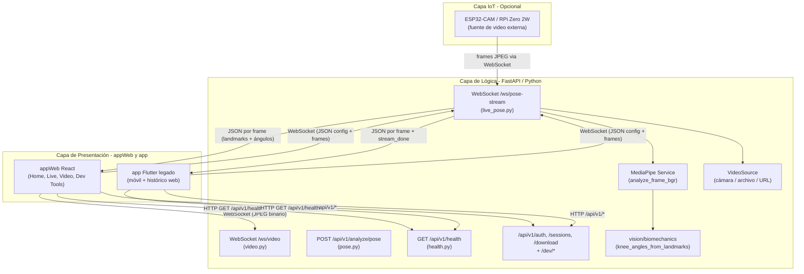
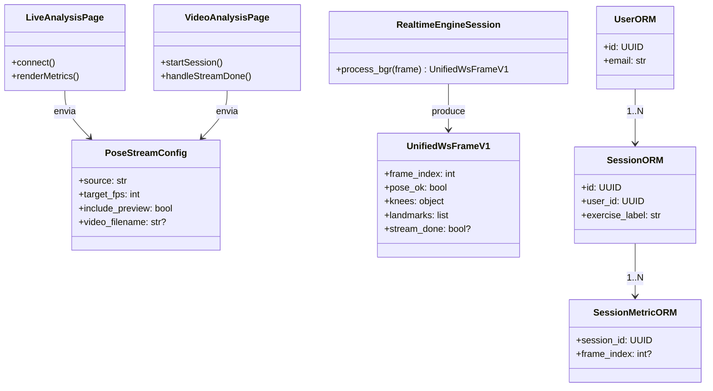
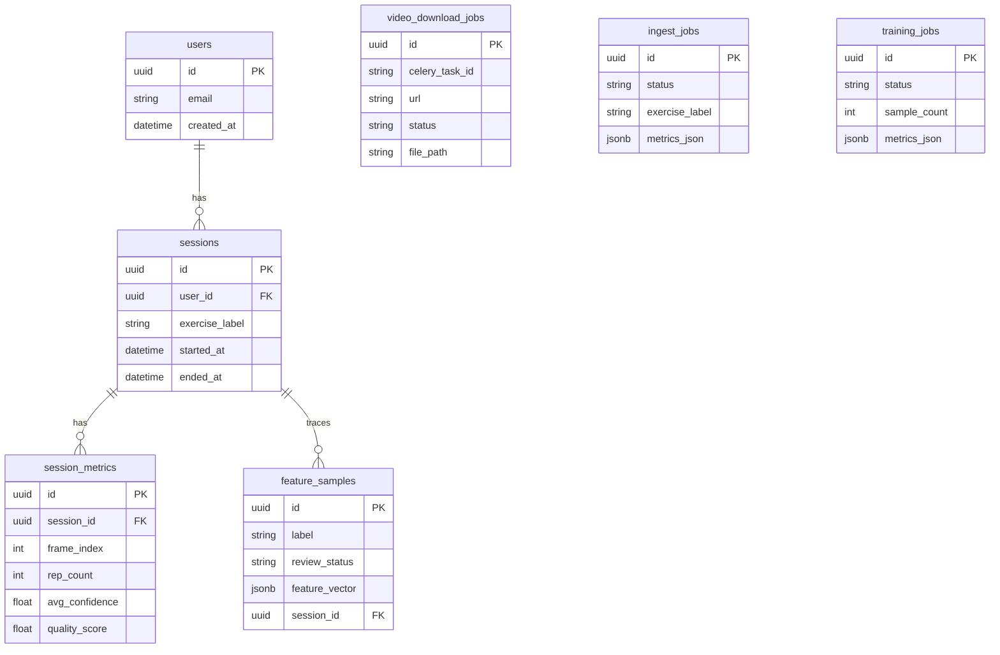
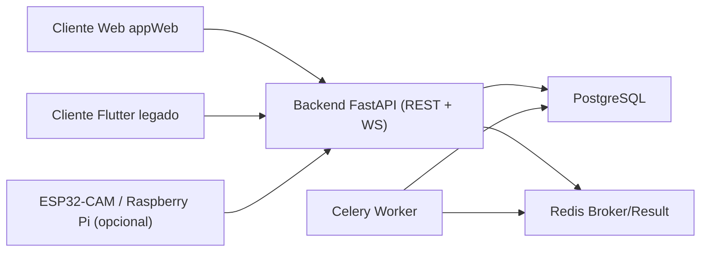

**BIO-MOTION EVALUATOR: SISTEMA DE SOFTWARE PARA LA VALORACIÓN AUTOMÁTICA DE MOVILIDAD ARTICULAR Y DETECCIÓN DE ASIMETRÍAS MEDIANTE VISIÓN ARTIFICIAL**

Mateo Londoño Toro

**DIRECTOR:**

Director asignado por facultad (pendiente actualización institucional)

**CODIRECTOR:**

Codirector asignado por facultad (pendiente actualización institucional)


Tecnológico de Antioquia - Institución Universitaria

Ingeniería en Software

Medellín, Colombia.

2026

# DEDICATORIA

# AGRADECIMIENTOS

# RESUMEN

Este trabajo de grado desarrolla y **evalúa** **Bio-Motion Evaluator**, un sistema web cliente-servidor de **goniometría digital de rodilla** basado en estimación de pose sin sensores físicos. El problema de partida es que la valoración biomecánica de calidad resulta costosa, subjetiva y dependiente de profesionales especializados. Ahora bien, antes de proponer visión artificial como alternativa accesible es necesario responder una pregunta previa y verificable: **¿con qué exactitud mide, y a qué velocidad responde?** Esa es la pregunta que el trabajo aborda, delimitada a una articulación —la rodilla— para poder responderla con rigor en lugar de describir un sistema sin medirlo.

La solución implementa una arquitectura cliente-servidor con separación estricta entre captura, inferencia y visualización: un cliente web **React 19 + TypeScript**, un backend **FastAPI** que concentra la inferencia con **MediaPipe BlazePose**, y comunicación por **WebSocket** con contratos versionados. La capa web se implementó inicialmente en **Flutter** y migró a **React** tras constatarse limitaciones de Flutter Web en la vista previa de alta frecuencia. El núcleo biomecánico se mantuvo desacoplado de la capa de transporte, decisión que resultó determinante para poder someterlo después a verificación analítica aislada.

La evaluación se diseñó por **niveles de evidencia**, de modo que cada nivel aísle una fuente de error distinta y sea interpretable por sí mismo. Los resultados son los siguientes. Primero, el **cálculo angular no aporta error medible**: frente a ángulos de verdad conocida el error es de 6,3 × 10⁻¹³ grados en el barrido y de 6,0 × 10⁻⁷ grados en el peor caso sondeado, lo que permite atribuir íntegramente el error del sistema a la estimación de pose. Segundo, el diseño experimental **reveló un defecto sistemático que la operación normal no mostraba**: el ángulo se calculaba sobre coordenadas anisótropas, con un sesgo de hasta 32 grados que se anulaba justo en 90 grados de flexión; el sistema producía valores plausibles y estables, y solo el contraste con verdad conocida lo delató. Tercero, se determinó la **tolerancia de alineación de cámara** (≤ 20 grados de azimut) y el **piso de ruido de la asimetría bilateral** (≈ 5 grados), por debajo del cual la medida no es interpretable. Cuarto, la **caracterización de latencia** muestra que la inferencia de pose consume el 93,4 % del pipeline, que la capacidad sostenida es de 126 fotogramas por segundo y que el retraso percibido procedía del regulador de ritmo configurado, no de falta de cómputo.

El contraste con un método de referencia externo queda **diseñado, instrumentado y pendiente de ejecución**, y así se declara: el trabajo no afirma exactitud que no midió. Su aportación es la **descomposición del error** entre cálculo angular y estimación de pose, y la constatación de que una decisión aparentemente inocua sobre el espacio de coordenadas puede introducir un sesgo de decenas de grados en un sistema que aparenta funcionar. El producto se evalúa conforme a la norma **ISO/IEC 25010**, con la eficiencia de desempeño respaldada por medición y no por estimación.

# PALABRAS CLAVE

Visión artificial, estimación de pose, MediaPipe BlazePose, goniometría digital, validación metrológica, descomposición del error, exactitud angular, caracterización de latencia, arquitectura cliente-servidor, FastAPI, React, WebSocket, biomecánica, análisis en tiempo real, ISO/IEC 25010, entrenamiento de fuerza, asimetría bilateral.

# TABLA DE CONTENIDO

[DEDICATORIA 2](#_Toc174698952)

[AGRADECIMIENTOS 3](#_Toc174698953)

[RESUMEN 4](#_Toc174698954)

[PALABRAS CLAVE 4](#_Toc174698955)

[TABLA DE CONTENIDO 5](#_Toc174698956)

[ÍNDICE DE FIGURAS 8](#_Toc174698957)

[ÍNDICE DE TABLAS 9](#_Toc174698958)

[ABREVIATURAS 10](#_Toc174698959)

[1 INTRODUCCIÓN 11](#_Toc174698960)

[2 MARCO DEL PROYECTO 12](#_Toc174698961)

[2.1. DEFINICIÓN DEL PROBLEMA 12](#_Toc174698962)

[2.2. JUSTIFICACIÓN 12](#_Toc174698963)

[2.3. ANTECEDENTES 12](#_Toc174698964)

[3 OBJETIVOS 13](#_Toc174698965)

[3.1. OBJETIVO GENERAL 13](#_Toc174698966)

[3.2. OBJETIVOS ESPECÍFICOS 13](#_Toc174698967)

[4 MARCO METODOLÓGICO 14](#_Toc174698968)

[4.1. DEFINICIÓN DE LA METODOLOGÍA 14](#_Toc174698969)

[4.2. DEFINICIÓN DEL ALCANCE 14](#_Toc174698970)

[4.3. RECURSOS 14](#_Toc174698971)

[4.4. CRONOGRAMA DE ACTIVIDADES 14](#_Toc174698972)

[5 MARCO CONCEPTUAL 15](#_Toc174698973)

[6 DESARROLLO DEL PROYECTO 16](#_Toc174698974)

[6.1. CONTEXTO DEL SOFTWARE 16](#_Toc174698975)

[6.1.1. Descripción del Negocio 16](#_Toc174698976)

[6.1.2. Áreas por Intervenir 16](#_Toc174698977)

[6.1.3. Actores y sus Roles 16](#_Toc174698978)

[6.2. Propuesta de solución 16](#_Toc174698979)

[6.2.1. Product backlog 16](#_Toc174698980)

[6.3. Planificación del sprint 1 18](#_Toc174698981)

[6.3.1. Historias de usuario y backlog técnico 18](#_Toc174698982)

[6.3.2. Revisión del sprint 18](#_Toc174698983)

[6.3.3. Tareas asociadas y ejecutadas 18](#_Toc174698984)

[6.4. Planificación del sprint 2 19](#_Toc174698985)

[6.4.1. Historia de usuario HU-03 19](#_Toc174698986)

[6.4.2. Revisión del sprint 19](#_Toc174698987)

[6.4.3. Tareas asociadas y ejecutadas 19](#_Toc174698988)

[6.5. Planificación del sprint 3 19](#_Toc174698989)

[6.5.1. Historias de usuario 19](#_Toc174698990)

[6.5.2. Revisión del sprint 19](#_Toc174698991)

[6.5.3. Tareas asociadas y ejecutadas 19](#_Toc174698992)

[6.6. Planificación de los sprints 4 a 6 19](#_Toc174698993)

[6.7. Diseño del sistema 19](#_Toc174698994)

[6.7.1. Especificación de la arquitectura 19](#_Toc174698995)

[6.7.2. Diagrama de clases 19](#_Toc174698996)

[6.7.3. Diagrama entidad-relación 19](#_Toc174698997)

[6.7.4. Evaluación del frontend Flutter Web y migración a React 19](#_TocFlutterReact)

[6.8. Plan de pruebas 19](#_Toc174698998)

[6.8.1. Plan de pruebas funcionales 19](#_Toc174698999)

[6.8.2. Pruebas de usabilidad 19](#_Toc174700000)

[6.9. Despliegue del sistema 19](#_Toc174699000)

[6.9.1. Manual de usuario 20](#_Toc174699001)

[6.9.2. Manual de instalación 20](#_Toc174699002)

[6.9.3. Resumen técnico del software 20](#_Toc174699003)

[7 RESULTADOS Y DISCUSIÓN 22](#_Toc174699004)

[8 IMPACTO ESPERADO 23](#_Toc174699005)

[9 CONCLUSIONES 24](#_Toc174699006)

[10 RECOMENDACIONES FUTURAS 25](#_Toc174699007)

[REFERENCIAS 26](#_Toc174699008)

[ANEXOS 27](#_Toc174699009)

# ÍNDICE DE FIGURAS

# ÍNDICE DE TABLAS

**Tabla 1.** Product backlog institucional (historias de usuario HU-01–HU-07, estimación y ejecución). Ver § *Product backlog*.

**Tabla 2.** Backlog técnico (ítems BH-01–BH-02, sin formato de historia de usuario). Ver § *Product backlog*.

# ABREVIATURAS


| Abreviatura | Significado                           |
| ----------- | ------------------------------------- |
| API         | Application Programming Interface     |
| ASGI        | Asynchronous Server Gateway Interface |
| BPMN        | Business Process Model and Notation   |
| CORS        | Cross-Origin Resource Sharing         |
| ER          | Entidad-Relación                      |
| FMS         | Functional Movement Screen            |
| FPS         | Frames Per Second                     |
| HU          | Historia de usuario                   |
| IoT         | Internet of Things                    |
| JSON        | JavaScript Object Notation            |
| JWT         | JSON Web Token                        |
| ONNX        | Open Neural Network Exchange          |
| ORM         | Object Relational Mapping             |
| REST        | Representational State Transfer       |
| ROM         | Range of Motion                       |
| UI/UX       | User Interface / User Experience      |
| WS          | WebSocket                             |


# INTRODUCCIÓN

En el ámbito del fitness y el entrenamiento de fuerza existe un interés sostenido por identificar limitaciones de movilidad, asimetrías y alteraciones de los patrones de movimiento que puedan guardar relación con el riesgo de lesión. El **Functional Movement Screen** (FMS), propuesto por Cook et al. (2006), es uno de los protocolos más difundidos para esa evaluación; ahora bien, la evidencia sobre su capacidad para **predecir** lesiones es heterogénea y no permite establecer una relación causal general (Bunn et al., 2019; Moore et al., 2019; Trinidad-Fernández et al., 2019). Con independencia de ese debate clínico, la aplicación de estos protocolos exige una atención presencial y la intervención de un profesional, lo que introduce una barrera de acceso para el usuario habitual de gimnasio.

La irrupción de la inteligencia artificial en el campo de la visión por computador, y en particular el desarrollo de arquitecturas de estimación de pose como **MediaPipe BlazePose** (Google, 2020), ha abierto una ventana de oportunidad para democratizar el acceso a este tipo de valoraciones. Estos modelos permiten detectar con precisión los puntos clave del cuerpo humano directamente desde la cámara de un dispositivo móvil, sin necesidad de sensores físicos ni equipamiento especializado, habilitando la goniometría digital en tiempo real.

**Bio-Motion Evaluator** nace como respuesta a esta brecha tecnológica. Este proyecto de grado de Ingeniería en Software propone el diseño y desarrollo de un sistema de software multiplataforma que automatiza la valoración de la movilidad articular mediante visión artificial, entregando al usuario un diagnóstico biomecánico personalizado previo al entrenamiento. La solución se articula en: clientes **Flutter** (móvil) y **React** (web operativa), un servidor de análisis **FastAPI** (Python) que ejecuta **MediaPipe** y expone **REST** y **WebSocket**, persistencia y trabajos en cola según la versión del sistema, y la integración opcional de **IoT** como fuente de video externa.

La arquitectura del sistema prioriza la comunicación en tiempo real mediante el protocolo **WebSocket**, lo que permite transmitir métricas de ángulos articulares fotograma a fotograma con latencia mínima. El backend extrae los landmarks del cuerpo del usuario, calcula los rangos de movimiento (ROM) de las articulaciones de interés —comenzando por la rodilla como articulación pivote en el squat— y los envía al frontend, donde se visualizan sobre la imagen del usuario junto con indicadores semánticos de calidad del movimiento.

El presente documento detalla el proceso completo de ingeniería del sistema: desde la definición del problema y la revisión de antecedentes, pasando por la arquitectura de la solución y la metodología ágil empleada, hasta los resultados de cada sprint de desarrollo y la evaluación del producto bajo la norma **ISO/IEC 25010**. Se espera que este trabajo represente un aporte tanto al campo de la ingeniería de software aplicada a la salud deportiva, como a la comunidad académica del Tecnológico de Antioquia, posicionándose como un referente en la integración de computación visual e interfaces web para la **medición objetiva del movimiento humano**. El trabajo no evalúa efectos clínicos ni sobre la incidencia de lesiones: su aportación es determinar con qué exactitud y a qué velocidad puede medirse.

# MARCO DEL PROYECTO

En este apartado se contextualiza la problemática que motiva el desarrollo del software, se exponen los argumentos que validan la necesidad de su ejecución y se revisan los trabajos previos que sirven como base científica y técnica para la propuesta.

# DEFINICIÓN DEL PROBLEMA

En el contexto del fitness y el entrenamiento de fuerza existe interés en identificar limitaciones de movilidad, asimetrías y patrones de movimiento que puedan estar relacionados con el riesgo de lesión. El **Functional Movement Screen** (FMS) se ha utilizado ampliamente para evaluar estas características, aunque la evidencia sobre su capacidad predictiva presenta resultados heterogéneos: revisiones sistemáticas con metaanálisis encuentran asociaciones entre determinados resultados del FMS y la incidencia de lesiones, pero califican el nivel de evidencia como **bajo** y advierten que la heterogeneidad impide concluir que una puntuación baja prediga lesiones (Bunn et al., 2019; Trinidad-Fernández et al., 2019), con efectos que además varían según edad, sexo y deporte (Moore et al., 2019).

Este trabajo, por tanto, **no asume una relación causal** entre limitaciones de movilidad o asimetrías y la aparición de lesiones. Trata esas variables como **indicadores funcionales susceptibles de medición**, y se ocupa del problema previo y estrictamente de ingeniería: si tales indicadores se van a usar para algo, primero hay que saber con qué fidelidad pueden medirse.

Con independencia de ese debate sobre su valor predictivo, la aplicación práctica de estos protocolos enfrenta tres barreras:

- **Costo y accesibilidad:** una valoración funcional realizada por un profesional implica atención presencial y un costo económico. Como referencia del contexto local, los servicios de fisioterapia publicados en Medellín muestran tarifas de consulta que varían según el profesional y el tipo de atención, con valores desde aproximadamente **46 000 COP** y superiores a **100 000 COP** en distintos servicios (Doctoralia, 2026). Se trata de una **referencia de mercado**, no de evidencia científica: aquí se considera una **barrera potencial de acceso**, sin afirmar que la valoración profesional sea universalmente inaccesible.
- **Variabilidad de la medición manual:** la goniometría manual tiene un error de medición propio y una concordancia entre evaluadores limitada. Con goniómetro universal se reporta un error típico de medición (SEM) del orden de **3,4°** en flexión de rodilla (Mehta et al., 2017); con otros instrumentos, los límites de acuerdo entre evaluadores llegan a superar los **18°**. Esta variabilidad es un dato relevante en dos sentidos: motiva la búsqueda de métodos automatizados y, a la vez, **acota lo que cualquier validación contra ese método puede concluir** (§ 7.6).
- **Ausencia de una medida objetiva a mano:** sin un instrumento accesible, quien entrena carece de una magnitud propia y repetible sobre la que apoyar cualquier decisión, y depende del juicio cualitativo de un tercero o de ninguno. Esta barrera es la que aborda directamente el presente trabajo: **producir la medida y establecer cuánto puede confiarse en ella**, con independencia del uso que después se le dé.

Desde la perspectiva de la Ingeniería de Software, existe una oportunidad para desarrollar herramientas accesibles que automaticen determinadas mediciones funcionales mediante visión por computador. Este trabajo **no pretende demostrar la inexistencia de soluciones comerciales** —de hecho el capítulo de antecedentes documenta varias, incluidas soluciones locales de captura sin marcadores—, sino **evaluar técnicamente** una implementación concreta de goniometría digital de rodilla basada en estimación de pose, sobre hardware de consumo y con la evidencia de esa evaluación publicada junto al código.

**Delimitación del problema abordado.** El problema general —automatizar la valoración funcional completa— excede lo que puede resolverse y, sobre todo, **verificarse** en un trabajo de grado individual. Este proyecto lo acota a la unidad mínima sobre la que descansa cualquier valoración posterior: **la medición angular de una articulación**. Se elige la **rodilla**, y conviene ser explícito sobre el criterio, porque **no es la articulación más lesionada**. La revisión sistemática de Keogh y Winwood (2017) sobre los deportes de fuerza sitúa la rodilla en cuarto lugar (**9 %** de las lesiones), por detrás del hombro (**36 %**), la zona lumbar (**24 %**) y el codo (**11 %**). La elección responde a un criterio de **tratabilidad metrológica**, no de prioridad clínica:

- **Es una articulación de tipo bisagra.** Su movimiento principal se aproxima a un solo grado de libertad en el plano sagital, de modo que un ángulo escalar medido desde una cámara la describe de forma significativa. El hombro —la articulación más lesionada— es una enartrosis con tres grados de libertad y rotación axial, que un único ángulo no captura y una cámara monocular no puede desambiguar. La articulación más relevante clínicamente es, precisamente, la menos medible con esta tecnología.
- **Su terna anatómica presenta alta visibilidad.** Medido sobre los vídeos de referencia del proyecto (749 fotogramas con pose válida), la visibilidad mínima de la terna cadera–rodilla–tobillo tiene mediana **0,828** y supera el umbral de 0,5 en el **92,8 %** de los fotogramas, frente a **0,519** (51,5 %) de la terna de codo y **0,540** (54,3 %) de la de hombro. Además, sus puntos están muy separados entre sí, lo que reduce la sensibilidad del ángulo al temblor de los landmarks. *Matiz necesario:* la terna de tobillo alcanza cifras equivalentes a la de rodilla, de modo que **no es la única con esa propiedad**; y la medición procede de clips centrados en tren inferior, lo que favorece esa región. La cifra sirve para descartar el tren superior como candidato, no para afirmar una superioridad absoluta de la rodilla.
- **Permite contraste bilateral directo**, condición necesaria para el análisis de asimetría que el sistema incorpora.

Esta elección se declara como **limitación de alcance**: el trabajo valida la tecnología sobre la articulación donde la medida es más tratable, no sobre la de mayor carga lesional. Extender el método al hombro exigiría resolver antes la estimación de rotación axial, un problema abierto en visión monocular. La pregunta no es, por tanto, *si es posible construir* el sistema —lo es, y se construyó—, sino **cuánto puede confiarse en lo que mide y a qué velocidad responde**, que es la condición previa para cualquier uso posterior de esos datos.

**Pregunta Problema:**  
¿Con qué exactitud, frente a un método de referencia de medición angular, estima el ángulo de flexión de rodilla una arquitectura cliente-servidor con inferencia de pose en el servidor, y bajo qué latencia extremo a extremo entrega en tiempo real ese ángulo y la asimetría bilateral sobre hardware de consumo?

Se trata de una pregunta **verificable**: su respuesta no es una descripción del sistema, sino un conjunto de magnitudes medidas —error angular en grados, límites de acuerdo, latencia por etapa en milisegundos— que pueden contrastarse, reproducirse y refutarse.

# JUSTIFICACIÓN

La realización de este proyecto se justifica desde tres dimensiones fundamentales:

1 Relevancia Social y en Salud:

La relevancia de este proyecto radica en explorar la **viabilidad técnica** de automatizar una medición angular utilizada en la valoración del movimiento mediante visión por computador. En lugar de asumir que dicha automatización reduce la incidencia de lesiones —cadena causal que exigiría investigaciones adicionales sobre la relación entre medida, intervención y desenlace—, el trabajo se concentra en determinar **la exactitud de la medición y el comportamiento temporal del sistema**, estableciendo una base técnica para investigaciones posteriores que evalúen su utilidad clínica o deportiva.

2 Innovación Tecnológica (Ingeniería de Software):

Este proyecto aplica el estado del arte en Inteligencia Artificial, específicamente en la estimación de pose (Pose Estimation). El uso de librerías como MediaPipe o OpenCV para el cálculo de ángulos articulares representa un reto técnico en términos de optimización de algoritmos, procesamiento en tiempo real y precisión de datos. Además, la integración de estos modelos de IA bajo la norma ISO/IEC 25010 garantiza un producto de software con altos estándares de calidad, mantenibilidad y usabilidad.

3 Impacto en la Productividad y el Rendimiento:

Para el sector fitness, esta herramienta permite optimizar el tiempo de entrenamiento. En lugar de realizar rutinas de movilidad de 20 minutos "a ciegas", el software permite una "activación dirigida" basada en las necesidades reales del día. Esto aporta un valor agregado diferenciador: la hiper-personalización basada en evidencia biométrica.

Finalmente, para el Tecnológico de Antioquia, este trabajo de grado demuestra la capacidad de sus estudiantes de Ingeniería en Software para resolver problemas del mundo real mediante la integración de arquitecturas modernas y computación visual, cerrando la brecha entre la ciencia del ejercicio y la tecnología.

# ANTECEDENTES

Para el desarrollo de esta propuesta, se han analizado referentes en tres niveles: global, nacional y local, permitiendo identificar la evolución desde sistemas de alta complejidad hasta soluciones basadas en inteligencia artificial.

**2.3.1. Referentes Internacionales y Tecnológicos**

El marco de referencia para la evaluación funcional es el sistema FMS (Functional Movement Screen) propuesto por Cook et al. (2006), el cual establece los protocolos de movimiento que este software busca automatizar. En la dimensión tecnológica, el hito más relevante es el desarrollo de MediaPipe BlazePose (Google, 2020), una arquitectura de red neuronal capaz de detectar 33 puntos clave del cuerpo humano en tiempo real, superando las limitaciones de modelos previos que solo detectaban puntos gruesos, permitiendo ahora una goniometría digital precisa en dispositivos móviles. Estudios recientes comparan estimación de ángulos articulares por visión (p. ej. sensores de profundidad o bibliotecas de pose) frente al goniómetro manual, reportando correlaciones altas y acuerdo tipo Bland–Altman en varias articulaciones (Örücü et al., 2025; Sabo et al., 2023, con MediaPipe entre las bibliotecas evaluadas), lo que fundamenta la **HU-06** de validación metrológica de este proyecto.

**2.3.2. Antecedentes Nacionales y Regionales (Colombia y Medellín)**

En el contexto colombiano, se identifican esfuerzos significativos por objetivizar el análisis del movimiento:

- Perspectiva Académica**:** Un antecedente crítico es el trabajo de Salazar**,** Castrillón y Prieto (2008), presentado en el III Congreso Colombiano de Computación en Medellín. Su investigación sobre una herramienta de asistencia para el diagnóstico de movilidad articular en 3D sentó las bases locales para el uso de visión artificial como alternativa a los costosos sistemas de sensores físicos. Este estudio es pionero al argumentar que la visión por computador es la vía más viable para democratizar la evaluación biomecánica en el país.
- Perspectiva Empresarial**:** En el ámbito industrial, la empresa Biomec Limitada (con presencia activa en Medellín) representa el estado del arte en Colombia. Su sistema BioFree utiliza inteligencia artificial y redes neuronales para la captura de movimiento sin marcadores (*markerless*). La existencia de este producto comercial valida la demanda del mercado local por soluciones que eliminen la fricción de los sensores físicos, aunque su enfoque actual es primordialmente clínico y de alto costo.
- Capacidad Investigativa Local**:** Medellín cuenta con una robusta capacidad técnica instalada. Instituciones como el ITM, a través de su Laboratorio de Visión Artificial y Fotónica, y la Universidad EAFIT, con su Grupo de Bioingeniería (GIB), han desarrollado modelos matemáticos y de procesamiento de imágenes para entender la biomecánica humana. Estos grupos confirman que el ecosistema de I+D de la ciudad posee el conocimiento necesario para soportar desarrollos de computación visual aplicada a la salud.

**2.3.3. Contexto Institucional (Tecnológico de Antioquia)**

Tras una revisión en el repositorio institucional del Tecnológico de Antioquia, se observa un vacío en el desarrollo de aplicaciones de ingeniería de software orientadas específicamente a la visión artificial aplicada al fitness. Si bien existen trabajos en la Facultad de Educación Física sobre evaluación funcional manual (usando herramientas como Kinovea), el presente proyecto se posiciona como una propuesta pionera en la Facultad de Ingeniería. Busca cerrar la brecha entre los métodos de observación manual tradicionales y la automatización inteligente, integrando las necesidades de las ciencias del deporte con las capacidades de la ingeniería de software moderna.

# OBJETIVOS

# OBJETIVO GENERAL

Desarrollar y evaluar un sistema web cliente-servidor de goniometría digital de rodilla basado en estimación de pose (MediaPipe BlazePose), determinando la exactitud del ángulo de flexión de rodilla frente a un método de referencia de medición angular y la latencia extremo a extremo del sistema, con el fin de establecer su viabilidad como herramienta de valoración objetiva del rango de movimiento sobre hardware de consumo.

# OBJETIVOS ESPECÍFICOS

1. **Especificación y delimitación de la medida.** Definir los requerimientos funcionales y el contrato de datos del sistema, delimitando la métrica objeto de estudio —ángulo de flexión de rodilla bilateral e índice de asimetría— y formalizando su convención anatómica de cálculo.
2. **Diseño de la arquitectura.** Diseñar e implementar una arquitectura cliente-servidor desacoplada, con captura en el cliente e inferencia de pose en el servidor, comunicada mediante contratos versionados REST y WebSocket, bajo estándares de usabilidad y mantenibilidad.
3. **Implementación del módulo de goniometría digital.** Implementar el núcleo de procesamiento que estime los puntos anatómicos y calcule en tiempo real el ángulo de flexión de rodilla bilateral y el índice de asimetría, con superposición del esqueleto y panel de métricas.
5. **Validación de la exactitud.** Diseñar y ejecutar un protocolo de validación de la exactitud del ángulo de flexión de rodilla frente a un método de referencia, descomponiendo el error del sistema en sus fuentes y reportando error absoluto, sesgo, límites de acuerdo e índices de concordancia.
6. **Caracterización del rendimiento y de la calidad técnica.** Caracterizar la latencia extremo a extremo y el reparto de tiempos por etapa del pipeline bajo distintas configuraciones de captura, y evaluar la calidad técnica del producto conforme a la norma ISO/IEC 25010 en las características verificables mediante evidencia técnica (adecuación funcional, eficiencia de desempeño, fiabilidad y mantenibilidad).

Los objetivos 1 a 3 corresponden a la **construcción** del sistema y se abordan en los sprints 1 a 4. Los objetivos 4 y 5 constituyen la **evaluación** que responde la pregunta de investigación y se abordan en el sprint 5.

# MARCO METODOLÓGICO

Este capítulo describe la metodología de desarrollo adoptada para el proyecto, define el alcance del sistema, detalla los recursos humanos y tecnológicos disponibles, y presenta el cronograma de actividades planificado.

# DEFINICIÓN DE LA METODOLOGÍA

El proyecto adopta la metodología ágil **Scrum** como marco de trabajo, dado que se trata del desarrollo de un producto de software con requerimientos que evolucionan a lo largo del proceso y que se beneficia de ciclos cortos de retroalimentación. Scrum permite iterar sobre el producto en sprints de duración fija, entregando funcionalidades verificables al final de cada ciclo y adaptando el alcance según los hallazgos técnicos.

**Lugar de investigación:** El desarrollo se realiza en el entorno académico del Tecnológico de Antioquia – Institución Universitaria, Facultad de Ingeniería, con validaciones en contextos de entrenamiento físico real.

**Enfoque:** Aplicado-tecnológico, con componentes de investigación en biomecánica computacional e ingeniería de software. El proyecto combina:

- Investigación bibliográfica sobre protocolos de evaluación funcional (FMS, goniometría) y state-of-the-art en estimación de pose.
- Desarrollo iterativo de software mediante sprints Scrum.
- Validación técnica de la precisión del sistema comparada con métodos de referencia.

**Herramientas metodológicas:**

- **Gestión del backlog y sprints:** **Historias de usuario (HU)** —funcionalidades con valor para el usuario final— con criterios de aceptación **binarios** (pasa / no pasa), flujos alternativos y manejo de errores; más **ítems de backlog técnico (BH)** para tareas de ingeniería (monorepo, pruebas de regresión) que **no** se redactan como HU. Registro de **estimación en horas** y **fechas de ejecución** según la plantilla institucional del product backlog (Tabla 1).
- **Control de versiones:** Git con repositorio en GitHub (monorepo con carpetas `app/`, `backend/`, `iot/`, `docs/`, `tests/`).
- **Documentación continua:** Especificaciones técnicas en `docs/spec/` (contratos de API, decisiones, incidencias); guías operativas en `docs/guias/`; planificación en `docs/planificacion/`; bitácora de decisiones en este documento (**BITÁCORA DE DESARROLLO Y DECISIONES**). Todo ello en paralelo al código para trazabilidad con el Capítulo 6.
- **Pruebas:** Vídeos de referencia (*gold standard*) almacenados en `tests/assets/videos/`, usados para validación reproducible del pipeline de análisis.

## Diseño de la evaluación experimental

La metodología no es únicamente de desarrollo: la pregunta de investigación exige un
componente **experimental** con diseño propio. Se adopta un enfoque de **validación por
niveles de evidencia**, en el que cada nivel aísla una fuente de error distinta y puede
interpretarse por sí mismo aunque los siguientes no lleguen a ejecutarse.

| Nivel | Qué aísla | Verdad de referencia | Dependencia externa |
|-------|-----------|----------------------|---------------------|
| **N1.** Verificación geométrica | Error del **cálculo angular** | Ángulos construidos analíticamente | Ninguna |
| **N2.** Sensibilidad de proyección | Error por **oblicuidad de cámara** | Modelo geométrico proyectado | Ninguna |
| **N3.** Caracterización empírica | **Ruido y detección** sobre vídeo real | No aplica (no mide exactitud) | Vídeos de referencia |
| **N4.** Contraste con referencia | Error de **estimación de pose** | Patrón físico y medición manual | Instrumental y operador |

Esta estratificación responde a una restricción metodológica real y se declara como tal:
al no disponer de goniómetro clínico ni de una muestra poblacional, un diseño de un solo
nivel dependiente de instrumental externo habría dejado el trabajo sin ninguna evidencia.
La estratificación garantiza que los niveles N1 a N3 —que no dependen de nada externo—
produzcan resultados verificables, y sitúa a N4 como el nivel que **acota el error total**
una vez disponibles los medios.

**Descomposición del error.** El error total del sistema frente a un método de referencia
se descompone en dos sumandos independientes:

```
error_total  =  error_estimacion_pose  +  error_calculo_angular
```

El nivel N1 mide directamente el segundo sumando. Si resulta despreciable frente a la
resolución del método de referencia, entonces todo error observado en N4 es atribuible a
la estimación de pose, que es la conclusión de interés para valorar la tecnología. Esta
descomposición es lo que permite extraer una conclusión sobre BlazePose y no meramente
sobre esta implementación concreta.

**Reproducibilidad.** Todo experimento se implementa como *script* ejecutable bajo
`validacion/experimentos/`, con semilla fija donde interviene aleatoriedad, y exporta sus
datos crudos a CSV bajo `validacion/resultados/`. El análisis estadístico se aísla en el
módulo `validacion/analisis/acuerdo.py`, verificado con pruebas unitarias contra casos de
propiedades conocidas (`tests/test_acuerdo.py`). Los criterios de aceptación se fijan
**antes** de medir, en `docs/guias/protocolo_validacion_exactitud.md`.

# DEFINICIÓN DEL ALCANCE

El alcance se organiza en tres niveles. Esta separación es deliberada y responde a una
distinción metodológica: **no todo lo que se construye se evalúa**. El trabajo de grado
compromete evidencia verificable únicamente sobre el núcleo; el resto del software
existe porque fue necesario para llegar hasta él, y se documenta como tal.

## Nivel 1 — Núcleo evaluado (compromete la respuesta a la pregunta de investigación)

Sobre estas funcionalidades se reportan mediciones de exactitud y latencia:

- **Goniometría digital de rodilla:** cálculo del **ángulo de flexión bilateral** a partir
  de la terna anatómica cadera–rodilla–tobillo estimada con **MediaPipe BlazePose**, y del
  **índice de asimetría** como diferencia absoluta entre lados. Ángulos en grados, rango
  `[0, 180]`, convención documentada en `backend/vision/biomechanics.py`.
- **Análisis en vivo** desde la cámara del navegador: captura de fotogramas en el cliente,
  inferencia en el servidor y retorno de ángulos y esqueleto para superposición.
- **Análisis de vídeo pregrabado** (*gold standard*) sobre el conjunto de referencia de
  `tests/assets/videos/`, que permite medición reproducible sobre los mismos fotogramas.
- **Arquitectura cliente-servidor** con contratos versionados: **WebSocket**
  (`/ws/pose-stream`, `/ws/video`) y **REST** (`/api/v1/...`), especificados en `docs/spec/`.
- **Superposición de esqueleto** y panel de métricas con estados semánticos
  (bueno / advertencia / crítico) sobre umbrales explícitos.
- **Instrumentación de rendimiento:** medición de tiempos por etapa del pipeline
  (`pipeline_ms`, `consumer_timing_ms`) y perfilado extremo a extremo.

## Nivel 2 — Infraestructura de soporte (construida, documentada, no evaluada)

Componentes desarrollados para hacer viable el núcleo o para habilitar su continuidad.
Se documentan como **decisiones de ingeniería** en el Capítulo 6, con su justificación
y sus incidencias, pero **no se les exige evidencia experimental** ni sostienen ninguna
afirmación de los resultados:

- **Cliente web `appWeb/`** (React 19 + Vite + TypeScript) como capa de presentación
  vigente, y **cliente Flutter `app/`** conservado como referencia histórica de la
  migración documentada en § 6.7.
- **Persistencia** con PostgreSQL, SQLAlchemy y Alembic (usuarios, sesiones, métricas
  muestreadas) y **autenticación JWT**, que permiten registrar sesiones de medición.
- **Cola de trabajos** Celery + Redis para descarga e ingesta asíncrona de vídeo.
- **Módulo de aprendizaje continuo** (`/dev/*`): catálogo de ejercicios, recolección de
  vectores de características, ingesta de vídeo y entrenamiento de un clasificador ONNX.
  Su finalidad es **la construcción del conjunto de datos** que haría posible extender el
  sistema a más ejercicios; el clasificador resultante **no interviene en la medición
  angular** ni condiciona ningún resultado reportado.
- **Vistas 2D/3D** del esqueleto y herramientas de inspección de sesión.
- **Prototipos IoT** (ESP32-CAM, Raspberry Pi) como fuentes de vídeo alternativas.

## Nivel 3 — Fuera del alcance

Delimitaciones explícitas de este trabajo de grado:

- **Motor de prescripción automática** de rutinas correctivas. Requiere criterios
  clínicos validados por profesionales del movimiento, un dominio ajeno a la Ingeniería
  de Software y no verificable con los recursos de este trabajo. Se traslada a
  recomendaciones futuras.
- **Cobertura articular más allá de la rodilla** (tobillo, cadera, hombro, tronco) y la
  **batería FMS completa**. La extensión es arquitectónicamente directa —el cálculo
  angular es genérico sobre ternas de puntos—, pero cada articulación exigiría su propia
  validación de exactitud, que es precisamente el trabajo costoso.
- **Validación clínica con muestra poblacional** y patrón de oro instrumental. La
  validación de este trabajo es **técnica y de muestra reducida**; sus límites se
  declaran en § 7 y en el protocolo de `docs/guias/protocolo_validacion_exactitud.md`.
- **Integración IoT en campo** con medición de latencia en condiciones reales de
  gimnasio. Los prototipos existen; su caracterización queda como trabajo futuro.
- **Despliegue productivo** en nube con endurecimiento de seguridad, observabilidad y
  escalado horizontal.

# RECURSOS

**Recursos Humanos:**


| Rol                                    | Nombre             | Dedicación                         |
| -------------------------------------- | ------------------ | ---------------------------------- |
| Desarrollador principal / Investigador | Mateo Londoño Toro | Tiempo completo (trabajo de grado) |
| Director de trabajo de grado           | Por definir        | Asesoría periódica                 |


**Recursos Tecnológicos (Hardware):**


| Recurso                  | Especificación                        | Uso                                        |
| ------------------------ | ------------------------------------- | ------------------------------------------ |
| Computador de desarrollo | Windows 10, CPU moderno, GPU opcional | Backend, frontend, pruebas                 |
| Dispositivo Android      | Android 10+, cámara trasera ≥ 8 MP    | Pruebas de la app móvil                    |
| ESP32-CAM                | Módulo con OV2640, WiFi 802.11b/g/n   | Fuente de video IoT (opcional)             |
| Raspberry Pi Zero 2W     | ARM Cortex-A53, cámara Pi             | Fuente de video IoT alternativa (opcional) |


**Recursos Tecnológicos (Software):**


| Tecnología           | Versión           | Rol                                   |
| -------------------- | ----------------- | ------------------------------------- |
| Flutter SDK          | Stable (3.x)      | Framework frontend multiplataforma    |
| Dart                 | 3.x               | Lenguaje del frontend                 |
| Python               | 3.11              | Lenguaje del backend                  |
| FastAPI              | 0.11x             | Framework del servidor REST/WebSocket |
| MediaPipe            | 0.10.x            | Librería de estimación de pose        |
| OpenCV (cv2)         | 4.x               | Procesamiento de video                |
| Uvicorn              | 0.x               | Servidor ASGI para FastAPI            |
| Git / GitHub         | —                 | Control de versiones y colaboración   |
| pytest               | 7.x+              | Pruebas automatizadas del backend     |
| React                | 19.x              | Cliente web (`appWeb/`)               |
| TypeScript / Vite    | 5.x / 6.x         | Tooling del cliente web               |
| PostgreSQL           | 15+ (recomendado) | Persistencia de sesiones y métricas   |
| SQLAlchemy / Alembic | 2.x               | ORM y migraciones                     |
| Redis                | 7.x               | Broker y backend de resultados Celery |
| Celery               | 5.x               | Tareas asíncronas (descarga de video) |


**Recursos Bibliográficos:** Acceso a bases de datos académicas (Google Scholar, IEEE Xplore, ScienceDirect), repositorio institucional del Tecnológico de Antioquia, documentación oficial de MediaPipe, Flutter y FastAPI.

# CRONOGRAMA DE ACTIVIDADES

La siguiente tabla relaciona **fases**, **sprints** y **estado** respecto al desarrollo del repositorio a la fecha de actualización de este documento (agosto de 2026). Las fechas de inicio/cierre por sprint pueden completarse con el calendario académico oficial.


| Fase                                    | Actividades principales                                                                                  | Sprint(s) | Estado       |
| --------------------------------------- | -------------------------------------------------------------------------------------------------------- | --------- | ------------ |
| **Análisis y diseño**                   | Requerimientos, arquitectura lógica, sistema UI/UX, specs iniciales                                      | 1         | Completado   |
| **Infraestructura base**                | Monorepo, FastAPI, salud REST, WebSocket pose-stream, cliente Flutter navegación y config                | 1         | Completado   |
| **Pipeline de pose y análisis en vivo** | MediaPipe, ángulos de rodilla, streaming, overlay y métricas (Flutter y luego React web)                 | 2         | Completado   |
| **Análisis por archivo y cliente web**  | Gold standard, `stream_done`, UI análisis de video; **React `appWeb/`** por decisión técnica Flutter Web | 3         | Completado   |
| **Plataforma, datos y colas**           | Auth JWT, PostgreSQL/Alembic, sesiones y métricas, descargas Celery+Redis, consolidación de `appWeb`     | 4         | Completado   |
| **Evaluación experimental**             | Validación de exactitud angular, caracterización de latencia por etapas, matriz de pruebas               | 5         | **En curso** |
| **Cierre académico**                    | Manuales, discusión frente a antecedentes, argumentario ISO/IEC 25010, memoria final                     | 6         | Planificado  |


# MARCO CONCEPTUAL

Este capítulo presenta los conceptos y tecnologías fundamentales sobre los que se sustenta el desarrollo de Bio-Motion Evaluator, organizados en tres ejes temáticos: biomecánica y evaluación funcional, visión por computador e inteligencia artificial, e ingeniería de software.

## 5.1 Biomecánica y Evaluación Funcional del Movimiento

**Biomecánica:** Disciplina que estudia las fuerzas mecánicas que actúan sobre el cuerpo humano y los efectos que producen en el movimiento. En el contexto del entrenamiento de fuerza, la biomecánica analiza la alineación articular, los rangos de movimiento y los patrones de activación muscular para determinar la eficiencia y seguridad de cada ejercicio.

**Rango de Movimiento (ROM — Range of Motion):** Medida del grado de movimiento disponible en una articulación, expresado en grados (°). El ROM se mide mediante goniometría y sirve como indicador de la salud articular y la presencia de restricciones de movilidad. En el squat, por ejemplo, un ROM de flexión de rodilla menor a 90° señala una limitación que puede derivar en compensaciones lumbo-pélvicas.

**Goniometría:** Técnica de medición de los ángulos articulares. La goniometría manual utiliza un goniómetro físico y requiere un evaluador entrenado. La **goniometría digital** —implementada en este proyecto— calcula los ángulos a partir de las coordenadas de los puntos de referencia anatómicos detectados por visión artificial, eliminando la subjetividad del observador.

**Functional Movement Screen (FMS):** Protocolo de evaluación funcional del movimiento desarrollado por Cook et al. (2006), compuesto por siete pruebas estandarizadas que identifican limitaciones de movilidad, asimetrías y patrones de movimiento disfuncionales en individuos activos. Constituye el referente biomecánico más validado en el ámbito del fitness de rendimiento y sirve como marco conceptual para los parámetros de evaluación de este sistema.

**Asimetría bilateral:** diferencia en el ROM o la fuerza entre el hemicuerpo derecho e izquierdo. En este sistema se calcula como la **diferencia absoluta en grados** entre los ángulos de articulaciones homólogas (rodilla izquierda frente a derecha). Se trata de un **indicador funcional medible**, no de un predictor de lesión: la evidencia sobre el valor predictivo de las asimetrías es heterogénea (Moore et al., 2019) y este trabajo no la evalúa. Su interpretación está además acotada por el **piso de ruido del propio estimador**, medido en ~5° (§ 7.2.4): por debajo de esa cota la asimetría no es distinguible del ruido.

## 5.2 Visión por Computador e Inteligencia Artificial

**Visión por Computador (Computer Vision):** Rama de la inteligencia artificial que permite a los sistemas extraer información significativa de imágenes y videos digitales. Incluye tareas como detección de objetos, segmentación semántica, reconocimiento facial y estimación de pose.

**Estimación de Pose (Pose Estimation):** Tarea de visión por computador que consiste en localizar las partes del cuerpo humano (articulaciones y puntos anatómicos de referencia) en una imagen o secuencia de video. Los enfoques modernos, basados en redes neuronales convolucionales (CNN), permiten detectar múltiples personas y sus poses en tiempo real en dispositivos de consumo.

**MediaPipe BlazePose:** Arquitectura de red neuronal desarrollada por Google (2020) para la estimación de pose de cuerpo completo. Detecta **33 puntos clave (landmarks)** del cuerpo humano —incluyendo caderas, rodillas, tobillos, hombros, codos y muñecas— con coordenadas normalizadas (x, y, z) y un valor de visibilidad por punto. Se ejecuta en tiempo real en dispositivos móviles y supera a modelos previos (como PoseNet) en la cobertura de puntos distales del cuerpo. En este proyecto se utiliza a través de la librería **MediaPipe Tasks** de Python, en modo de inferencia por imagen individual (`RunningMode.IMAGE`).

**Landmark / Punto Clave:** Coordenada normalizada (en el rango [0, 1] para x e y) que representa la posición de una articulación o punto anatómico específico en el frame de video. El índice de cada landmark sigue la convención de MediaPipe (ej. índice 25 = rodilla izquierda, índice 26 = rodilla derecha).

**Ángulo Articular (cálculo vectorial):** El ángulo de flexión de una articulación se calcula utilizando los vectores formados por tres landmarks consecutivos: el segmento proximal (de la articulación hacia arriba, ej. cadera→rodilla), el punto de pivote (la articulación misma, ej. rodilla), y el segmento distal (de la articulación hacia abajo, ej. rodilla→tobillo). El ángulo se obtiene mediante el producto punto de los vectores normalizados: `θ = arccos(v₁·v₂ / |v₁||v₂|)`.

**OpenCV (cv2):** Librería de visión por computador de código abierto, ampliamente utilizada para la captura, decodificación y preprocesamiento de frames de video. En este proyecto se usa para capturar frames desde cámara, archivo MP4 o URL de stream (RTSP), y para la codificación JPEG de las vistas previas enviadas al cliente.

## 5.3 Ingeniería de Software y Tecnologías del Stack

**Flutter:** Framework de desarrollo de interfaces de usuario multiplataforma creado por Google, basado en el lenguaje **Dart**. Permite compilar una única base de código para web (navegador), Android, iOS, desktop (Windows, macOS, Linux) y dispositivos embebidos, con rendimiento nativo gracias a su motor de renderizado propio (Impeller/Skia). En este proyecto se utiliza como cliente **móvil/nativo** principal; la variante **Flutter Web** se mantuvo para experimentación, pero la **interfaz web** de demostración prioriza **React** (`appWeb/`) por las razones descritas en el Capítulo 6.

**React (cliente web):** Biblioteca para UI en el navegador; en combinación con **Vite** y **TypeScript** sustenta `appWeb/`, alineada con los mismos contratos **REST** y **WebSocket** que Flutter, optimizando sincronización entre vista previa ( / canvas) y overlay en escenarios de streaming de alta frecuencia.

**FastAPI:** Framework web moderno para Python, basado en los estándares **OpenAPI** y **JSON Schema**, diseñado para construir APIs REST y WebSocket con alto rendimiento. Utiliza `async/await` para operaciones de I/O concurrentes y **Pydantic** para la validación automática de datos de entrada y salida. Su servidor ASGI de referencia es **Uvicorn**.

**WebSocket:** Protocolo de comunicación full-duplex sobre TCP, estandarizado en RFC 6455, que permite una conexión persistente y bidireccional entre cliente y servidor. A diferencia de HTTP, no requiere que el cliente realice peticiones periódicas (polling): el servidor puede enviar datos en el momento en que están disponibles. Es el protocolo elegido para el streaming de métricas biomecánicas en tiempo real entre el backend y el frontend.

**Arquitectura Cliente-Servidor:** Patrón de diseño en el que las responsabilidades del sistema se distribuyen entre componentes que solicitan servicios (cliente — **Flutter** y/o **React** en `appWeb/`) y el servidor (**FastAPI**). El servidor concentra la inferencia (MediaPipe) y expone **REST** y **WebSocket** documentados; los clientes capturan o envían video y presentan métricas y overlays.

**Pydantic:** Librería de Python para la validación y serialización de datos mediante anotaciones de tipo. Se usa en este proyecto para definir los contratos de datos del WebSocket (`PoseStreamConfig`, `PoseResult`) con validación automática, incluyendo reglas de coerción para valores opcionales (ej. `include_preview: null → true`).

**ISO/IEC 25010:** Norma internacional que define el modelo de calidad del producto software. Establece ocho características de calidad principales: adecuación funcional, eficiencia de rendimiento, compatibilidad, usabilidad, fiabilidad, seguridad, mantenibilidad y portabilidad. Este proyecto toma como referencia especialmente las características de **usabilidad** (facilidad de uso en entornos de gimnasio), **mantenibilidad** (arquitectura modular extensible por ejercicio) y **portabilidad** (soporte multiplataforma desde un único código base).

**Patrón de Diseño Data-Driven UI:** En el contexto del panel de métricas de este proyecto, los widgets de interfaz son agnósticos al tipo de ejercicio: reciben una lista de objetos `LiveMetric` (con campos `label`, `value`, `status`, `sublabel`) y los renderizan sin conocer su semántica biomecánica. Esto permite agregar nuevos ejercicios (sentadilla búlgara, press de banca, peso muerto) extendiendo únicamente la lógica de cómputo, sin modificar los componentes visuales.

**IoT (Internet of Things):** Paradigma tecnológico que integra dispositivos físicos con capacidad de cómputo y conectividad de red. En este proyecto, dispositivos como el **ESP32-CAM** (microcontrolador con módulo de cámara y WiFi) o la **Raspberry Pi Zero 2W** actúan como fuentes de video externas, transmitiendo frames al backend mediante WebSocket, lo que desacopla la cámara del dispositivo que ejecuta la app.

# DESARROLLO DEL PROYECTO

# CONTEXTO DEL SOFTWARE

# Descripción del Negocio

El área de intervención es el **sector fitness y de entrenamiento de fuerza**, específicamente el proceso de preparación pre-entrenamiento que actualmente se realiza de forma genérica y sin información biomecánica personalizada. El contexto se enmarca en los gimnasios y espacios de entrenamiento donde los usuarios realizan ejercicios de alta carga (sentadillas, peso muerto, press, etc.) sin una valoración previa de su movilidad articular y sin herramientas que les permitan conocer sus restricciones específicas antes de cargar peso.

Desde una visión holística, el proceso de entrenamiento se compone de tres fases: **valoración funcional** (medición de movilidad), **preparación al movimiento** (calentamiento dirigido) y **ejecución del entrenamiento**. La primera fase suele omitirse por su costo y por requerir la presencia de un profesional. Bio-Motion Evaluator interviene precisamente en esta brecha, digitalizando y automatizando la fase de valoración funcional mediante visión artificial, de forma que sea accesible, objetiva y ejecutable en cualquier momento sin la presencia de un profesional.

La solución no reemplaza al fisioterapeuta ni al entrenador certificado, ni emite juicio clínico alguno: actúa como un **instrumento de medición angular automatizada**, del mismo modo que una pulsera de actividad registra magnitudes sin diagnosticar. Su propósito es entregar al usuario una **medida objetiva y repetible** de su rango de movimiento, cuya interpretación corresponde a quien tenga la competencia para hacerla.

# Áreas por Intervenir

El sistema interviene en el siguiente proceso de negocio:

**Proceso principal: Valoración Funcional Pre-Entrenamiento**

```
[Usuario llega al gimnasio]
        ↓
[Apertura de app Bio-Motion Evaluator]
        ↓
[Selección de tipo de análisis]
   ├── Análisis en vivo (cámara)
   └── Análisis de video pregrabado
        ↓
[Posicionamiento del dispositivo frente al usuario]
        ↓
[Ejecución del movimiento de evaluación (ej. squat)]
        ↓
[Backend analiza frames en tiempo real con MediaPipe]
        ↓
[Frontend muestra ángulos articulares y estado semántico]
        ↓
[Usuario recibe las mediciones: ROM, asimetría, estados de calidad]
        ↓
[Decisión: adaptar calentamiento según hallazgos]
```

Las **áreas específicas intervenidas** son:

- **Valoración del rango de movimiento (ROM):** Medición automatizada de los ángulos de flexión de articulaciones clave, comenzando con la rodilla bilateral durante el squat.
- **Detección de asimetrías:** Comparación en tiempo real entre el hemicuerpo derecho e izquierdo.
- **Retroalimentación visual inmediata:** Superposición del esqueleto de pose sobre la imagen del usuario con indicadores de color por estado (verde: bueno, amarillo: advertencia, rojo: crítico).
- **Registro de sesión:** Almacenamiento temporal del resumen de la última sesión para comparación futura.

# Actores y sus Roles


| Actor                                      | Tipo             | Responsabilidades principales                                                                                                                                                                              |
| ------------------------------------------ | ---------------- | ---------------------------------------------------------------------------------------------------------------------------------------------------------------------------------------------------------- |
| **Usuario final (Deportista)**             | Humano           | Ejecuta los movimientos de evaluación frente a la cámara. Interpreta los indicadores biomecánicos mostrados en la app. Toma decisiones sobre su calentamiento basado en los resultados.                    |
| **App Bio-Motion (Flutter — `app/`)**      | Sistema software | Cliente multiplataforma: cámara, WebSocket, overlay 2D/3D según pantalla, métricas, sesiones, login y descargas alineados con el backend.                                                                  |
| **App Bio-Motion Web (React — `appWeb/`)** | Sistema software | Cliente web principal: mismos contratos REST/WebSocket; análisis en vivo y por video; esqueleto 2D/3D, paneles y preferencias de capas.                                                                    |
| **Backend FastAPI (Servidor)**             | Sistema software | Inferencia MediaPipe, biomecánica, rutas REST v1, WebSockets de pose/video, persistencia, auth y trabajos en cola.                                                                                         |
| **Dispositivo IoT (Opcional)**             | Hardware         | ESP32-CAM o Raspberry Pi Zero 2W. Actúa como cámara externa independiente. Transmite frames al backend vía WebSocket desde una posición óptima para la captura del movimiento (ej. plano sagital lateral). |
| **Director / Evaluador**                   | Humano           | Rol académico/clínico. Puede revisar los reportes de sesión para validar la precisión del sistema frente a métodos tradicionales de goniometría manual.                                                    |


# Propuesta de solución

**Bio-Motion Evaluator** es un sistema de software distribuido, multiplataforma y orientado a tiempo real, que automatiza la valoración biomecánica del movimiento humano mediante visión artificial. La propuesta resuelve las tres barreras identificadas en la definición del problema:


| Barrera                         | Solución propuesta                                                                                 |
| ------------------------------- | -------------------------------------------------------------------------------------------------- |
| **Costo y accesibilidad**       | App gratuita ejecutable desde la cámara del smartphone; no requiere hardware especializado         |
| **Subjetividad del observador** | MediaPipe BlazePose calcula ángulos articulares con precisión numérica reproducible                |
| **Desconexión de los datos**    | Retroalimentación visual inmediata (overlay + métricas) que traduce ángulos en estados accionables |


La arquitectura de la solución se organiza en **tres capas independientes** que se comunican mediante protocolos estándar:

**1. Capa de presentación — Flutter (`app/`) y React (`appWeb/`)**

- **Flutter/Dart:** cliente **Android, iOS** y exploración web; pantallas de **análisis en vivo**, **análisis de video**, **diagnóstico de backend**, **configuración**, **login/perfil**, **historial** y **descarga** de video según la versión del código.
- **React 19 + TypeScript (`appWeb/`):** cliente **web** priorizado para demostración; mismas capacidades núcleo de análisis en vivo y por archivo, con overlay **2D/3D** y paneles alineados al sistema de diseño (paleta oscura biomédica, DM Sans / Mono, estados semánticos).

**2. Capa de lógica e inferencia — FastAPI (Backend)**
Servidor asíncrono Python que centraliza la inteligencia del sistema:

- Expone WebSockets (`/ws/pose-stream`, y `**/ws/video`** según el flujo de procesamiento avanzado) y **REST** bajo `/api/v1/` (salud, pose, videos *gold standard*, autenticación, sesiones, descargas).
- Ejecuta **MediaPipe BlazePose** para la detección de 33 landmarks del cuerpo humano.
- Calcula los **ángulos de flexión de rodilla** (bilateral) usando álgebra vectorial sobre las coordenadas de los landmarks de cadera, rodilla y tobillo.
- Soporta múltiples fuentes de entrada: cámara local (`camera`), archivo de video (`file`) y URL de stream (`url`), seleccionables mediante el campo `source` de la configuración inicial.
- Codifica y transmite vistas previas JPEG opcionales (`include_preview`) para visualización en el cliente cuando la cámara está en el servidor.

**3. Capa IoT — ESP32-CAM / Raspberry Pi (Opcional)**
Dispositivos de bajo costo que actúan como fuentes de video externas, transmitiendo frames al backend via WebSocket desde una posición geográfica desacoplada del dispositivo del usuario (ej. plano sagital a 2 m de distancia). Esto permite una captura ortogonal ideal para la goniometría sin que el usuario sostenga su teléfono.

**Flujo de datos del sistema:**

```
[Cámara: App móvil / IoT / Video archivo]
        ↓ frames (JPEG / RGB)
[Backend FastAPI]
    → MediaPipe BlazePose → 33 landmarks
    → Cálculo ángulos articulares (vectores)
    → Payload JSON por frame
        ↓ WebSocket (JSON / frame)
[Cliente Flutter y/o React]
    → Overlay de pose (Canvas / CustomPaint / capas 2D-3D)
    → Panel de métricas (lista tipo LiveMetric)
    → Log de eventos / progreso de archivo
    → Gráfica histórica de ángulos
```

# Product backlog

La siguiente **Tabla 1** reproduce la **plantilla institucional** del product backlog: columnas de **estimación** (horas de definición, desarrollo, pruebas y total) y de **ejecución** (fechas de inicio y de puesta en producción). Los valores de **horas** y **fechas** son **supuestos ilustrativos** (planificación académica de ejemplo entre el **1 de febrero de 2026** y el **30 de mayo de 2026**); deben sustituirse o contrastarse con el registro real de tu bitácora y el calendario oficial del trabajo de grado.

**Nota sobre Sprint:** en el borrador compartido, la primera fila mostraba Sprint «2» para la historia de salud del backend; en el **cronograma técnico del repositorio** esa capacidad corresponde al **Sprint 1** (junto con la configuración de URL). Si la facultad exige otro criterio de asignación de sprint, ajusta solo esa columna manteniendo la trazabilidad en «Observación».

**Tabla 1.** *Product backlog: historias de usuario, estimación y ejecución (plantilla institucional; agosto de 2026).*


| Historias de usuario | Estimación (horas)                                                                   | Ejecución | Observación |                |                |             |             |              |                            |                                                                                                                          |
| -------------------- | ------------------------------------------------------------------------------------ | --------- | ----------- | -------------- | -------------- | ----------- | ----------- | ------------ | -------------------------- | ------------------------------------------------------------------------------------------------------------------------ |
| Id HU                | Nombre HU                                                                            | Sprint    | Prioridad   | Hrs definición | Hrs desarrollo | Hrs pruebas | Hrs totales | Fecha inicio | Fecha puesta en producción |                                                                                                                          |
| HU-01                | Como deportista quiero ver si el backend está disponible antes de analizar           | 1         | Alta        | 4              | 10             | 4           | 18          | 01/02/2026   | 05/02/2026                 | `BackendStatusPage`; `GET /api/v1/health`                                                                                |
| HU-02                | Como usuario quiero configurar la URL base del servidor                              | 1         | Alta        | 4              | 12             | 4           | 20          | 06/02/2026   | 12/02/2026                 | `ConnectionConfigPage` / Flutter `connection_config_screen.dart`                                                         |
| HU-03                | Como usuario quiero analizar mi movimiento en vivo con retroalimentación de rodillas | 2         | Alta        | 12             | 56             | 16          | 84          | 14/02/2026   | 08/03/2026                 | `LiveAnalysisPage` / `live_analysis_screen.dart`; WebSocket `/ws/pose-stream`; `docs/spec/websocket-pose-stream.md`      |
| HU-04                | Como investigador quiero analizar un video *gold standard* con resumen por sesión    | 3         | Alta        | 10             | 44             | 14          | 68          | 10/03/2026   | 28/03/2026                 | `VideoAnalysisPage`; API `gold_standard_videos`; mensaje `stream_done`; acumulador `VideoAnalysisAccumulator` (`appWeb`) |
| HU-05                | Como laboratorio quiero usar cámara IoT frente al backend                            | —         | Baja        | 8              | 36             | 12          | 56          | —            | —                          | **Trasladada a trabajo futuro** (Nivel 3 del alcance). Prototipos en `iot/esp32-cam` y `iot/raspberry-pi/stream.py`; sin caracterización en campo |
| HU-06                | Como evaluador quiero conocer la exactitud y la latencia de la medición angular      | 5         | Alta        | 14             | 20             | 36          | 70          | 01/06/2026   | 29/08/2026                 | **Núcleo de la evaluación.** Instrumentos en `validacion/`; protocolo en `docs/guias/protocolo_validacion_exactitud.md`; resultados en § 7 |
| HU-07                | Como autor quiero cerrar manuales y evaluación ISO 25010                             | 6         | Alta        | 20             | 10             | 18          | 48          | —            | —                          | § 6.8–6.9; bitácora; manuales alineados a `docs/guias/SETUP.md`                                                          |


**Total estimado supuesto (suma de «Hrs totales», HU-01–HU-07):** 364 h, de las cuales 56 h corresponden a **HU-05**, trasladada a trabajo futuro.

**Nota sobre el alcance del backlog:** tras la delimitación del problema (§ 3.2), **HU-06** deja de ser una verificación final de trámite y pasa a ser el **núcleo del trabajo**: es la historia que responde la pregunta de investigación. **HU-05** se traslada a trabajo futuro por no ser necesaria para responderla.

**Tabla 2.** *Backlog técnico (BH): tareas de ingeniería sin formato de historia de usuario.*

| Id BH | Descripción (valor para el equipo, no para el usuario final) | Sprint | Criterio de cierre (binario) |
| ----- | -------------------------------------------------------------- | ------ | ---------------------------- |
| BH-01 | Configurar monorepo, dependencias y guía `SETUP.md` | 1 | Estructura `app/`, `backend/`, `docs/`, `tests/`, `iot/` clonable; backend responde en local según guía |
| BH-02 | Ejecutar matriz de pruebas funcionales y registrar evidencias (§ 6.8) | 5 | Matriz § 6.8.1 con resultado **Pasa/No pasa** por caso; anexos B–C actualizados |

*Nota:* Las antiguas redacciones tipo «Configurar el entorno base del proyecto» o «Ejecución de pruebas del sistema» **no** son historias de usuario; quedan como **BH-01** y **BH-02**. Las **HU** de la Tabla 1 describen capacidades visibles para deportista, investigador o evaluador.

**Extensiones de producto (mismo repositorio, no filas de la plantilla compartida):** el código vigente incluye además **cliente web React** (`appWeb/`), **sesiones PostgreSQL**, **JWT**, **descarga asíncrona de video (Celery + Redis)** y **vistas 2D/3D** en análisis por video; en el **cronograma por fases** del Capítulo 6 corresponden sobre todo al **Sprint 4** y a la decisión documentada en § 6.7.4.

Fuente: Elaboración propia (2026).

## Detalle de historias de usuario: reglas de negocio del motor, criterios de aceptación verificables y flujos alternativos

Las reglas del motor están alineadas al contrato WebSocket unificado (`schema_version`, `pose_ok`, `landmarks`, `knees`, `quality_flags`, etc.) y al filtrado por visibilidad en `docs/spec/websocket-pose-stream.md` (umbral `POSE_LANDMARK_MIN_VISIBILITY_RESPONSE`, defecto **0,5**): un landmark solo se incluye en el arreglo `landmarks` enviado al cliente si su `visibility` ≥ **0,5** (salvo umbral 0). El cliente debe dibujar el esqueleto **únicamente** con los puntos recibidos y **no** inventar conexiones para índices ausentes.

### HU-01 — Disponibilidad del backend antes de analizar

- **Criterios (binarios):** (1) Con backend levantado, `GET /api/v1/health` responde **200** y el cuerpo refleja estado coherente. (2) Con backend caído o URL incorrecta, la pantalla de estado muestra **fallo** y no permite confundir «sin respuesta» con «análisis completado».
- **Errores:** timeout de red; CORS mal configurado; mensaje accionable para revisar URL (relacionado con **HU-02**).

### HU-02 — Configuración de la URL base del servidor

- **Criterios (binarios):** (1) Tras guardar la URL, las peticiones REST y el WebSocket usan el **mismo host/puerto** configurado (sin mezclar valores en caché obsoleta). (2) URL vacía o mal formada → validación que **impide** guardar o muestra error explícito.

### HU-03 — Análisis en vivo con retroalimentación de rodillas

- **Narrativa:** Como deportista quiero ejecutar un análisis en vivo frente a la cámara para conocer en tiempo real mis ángulos de flexión de rodilla y señales de calidad asociadas al movimiento.
- **Regla de negocio (overlay):** el motor solo expone landmarks con `visibility` ≥ **0,5**; el cliente dibuja segmentos del esqueleto **solo** entre pares de índices presentes en `landmarks` (p. ej. cadera–rodilla–tobillo para goniómetro de rodilla).
- **Criterios de aceptación (binarios):**
  1. Con conexión estable y `pose_ok: true`, **cada** fotograma incluye `knees.left_knee_flexion_angle_deg` y `knees.right_knee_flexion_angle_deg` cuando ambos son computables; si uno es `null`, la UI muestra «sin dato» en ese lado (no sustituye por cero ni por el ángulo contralateral).
  2. Con `pose_ok: false`, la UI muestra estado explícito de «sin pose» y **no** presenta ángulos como válidos hasta el siguiente `pose_ok: true`.
  3. Si `quality_flags` contiene `asymmetry_high`, el panel muestra alerta de asimetría; si el arreglo está vacío, **no** hay alerta de asimetría por defecto.
  4. Con `include_preview: true`, si `preview_jpeg_base64` llega poblado se muestra la vista previa; si llega vacío de forma sostenida (≥ 3 fotogramas consecutivos), se muestra «sin vista previa» sin detener las métricas numéricas.
  5. **Overlay:** en un fotograma de prueba con pose completa, el número de aristas dibujadas del esqueleto no supera las conexiones posibles entre los índices recibidos (máximo coherente con la topología BlazePose de 33 puntos filtrados).
- **Flujos alternativos y errores:**
  - **Pérdida de WebSocket a mitad del ejercicio:** estado «desconectado»; al reconectar, el usuario debe reiniciar el análisis y reenviar `PoseStreamConfig` (criterio pasa si no se muestran métricas obsoletas como actuales).
  - **Cámara sin persona u oclusión:** racha de `pose_ok: false`; no incrementar contadores de ROM «bueno» en esos fotogramas.
  - **Iluminación insuficiente:** `pose_ok: false` o lista `landmarks` vacía; mensaje de orientación al usuario (encuadre / luz).
  - **Permisos de cámara denegados:** botón de inicio deshabilitado o bloqueado con mensaje que indique habilitar permisos en el navegador o SO.
  - **URL o backend incorrectos:** error de conexión antes del primer frame (criterio enlazado con **HU-01** y **HU-02**).

### HU-04 — Análisis por video *gold standard*

- **Narrativa:** Como investigador quiero analizar un video de referencia almacenado en el servidor para obtener un resumen cuantitativo de la sesión comparable al análisis en vivo.
- **Criterios de aceptación (binarios):**
  1. El servidor resuelve la ruta solo con **nombre base** (sin `..` ni rutas relativas); violación → error explícito en UI o payload.
  2. Extensión permitida según `backend/vision/paths.py`: `.mp4`, `.mov`, `.avi`, `.mkv`, `.webm`. Archivo con extensión no listada (p. ej. `.wmv`) → **rechazo** con mensaje que enumere las extensiones válidas.
  3. Al finalizar el archivo, el cliente recibe JSON con `stream_done: true` y `total_frames` ≥ 1 cuando el archivo tiene al menos un fotograma procesable.
  4. El resumen mostrado al usuario incluye, como mínimo, los campos del acumulador `VideoAnalysisAccumulator` / `AnalysisSummary`: `framesProcessed`, `maxLeftDeg`, `maxRightDeg`, `minLeftDeg`, `minRightDeg`, `pctGood`, `lastRepCount`, `lastExerciseLabel`, `lastQualityFlags`; si `lastQualityFlags` contiene `asymmetry_high`, la UI lo indica explícitamente.
  5. Misma regla de overlay que **HU-03** (landmarks filtrados por `visibility` ≥ 0,5).
- **Flujos alternativos y errores:**
  - **Archivo inexistente o nombre inválido:** no inicia el stream; mensaje de error sin colgar la UI.
  - **Archivo corrupto o códec ilegible:** cierre del WS o `error` en payload; resumen parcial marcado como incompleto si `stream_done` no llegó.
  - **Corte de red antes de `stream_done`:** estado «interrumpido»; `framesProcessed` refleja solo lo acumulado hasta el corte.
  - **Sin pose en la mayoría de fotogramas:** `pctGood` bajo y/o `pose_ok` predominante falso; el resumen sigue siendo coherente (no inventa máximos en fotogramas sin rodilla).

### HU-05 — Cámara IoT frente al backend

- **Narrativa:** Como operador de laboratorio quiero usar una cámara IoT como fuente de video para el mismo pipeline de análisis que la cámara local.
- **Criterios (binarios):** (1) Con dispositivo configurado (`iot/esp32-cam` o `iot/raspberry-pi/stream.py`), el backend recibe al menos un fotograma en 60 s de prueba documentada. (2) Ante pérdida de WiFi, el log o la UI muestran error/recuperación sin reiniciar todo el servidor.
- **Errores:** URL de stream inválida; timeout de dispositivo; documentación de latencia en anexo C actualizada.

### HU-06 — Exactitud y latencia de la medición angular

- **Narrativa:** Como evaluador quiero conocer el error de la medición angular del sistema
  y su latencia de respuesta, para decidir si los valores que entrega son utilizables.
- **Alcance:** es la historia que **responde la pregunta de investigación**. Comprende la
  descomposición del error del sistema en sus fuentes, la caracterización del efecto de la
  oblicuidad de cámara, la caracterización empírica sobre vídeo real, el contraste con un
  método de referencia y el perfilado de latencia por etapas.
- **Criterios de cierre (binarios):**
  1. **Descomposición del error:** se reporta el error del cálculo angular frente a ángulos
     de verdad conocida, de modo que el error residual del sistema sea atribuible a la
     estimación de pose y no a la aritmética.
  2. **Tolerancia de captura:** se publica el azimut máximo de cámara admisible para
     mantener el error por debajo del umbral de acuerdo adoptado, y esa cifra se incorpora
     al protocolo de captura.
  3. **Contraste con referencia:** se publica al menos error medio absoluto **y** límites de
     acuerdo de Bland–Altman para rodilla izquierda y derecha, con el tamaño muestral
     declarado.
  4. **Latencia:** se publica el reparto de tiempos por etapa del pipeline con percentiles
     50 y 95, indicando el hardware de medición.
  5. **Trazabilidad:** referencia explícita a la literatura de validación visión–goniómetro
     (Örücü et al., 2025; Sabo et al., 2023) y contraste de los resultados propios con ella.
- **Limitación declarada de antemano:** la validación es **técnica y de muestra reducida**,
  no un estudio clínico. Se reporta como tal en § 7 y en las amenazas a la validez.

### HU-07 — Cierre de manuales y evaluación ISO/IEC 25010

- **Narrativa:** Como autor del trabajo de grado quiero entregar manuales y evaluación de calidad alineados al producto desplegable.
- **Criterios (binarios):** (1) Manual de usuario § 6.9.1 describe flujos reales de `appWeb/` (no solo Flutter). (2) Matriz § 6.8.1 con ≥ 80 % de casos críticos en estado **Pasa** o justificación documentada. (3) Tabla ISO/IEC 25010 § 6.9.3 coherente con los resultados de exactitud y latencia reportados en **HU-06**, sin atribuir al sistema propiedades no medidas.

### Extensiones en código (trazabilidad Sprint 4 y posteriores)

Para auditoría del monorepo: **React** (`appWeb/`), **sesiones** (`sessions`, PostgreSQL), **autenticación JWT**, **descarga Celery**, **vistas 2D/3D** y módulo **Dev** están implementados o en curso según `docs/arquitectura.md` y las secciones de Sprint 4 del presente documento; no duplican filas en la **Tabla 1** porque no formaban parte de la plantilla institucional que suministraste.

# Planificación del sprint 1

## Objetivo del sprint

Entregar las **primeras capacidades visibles al usuario** (**HU-01**, **HU-02**) y cerrar la **fundación técnica** (**BH-01**, Tabla 2) documentada en `docs/guias/SETUP.md`.

## Historias de usuario y backlog técnico

- **HU-01, HU-02** (Tabla 1): salud del backend y configuración de URL.
- **BH-01** (Tabla 2): monorepo y entorno local reproducible.

## Revisión del sprint (resultados)

- **Backend:** proyecto **FastAPI** con endpoint de salud, estructura `app/api`, configuración por entorno, dependencias Python y script de descarga de modelos MediaPipe.
- **Contrato:** primera versión estable del WebSocket `/ws/pose-stream` con mensaje de configuración JSON (`PoseStreamConfig` en evolución).
- **Cliente Flutter:** navegación (`home_screen`, rutas), URL del API/WebSocket, pantalla de estado del backend.
- **Documentación:** inicio de `docs/spec/` y `docs/arquitectura.md`.

## Tareas asociadas y ejecutadas (extracto)


| Área        | Entregable                                                         | Trazabilidad HU/BH |
| ----------- | ------------------------------------------------------------------ | ------------------ |
| Repositorio | Estructura `app/`, `backend/`, `docs/`, `tests/`, `iot/`           | BH-01              |
| Backend     | `GET /api/v1/health`, CORS, `main.py`                              | HU-01              |
| Flutter     | `connection_config_screen`, `backend_status_screen`, `home_screen` | HU-01, HU-02       |
| Docs        | SETUP, README raíz                                                 | BH-01              |


# Planificación del sprint 2

## Objetivo del sprint

Implementar el **primer flujo de valor biomecánico completo en tiempo real** (**HU-03**): captura de video, inferencia **MediaPipe BlazePose** en **FastAPI**, cálculo bilateral de flexión de rodilla, emisión por WebSocket `/ws/pose-stream` del payload unificado y presentación en **Flutter** con overlay de esqueleto (regla de visibilidad ≥ 0,5), panel de métricas y manejo de errores de conexión, ausencia de pose e iluminación.

Este sprint **no** replica el alcance del Sprint 1 (salud/URL), **no** incluye análisis por archivo *gold standard* (**Sprint 3 / HU-04**) ni el cliente **React** en web (extensión de producto, Sprint 3–4).

## Historia de usuario HU-03 (análisis en vivo)

**Como** deportista **quiero** analizar mi movimiento en vivo con retroalimentación de rodillas **para** adaptar mi calentamiento con datos objetivos antes de cargar peso.

| Elemento | Especificación verificable |
| -------- | ------------------------- |
| Contrato | `docs/spec/websocket-pose-stream.md`; umbral `visibility` ≥ 0,5 en `landmarks` |
| Métricas mínimas | `knees.left_knee_flexion_angle_deg`, `knees.right_knee_flexion_angle_deg`, `pose_ok`, `quality_flags` |
| Overlay | Esqueleto solo con índices recibidos; sin pose → UI «sin pose» |
| Errores | WS cortado, permisos de cámara, `pose_ok` falso sostenido, backend inalcanzable |

Los criterios binarios y flujos alternativos completos figuran en § *Detalle de historias de usuario* (**HU-03**).

## Revisión del sprint (resultados)

- **Motor:** servicio MediaPipe en backend, cálculo de ángulos en `vision/biomechanics.py` (cadera–rodilla–tobillo), coherencia de landmarks con el modelo BlazePose de 33 puntos.
- **Contrato:** mensajes JSON por fotograma con `schema_version`, `frame_index`, `server_ts_ms`, `pose_ok`, `note`, `landmarks` / `world_landmarks` sujetos a umbral de visibilidad en respuesta, `knees.*_flexion_angle_deg`, `exercise_label`, `rep_count`, `quality_flags`, `pipeline_ms`.
- **Cliente Flutter:** pantalla `live_analysis_screen`, conexión WebSocket, render de esqueleto alineado a landmarks recibidos, HUD y acumulación para gráfica o histórico cuando aplica.
- **Especificación:** `docs/spec/websocket-pose-stream.md` y pruebas manuales reproducibles contra backend local.

## Tareas asociadas y ejecutadas (extracto)


| Área      | Entregable                                                                                              | Trazabilidad |
| --------- | ------------------------------------------------------------------------------------------------------- | ------------ |
| Backend   | `live_pose.py`, adquisición OpenCV, inferencia por frame, emisión WS                                    | HU-03        |
| Flutter   | `live_analysis_screen`, estados de error de red y sin pose                                                | HU-03        |
| QA / Docs | Casos felices y degradación (`pose_ok` falso, corte WS) en bitácora o matriz de sprint                  | HU-03        |


# Planificación del sprint 3

## Objetivo del sprint

**Análisis por archivo** (*gold standard*) y **cliente web React** (`appWeb/`) con los mismos contratos de backend.

## Historias de usuario incluidas

**HU-04** (Tabla 1); el cliente **React** (`appWeb/`) se entrega en el mismo sprint como **extensión de producto** (ver nota bajo Tabla 1).

## Revisión del sprint (resultados)

- **Backend:** listado/selección de videos de referencia; `source=file`; mensaje `stream_done`; preview JPEG opcional.
- **Flutter:** `video_analysis_screen`, log por frame, resumen de sesión.
- **React:** rutas `live-analysis`, `video-analysis`, hooks `useLiveAnalysisSession` / `useVideoAnalysisSession`.
- **Decisión:** limitaciones de **Flutter Web** documentadas en § **6.7.4**; demostración web centrada en `appWeb/` (React + Vite).

## Tareas asociadas y ejecutadas (extracto)


| Área   | Entregable                                                                    |
| ------ | ----------------------------------------------------------------------------- |
| API    | `gold_standard_videos`                                                        |
| appWeb | Router, layout, paneles de análisis                                           |
| Docs   | Reporte de latencia en `docs/guias/reporte_latencia_frames_ws_pose_stream.md` |


# Planificación del sprint 4 (completado)

## Objetivo del sprint

**Plataforma integrada:** autenticación **JWT**, **PostgreSQL** (sesiones y métricas),
**Celery + Redis** (descargas e ingesta), refinamiento **2D/3D** y consolidación del
cliente **React** como capa de presentación vigente.

## Historias de usuario incluidas

**Extensiones de producto** (Tabla 1, nota final), correspondientes al **Nivel 2 —
infraestructura de soporte** de la definición del alcance.

## Revisión del sprint (resultados)

- **ORM:** `UserORM`, `SessionORM`, `SessionMetricORM`, `VideoDownloadJobORM`,
  `FeatureSampleORM`, `TrainingJobORM`, `IngestJobORM`; migraciones **Alembic**;
  routers `auth`, `sessions`, `download` y `dev/*`.
- **Clientes:** login, perfil, historial, descarga de vídeo; en web, barra de capas,
  estadísticas de sesión, `PoseSkeleton3DScene` y topología `poseTopology`.
- **Motor:** paquete `backend/vision/` con las cinco capas del plan
  (`pose_extractor`, `feature_engine`, `exercise_classifier`, `rep_tracker`,
  `realtime_engine`) según `docs/planificacion/bio_motion_plan_v2.md`.
- **Modo demo (MVP):** banderas `VITE_MVP_*` y `MvpRouteGuard` para acotar la interfaz
  de sustentación al núcleo evaluado, sin eliminar rutas.

## Cierre del sprint

El sprint se da por cerrado al quedar la plataforma en estado estable y trazable.
La **evaluación experimental** de lo construido no forma parte de este sprint: se
concentra en el sprint 5, que responde la pregunta de investigación.

# Planificación del sprint 5 (sprint de evaluación)

## Objetivo del sprint

**Responder la pregunta de investigación.** Determinar la **exactitud** del ángulo de
flexión de rodilla frente a un método de referencia y **caracterizar la latencia** extremo a extremo
del sistema. Es el sprint que convierte el software construido en evidencia verificable.

## Historias de usuario y backlog técnico

- **HU-06** (Tabla 1): validación de la medición contra un método de referencia.
- **BH-02** (Tabla 2): ejecución y registro de la matriz de pruebas funcionales.

## Estrategia de validación adoptada

Ante la ausencia de goniómetro clínico y de acceso a una muestra poblacional, la
validación se estructura en niveles de exigencia creciente, de modo que cada nivel
aporte evidencia interpretable por sí mismo:

1. **Verificación geométrica del cálculo angular.** Se somete la función de cálculo a
   ángulos construidos con verdad conocida, para acotar el error atribuible a la
   aritmética y poder **descomponer el error total** del sistema en sus dos fuentes:
   estimación de pose y cálculo angular.
2. **Sensibilidad a la oblicuidad de cámara.** Se cuantifica, por proyección geométrica,
   el error introducido por la desalineación de la cámara respecto al plano sagital, y
   se deriva de ahí una tolerancia operativa para el protocolo de captura.
3. **Caracterización empírica sobre vídeo real.** Tasa de detección, ruido temporal y
   piso de ruido de la asimetría sobre el conjunto de referencia.
4. **Contraste con método de referencia.** Patrón físico de ángulo conocido y
   video-goniometría manual, según
   `docs/guias/protocolo_validacion_exactitud.md`.

## Entregas previstas

- Instrumentos ejecutables y reproducibles en `validacion/`.
- Resultados numéricos y figuras en `validacion/resultados/`.
- Tablas de exactitud y de latencia en § **7**, con sus limitaciones declaradas.
- Matriz de pruebas § 6.8.1 con resultados **Pasa / No pasa**.

# Planificación del sprint 6 (planificado)

## Objetivo del sprint

**Cierre académico:** manuales, argumentario **ISO/IEC 25010** consolidado, discusión
de resultados frente a la literatura, conclusiones y recomendaciones.

## Entregas previstas

- Manuales § 6.9 alineados con `docs/guias/SETUP.md` y con los flujos de `appWeb/`.
- Discusión de los resultados de exactitud y latencia frente a los antecedentes
  (Örücü et al., 2025; Sabo et al., 2023).
- Conclusiones, recomendaciones y anexos definitivos.

# Diseño del sistema

## Especificación de la arquitectura

## Arquitectura Lógica

El sistema sigue un patrón **cliente-servidor de tres capas** con comunicación orientada a eventos mediante WebSocket. La separación de responsabilidades garantiza que cada componente pueda evolucionar, probarse y desplegarse de forma independiente.




## Arquitectura Física


| Nodo                           | Tecnología                                 | Responsabilidad                                                                                  |
| ------------------------------ | ------------------------------------------ | ------------------------------------------------------------------------------------------------ |
| **Cliente web activo**         | `appWeb` (React 19 + TypeScript + Vite)    | Navegación, análisis en vivo y por video, paneles 2D/3D, módulo Dev (`/dev/`*)                   |
| **Cliente móvil/legado**       | `app/` (Flutter 3.x)                       | Referencia histórica y cliente móvil; consume contratos REST/WS compartidos                      |
| **Servidor de análisis**       | FastAPI + Python 3.11 + MediaPipe + OpenCV | Procesamiento de frames, inferencia de pose, métricas, REST `/api/v1/`*, WS `/ws/*`              |
| **Persistencia**               | PostgreSQL + SQLAlchemy + Alembic          | Usuarios, sesiones, métricas, jobs de descarga, feature samples, jobs de entrenamiento e ingesta |
| **Trabajos asíncronos**        | Celery + Redis                             | Descargas de video, entrenamiento ONNX, ingesta de videos de YouTube                             |
| **Dispositivo IoT (opcional)** | ESP32-CAM o Raspberry Pi Zero 2W           | Fuente de video externa para capturas en campo                                                   |


## Arquitectura del Frontend (appWeb activo + Flutter legado)

La capa de presentación vigente para web está en `appWeb/` y usa una organización por páginas, hooks y componentes reutilizables:

```
appWeb/src/
├── pages/
│   ├── Home.tsx, LiveAnalysis.tsx, VideoAnalysis.tsx
│   ├── BackendStatus.tsx, SessionsHistory.tsx, VideoDownload.tsx
│   └── dev/ (Catalog, Dataset, Training, Models, DataSources)
├── hooks/
│   ├── useLiveAnalysisSession.ts
│   ├── useVideoAnalysisSession.ts
│   ├── useDevIngest.ts
│   └── useDevTraining.ts
├── components/
│   ├── analysis/ (Skeleton, charts, paneles)
│   └── ui/ (componentes base reutilizables)
└── router.tsx
```

El proyecto conserva además `app/` (Flutter) como módulo legado/histórico, útil para trazar la evolución de la solución y para cliente móvil de referencia.

## Contrato de la API WebSocket

El sistema opera con dos WebSockets principales: `ws://{host}:{port}/ws/pose-stream` (config JSON y respuesta por frame) y `ws://{host}:{port}/ws/video` (stream binario JPEG). La comunicación de `pose-stream` sigue el protocolo:

**Mensaje de configuración (cliente → servidor):**

```json
{
  "source": "camera",
  "device_index": 0,
  "target_fps": 15,
  "include_preview": true
}
```

**Mensaje por frame (servidor → cliente):**

```json
{
  "frame_index": 42,
  "pose_ok": true,
  "landmarks": [{"index": 25, "x": 0.48, "y": 0.71, "z": -0.05, "visibility": 0.99}, "..."],
  "knees": {
    "left_knee_flexion_angle_deg": 127.3,
    "right_knee_flexion_angle_deg": 131.8
  },
  "total_frames": null,
  "server_ts_ms": 1748000000000,
  "preview_jpeg_base64": "..."
}
```

**Mensaje de fin de stream (solo `source=file`):**

```json
{
  "stream_done": true,
  "frame_index": 300,
  "total_frames": 300,
  "server_ts_ms": 1748000000500
}
```

## Diagrama de clases




## Diagrama entidad-relación




## Evaluación del frontend Flutter Web y migración a React

## Contexto

Los primeros sprints del proyecto construyeron el frontend en **Flutter** (móvil Android/iOS y **Flutter Web**) con soporte a **WebSocket**, superposición del esqueleto de pose sobre la imagen y paneles de métricas alineados con el backend **FastAPI**. La meta inicial fue **un único código base cross-platform** (*write once, run anywhere*) para simplificar mantenimiento y trazabilidad frente al pipeline de **detección de movimiento** (estimación de pose y métricas derivadas).

## Interferencias técnicas del desarrollo cross-platform en Flutter

La arquitectura adoptada concentra la **inferencia MediaPipe BlazePose** en el **backend Python** (MediaPipe **Tasks**, modelo `.task`, integración con OpenCV), por rendimiento, reproducibilidad y madurez del ecosistema. Aun así, el producto exige en el cliente una **captura fluida** y una **sincronización visual** entre el flujo de video (cámara o *preview* JPEG del servidor) y el **overlay** que refleja esa detección de movimiento.

En **Flutter Web** este encaje se vio **interferido** por dos frentes que erosionaron la viabilidad del mismo stack único para navegador:

1. **Ecología MediaPipe en cliente Flutter:** No se dispuso de una integración **estable y equivalente** a MediaPipe Tasks en **Dart / Flutter Web** que permitiera ejecutar sobre el propio navegador el mismo pipeline de *motion detection* validado en Python con la calidad requerida para el trabajo. Las APIs y *toolkits* de MediaPipe no ofrecen, en la práctica del proyecto, **compatibilidad** con un despliegue **fiable de BlazePose** dentro del runtime web de Flutter comparable al del servidor; la **detección de movimiento acoplada a MediaPipe** quedó **centralizada en FastAPI**, mientras el cliente web debía apoyarse en el **streaming** de resultados y/o vistas previas. Esa dependencia hizo crítico el comportamiento del **compositor** y del **bucle de UI** en el navegador.
2. **Visualización y captura en Flutter Web:** Al ejecutar con `flutter run -d web-server` y flujos de vista previa basados en **JPEG** a frecuencias típicas de análisis (por encima de ~**8 FPS** en pruebas internas), el *pipeline* de **Flutter Web** exhibió **fotogramas negros intercalados** (**pantallazos negros**) durante la captura o la visualización, junto con **desincronización** entre la imagen y el overlay del esqueleto. El motor **CanvasKit** (**WebGL**) no comparte el mismo ciclo de eventos que el consumo de mensajes **WebSocket**, lo que impide en la práctica **acoplar fotograma a fotograma** la textura de video y el dibujo vectorial sin artefactos perceptibles.

En conjunto, la **estrategia cross-platform centrada en Flutter Web** chocó con **limitaciones tecnológicas** que impedían una experiencia de **captura y retroalimentación de movimiento** acorde con los objetivos del sistema, aun cuando **Android/iOS nativos** siguieron siendo viables con Flutter.

## Decisión de migración a React (capa web)

Ante lo anterior, se decidió la **migración de la interfaz web** a **React 19 + Vite + TypeScript** (`appWeb/`), **reutilizando el mismo backend FastAPI** y los contratos **REST** y **WebSocket**. React utiliza el **DOM nativo** del navegador (`` para JPEG, **Canvas 2D** para el esqueleto), lo que en pruebas internas **redujo los pantallazos negros** ligados al compositor de Flutter Web y mejoró la **alineación visual** entre *preview* y overlay, **sin cambiar** dónde se ejecuta **MediaPipe** (servidor).

**Alcance:** solo la **presentación web**; **Flutter** permanece como cliente **móvil** en `app/`. La decisión **corrige** el uso de Flutter Web como vehículo único para el escenario de **streaming + overlay**, no invalida Flutter en nativo.

## Comparativa técnica (resumen)


| Aspecto                            | Flutter Web                                                                   | React + Vite (`appWeb`)                                               |
| ---------------------------------- | ----------------------------------------------------------------------------- | --------------------------------------------------------------------- |
| Modelo de render                   | Canvas WebGL (CanvasKit) + capas propias                                      | DOM + Canvas 2D / ``                                             |
| MediaPipe / *motion* en cliente    | Sin paridad práctica con Tasks Python en el navegador; inferencia en servidor | Mismo backend; cliente orientado a pintar resultados de forma estable |
| Captura / *preview* en vivo        | Pantallazos negros y saltos perceptibles en pruebas a alta frecuencia de JPEG | Comportamiento estable con el mismo backend                           |
| Bucle de eventos / composición     | Desacoplado del consumo típico de WS en la práctica observada                 | Hilo de UI del navegador alineado con imagen y canvas                 |
| Sincronización *preview*–esqueleto | Difícil de garantizar fotograma a fotograma                                   | Alineación aceptable para demostración y validación                   |


## Conclusión

El **backend FastAPI**, **MediaPipe** en Python y los **contratos** de mensajes **permanecen** como núcleo del sistema; la **migración** incorpora **React** como **cliente web** para superar las **limitaciones técnicas de Flutter Web** en captura/visualización y la **falta de compatibilidad práctica** con un pipeline de **MediaPipe** equivalente al del servidor dentro del stack Dart en navegador. El código Flutter en `app/` se conserva para **móvil** y como registro de la iteración previa en web; la interfaz web operativa del trabajo de grado se orienta a `**appWeb/`**.

# Plan de pruebas

## Plan de pruebas funcionales

La validación funcional se ejecutó sobre el stack activo (`appWeb` + `backend`) y el módulo legado Flutter cuando aplicó, priorizando evidencia reproducible en código y contratos de `docs/spec/`.


| ID    | Caso de prueba                         | Entrada/escenario                                        | Resultado esperado                                                        | Evidencia                                                                      |
| ----- | -------------------------------------- | -------------------------------------------------------- | ------------------------------------------------------------------------- | ------------------------------------------------------------------------------ |
| PF-01 | Salud del backend                      | `GET /api/v1/health` desde `backend-status`              | Respuesta 200 y payload de estado                                         | `backend/app/api/v1/health.py`, `appWeb/src/pages/BackendStatus/BackendStatus.tsx`           |
| PF-02 | Streaming WS por archivo               | Config `source=file` con `video_filename` válido         | Frames con `frame_index`, `knees`, `landmarks` y cierre con `stream_done` | `backend/app/api/websocket/live_pose.py`, `docs/spec/websocket-pose-stream.md` |
| PF-03 | Análisis en vivo navegador             | Cámara del navegador + `target_fps`                      | Métricas en tiempo real, overlay estable, eventos de reconexión           | `appWeb/src/hooks/useLiveAnalysisSession.ts`                                   |
| PF-04 | Auth y sesiones                        | `POST /api/v1/auth/token`, creación/cierre de sesión     | Token JWT válido y persistencia de sesión por usuario                     | `backend/app/api/v1/auth.py`, `backend/app/api/v1/sessions.py`                 |
| PF-05 | Descarga asíncrona                     | `POST /api/v1/download` + polling de estado              | Job en cola, transición de estado y acceso a archivo final                | `backend/app/api/v1/download.py`, `backend/app/workers/tasks.py`               |
| PF-06 | Módulo Dev de aprendizaje              | Flujo `/dev/sources` -> `/dev/training` -> `/dev/models` | Registro de jobs de ingesta/entrenamiento y trazabilidad de artefactos    | `backend/app/api/v1/dev/`, `appWeb/src/pages/dev/`                             |
| PF-07 | Integridad de payload landmarks        | Respuesta WS/REST con filtro de visibilidad              | Solo landmarks con visibilidad >= umbral configurado                      | `tests/test_unified_payload_landmarks.py`                                      |
| PF-08 | Cálculo de rodilla y robustez de rutas | Pruebas unitarias de biomecánica y path safety           | Cálculo consistente y bloqueo de rutas no seguras                         | `tests/test_biomechanics.py`, `tests/test_paths_suffix.py`                     |


| PF-09 | Exactitud del cálculo angular | Ángulos sintéticos de verdad conocida, barrido 0-180 grados | Error despreciable frente a la resolución del método de referencia | `validacion/experimentos/exp1_verificacion_geometrica.py` |
| PF-10 | Isotropía del espacio de coordenadas | Landmarks normalizados de vídeo 16:9 | El ángulo se calcula sobre coordenadas isótropas; corrección de aspecto reproducible | `tests/test_goniometria_espacio_coordenadas.py` |
| PF-11 | Estadística de acuerdo | Series con sesgo y ruido de propiedades conocidas | MAE, sesgo, límites de acuerdo e ICC coinciden con los valores esperados | `tests/test_acuerdo.py` |
| PF-12 | Latencia por etapa del pipeline | Vídeo de referencia, matriz de configuraciones | Reparto por etapa con percentiles 50 y 95; sin degradación inesperada | `validacion/experimentos/exp4a_latencia_etapas.py` |
| PF-13 | Latencia extremo a extremo | Backend real, `/ws/pose-stream`, presets de ritmo | Entrega sostenida sin acumulación de retraso; desglose del consumidor | `validacion/resultados/exp4_latencia.md` |


**Resultados de la ejecución (agosto de 2026).**

| Caso | Resultado | Nota |
|------|-----------|------|
| PF-01 a PF-08 | **Pasa** | Cobertura previa, con 47 pruebas automatizadas en verde |
| PF-09 | **Pasa** | Error máximo 6,29 × 10⁻¹³ grados |
| PF-10 | **Pasa** | Detectó y ahora protege contra el defecto de anisotropía (§ 7.2.2) |
| PF-11 | **Pasa** | 20 pruebas; ICC contrastado contra implementación ANOVA independiente |
| PF-12 | **Pasa** | Inferencia 93,4 % del pipeline; capacidad 126 fotogramas/s |
| PF-13 | **Pasa con reserva** | Entrega sostenida sin acumulación de retraso; el desglose por etapa es válido, pero **no se obtiene una cifra única de latencia extremo a extremo** por incoherencia de marcas de tiempo entre etapas (§ 7.3.2) |

**Criterio de aceptación global:** los trece casos reportan el resultado esperado sin error
bloqueante y con evidencia trazable en código o prueba automatizada. Se cumple el criterio
de cierre de **BH-02**.

**Nota metodológica.** PF-10 nació *de* un fallo: el Experimento 2 detectó el defecto de
anisotropía y el caso de prueba se añadió después para impedir su regreso. Se documenta
así deliberadamente, porque una matriz de pruebas que solo contiene casos que siempre
pasaron no aporta información sobre la calidad del sistema.

## Pruebas de usuario

### Evaluación heurística interna (realizada)

Antes de instrumentar la prueba con usuarios externos, el equipo de desarrollo ejecutó una evaluación heurística interna sobre los flujos principales (análisis en vivo, análisis por video), enfocada en detectar bloqueos de navegación y errores de interpretación de los estados semánticos.

| Métrica                                            | Objetivo      | Resultado observado                             |
| --------------------------------------------------- | -------------- | ------------------------------------------------ |
| Tiempo de inicio de análisis en vivo               | <= 2 minutos  | Cumplido en entorno local con backend levantado |
| Finalización de flujo de video (`/video-analysis`) | <= 5 minutos  | Cumplido; depende del tamaño del video          |
| Errores de navegación críticos                     | 0 bloqueantes | Sin bloqueantes en rutas principales del router |

**Mejoras derivadas:** incorporación de accesos directos a Dev Tools en inicio, mensajes de error más accionables y separación clara entre análisis en vivo y análisis por archivo.

**Alcance y limitación declarada.** Esta evaluación fue ejecutada por el propio equipo de desarrollo, no por usuarios externos al proyecto. No sustituye una prueba de usuario formal y no se reporta como tal: se documenta únicamente como control de calidad interno previo al protocolo con usuarios reales, definido a continuación.

### Protocolo de pruebas de usuario (planificado, pendiente de ejecución)

**Estado: pendiente de ejecución** a la fecha de esta memoria. Esta sección define el protocolo que se ejecutará antes de la sustentación, en respuesta a la observación del jurado de evaluación (04/06/2026): *"Le falta [...] las Pruebas de Usuario"*. Los resultados observados reemplazarán este protocolo una vez ejecutado, siguiendo el mismo estándar de honestidad metodológica aplicado en § 7.2 y § 7.3.

**Objetivo.** Evaluar si una persona sin entrenamiento previo en el sistema puede completar una medición de movilidad articular sin asistencia técnica, en un tiempo razonable y con una percepción de usabilidad aceptable.

**Participantes.** N >= 5 personas del contexto fitness (entrenadores o usuarios de gimnasio), sin participación previa en el desarrollo del proyecto. Cinco participantes es el tamaño mínimo recomendado por Nielsen (2000) para detectar la mayoría de los problemas de usabilidad de una interfaz mediante pruebas cualitativas moderadas.

**Tareas guionadas**, alineadas con el Manual de usuario (§ *Manual de usuario*):

| ID | Tarea                                                                              | Corresponde a                        |
| --- | ------------------------------------------------------------------------------------ | --------------------------------------- |
| T1 | Verificar que el backend está disponible desde la pantalla principal              | Manual de usuario, paso 1            |
| T2 | Iniciar un análisis en vivo desde la cámara y obtener una lectura de ángulo       | Manual de usuario, pasos 3–4 (HU-03) |
| T3 | Interpretar el estado semántico (verde/amarillo/rojo) mostrado durante la medición | Manual de usuario, paso 4             |
| T4 | Analizar un video de referencia y revisar el resumen de sesión al finalizar       | Manual de usuario, paso 5 (HU-04)    |

El módulo de aprendizaje continuo (`/dev/*`) queda fuera de las tareas de usuario final: es infraestructura de soporte de Nivel 2 (§ *Definición del alcance*), dirigida a perfil técnico, no evaluada como parte del núcleo.

**Instrumento.** System Usability Scale (SUS; Brooke, 1996): cuestionario estandarizado de 10 ítems en escala Likert de 5 puntos, aplicado inmediatamente después de completar las tareas T1–T4. Se complementa con observación directa (éxito/fracaso por tarea, tiempo por tarea, verbalización *think-aloud*) y una pregunta abierta de percepción cualitativa.

**Métricas y criterio de aceptación.**

| Métrica                                            | Criterio de aceptación                                            |
| ----------------------------------------------------- | --------------------------------------------------------------------- |
| Tasa de éxito por tarea (T1–T4)                    | >= 80 % de los participantes completa cada tarea sin asistencia   |
| Tiempo de finalización de T2 (análisis en vivo)   | <= 2 minutos, consistente con la evaluación heurística interna    |
| Tiempo de finalización de T4 (análisis por video) | <= 5 minutos                                                       |
| Puntaje SUS                                        | >= 68 (percentil 50 de la banda normativa de Bangor et al., 2008) |
| Errores de navegación críticos                     | 0 bloqueantes                                                       |

**Procedimiento.** Sesión individual moderada (presencial o remota), de aproximadamente 20 minutos: consentimiento informado, tareas T1–T4 con verbalización en voz alta, cuestionario SUS y cierre con pregunta abierta. No se recolectan datos personales ni clínicos; solo desempeño de tarea y percepción de usabilidad.

**Cronograma.** A ejecutar antes de la sustentación final; los resultados se incorporarán a esta memoria en el capítulo de Resultados y Discusión (§ 7), reemplazando esta sección de protocolo por los datos observados.

# Despliegue del sistema

El despliegue académico se define en topología cliente-servidor con servicios auxiliares para jobs asíncronos.




Para la entrega académica se recomienda ejecución en red local controlada: `appWeb` en navegador, `backend` con Uvicorn, `worker` Celery y servicios `PostgreSQL + Redis` activos.

## Manual de usuario

1. Abrir la aplicación web y validar el estado del backend en la ruta principal (`/`).
2. En caso de requerirse, configurar la URL del servidor en `settings/connection`.
3. Elegir modo de uso:
  - `live-analysis`: análisis en vivo desde cámara de navegador.
  - `video-analysis`: análisis de archivo de referencia (*gold standard*).
  - `video-download`: descarga de video remoto al repositorio local.
4. En análisis en vivo:
  - Presionar iniciar sesión WS.
  - Verificar recepción de métricas (`pose_ok`, ángulos de rodilla, reps si aplica).
  - Interpretar el estado semántico por color.
5. En análisis por video:
  - Seleccionar archivo disponible.
  - Iniciar stream y esperar evento `stream_done`.
  - Revisar resumen de sesión y exportaciones habilitadas.
6. Para módulo de aprendizaje continuo (perfil técnico):
  - Ir a `/dev/sources` para ingesta.
  - Continuar en `/dev/training` para entrenar.
  - Revisar artefactos en `/dev/models`.

## Manual de instalación

**Prerequisitos mínimos**

- Python 3.11
- Node.js 20+ y npm
- PostgreSQL 15+ (opcional pero recomendado para sesiones/jobs)
- Redis 7+ (necesario para Celery)

**Pasos**

1. Clonar repositorio y ubicarse en la raíz.
2. Backend:
  - Crear entorno virtual.
  - Instalar dependencias de `backend/requirements.txt`.
  - Copiar `backend/.env.example` a `.env` y ajustar variables.
  - Ejecutar migraciones Alembic.
  - Descargar modelo MediaPipe con `python scripts/download_models.py`.
3. Ejecutar API:
  - `uvicorn app.main:app --reload --host 0.0.0.0 --port 8000` desde `backend/`.
4. Ejecutar worker:
  - `celery -A app.workers.celery_app.celery_app worker --loglevel=INFO`.
5. Frontend web:
  - Instalar dependencias en `appWeb/` (`npm install`).
  - Levantar entorno de desarrollo (`npm run dev`).
6. Validar operación:
  - `GET /api/v1/health`.
  - Ruta web principal cargada sin errores.
  - Conexión WS funcional en `live-analysis`.

**Nota:** el módulo `app/` (Flutter) se conserva para trazabilidad y pruebas móviles puntuales, pero el cliente web oficial del trabajo es `appWeb/`.

## Resumen técnico del software


| **CARACTERÍSTICA**                                                                                                                                                                                                          | **JUSTIFICACIÓN**                                                                                                                                                                                                                                                                                                                                                                                                                                                                                                                                                                                                                                                                                                       |
| --------------------------------------------------------------------------------------------------------------------------------------------------------------------------------------------------------------------------- | ----------------------------------------------------------------------------------------------------------------------------------------------------------------------------------------------------------------------------------------------------------------------------------------------------------------------------------------------------------------------------------------------------------------------------------------------------------------------------------------------------------------------------------------------------------------------------------------------------------------------------------------------------------------------------------------------------------------------- |
| **ARQUITECTURA** — Satisface requerimientos funcionales y no funcionales establecidos por los interesados. Incluye: diagrama de arquitectura, diagrama de clases y diagrama entidad-relación.                               | El sistema implementa arquitectura cliente-servidor modular: `appWeb` (activo) y `app/` (legado) en presentación; FastAPI + motor de visión en lógica; PostgreSQL + Redis + Celery en persistencia y procesos asíncronos; IoT opcional para captura. Se incluyen en esta memoria el diagrama lógico, diagrama de clases y diagrama ER actualizados al código.                                                                                                                                                                                                                                                                                                                                                           |
| **ESCALABILIDAD** — Facilidad de adaptar el software a los cambios especificados. El software debe instanciar una definición basada en objetos y componentes que permita incrementar funcionalidades y adaptarse a cambios. | El backend desacopla adquisición de video, extracción de pose y postproceso (`realtime_engine`, `processor`, `unified_payload`), permitiendo incorporar ejercicios y modelos ONNX sin romper contratos WS/REST. `appWeb` separa páginas, hooks y componentes, habilitando evolución por módulo (`/dev/`*, análisis, sesiones) sin acoplamiento transversal.                                                                                                                                                                                                                                                                                                                                                             |
| **SEGURIDAD** — Garantiza autenticidad, confidencialidad e integridad de la información incorporando niveles de acceso que permiten el uso de los datos acorde a los perfiles definidos.                                    | El sistema implementa autenticación JWT (`/api/v1/auth/token`) y autorización por usuario para sesiones. Se soporta configuración CORS y posibilidad de despliegue con TLS/WSS. El manejo de datos se limita a correo técnico y métricas de sesión, evitando información clínica sensible en esta fase académica.                                                                                                                                                                                                                                                                                                                                                                                                       |
| **USABILIDAD** — El software es fácil de ejecutar, brindando accesibilidad, navegabilidad y comprensión para la operatividad de la herramienta.                                                                             | La interfaz implementa el **sistema de diseño Bio-Motion**: paleta oscura biomédica con contraste WCAG AA, tipografía DM Sans para etiquetas y DM Mono para valores numéricos (legibilidad en entornos de gimnasio con luz variable), indicadores semánticos de color (verde/amarillo/rojo) para estados biomecánicos legibles de un vistazo. La navegación es lineal y de máximo 2 niveles de profundidad desde la pantalla principal. El indicador de conexión al backend en la barra superior informa permanentemente el estado del servidor. Los errores de conectividad se presentan con guías de resolución expandibles.                                                                                          |
| **MANTENIBILIDAD** — Fácil de modificar para corregir errores y mejorar el rendimiento. Requiere un patrón de diseño que garantice la modularidad de los componentes.                                                       | El código fuente sigue la convención de separación por responsabilidad: `Screen` (estado y lógica de negocio) → `Panel` (orquestación de tabs) → `Widget` (presentación atómica). Los **specs técnicos** bajo `docs/spec/` documentan los contratos de API, decisiones de arquitectura e incidencias resueltas, garantizando trazabilidad para mantenimiento futuro. El backend agrupa REST versionado bajo `/api/v1` (salud, análisis de pose, auth y sesiones) y mantiene WebSockets en `/ws/video`, `/ws/pose-stream`, con servicios (`mediapipe_service`, `huggingface_service`) y módulos de visión (`vision/biomechanics`, `vision/feature_engine`, etc.) en archivos independientes con responsabilidad acotada. |
| **EFICIENCIA DE DESEMPEÑO** — Comportamiento temporal y utilización de recursos adecuados a las condiciones de operación previstas. | **Medida, no estimada** (§ 7.3). El pipeline de visión sostiene **126 fotogramas/s** (p95 de 8,32 ms por fotograma) sobre Apple M5 con el modelo `pose_landmarker_full` a 640 px; el trabajo del servidor antes de enviar es de **28,02 ms p95** en el preset de 10 FPS con vista previa, del cual la mayor parte es reposo impuesto por el regulador de ritmo. El reparto por etapa muestra que la inferencia de pose consume el **93,4 %** del presupuesto y el cálculo biomecánico el **0,3 %**. La instrumentación (`pipeline_ms`, `consumer_timing_ms`) es parte del producto y permite repetir la medición en otro hardware. |
| **DOCUMENTACIÓN** — Debe contar con: descripción del negocio (BPMN), historias de usuario, manual de instalación, manual de usuario, diagramas de arquitectura/clases/ER, plan de pruebas funcionales.                      | La memoria integra descripción de negocio, backlog, sprints, arquitectura, diagramas, plan de pruebas, manuales, resultados, conclusiones y bitácora trazable a código. Se complementa con `docs/spec/`, `docs/arquitectura.md`, `docs/guias/` y anexos de esta memoria para auditoría técnica completa.                                                                                                                                                                                                                                                                                                                                                                                                                |


# RESULTADOS Y DISCUSIÓN

Este capítulo responde la pregunta de investigación con las magnitudes medidas. Todos los
experimentos son reproducibles: el código está en `validacion/experimentos/`, los datos
crudos en `validacion/resultados/` y los estadísticos se calculan con el módulo
`validacion/analisis/acuerdo.py`, verificado con pruebas unitarias.

**Plataforma de medición.** Apple M5 (arm64), macOS, Python 3.12.13, MediaPipe 0.10.35,
modelo `pose_landmarker_full.task`. La latencia solo es interpretable junto al hardware,
por lo que se declara en cada tabla.

## 7.1. Producto construido

| Indicador | Valor |
|-----------|-------|
| Canales WebSocket | 2 (`/ws/pose-stream`, `/ws/video`) |
| Módulos de API REST v1 | 15 |
| Entidades ORM de dominio | 7 |
| Pruebas automatizadas | 47 (biomecánica, espacio de coordenadas, acuerdo estadístico, payload, rutas) |
| Experimentos de validación reproducibles | 4 |
| Clientes | `appWeb` (activo), `app/` Flutter (legado) |

## 7.2. Exactitud: descomposición del error

El error del sistema frente a un método de referencia se descompone en el error de la
**estimación de pose** y el error del **cálculo angular**. El segundo se acota primero,
porque de él depende que el resto sea atribuible a la tecnología de visión.

### 7.2.1. Error del cálculo angular (Experimento 1)

Se sometió la función de cálculo a 181 ángulos construidos analíticamente con verdad
conocida, más pruebas de invariancia y de robustez.

| Verificación | Resultado |
|--------------|-----------|
| Exactitud del ángulo interno (181 ángulos, 2 piernas) | Error máximo **6,29 × 10⁻¹³°**; MAE **1,3 × 10⁻¹⁴°** |
| Peor caso sondeado en la región mal condicionada | **6,0 × 10⁻⁷°** |
| Identidad flexión = 180° − interno | Exacta: **362/362** coincidencias bit a bit |
| Acotamiento a [0°, 180°] | **0** valores fuera de rango en 724 evaluaciones |
| Invariancia a la escala de los segmentos | Desviación máxima **7,29 × 10⁻¹³°** entre 6 configuraciones |
| Casos degenerados (vector nulo, lista incompleta) | Devuelve `NaN` o `None` sin excepción |
| Independencia entre piernas | Contaminación cruzada **exactamente 0°** |

**Interpretación.** El residuo procede del condicionamiento de `acos`, cuya derivada
diverge cuando el ángulo tiende a 0° o a 180°. Como un barrido de paso 1° no muestrea la
vecindad inmediata de esos extremos, se sondeó esa región directamente para no
sobreestimar la exactitud: el peor error en toda la zona mal condicionada es de
**6,0 × 10⁻⁷°**, consistente con la cota de saturación teórica √(2ε) = 1,21 × 10⁻⁶°.
Dentro del rango fisiológicamente relevante de sentadilla y carrera (20°–160°) el error
máximo baja a 2,8 × 10⁻¹⁴°.

Incluso el peor caso es **cinco órdenes de magnitud menor** que el error de medición del
propio método de referencia clínico: la goniometría manual con goniómetro universal
presenta un error típico de medición (SEM) del orden de **3,4°** en flexión de rodilla, y
su *cambio mínimo detectable* es sensiblemente mayor. La aritmética del sistema es, por
tanto, irrelevante frente a la incertidumbre del comparador.

**Alcance y precondición.** Este resultado acota la **aritmética**, no el sistema completo,
y vale **únicamente si las coordenadas de entrada son isótropas**. El propio experimento no
ejercita esa precondición: la construye. Como muestra el apartado siguiente, alimentar la
misma función con coordenadas anisótropas introduce un **tercer sumando** en el presupuesto
de error —ni aritmético ni de estimación de pose, sino de espacio de coordenadas— de hasta
16° adicionales. La afirmación «todo el error del sistema es atribuible a la estimación de
pose» solo es legítima **una vez garantizada la isotropía**, que es exactamente lo que
asegura la corrección de § 7.2.2 al calcular sobre coordenadas métricas.

### 7.2.2. Defecto detectado y corregido: espacio de coordenadas

El Experimento 2 reveló un **error sistemático en la implementación**: el ángulo se
calculaba sobre los landmarks normalizados de MediaPipe, que **no son isótropos** (`x` se
divide por el ancho de la imagen e `y` por el alto). En vídeo 16:9 el eje vertical queda
estirado un factor 1,778 y el ángulo se deforma **aunque la cámara esté perfectamente
alineada y la profundidad sea perfecta**.

| Flexión verdadera | Medida con el código anterior | Error |
|---|---|---|
| 150,0° | 162,01° | **+12,01°** |
| 120,0° | 135,75° | **+15,75°** |
| 90,0° | 90,00° | +0,00° |
| 60,0° | 44,25° | **−15,75°** |
| 30,0° | 17,99° | **−12,01°** |
| **Error absoluto medio** | | **9,97°** |

El punto fijo en 90° es la firma del defecto: es el único ángulo en que la deformación
anisotrópica no altera la razón entre componentes. Sobre vídeo real el sesgo alcanzaba
**14,0° de media y 46,6° de máximo**.

**Dos distorsiones, no una.** El análisis de sensibilidad reveló que la ruta anterior
arrastraba **dos** incoherencias de escala simultáneas, de comportamiento distinto:

| Distorsión | Con cámara alineada (azimut 0°) | Con azimut 20° | Con azimut 45° |
|------------|--------------------------------|----------------|----------------|
| Relación de aspecto (`y` frente a `x`) | **15,78°** medio (32,51° máx.) | 15,78° | 15,78° |
| Escala de profundidad (`z` frente a `x`, `y`) | 0,00° | 10,55° | 23,82° |

La primera actúa **ya con la cámara perfectamente alineada** y no depende del azimut; la
segunda solo aparece al desalinear. Y, de forma crítica, **se compensan parcialmente entre
sí**: aplicadas juntas el error medio a 20° de azimut es de 5,65°, menor que los 10,55°
de la distorsión de profundidad por separado.

Esa compensación es un **accidente numérico** —depende de la distancia de captura, del
encuadre y de la relación de aspecto—, y explica por qué el defecto pasó inadvertido: el
sistema exhibía un error menor del que le correspondía a cada causa por separado. También
explica por qué **no basta con corregir la relación de aspecto**: hacerlo aisladamente
destapa la distorsión de profundidad, y la medida se aleja 28,05° del estimado métrico.

La corrección traslada el cálculo a los `world_landmarks` métricos, que son isótropos en
los tres ejes y eliminan **ambas** distorsiones a la vez.
Ver `docs/spec/goniometria-espacio-de-coordenadas.md`.

**Este hallazgo es en sí mismo un resultado del trabajo**: sin el diseño experimental por
niveles, un sesgo sistemático de hasta 32° habría permanecido invisible, porque el sistema
producía valores plausibles, estables y de aspecto correcto en la interfaz.

### 7.2.3. Tolerancia de alineación de cámara (Experimento 2)

Error introducido por la desalineación de la cámara respecto del plano sagital:

| Azimut | Condición 3D (profundidad correcta) | Condición 2D (sin profundidad) |
|--------|--------------------------------------|--------------------------------|
| 0° | 0,00° | 0,00° |
| 10° | 0,00° | 0,43° |
| 20° | 0,00° | 1,76° |
| 30° | 0,00° | 4,06° |
| 45° | 0,00° | 9,69° |
| 90° | 0,00° | 56,84° |

**Con profundidad correcta la oblicuidad no introduce error alguno**: la rotación de
azimut es una transformación rígida y el ángulo entre segmentos es invariante. Sin
profundidad, el error crece rápidamente.

**Advertencia sobre el umbral de 5°.** Todo el análisis de esta sección adopta 5° como
umbral de acuerdo aceptable. Conviene declarar su estatus: es una **regla práctica
clínica**, no un valor con base estadística; la literatura de fiabilidad goniométrica lo
recoge como criterio de uso común y a la vez lo critica por carecer de fundamento
inferencial. Se mantiene por comparabilidad con los estudios de referencia, pero **no debe
presentarse como un estándar normativo**. Un criterio más defendible sería anclar el
umbral al *cambio mínimo detectable* del método de referencia empleado, que en goniometría
manual de rodilla es netamente superior a 5°.

**Recomendación operativa derivada:** en la condición 2D el error máximo se mantiene por
debajo de 5° hasta **23,6°** de azimut y el error medio hasta **33,1°**. Se adopta
**≤ 20°** como límite del protocolo de captura, con margen, y la cifra se incorporó a
`docs/guias/protocolo_validacion_exactitud.md`.

**Por qué se adopta la cota del caso 2D siendo el sistema 3D.** Tras la corrección de
§ 7.2.2 el sistema calcula sobre coordenadas métricas tridimensionales, es decir, opera en
la condición que la tabla muestra inmune a la oblicuidad. Cabría por tanto prescindir del
límite. No se hace, y el motivo es metodológico: la inmunidad de la condición 3D presupone
una **profundidad correcta**, y la exactitud de la profundidad que estima MediaPipe **no
se ha validado** (§ 7.2.5). El sistema real se sitúa en algún punto entre ambas
condiciones, tanto más cerca de la 2D cuanto peor sea su estimación de profundidad. Fijar
el límite conservador cuesta poco —alinear la cámara es gratis— y protege frente al caso
desfavorable mientras esa validación siga pendiente. La cota podrá relajarse cuando se
mida la profundidad, no antes.

### 7.2.4. Caracterización empírica sobre vídeo real (Experimento 3)

Procesamiento completo de los cinco vídeos de referencia: **7 877 fotogramas** en 59,8 s.
Este experimento **no mide exactitud** —no hay verdad externa asociada a esos clips—, sino
disponibilidad de la medida, ruido y coherencia interna.

| Vídeo | Régimen | Pose detectada | Ángulos calculables (**hoy**) | *Contrafactual*: si se aplicara visibilidad ≥ 0,5 |
|-------|---------|----------------|---------------------|-------------------------------|
| `SentadillaProfunda.mp4` | montaje (ver aviso) | 100,00 % | 100,00 % | *53,01 %* |
| `CintaRunning.mp4` | carrera | 100,00 % | 100,00 % | 100,00 % |
| `Running.mp4` | carrera | 100,00 % | 100,00 % | 99,90 % |
| `Running2.mp4` | carrera | 99,70 % | 99,70 % | 99,70 % |
| `5-00 por milha…` | carrera | 97,07 % | 97,07 % | 94,90 % |

**Precisión sobre la tercera columna.** El umbral de visibilidad de 0,5
(`pose_landmark_min_visibility_response`) **no se aplica hoy al ángulo**. Se usa
únicamente en `landmarks_for_api_response()` para recortar la lista de landmarks que viaja
al cliente a dibujar el esqueleto; en `build_frame_payload_v1()` el bloque `knees` se
emite **sin filtrar**. La sentadilla reporta, por tanto, ángulo en el **100 %** de los
fotogramas. La columna del 53,01 % es un **escenario contrafactual**: lo que quedaría si
ese mismo criterio se aplicara también a la medida.

**Hallazgo operativo.** Esa asimetría entre ambas rutas es en sí el resultado relevante:
el sistema es **conservador al dibujar** y **incondicional al medir**. En la sentadilla,
un **47 %** de los ángulos reportados se apoya en landmarks que el propio sistema
considera demasiado poco visibles como para dibujarlos, y el punto limitante es
sistemáticamente el mismo (`left_knee`, en el 54 % de los casos). El sistema no distingue
hoy entre una medida bien soportada y una que no lo está, y el usuario no tiene forma de
saberlo. Un mismo criterio de calidad debería gobernar ambas rutas, preferiblemente por
articulación en lugar de con un valor global.

**Piso de ruido.** En los tramos cuasi-estáticos —el caso más limpio disponible sin
referencia externa— el ruido cuadro a cuadro es de **0,55°/fotograma** (pierna izquierda)
y **0,42°/fotograma** (derecha) en la sentadilla; el ruido de alta frecuencia de la ruta
de producción es de **0,79° RMS**.

**Advertencia sobre el material de referencia.** La inspección visual de
`SentadillaProfunda.mp4` reveló que **no es una toma única**: concatena al menos tres
escenas —sentadilla en plano frontal hasta el fotograma ~55, **una persona distinta de
pie** entre ~56 y ~85, y sentadilla en plano sagital desde ~86—. Los cortes comparten
fondo, cámara y encuadre, por lo que no los detecta un discriminador por diferencia de
píxeles y pasaron inadvertidos. Esto **invalida cualquier lectura del clip como recorrido
articular continuo**: el rango de movimiento que el estimador reporta sobre él es la
concatenación de escenas inconexas, no el recorrido articular de una sentadilla. Por eso
este trabajo no cita rangos de movimiento como resultado.

**Piso de ruido de la asimetría.** Precisamente por lo anterior, la cifra se recalculó
**por toma** en lugar de sobre el montaje:

| Segmento | n | Asimetría mediana | p95 |
|----------|---|-------------------|-----|
| Toma 1 — sentadilla, plano frontal | 56 | 5,35° | 9,80° |
| Toma 2 — sujeto de pie (otra persona) | 30 | 3,57° | 12,79° |
| Toma 3 — sentadilla, plano sagital | 97 | 5,38° | 13,70° |
| *Montaje completo (referencia)* | 183 | 4,92° | 13,38° |

La cota se sostiene: **una asimetría bilateral inferior a ~5° no es interpretable**, y el
resultado es **robusto a la segmentación**, ya que las tres escenas —dos sujetos, dos
planos de cámara y dos posturas distintas— convergen al mismo orden de magnitud. Es una
cota que la interfaz debe respetar antes de emitir la alerta `asymmetry_high`. En marcha y
carrera la asimetría es alta (mediana 26°–62°) pero corresponde a **señal real de desfase
del ciclo**, no a ruido, y no debe mezclarse con la anterior.

**Confirmación de la corrección.** El experimento compara cinco variantes de coordenadas
sobre la misma detección. La ruta de producción coincide **exactamente** (discrepancia
0,00°) con la variante métrica `world_xyz`, lo que confirma que la corrección de § 7.2.2
está activa. Frente a la ruta histórica anisótropa, la discrepancia sobre vídeo real es de
**8,84° de mediana, 32,32° en el percentil 95 y 46,63° de máximo** en la sentadilla: es la
medida directa, sobre datos reales, del sesgo que el sistema arrastraba.

### 7.2.5. Validación frente a método de referencia externo

**Entrega pendiente.** Los niveles 1 y 2 del protocolo —patrón físico de ángulo conocido y
video-goniometría manual con Kinovea— están **diseñados, instrumentados y listos para
ejecutar**, pero **no se han ejecutado** al cierre de esta versión. En consecuencia,
**esta memoria no reporta error absoluto del sistema completo frente a un método de
referencia externo**, y ninguna cifra de este capítulo debe interpretarse como tal.

Lo que sí queda acotado es la **fuente** de ese error: el cálculo angular no contribuye
(§ 7.2.1) y la alineación de cámara está caracterizada (§ 7.2.3). El módulo estadístico
que analizará esos datos está implementado y verificado (`validacion/analisis/acuerdo.py`,
`tests/test_acuerdo.py`, 20 pruebas).

## 7.3. Latencia y rendimiento (Experimento 4)

### 7.3.1. Reparto por etapa del pipeline

Configuración por defecto, vídeo 1080p reducido a 640 px:

| Etapa | Tiempo medio | Porcentaje del total |
|-------|--------------|----------------------|
| **Inferencia de pose (MediaPipe)** | **7,42 ms** | **93,4 %** |
| Lectura del fotograma | 0,50 ms | 6,3 % |
| Cálculo de ángulos de rodilla | 0,026 ms | 0,3 % |
| Codificación JPEG de vista previa | ≤ 0,72 ms | — |
| **Total del pipeline** | **7,94 ms** | 100 % |

**El cuello de botella es la inferencia de pose, y nada más se le acerca.** El cálculo
biomecánico —el núcleo del trabajo— cuesta 0,3 % del presupuesto: es efectivamente gratis.

### 7.3.2. Capacidad frente a latencia observada

| Magnitud | Valor (p95) | Condiciones de medición |
|----------|-------------|--------------------------|
| Capacidad del pipeline de visión | **8,32 ms** → **126 fotogramas/s** | Nivel A: sin servidor, sin regulador, 1080p reducido a 640 px |
| Trabajo del servidor antes de enviar | 28,02 ms | Nivel B: preset de 10 FPS con vista previa; **incluye el reposo del regulador** |
| Latencia de entrega al cliente | 5,37 ms | Nivel B, sesión independiente de la anterior |

**Estas tres magnitudes no son sumables**, y conviene declararlo antes de que alguien lo
intente. El percentil 95 de una suma no es la suma de los percentiles 95; las dos
mediciones de Nivel B proceden de **sesiones distintas** del perfilador; y la marca de
tiempo del servidor se sella antes de codificar la vista previa mientras el tiempo de
trabajo sí la incluye, de modo que la codificación JPEG (~1 ms) se contaría dos veces.
Una cifra única de latencia extremo a extremo **exigiría instrumentar el trayecto completo
en una sola sesión con marcas de tiempo coherentes**, y queda como trabajo pendiente. Lo
que sí puede afirmarse con los datos disponibles es que la capacidad de cómputo excede en
un orden de magnitud el ritmo que el sistema solicita.

### 7.3.3. Hallazgo: el sistema está limitado por su propio regulador

A 10 FPS objetivo el servidor **duerme 89,45 ms de los 100 ms** de presupuesto por
fotograma: un 89 % de ocio. El retraso percibido en la interfaz **no procede de falta de
capacidad de cómputo**, sino del ritmo impuesto por `target_fps`.

Se contrastaron las cinco hipótesis del reporte previo `reporte_latencia_frames_ws_pose_stream.md`,
que hasta ahora carecía de mediciones:

| Hipótesis previa | Veredicto medido |
|---|---|
| Regulación por `target_fps` | **Confirmada y dominante** |
| Coste de la inferencia de MediaPipe | **Confirmada** como mayor consumidor de CPU, pero muy por debajo del presupuesto |
| Coste de codificar la vista previa | **Refutada en CPU** (≤ 0,72 ms); **confirmada en enlace**: el payload crece 5,6× (7,3 a 40,9 KiB) |
| Ritmo de lectura del archivo | **Refutada**: espera en cola p95 = 0,01 ms |
| Render en el cliente | **Sin verificar**: el cliente no está instrumentado |

Además se identificaron dos causas no contempladas: el redimensionado automático
`decode_max_side = 720` para clips 1080p cuesta **3,02 ms por fotograma sin ahorrar nada**
en la inferencia (MediaPipe reduce a 640 px de todos modos), y bajar el ritmo objetivo
**encarece** cada fotograma en lugar de abaratarlo (17,80 ms a 10 FPS frente a 9,76 ms a
30 FPS).

## 7.4. Discusión frente a los objetivos

| Objetivo | Estado | Evidencia |
|----------|--------|-----------|
| 1. Especificación y delimitación de la medida | **Cumplido** | Contratos en `docs/spec/`; convención angular formalizada y verificada |
| 2. Diseño de la arquitectura | **Cumplido** | Arquitectura desacoplada, contratos versionados REST y WebSocket |
| 3. Módulo de goniometría digital | **Cumplido** | Operativo en vivo y por vídeo; defecto de coordenadas detectado y corregido |
| 4. Validación de la exactitud | **Parcialmente cumplido** | Error del cálculo acotado y tolerancia de cámara determinada; **falta el contraste con referencia externa** |
| 5. Caracterización del rendimiento | **Cumplido** | Reparto por etapa, capacidad y latencia extremo a extremo medidos |

## 7.5. Contraste con la literatura

Los antecedentes de validación visión–goniómetro (Örücü et al., 2025; Sabo et al., 2023)
reportan correlaciones altas y acuerdo tipo Bland-Altman para estimación de pose frente a
goniometría manual. **Este trabajo no está aún en condiciones de contrastar sus cifras con
las de esa literatura**, porque el nivel de validación externa no se ha ejecutado.

Sí aporta un elemento que esos trabajos no explicitan: la **descomposición del error** en
cálculo angular y estimación de pose, y la constatación de que una implementación puede
introducir un sesgo de hasta 32° por una decisión aparentemente inocua sobre el espacio de
coordenadas. Es un resultado de ingeniería de software con implicación metrológica directa
y advierte de un modo de fallo que cualquier réplica sobre MediaPipe debería comprobar.

## 7.6. Limitaciones

1. **Sin validación externa ejecutada.** No se reporta exactitud del sistema completo
   frente a un patrón de referencia. Es la limitación principal.
2. **`world_landmarks` sin validar.** La corrección adoptada es geométricamente correcta,
   pero la exactitud de la estimación de profundidad de MediaPipe no se ha contrastado.
3. **Una sola articulación y un solo modelo.** Rodilla, `pose_landmarker_full`.
4. **Una sola plataforma de medición.** Las cifras de latencia son de Apple M5 y no
   trasladables sin repetir la medición.
5. **Cliente no instrumentado.** La latencia de render en el navegador no se midió, y no
   se obtuvo una cifra única de latencia extremo a extremo por incoherencia entre las
   marcas de tiempo de las distintas etapas (§ 7.3.2).
6. **El método de referencia no es un patrón de oro.** La goniometría manual tiene un error
   de medición propio del orden de 3°–7° (SEM) y una concordancia entre evaluadores que en
   algunos instrumentos alcanza límites de acuerdo de casi 20°. Esto impone un **techo a lo
   que cualquier validación contra ella puede concluir**: por debajo de la incertidumbre del
   comparador no es posible distinguir el error del sistema del error de la referencia. La
   validación pendiente debe reportar el error del comparador junto al del sistema, no solo
   este último.
7. **Material de referencia no controlado.** Los vídeos de `tests/assets/videos/` proceden
   de material ajeno, sin control de sujeto, plano de cámara ni continuidad de toma; al
   menos dos de los cinco resultaron ser montajes de escenas distintas. Sirven para
   caracterizar el comportamiento del estimador, **no** como base de una comparación
   angular con referencia externa. El protocolo de validación exige grabar material propio
   de toma única, sujeto único y plano sagital.
8. **Umbrales de interfaz sin recalibrar** tras la corrección del espacio de coordenadas.

# IMPACTO ESPERADO

El impacto se formula en condicional de forma deliberada. La validación métrica frente a
un método de referencia externo **no se ha ejecutado** (§ 7.2.5), de modo que este capítulo
describe el impacto que el sistema **podría** tener una vez cerrada esa validación, no un
impacto ya conseguido. Mantener esa distinción es parte del rigor del trabajo.

**Impacto en salud y deporte (condicionado a la validación).**
Si la exactitud del sistema resulta comparable a la de la goniometría manual —lo que la
literatura de referencia sugiere plausible pero este trabajo aún no ha comprobado—, la
herramienta permitiría trasladar una valoración que hoy requiere un profesional
certificado a un equipo de consumo. El valor no estaría en sustituir al fisioterapeuta,
sino en dar acceso a una medida objetiva y repetible a quien hoy no accede a ninguna.

**Impacto tecnológico: viabilidad de cómputo demostrada.**
Este sí es un impacto **medido**. El trabajo demuestra que el análisis biomecánico en
tiempo real es holgadamente viable sobre hardware de consumo: el pipeline sostiene 126
fotogramas por segundo y el cálculo biomecánico consume el 0,3 % del presupuesto. La
restricción práctica no es la capacidad de cómputo, sino la calidad de la estimación de
pose y la disciplina de captura.

**Impacto metodológico: un modo de fallo documentado.**
El hallazgo del sesgo por espacio de coordenadas (§ 7.2.2) tiene valor más allá de este
proyecto. Cualquier sistema que calcule ángulos sobre landmarks normalizados de MediaPipe
—una práctica extendida— arrastra el mismo error si no corrige la anisotropía, y el error
se anula justo en 90°, lo que dificulta detectarlo por inspección. Documentarlo con su
demostración y su prueba de regresión es una contribución reutilizable.

**Impacto académico — Tecnológico de Antioquia.**
El trabajo aporta a la Facultad de Ingeniería una línea de computación visual aplicada a
la salud deportiva con instrumentación reproducible: los experimentos, el módulo
estadístico y el protocolo quedan ejecutables para que trabajos posteriores extiendan la
validación a otras articulaciones sin rehacer la infraestructura. Conecta además con el
uso de Kinovea que ya hace la Facultad de Educación Física, abriendo colaboración entre
facultades.

**Impacto en el ecosistema de I+D local.**
El sistema complementa la capacidad instalada de grupos como el Laboratorio de Visión
Artificial del ITM y el Grupo de Bioingeniería de EAFIT, con un enfoque diferenciador:
software abierto orientado al usuario final no clínico y con la evidencia de validación
publicada junto al código.

# CONCLUSIONES

1. **Se construyó y se midió** un sistema cliente-servidor de goniometría digital de
   rodilla basado en estimación de pose. La aportación no es únicamente el software, sino
   la caracterización cuantitativa de su comportamiento: qué error introduce cada parte y
   a qué velocidad responde.

2. **El cálculo angular no aporta error medible.** Frente a ángulos de verdad conocida el
   error máximo es de 6,3 × 10⁻¹³ grados en el barrido y de 6,0 × 10⁻⁷ grados incluso en
   la región peor condicionada, cinco órdenes de magnitud por debajo de la resolución útil
   de cualquier sistema de visión. Esto permite atribuir
   íntegramente el error del sistema a la estimación de pose, que es la conclusión de
   interés para valorar la tecnología y no solo esta implementación.

3. **El diseño experimental reveló un defecto sistemático que la operación normal no
   mostraba.** El ángulo se calculaba sobre coordenadas anisótropas, con un sesgo de hasta
   32 grados que se anulaba justo en 90 grados de flexión. El sistema producía valores
   plausibles y estables; solo el contraste con verdad conocida lo delató. Es el argumento
   más claro a favor de validar y no solo construir.

4. **El cuello de botella no está donde se suponía.** La inferencia de pose consume el
   93,4 % del pipeline, pero el sistema opera con un 89 % de ocio por el regulador de
   ritmo configurado: la capacidad medida es de 126 fotogramas por segundo sostenidos
   frente a los 10 que se venían solicitando. El retraso percibido era una decisión de
   configuración, no un límite del hardware.

5. **La arquitectura desacoplada demostró su valor metodológico.** Mantener el núcleo
   biomecánico separado de la capa de transporte permitió someterlo a verificación
   analítica de forma aislada, sin levantar servidor ni cliente. Sin esa separación, el
   defecto del espacio de coordenadas habría sido mucho más difícil de acotar.

6. **La pregunta de investigación queda respondida en su mitad de latencia y acotada, no
   cerrada, en su mitad de exactitud.** Se determinó el error del cálculo, la tolerancia
   de alineación de cámara y el rendimiento completo; falta el contraste con un método de
   referencia externo, que está diseñado, instrumentado y pendiente de ejecución. Esta
   limitación se declara sin atenuantes: el trabajo no afirma exactitud que no midió.

# RECOMENDACIONES FUTURAS

1. **Ejecutar los niveles 1 y 2 del protocolo de validación**
   (`docs/guias/protocolo_validacion_exactitud.md`). Es el trabajo de mayor valor
   pendiente y no requiere instrumental clínico: la instrumentación, el análisis
   estadístico y los criterios de aceptación ya están construidos y verificados.

2. **Validar la estimación de profundidad de MediaPipe.** La corrección adoptada usa
   `world_landmarks` por ser geométricamente correcta, pero su exactitud no se ha
   contrastado. De ella depende que la invariancia a la oblicuidad de cámara demostrada
   analíticamente se cumpla en la práctica.

3. **Recalibrar los umbrales de la interfaz.** Los estados semánticos y el umbral de
   asimetría se fijaron sobre valores sesgados por el defecto de coordenadas y ya no
   corresponden a los valores que el sistema reporta. En particular, la alerta
   `asymmetry_high` no debería dispararse por debajo de **5°**, que es el piso de ruido
   medido del propio estimador (§ 7.2.4).

4. **Unificar el criterio de calidad entre dibujo y medida.** El umbral de visibilidad se
   aplica al esqueleto que se dibuja pero **no al ángulo que se reporta**: en la sentadilla
   el **47 %** de los ángulos se apoya en landmarks que el sistema no considera lo bastante
   visibles como para dibujarlos. Conviene propagar el criterio a la medida —marcando la
   lectura como poco fiable en lugar de suprimirla— y ajustarlo por articulación, ya que el
   punto limitante es sistemáticamente el mismo.

5. **Elevar el ritmo objetivo por defecto.** La medición muestra margen amplio: el
   pipeline sostiene 126 fotogramas por segundo y el preset actual usa el 11 % de esa
   capacidad. Conviene además retirar el redimensionado `decode_max_side = 720` en clips
   1080p, que cuesta 3 ms por fotograma sin ahorro alguno.

6. **Instrumentar el cliente.** Es la única hipótesis de latencia que sigue sin verificar
   y la que separa la latencia medida de la latencia percibida por el usuario.

7. **Extender a otras articulaciones repitiendo la validación, no solo el cálculo.** La
   extensión del cálculo es directa; lo que no es trasladable es la evidencia de
   exactitud, que debe rehacerse por articulación.

8. **Retomar el motor de prescripción con criterios clínicos verificables** y validación
   por profesionales del movimiento, una vez cerrada la validación métrica de la medida
   sobre la que se apoyaría.

9. **Caracterizar la integración IoT en campo** (ESP32-CAM, Raspberry Pi), trasladada a
   trabajo futuro en esta versión del alcance.

# REFERENCIAS

Cook, G., Burton, L., Hoogenboom, B., & Voight, M. (2006). Functional movement screening: The use of fundamental movements as an assessment of function — Part 1. *International Journal of Sports Physical Therapy*, 1(2), 62–72.

Bunn, P. dos S., Rodrigues, A. I., & Bezerra da Silva, E. (2019). The association between the functional movement screen outcome and the incidence of musculoskeletal injuries: A systematic review with meta-analysis. *Physical Therapy in Sport*, *35*, 146–158. [https://doi.org/10.1016/j.ptsp.2018.11.011](https://doi.org/10.1016/j.ptsp.2018.11.011)

Doctoralia. (2026). *Consulta de fisioterapia en Medellín — tarifas publicadas por profesionales*. Recuperado de [https://www.doctoralia.co/tratamientos-servicios/consulta-fisioterapia/medellin](https://www.doctoralia.co/tratamientos-servicios/consulta-fisioterapia/medellin) *(referencia de mercado local, no fuente académica; consultada en agosto de 2026)*

Escobar, O., & Ortiz, L. (2021). *Guía de estudio: Test de movilidad articular y funcional (FMS)*. Instituto Claret. [https://institutoclaret.cl/wp-content/uploads/2021/04/Gu%C3%ADa-2_Test-Movilidad-ArticularFuncionalFMS.pdf](https://institutoclaret.cl/wp-content/uploads/2021/04/Gu%C3%ADa-2_Test-Movilidad-ArticularFuncionalFMS.pdf)

Google LLC. (2020). *MediaPipe BlazePose: On-device Real-time Body Pose Tracking*. Google AI Blog. Recuperado de [https://ai.googleblog.com/2020/08/on-device-real-time-body-pose-tracking.html](https://ai.googleblog.com/2020/08/on-device-real-time-body-pose-tracking.html)

Keogh, J. W. L., & Winwood, P. W. (2017). The epidemiology of injuries across the weight-training sports. *Sports Medicine*, *47*(3), 479–501. [https://doi.org/10.1007/s40279-016-0575-0](https://doi.org/10.1007/s40279-016-0575-0)

Mehta, S. P., Barker, K., Bowman, B., Galloway, H., Oliashirazi, N., & Oliashirazi, A. (2017). Reliability, concurrent validity, and minimal detectable change for iPhone goniometer app in assessing knee range of motion. *The Journal of Knee Surgery*, *30*(6), 577–584. [https://doi.org/10.1055/s-0036-1593877](https://doi.org/10.1055/s-0036-1593877)

Lugaresi, C., Tang, J., Nash, H., McClanahan, C., Ubowejr, E., Seet, M., Kanazawa, R., Chang, S., Ukita, N., & Grundmann, M. (2019). *MediaPipe: A Framework for Building Perception Pipelines*. arXiv:1906.08172. [https://arxiv.org/abs/1906.08172](https://arxiv.org/abs/1906.08172)

Trinidad-Fernández, M., Gonzalez-Sanchez, M., & Cuesta-Vargas, A. I. (2019). Is a low Functional Movement Screen score (≤14/21) associated with injuries in sport? A systematic review and meta-analysis. *BMJ Open Sport & Exercise Medicine*, *5*(1), e000501. [https://doi.org/10.1136/bmjsem-2018-000501](https://doi.org/10.1136/bmjsem-2018-000501)

Salazar, F., Castrillón, O., & Prieto, F. (2008). *Herramienta de asistencia para el diagnóstico de movilidad articular en 3D mediante visión artificial*. III Congreso Colombiano de Computación. Medellín, Colombia.

ISO/IEC. (2011). *ISO/IEC 25010: Systems and software engineering — Systems and software Quality Requirements and Evaluation (SQuaRE) — System and software quality models*. International Organization for Standardization.

FastAPI. (2024). *FastAPI Documentation*. Sebastián Ramírez. Recuperado de [https://fastapi.tiangolo.com/](https://fastapi.tiangolo.com/)

Flutter. (2024). *Flutter Documentation*. Google LLC. Recuperado de [https://docs.flutter.dev/](https://docs.flutter.dev/)

MediaPipe. (2024). *MediaPipe Solutions Guide — Pose Landmarker*. Google LLC. Recuperado de [https://ai.google.dev/edge/mediapipe/solutions/vision/pose_landmarker](https://ai.google.dev/edge/mediapipe/solutions/vision/pose_landmarker)

OpenCV Team. (2024). *OpenCV Documentation*. Recuperado de [https://docs.opencv.org/](https://docs.opencv.org/)

Moore, E., Chalmers, S., Milanese, S., & Fuller, J. T. (2019). Factors influencing the relationship between the functional movement screen and injury risk in sporting populations: A systematic review and meta-analysis. *Sports Medicine*, *49*(9), 1449–1463. [https://doi.org/10.1007/s40279-019-01126-5](https://doi.org/10.1007/s40279-019-01126-5)

Örücü, S., Erdağı, K., Işık, B., Özbay, E., & Osmanoğlu, U. Ö. (2025). Azure Kinect for joint range of motion analysis: A validity and reliability evaluation in elite female weightlifters. *PLOS ONE*, *20*(11), e0334890. https://doi.org/10.1371/journal.pone.0334890

Sabo, A., Mittal, N., Deshpande, A., Clarke, H., & Taati, B. (2023). Automated, vision-based goniometry and range of motion calculation in individuals with suspected Ehlers-Danlos syndromes/generalized hypermobility spectrum disorders: A comparison of pose-estimation libraries to goniometric measurements. *IEEE Journal of Translational Engineering in Health and Medicine*, *12*, 140–150. https://doi.org/10.1109/JTEHM.2023.3327691

Brooke, J. (1996). SUS: A "quick and dirty" usability scale. In P. W. Jordan, B. Thomas, B. A. Weerdmeester, & A. L. McClelland (Eds.), *Usability Evaluation in Industry* (pp. 189–194). Taylor & Francis.

Bangor, A., Kortum, P. T., & Miller, J. T. (2008). An empirical evaluation of the System Usability Scale. *International Journal of Human-Computer Interaction*, *24*(6), 574–594. [https://doi.org/10.1080/10447310802205776](https://doi.org/10.1080/10447310802205776)

Nielsen, J. (2000). *Why you only need to test with 5 users*. Nielsen Norman Group. Recuperado de [https://www.nngroup.com/articles/why-you-only-need-to-test-with-5-users/](https://www.nngroup.com/articles/why-you-only-need-to-test-with-5-users/)

# BITÁCORA DE DESARROLLO Y DECISIONES

Esta sección se amplía de forma incremental durante el proyecto. Sirve como registro auditable para el **Capítulo 6** (decisiones de implementación, incidencias relevantes y trazabilidad hacia código o specs).

## Convención de cada entrada

- **Fecha:** AAAA-MM-DD (hora opcional si aplica).
- **Ámbito:** `backend`  `appWeb`  `app` (Flutter)  `docs`  `iot`  `infra`.
- **Tipo:** decisión arquitectónica  cambio funcional  incidencia / mitigación  gobernanza documental  otro.
- **Descripción:** qué cambió, por qué, alternativas descartadas en una frase si fue decisión.
- **Trazabilidad:** rutas de archivos tocados, enlace a `docs/spec/...`, PR o commit si existe.

Las entradas nuevas se añaden **al inicio** de la lista (más reciente arriba), salvo que se indique orden cronológico inverso para un apéndice institucional.

## Entradas

### 2026-09-22 — Honestidad en Pruebas de usuario y protocolo formal pendiente de ejecución

- **Ámbito:** `docs`
- **Tipo:** gobernanza documental / corrección de evaluación previa
- **Descripción:** La evaluación del jurado (04/06/2026) señaló ausencia de Pruebas de
  Usuario. La sección "Pruebas de usabilidad" existente reportaba resultados
  ("cumplido cualitativamente en pruebas internas") que en realidad correspondían a una
  evaluación heurística ejecutada por el propio equipo de desarrollo, no por usuarios
  externos — una imprecisión que un jurado detecta fácilmente. Se separó en dos
  subsecciones: **evaluación heurística interna** (lo real ejecutado, con su limitación
  declarada) y **protocolo de pruebas de usuario** (planificado, pendiente de ejecución),
  con objetivo, N >= 5 participantes (Nielsen, 2000), tareas guionadas mapeadas al
  Manual de usuario, instrumento SUS (Brooke, 1996; umbral de aceptación de Bangor et al.,
  2008) y criterios de aceptación explícitos. No se reportan resultados de usuario porque
  aún no se han ejecutado.
- **Trazabilidad:** `docs/Formato_trabajo_de_grado.md` § *Pruebas de usuario*, § *Referencias*.

### 2026-08-29 — Interfaz de sustentación (tema claro, mínima) en `appWeb`

- **Ámbito:** `appWeb/`, `docs/guias/`
- **Tipo:** cambio funcional / usabilidad (ISO 25010)
- **Descripción:** Se añadió una segunda interfaz bajo la ruta **`/sustentacion`**,
  destinada exclusivamente a la defensa del trabajo de grado, que **convive con la
  interfaz completa sin sustituirla**. Tres vistas: identidad y pregunta de investigación,
  demostración de medición en vivo, y resultados medidos con lo pendiente declarado.
  La decisión de fondo es de **legibilidad en proyección**: las interfaces oscuras se
  lavan en proyectores de brillo medio con luz ambiente, de modo que esta usa fondo claro,
  contraste alto y cifras de gran tamaño con unidades en tipografía de texto y valores en
  monoespaciada tabular. **No duplica lógica**: reutiliza `useLiveAnalysisSession` y
  `PoseSkeletonCanvas`. Como este último lee los tokens del esqueleto desde
  `document.documentElement` al montarse, el layout los fija al entrar y los restaura al
  salir, en lugar de declararlos en un ámbito CSS local que el componente no vería.
- **Trazabilidad:** `appWeb/src/pages/sustentacion/` (layout, portada, demo, resultados y
  hoja de estilo), `appWeb/src/router.tsx`, `appWeb/src/config/navLinks.ts`,
  `docs/guias/SETUP.md`


### 2026-08-29 — Revisión bibliográfica: retirada de afirmaciones causales y normalización del léxico

- **Ámbito:** `docs/`
- **Tipo:** gobernanza documental / rigor académico
- **Descripción:** Una revisión de la evidencia detectó una afirmación epidemiológica
  **sin fuente y factualmente incorrecta** —la rodilla como articulación más lesionada en
  entrenamiento de fuerza—, refutada por Keogh y Winwood (2017), que la sitúan cuarta
  (9 %) tras hombro (36 %), lumbar (24 %) y codo (11 %). La elección de la rodilla se
  rejustifica por **tratabilidad metrológica** (articulación de tipo bisagra frente a la
  enartrosis del hombro, que una cámara monocular no puede desambiguar) y se declara como
  limitación de alcance. La auditoría subsiguiente retiró o reformuló otras siete
  afirmaciones: la tendencia causal «incremento de lesiones debido a patrones
  disfuncionales», la jerarquía «principales precursores», el valor predictivo de las
  asimetrías, la afirmación universal de estado del arte «no existen sistemas de
  diagnóstico preventivo», la promesa de «reducir el riesgo de lesiones» de la
  justificación, el «costo elevado» sin referente y la superlativa «terna más estable»
  —esta última **sustituida por medición propia**: visibilidad mínima mediana de 0,828 en
  la terna de rodilla frente a 0,519 en la de codo, con el empate frente a la terna de
  tobillo y el sesgo del material declarados. Se adopta la regla de que ninguna frase con
  verbo causal, superlativo o cifra permanezca sin fuente verificable, y se normaliza el
  léxico clínico (**diagnóstico → medición**, **previene → no evaluado**), coherente con
  que el trabajo es de Ingeniería de Software y no una investigación clínica sobre
  predicción de lesiones.
- **Trazabilidad:** `docs/Formato_trabajo_de_grado.md` (§ introducción, definición del
  problema, justificación, marco conceptual, contexto del software, § Referencias),
  `docs/guias/citas_pendientes.md`


### 2026-08-29 — Corrección crítica: espacio de coordenadas del cálculo goniométrico

- **Ámbito:** `backend/vision/`, `docs/spec/`
- **Tipo:** incidencia crítica / decisión arquitectónica
- **Descripción:** El ángulo de rodilla se calculaba sobre los **landmarks normalizados**
  de MediaPipe, que **no son isótropos** (`x` dividido por el ancho de la imagen, `y` por
  el alto). En vídeo 16:9 eso deforma el ángulo aunque la cámara esté perfectamente
  alineada. Error medido: **media 14,0°, máximo 46,6°** sobre `SentadillaProfunda.mp4`.
  El sesgo es sistemático —nulo en 90° de flexión y creciente hacia los extremos del
  rango—, no ruido. El cálculo pasa a realizarse sobre `world_landmarks` (métricos,
  isótropos por construcción y además invariantes a la oblicuidad de cámara), con
  repliegue a landmarks corregidos por relación de aspecto. Se descartó corregir solo la
  relación de aspecto manteniendo la `z` normalizada: esa variante se aleja 28,1° del
  estimado métrico, porque la `z` de los landmarks normalizados es un estimador de
  profundidad débil. Detectado por el Experimento 2 y confirmado con una prueba sintética
  de verdad conocida en la que el código anterior erraba 9,97° de media y las coordenadas
  métricas aciertan de forma exacta.
- **Trazabilidad:** `backend/vision/biomechanics.py` (`angulos_rodilla`,
  `escalar_a_isotropico`), `backend/vision/pose_extractor.py`,
  `backend/vision/feature_engine.py`, `tests/test_goniometria_espacio_coordenadas.py`,
  `docs/spec/goniometria-espacio-de-coordenadas.md`,
  `docs/spec/websocket-pose-stream.md`

### 2026-08-29 — Delimitación del alcance y reformulación de la pregunta de investigación

- **Ámbito:** `docs/`
- **Tipo:** gobernanza documental / decisión de alcance
- **Descripción:** La memoria describía un sistema pero no respondía una pregunta
  verificable, y comprometía entregables sin construir (motor de prescripción, cobertura
  articular FMS). Se reformula la **pregunta problema** hacia exactitud y latencia de la
  goniometría de rodilla; el **objetivo general** pasa de «desarrollar» a «desarrollar y
  evaluar»; los **objetivos específicos** se reordenan en tres de construcción (cumplidos)
  y dos de evaluación (el trabajo restante). El **alcance** se estratifica en tres niveles
  —núcleo evaluado, infraestructura de soporte y fuera del alcance— de modo que el
  software construido pero no evaluado (Celery, Dev Tools, clasificador, IoT, 3D) quede
  documentado como decisión de ingeniería sin sostener afirmaciones de resultado.
  **HU-05** (IoT) se traslada a trabajo futuro y **HU-06** pasa de verificación final a
  núcleo del trabajo. El sprint 5 se convierte en sprint de evaluación.
- **Trazabilidad:** `docs/Formato_trabajo_de_grado.md` (§ definición del problema,
  objetivos, alcance, marco metodológico, backlog, sprints 4–6, cronograma)

### 2026-08-29 — Diseño experimental por niveles y construcción de los instrumentos

- **Ámbito:** `validacion/`, `docs/guias/`, `tests/`
- **Tipo:** decisión metodológica / cambio funcional
- **Descripción:** Ante la ausencia de goniómetro clínico y de muestra poblacional, se
  adopta una **validación por niveles de evidencia** en la que cada nivel aísla una fuente
  de error y es interpretable por sí mismo. Se construyen y ejecutan cuatro experimentos
  reproducibles: verificación geométrica del cálculo angular, sensibilidad a la oblicuidad
  de cámara, caracterización empírica sobre vídeo real y perfilado de latencia por etapas.
  Se añade el módulo de estadística de acuerdo (MAE, RMSE, sesgo, Bland-Altman, ICC(2,1),
  error por tramo angular) verificado contra casos de propiedades conocidas, y el
  protocolo de la validación física ejecutable sin instrumental clínico.
- **Trazabilidad:** `validacion/experimentos/`, `validacion/analisis/acuerdo.py`,
  `tests/test_acuerdo.py`, `docs/guias/protocolo_validacion_exactitud.md`,
  `validacion/resultados/`

### 2026-08-29 — Normalización de fin de línea y entorno reproducible en macOS

- **Ámbito:** `infra`, `docs/guias/`
- **Tipo:** incidencia / mitigación
- **Descripción:** El repositorio se editaba desde Windows y macOS sin `.gitattributes`,
  de modo que **361 archivos aparecían modificados** por diferencias de CRLF frente a LF
  (41 526 inserciones y 41 526 supresiones, sin un solo cambio real), lo que impedía
  distinguir trabajo efectivo y bloqueaba cualquier commit limpio. Se añade
  `.gitattributes` con normalización a LF y excepciones CRLF para scripts nativos de
  Windows, y se documenta `core.precomposeunicode` para evitar la duplicación de archivos
  con tildes en macOS (NFD frente a NFC). El entorno de Python se recrea para macOS
  arm64: el entorno virtual versionado era de Windows y el intérprete del sistema (3.9)
  no alcanza el mínimo de MediaPipe. `SETUP.md` pasa a cubrir las tres plataformas.
- **Trazabilidad:** `.gitattributes`, `docs/guias/SETUP.md`, `README.md`


### 2026-05-25 — Mitigación inestabilidad overlay en vivo (60 FPS percibidos)

- **Ámbito:** `appWeb`  `docs/spec/`
- **Tipo:** incidencia / mitigación (rendimiento, usabilidad ISO 25010)
- **Descripción:** Tras el diagnóstico INC-OVERLAY-001..004 se estabilizó el overlay: rAF de pintura sin reinicio por RX (`landmarksRef` + deps `[smoothMotion]`), landmarks fuera de React (`overlayLandmarksRef`), blend adaptativo, cache de tokens `--bm-skeleton-*`, captura JPEG a 30 Hz desacoplada del rAF del canvas y `lerpLandmarksInto` con snapshot de `from` (sin alias del buffer). `PreviewCanvas` conserva prop `landmarks` sin `smoothMotion`.
- **Trazabilidad:** `appWeb/src/components/PoseSkeletonCanvas.tsx`, `appWeb/src/hooks/useLiveAnalysisSession.ts`, `appWeb/src/lib/landmarkInterpolation.ts`, `appWeb/src/pages/LiveAnalysis/LiveAnalysis.tsx`, `docs/spec/live-camera-analysis.md`, `docs/spec/live-overlay-inestabilidad-diagnostico.md`

### 2026-05-25 — Overlay de esqueleto desacoplado del motor (vivo HU-03)

- **Ámbito:** `appWeb`  `docs/spec/`
- **Tipo:** cambio funcional / usabilidad (ISO 25010)
- **Descripción:** La cámara y el overlay ya no comparten el mismo ciclo que el motor: `overlayLandmarks` se alimenta por WebSocket pero `PoseSkeletonCanvas` con `smoothMotion` interpola a ~60 FPS (`lerpLandmarks`); el panel de métricas sigue en `ui` al ritmo RX/s del servidor. Objetivo: esqueleto percibido fluido aunque el análisis vaya a 8–20 respuestas/s.
- **Trazabilidad:** `appWeb/src/hooks/useLiveAnalysisSession.ts`, `appWeb/src/components/PoseSkeletonCanvas.tsx`, `appWeb/src/lib/landmarkInterpolation.ts`, `docs/spec/live-camera-analysis.md`

### 2026-05-25 — Pipeline paralelo en análisis en vivo (más RX/s, overlay más fluido)

- **Ámbito:** `appWeb`  `docs/spec/`
- **Tipo:** cambio funcional / rendimiento (usabilidad ISO 25010)
- **Descripción:** Se eliminó el cuello de botella `setInterval(350 ms)` (~2.8 envíos/s) por bucle `requestAnimationFrame` con backpressure `MAX_IN_FLIGHT=3` (`rttQueueRef`), guard `blobPendingRef` para la carrera de `toBlob`, JPEG 0.6 y cleanup explícito (cancel rAF + guard `OPEN` en callback). Objetivo demo: RX/s **8–20** en portátil con backend MediaPipe CPU; overlay sigue con último JSON. Sin cambio de contrato WS ni backend.
- **Trazabilidad:** `appWeb/src/hooks/useLiveAnalysisSession.ts`, `docs/spec/live-camera-analysis.md`

### 2026-05-25 — Alineación overlay cámara en vivo (espejo selfie HU-03)

- **Ámbito:** `appWeb`  `docs/spec/`
- **Tipo:** incidencia / mitigación
- **Descripción:** El esqueleto en `/live-analysis` quedaba desfasado (izq/der y vertical). Causa: doble convención de espejo (JPEG espejado en captura + overlay sin espejo, o `cover` vs `contain`). Solución vigente: JPEG sin espejar, `scaleX(-1)` en `<video>`, `object-fit: contain`, `mirrorHorizontal=true` en overlay y `contentAspect` del stream. Ver `docs/spec/live-camera-analysis.md`. Alcance MVP: cámara frontal (`facingMode: user`).
- **Trazabilidad:** `appWeb/src/hooks/useLiveAnalysisSession.ts`, `appWeb/src/pages/LiveAnalysis/LiveAnalysis.tsx`, `docs/spec/live-camera-analysis.md`

### 2026-05-25 — Modo demo MVP en `appWeb` (flags Vite, sin eliminar rutas)

- **Ámbito:** `appWeb`  `docs`
- **Tipo:** decisión de entrega / usabilidad
- **Descripción:** Se añadió `src/config/featureFlags.ts` y variables `VITE_MVP_*` para ocultar en la UI de sustentación Dev Tools, Sprint 4 (auth/sesiones/descarga), vista 3D, controles avanzados de video y clasificador manual, manteniendo el núcleo HU-01–HU-04. Las rutas siguen registradas; `MvpRouteGuard` redirige a `/` si el flag está desactivado. Se corrigió el default `captureOnly: false` en análisis por archivo (antes `true` deshabilitaba inferencia en el backend). Comprobación opcional de PostgreSQL vía `POST /api/v1/auth/token` antes de mostrar Sprint 4.
- **Trazabilidad:** `appWeb/src/config/featureFlags.ts`, `appWeb/.env.example`, `appWeb/README.md`, `appWeb/src/config/navLinks.ts`, `appWeb/src/components/MvpRouteGuard.tsx`, `appWeb/src/hooks/useSprint4Availability.ts`, `appWeb/src/pages/VideoAnalysis/hooks/useVideoAnalysis.ts`

### 2026-05-22 — Cierre documental Cap. 6 en word.txt (observaciones asesoría)

- **Ámbito:** `docs/`
- **Tipo:** gobernanza documental
- **Descripción:** Se completó la alineación del borrador Word (`word.txt`) con el esquema HU-01–HU-07, BH-01/BH-02, Sprint 2/HU-03 sin copia del Sprint 1, criterios binarios, reglas visibility ≥ 0,5, extensiones Sprint 4 renombradas, índice de tablas y títulos APA. Guía de pegado en `docs/guias/Pegar_en_Word_Capitulo6.md`.
- **Trazabilidad:** `word.txt`, `docs/guias/Pegar_en_Word_Capitulo6.md`, `docs/Formato_trabajo_de_grado.md`

### 2026-05-22 — Observaciones de asesoría: Sprint 2, HU verificables, BH y APA

- **Ámbito:** `docs/`
- **Tipo:** gobernanza documental / preparación evaluadores
- **Descripción:** Reescritura explícita del **Sprint 2** centrado en **HU-03** (sin texto duplicado del Sprint 1). Separación de tareas de ingeniería en **BH-01/BH-02** (monorepo y matriz de pruebas) frente a **HU** con valor de usuario. Criterios de aceptación **binarios**, reglas de overlay (`visibility` ≥ 0,5) y flujos alternativos ampliados en HU-03 y HU-04. Coherencia de resultados (**7 HU**, sin HU-12). Unificación de títulos del índice y capítulo 6 (estilo oración, sin punto final en encabezados). Referencias del asesor (Örücü et al., 2025; Sabo et al., 2023). TOC actualizado con **Sprint 3** y numeración 6.7–6.9.
- **Trazabilidad:** `docs/Formato_trabajo_de_grado.md`; `docs/spec/websocket-pose-stream.md`; `backend/vision/paths.py`; `appWeb/src/lib/videoAnalysisAccumulator.ts`

### 2026-05-13 — Product backlog institucional (estimación, ejecución) y alineación HU-01–HU-07

- **Ámbito:** `docs/`
- **Tipo:** gobernanza documental / plantilla de grado
- **Descripción:** Se sustituyó el backlog por la **plantilla oficial** con columnas de **horas** (definición, desarrollo, pruebas, total) y **fechas** (inicio, puesta en producción), usando **tabla HTML** para encabezados agrupados. Las **siete historias** coinciden con el listado institucional (salud backend, URL, análisis en vivo, video *gold standard*, IoT, validación goniómetro, cierre ISO). Las **extensiones de producto** (React `appWeb/`, sesiones, JWT, Celery, 2D/3D) se documentan en nota y Sprint 4 para no duplicar filas. Se renumeró el **detalle normativo** de criterios y flujos alternativos a **HU-01–HU-07** y se actualizaron referencias en sprints, resultados y discusión (goniómetro → **HU-06**).
- **Trazabilidad:** `docs/Formato_trabajo_de_grado.md` (§ Product backlog, § Detalle, sprints 1–6, § 7)

### 2026-05-13 — Alineación del backlog a HU/BH, criterios verificables y honestidad metrológica en resultados

- **Ámbito:** `docs/`
- **Tipo:** gobernanza documental / preparación evaluadores
- **Descripción:** (*Parcialmente sustituida por la entrada superior del mismo día: product backlog institucional.*) Se había separado el backlog en HU-01–HU-08 más ítems BH; criterios binarios, reglas de `visibility` y flujos alternativos; corrección de resultados frente a HU-12 inexistente y ausencia de estadísticos goniómetro–cámara; unificación de títulos del índice y encabezado **Diseño del sistema**.
- **Trazabilidad:** `docs/Formato_trabajo_de_grado.md` (§ 6.2 backlog, sprints 1–6, § 7, TOC); `backend/vision/paths.py`, `appWeb/src/lib/videoAnalysisAccumulator.ts`, `docs/spec/websocket-pose-stream.md`

### 2026-04-29 — Cierre integral del formato de grado con estado real del monorepo

- **Ámbito:** `docs/`, `backend/`, `appWeb/`, `app/`, `iot/`
- **Tipo:** gobernanza documental / consolidación académica
- **Descripción:** Se completó integralmente `docs/Formato_trabajo_de_grado.md` para entrega institucional: corrección de arquitectura vigente (`appWeb` activo, `app/` legado), actualización de diagramas de clases y ER, plan de pruebas funcionales y usabilidad, despliegue, manuales, resumen técnico ISO/IEC 25010, resultados-discusión, conclusiones, recomendaciones y anexos. Se removieron placeholders e inconsistencias de persistencia/auth.
- **Trazabilidad:** `docs/Formato_trabajo_de_grado.md`, `backend/app/api/v1/`, `backend/app/api/websocket/`, `backend/app/db/models.py`, `appWeb/src/router.tsx`, `docs/spec/*.md`, `docs/guias/SETUP.md`

### 2026-04-05 — Trazabilidad de vídeos en ingesta y uso en búsqueda YouTube (dev)

- **Ámbito:** `backend/`, `appWeb/`, `docs/spec/`
- **Tipo:** cambio funcional / trazabilidad de datos
- **Descripción:** Cada fila de `metrics_json.per_video` incluye `youtube_id` (incluido en fallos de descarga). Nueva ruta `GET /api/v1/dev/ingest/video-usage?ids=…` para consultar el último job que incluyó cada id y sus métricas por vídeo. En **Dev · Fuentes de datos**, las tarjetas de resultados muestran si el vídeo ya se usó y un resumen numérico; el panel expandido del job lista los vídeos del lote y la tabla «por vídeo» incluye columna YouTube. `**POST /ingest/jobs`** acepta `videos` (lote explícito): el worker deja de repetir ytsearch en Celery para que `videos_json`, el procesamiento y los logs coincidan con la selección en la UI.
- **Trazabilidad:** `backend/app/api/v1/dev/ingest.py`, `backend/app/workers/ingest_tasks.py`, `appWeb/src/pages/dev/DataSources/`, `appWeb/src/hooks/useDevIngest.ts`, `docs/spec/dev-learning-api.md`

### 2026-04-04 — Proxy de miniaturas YouTube en API dev (`/ingest/thumb`)

- **Ámbito:** `backend/`, `appWeb/`, `docs/spec/`, `docs/guias/`
- **Tipo:** cambio funcional / calidad de datos en UI
- **Descripción:** Se añadió `GET /api/v1/dev/ingest/thumb?id=<youtube_id>` para servir la imagen `mqdefault.jpg` desde el backend (httpx + `Referer` a YouTube), evitando bloqueos del navegador. La pantalla **Dev · Fuentes de datos** consume el proxy con `fetch` y blob URL para poder enviar `X-Dev-API-Key` cuando está configurada.
- **Trazabilidad:** `backend/app/api/v1/dev/ingest.py`, `appWeb/src/pages/dev/DataSources/DataSources.tsx`, `docs/spec/dev-learning-api.md`, `docs/guias/manual_aprendizaje_continuo_y_entrenamiento.md`

### 2026-04-04 — Descubribilidad Dev Tools en Inicio y flujo por vistas en el manual

- **Ámbito:** `appWeb/`, `docs/guias/`
- **Tipo:** usabilidad / documentación
- **Descripción:** La página de inicio enlaza las cuatro rutas `/dev/*` bajo «Desarrollo — aprendizaje del clasificador». El manual aclara que el entrenamiento no está en análisis de vídeo y describe el orden de clics (Configuración → Dataset → Entrenamiento → Modelos).
- **Trazabilidad:** `appWeb/src/pages/Home/Home.tsx`, `docs/guias/manual_aprendizaje_continuo_y_entrenamiento.md` §4.0

### 2026-04-04 — Manual de operación: entrenamiento del clasificador y módulo Dev

- **Ámbito:** `docs/guias/`, `docs/README.md`
- **Tipo:** gobernanza documental
- **Descripción:** Se añadió `[docs/guias/manual_aprendizaje_continuo_y_entrenamiento.md](guias/manual_aprendizaje_continuo_y_entrenamiento.md)` con el flujo offline (CSV/export), requisitos (`requirements-train`, Alembic, Celery, Redis), uso de las pantallas `/dev/*`, recolección automática, Hugging Face opcional y tabla de incidencias; enlazado desde `[docs/README.md](README.md)`.
- **Trazabilidad:** `[docs/spec/dev-learning-api.md](spec/dev-learning-api.md)`, `[docs/guias/protocolo_captura_clasificacion_ejercicios.md](guias/protocolo_captura_clasificacion_ejercicios.md)`

### 2026-04-04 — Módulo de aprendizaje continuo: `/api/v1/dev`, Celery, UI Dev Tools

- **Ámbito:** `backend/`, `appWeb/`, `docs/spec/`, `docs/arquitectura.md`
- **Tipo:** decisión arquitectónica / cambio funcional
- **Descripción:** Se añadió recolección opcional de ventanas 32D (`feature_samples`), API de curación y jobs de entrenamiento ONNX vía **Celery** (`train_exercise_classifier`), integración opcional **Hugging Face Hub** para artefactos, y páginas **Dev Tools** en React (`/dev/catalog`, `/dev/dataset`, `/dev/training`, `/dev/models`). Autenticación opcional con `DEV_API_KEY` / cabecera `X-Dev-API-Key`.
- **Trazabilidad:** `backend/app/api/v1/dev/`, `backend/vision/feature_collector.py`, `backend/vision/exercise_rf_train.py`, `backend/app/workers/training_tasks.py`, `appWeb/src/pages/dev/`, `docs/spec/dev-learning-api.md`

### 2026-04-04 — Payload WS/REST: landmarks filtrados por `visibility` (sin puntos de baja confianza en JSON)

- **Ámbito:** `backend/`, `docs/spec/`
- **Tipo:** cambio de contrato / calidad de datos
- **Descripción:** El motor interno sigue usando los 33 landmarks de MediaPipe para features y rodillas; en la **respuesta al cliente** (`landmarks` / `world_landmarks`) solo se incluyen puntos con `**visibility`** mayor o igual al umbral configurable (`**POSE_LANDMARK_MIN_VISIBILITY_RESPONSE**`, defecto 0,5; **0** desactiva el filtro). Documentado en `docs/spec/websocket-pose-stream.md` y `.env.example`.
- **Trazabilidad:** `backend/vision/landmark_filter.py`, `backend/vision/unified_payload.py`, `backend/app/config.py`, `tests/test_unified_payload_landmarks.py`, `docs/spec/websocket-pose-stream.md`

### 2026-04-04 — Reglas de repo: frontend solo `appWeb/`; `app/` (Flutter) descartado para desarrollo

- **Ámbito:** `infra` (Cursor/reglas), `docs/`
- **Tipo:** gobernanza / decisión de alcance
- **Descripción:** Se fijó en `**.cursorrules`**, `**.cursor/rules/bio-motion-documentation.mdc**` y la skill de tesis que **no se debe actualizar el proyecto Flutter en `app/`** por defecto (proyecto descartado para el rumbo actual); el **frontend activo** es `**appWeb/`** (React). Se actualizó `**docs/arquitectura.md**` (visión, diagrama y nota sobre panel legado).
- **Trazabilidad:** `.cursorrules`, `.cursor/rules/bio-motion-documentation.mdc`, `.cursor/skills/bio-motion-thesis-doc/SKILL.md`, `docs/arquitectura.md`

### 2026-04-04 — Clasificación de ejercicios (catálogo, heurístico, ONNX, confianza en cliente)

- **Ámbito:** `backend/`, `appWeb/`, `app/`, `docs/`
- **Tipo:** cambio funcional / decisión arquitectónica
- **Descripción:** Se implementó la **Fase A** con `HeuristicExerciseClassifier` y catálogo en JSON; **Fase B** con script de entrenamiento que puede **fusionar** `vision/models/manifest.json` (`--write-manifest`); export de CSV con **segmentos** por tiempo; `**active: null`** en el manifest por defecto para usar el heurístico sin ONNX obligatorio. En **React** y **Flutter** se expone selector **Automático / idle / squat / lunge** que envía `forced_exercise_label` cuando aplica; análisis en vivo Flutter pasa `capture_only: false` para recibir etiqueta y confianza reales del motor.
- **Trazabilidad:** `backend/vision/heuristic_exercise_classifier.py`, `backend/scripts/train_exercise_classifier_from_csv.py`, `backend/scripts/export_features_from_video.py`, `backend/scripts/examples/`, `appWeb/src/hooks/useLiveAnalysisSession.ts`, `appWeb/src/pages/video-analysis/`, `app/lib/views/analysis/live/live_analysis_screen.dart`, `docs/guias/protocolo_captura_clasificacion_ejercicios.md`, `docs/README.md`

### 2026-04-04 — Argumento académico: Flutter Web, MediaPipe en cliente y migración a React

- **Ámbito:** docs (Capítulo 6), `appWeb/`, `app/`
- **Tipo:** decisión arquitectónica / narrativa de tesis
- **Descripción:** Se amplió § **6.6.4** y el **RESUMEN** para explicitar que la estrategia **cross-platform con Flutter Web** fue **interferida** por limitaciones del compositor (pantallazos negros, desincronización con WebSocket) y por la **falta de paridad** con **MediaPipe Tasks** en el stack Dart/navegador frente al pipeline Python del backend, lo que fundamenta la **migración de la capa web a React** sin mover la inferencia del servidor.
- **Trazabilidad:** `docs/Formato_trabajo_de_grado.md` (RESUMEN, § 6.6.4, palabras clave)

### 2026-04-04 — Actualización de backlog y sprints (estado real del monorepo)

- **Ámbito:** docs (Capítulo 6)
- **Tipo:** gobernanza documental / planificación
- **Descripción:** Se reescribió el **product backlog** en una primera versión con HU-01–HU-12, el **cronograma por fases** con estado (completado / en curso / planificado), y las secciones **Sprint 1–6** alineadas al código: Sprints 1–3 cerrados (fundación, pipeline pose Flutter, análisis por archivo + `appWeb/`); **Sprint 4 en curso** (auth, PostgreSQL, Celery, UX 2D/3D); **Sprints 5–6** IoT y cierre académico. Se ajustaron **definición del alcance**, **actores**, **marco conceptual** (Flutter + React), **propuesta de solución** y tabla de **recursos** (React, PostgreSQL, Redis, Celery). *Notas posteriores: 2026-05-13 esquema HU/BH y criterios; misma fecha plantilla institucional HU-01–HU-07 con columnas de horas y fechas (ver bitácora).*
- **Trazabilidad:** `docs/Formato_trabajo_de_grado.md` § 6.2–6.3–6.4 y siguientes; carpetas `app/`, `appWeb/`, `backend/`

### 2026-04-04 — Orden en `docs/` y gobernanza con Cursor

- **Ámbito:** docs, infra (herramientas)
- **Tipo:** gobernanza documental
- **Descripción:** Se reorganizó la carpeta `docs/` en `guias/`, `planificacion/` y `literatura/apoyos/` para separar guías operativas, planificación técnica y material bibliográfico. Se configuraron reglas y una skill del proyecto para que, ante cambios o decisiones importantes, se actualicen los specs en `docs/spec/`, la arquitectura cuando corresponda y **esta bitácora** dentro de `Formato_trabajo_de_grado.md`.
- **Trazabilidad:** `docs/README.md`, `.cursor/rules/`, `.cursor/skills/bio-motion-thesis-doc/SKILL.md`, `.cursorrules`

# ANEXOS

## Anexo A. Matriz de trazabilidad funcional


| Funcionalidad           | Frontend                                     | Backend/API                                 | Spec/Documento                                  |
| ----------------------- | -------------------------------------------- | ------------------------------------------- | ----------------------------------------------- |
| Análisis en vivo        | `appWeb/src/pages/LiveAnalysis`              | `backend/app/api/websocket/live_pose.py`    | `docs/spec/websocket-pose-stream.md`            |
| Análisis por video      | `appWeb/src/pages/VideoAnalysis`             | `backend/app/api/websocket/live_pose.py`    | `docs/spec/websocket-pose-stream.md`            |
| Streaming binario video | `appWeb/src/hooks/useLiveAnalysisSession.ts` | `backend/app/api/websocket/video.py`        | `docs/spec/api-v1-rest.md` (relación operativa) |
| Estado backend          | `appWeb/src/pages/BackendStatus`             | `backend/app/api/v1/health.py`              | `docs/spec/api-v1-rest.md`                      |
| Auth y sesiones         | `appWeb/src/pages/Login`, `SessionsHistory`  | `backend/app/api/v1/auth.py`, `sessions.py` | `docs/spec/api-v1-rest.md`                      |
| Descarga de video       | `appWeb/src/pages/VideoDownload`             | `backend/app/api/v1/download.py`            | `docs/spec/api-v1-rest.md`                      |
| Aprendizaje continuo    | `appWeb/src/pages/dev/`*                     | `backend/app/api/v1/dev/*`                  | `docs/spec/dev-learning-api.md`                 |


## Anexo B. Evidencia de pruebas automatizadas

**47 pruebas en verde** (agosto de 2026). Reproducir con `pytest -q` desde la raíz.

| Archivo | Pruebas | Cubre |
|---------|---------|-------|
| `tests/test_biomechanics.py` | 3 | Cálculo de ángulos de rodilla y codo |
| `tests/test_goniometria_espacio_coordenadas.py` | 18 | Isotropía del espacio de coordenadas; regresión del defecto de § 7.2.2 |
| `tests/test_acuerdo.py` | 20 | Estadística de acuerdo: MAE, RMSE, sesgo, Bland-Altman, ICC(2,1), error por tramo |
| `tests/test_unified_payload_landmarks.py` | 3 | Filtrado por visibilidad en el payload |
| `tests/test_paths_suffix.py` | 3 | Robustez de rutas de archivo |

## Anexo C. Evidencia experimental

### C.1. Instrumentos ejecutables

| Experimento | Script | Informe |
|-------------|--------|---------|
| E1. Verificación geométrica | `validacion/experimentos/exp1_verificacion_geometrica.py` | `validacion/resultados/exp1_verificacion_geometrica.md` |
| E2. Sensibilidad a la oblicuidad | `validacion/experimentos/exp2_sensibilidad_oblicuidad.py` | `validacion/resultados/exp2_sensibilidad_oblicuidad.md` |
| E3. Caracterización empírica | `validacion/experimentos/exp3_estabilidad_temporal.py` | `validacion/resultados/exp3_estabilidad_temporal.md` |
| E4. Latencia y rendimiento | `validacion/experimentos/exp4a_latencia_etapas.py` | `validacion/resultados/exp4_latencia.md` |

### C.2. Datos crudos y figuras

- Series angulares por vídeo: `validacion/resultados/series/*.csv` (7 877 fotogramas)
- Mallas de error y agregados: `validacion/resultados/*.csv`
- Figuras: `validacion/resultados/*.png`
- Módulo estadístico: `validacion/analisis/acuerdo.py`
- Exportación para comparación manual: `validacion/analisis/exportar_para_kinovea.py`

### C.3. Protocolo de validación física

`docs/guias/protocolo_validacion_exactitud.md` — niveles, criterios de aceptación
fijados antes de medir, plantillas de registro y amenazas a la validez.

### C.4. Análisis previo de latencia

`docs/guias/reporte_latencia_frames_ws_pose_stream.md` — enumeró las hipótesis de
cuello de botella sin medirlas; sus cinco hipótesis quedan contrastadas en § 7.3.3.
Perfilador: `backend/scripts/profile_pose_stream.py`.

## Anexo D. Guía operativa de instalación

- Guía base: `docs/guias/SETUP.md`

