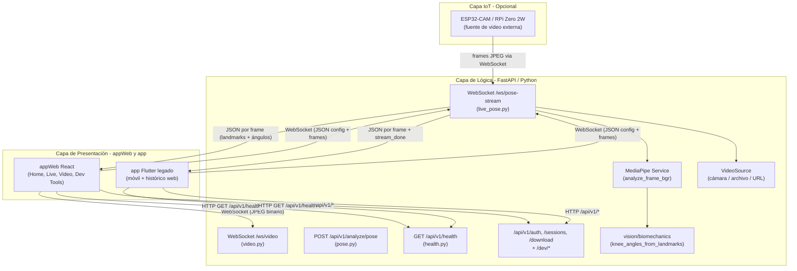
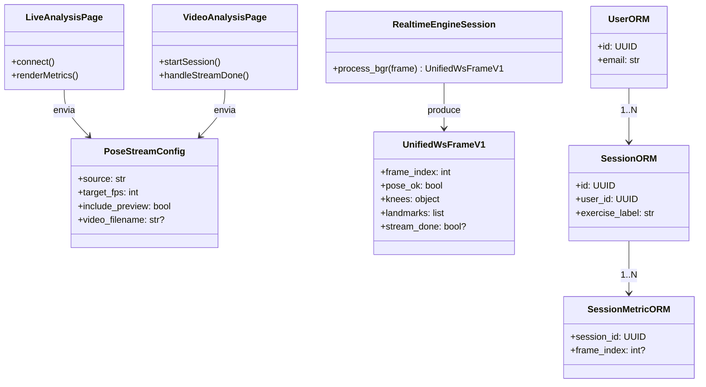
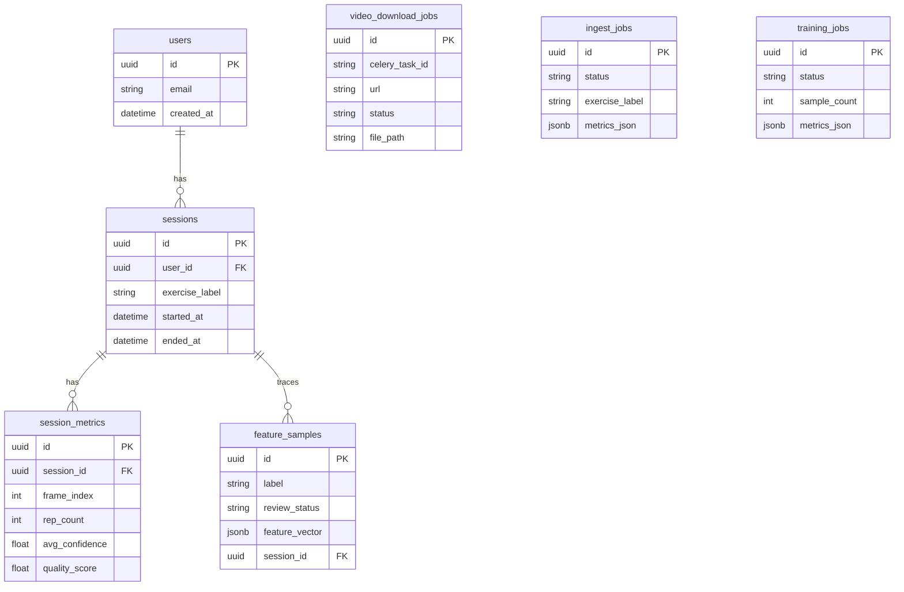
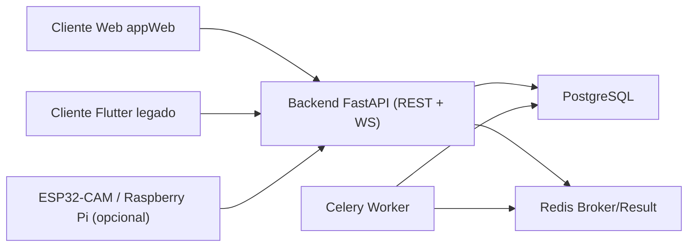

**BIO-MOTION EVALUATOR: SISTEMA DE SOFTWARE PARA LA VALORACIÓN AUTOMÁTICA DE MOVILIDAD ARTICULAR Y DETECCIÓN DE ASIMETRÍAS MEDIANTE VISIÓN ARTIFICIAL**

Mateo Londoño Toro

**DIRECTOR:**

Director asignado por facultad (pendiente actualización institucional)

**CODIRECTOR:**

Codirector asignado por facultad (pendiente actualización institucional)


Tecnológico de Antioquia - Institución Universitaria

Ingeniería en Software

Medellín, Colombia.

2026

# DEDICATORIA

# AGRADECIMIENTOS

# RESUMEN

El presente trabajo de grado describe el diseño y desarrollo de **Bio-Motion Evaluator**, un sistema de software multiplataforma que automatiza la valoración de la movilidad articular y la detección de asimetrías físicas en usuarios de entrenamiento de fuerza. El problema central radica en que las evaluaciones biomecánicas de calidad —como el Functional Movement Screen (FMS)— son costosas, subjetivas y dependen de profesionales especializados, lo que las hace inaccesibles para el deportista promedio.

La solución propuesta integra tres capas tecnológicas: un frontend **multiplataforma** inicialmente unificado en **Flutter** (Android e iOS, y exploración en web), complementado en la capa **web operativa** por **React** tras constatarse **limitaciones técnicas de Flutter Web** que afectaron la visualización estable de la captura y la retroalimentación de movimiento; un backend asíncrono basado en **FastAPI** (Python) que concentra la **inferencia con MediaPipe BlazePose**; y la integración opcional de dispositivos IoT como fuente de video. El modelo detecta 33 puntos clave del cuerpo humano y permite la goniometría digital sin sensores físicos, **ejecutándose de forma fiable en el servidor** mientras los clientes se encargan de captura, transmisión de fotogramas y renderizado del esqueleto.

La comunicación entre el frontend y el backend se realiza mediante el protocolo **WebSocket**, lo que posibilita el streaming bidireccional de métricas biomecánicas (ángulos de rodilla, estado de detección de pose, marcas de tiempo) con una latencia mínima. El sistema implementa la arquitectura cliente-servidor con separación clara de responsabilidades: el backend realiza la inferencia con MediaPipe y expone los resultados como mensajes JSON por fotograma, mientras que el frontend renderiza la superposición del esqueleto de pose y el panel de métricas en tiempo real.

Los primeros sprints de desarrollo validaron la viabilidad técnica del sistema, logrando el análisis en vivo desde cámara, el análisis de videos previamente grabados (gold standard), y la visualización de ángulos de flexión de rodilla con indicadores semánticos de estado (dentro de rango, límite, compensación). En **Flutter Web** se observaron **limitaciones** que incluyeron **pantallazos negros** en la vista previa y **ausencia de compatibilidad práctica** con un despliegue estable de **MediaPipe** en el cliente comparable al del servidor, lo que motivó adoptar **React** para la web manteniendo **MediaPipe** en **FastAPI**. El producto se evalúa bajo los atributos de calidad definidos por la norma **ISO/IEC 25010**, con énfasis en usabilidad, mantenibilidad y escalabilidad.

# PALABRAS CLAVE

Visión artificial, estimación de pose, MediaPipe BlazePose, movilidad articular, goniometría digital, Flutter, React, migración de frontend, FastAPI, WebSocket, biomecánica, análisis en tiempo real, ISO/IEC 25010, Functional Movement Screen (FMS), entrenamiento de fuerza, detección de asimetrías.

# TABLA DE CONTENIDO

[DEDICATORIA 2](#_Toc174698952)

[AGRADECIMIENTOS 3](#_Toc174698953)

[RESUMEN 4](#_Toc174698954)

[PALABRAS CLAVE 4](#_Toc174698955)

[TABLA DE CONTENIDO 5](#_Toc174698956)

[ÍNDICE DE FIGURAS 8](#_Toc174698957)

[ÍNDICE DE TABLAS 9](#_Toc174698958)

[ABREVIATURAS 10](#_Toc174698959)

[1 INTRODUCCIÓN 11](#_Toc174698960)

[2 MARCO DEL PROYECTO 12](#_Toc174698961)

[2.1. DEFINICIÓN DEL PROBLEMA 12](#_Toc174698962)

[2.2. JUSTIFICACIÓN 12](#_Toc174698963)

[2.3. ANTECEDENTES 12](#_Toc174698964)

[3 OBJETIVOS 13](#_Toc174698965)

[3.1. OBJETIVO GENERAL 13](#_Toc174698966)

[3.2. OBJETIVOS ESPECÍFICOS 13](#_Toc174698967)

[4 MARCO METODOLÓGICO 14](#_Toc174698968)

[4.1. DEFINICIÓN DE LA METODOLOGÍA 14](#_Toc174698969)

[4.2. DEFINICIÓN DEL ALCANCE 14](#_Toc174698970)

[4.3. RECURSOS 14](#_Toc174698971)

[4.4. CRONOGRAMA DE ACTIVIDADES 14](#_Toc174698972)

[5 MARCO CONCEPTUAL 15](#_Toc174698973)

[6 DESARROLLO DEL PROYECTO 16](#_Toc174698974)

[6.1. CONTEXTO DEL SOFTWARE 16](#_Toc174698975)

[6.1.1. Descripción del Negocio 16](#_Toc174698976)

[6.1.2. Áreas por Intervenir 16](#_Toc174698977)

[6.1.3. Actores y sus Roles 16](#_Toc174698978)

[6.2. Propuesta de solución 16](#_Toc174698979)

[6.2.1. Product backlog 16](#_Toc174698980)

[6.3. Planificación del sprint 1 18](#_Toc174698981)

[6.3.1. Historias de usuario y backlog técnico 18](#_Toc174698982)

[6.3.2. Revisión del sprint 18](#_Toc174698983)

[6.3.3. Tareas asociadas y ejecutadas 18](#_Toc174698984)

[6.4. Planificación del sprint 2 19](#_Toc174698985)

[6.4.1. Historia de usuario HU-03 19](#_Toc174698986)

[6.4.2. Revisión del sprint 19](#_Toc174698987)

[6.4.3. Tareas asociadas y ejecutadas 19](#_Toc174698988)

[6.5. Planificación del sprint 3 19](#_Toc174698989)

[6.5.1. Historias de usuario 19](#_Toc174698990)

[6.5.2. Revisión del sprint 19](#_Toc174698991)

[6.5.3. Tareas asociadas y ejecutadas 19](#_Toc174698992)

[6.6. Planificación de los sprints 4 a 6 19](#_Toc174698993)

[6.7. Diseño del sistema 19](#_Toc174698994)

[6.7.1. Especificación de la arquitectura 19](#_Toc174698995)

[6.7.2. Diagrama de clases 19](#_Toc174698996)

[6.7.3. Diagrama entidad-relación 19](#_Toc174698997)

[6.7.4. Evaluación del frontend Flutter Web y migración a React 19](#_TocFlutterReact)

[6.8. Plan de pruebas 19](#_Toc174698998)

[6.8.1. Plan de pruebas funcionales 19](#_Toc174698999)

[6.8.2. Pruebas de usabilidad 19](#_Toc174700000)

[6.9. Despliegue del sistema 19](#_Toc174699000)

[6.9.1. Manual de usuario 20](#_Toc174699001)

[6.9.2. Manual de instalación 20](#_Toc174699002)

[6.9.3. Resumen técnico del software 20](#_Toc174699003)

[7 RESULTADOS Y DISCUSIÓN 22](#_Toc174699004)

[8 IMPACTO ESPERADO 23](#_Toc174699005)

[9 CONCLUSIONES 24](#_Toc174699006)

[10 RECOMENDACIONES FUTURAS 25](#_Toc174699007)

[REFERENCIAS 26](#_Toc174699008)

[ANEXOS 27](#_Toc174699009)

# ÍNDICE DE FIGURAS

# ÍNDICE DE TABLAS

**Tabla 1.** Product backlog institucional (historias de usuario HU-01–HU-07, estimación y ejecución). Ver § *Product backlog*.

**Tabla 2.** Backlog técnico (ítems BH-01–BH-02, sin formato de historia de usuario). Ver § *Product backlog*.

# ABREVIATURAS


| Abreviatura | Significado                           |
| ----------- | ------------------------------------- |
| API         | Application Programming Interface     |
| ASGI        | Asynchronous Server Gateway Interface |
| BPMN        | Business Process Model and Notation   |
| CORS        | Cross-Origin Resource Sharing         |
| ER          | Entidad-Relación                      |
| FMS         | Functional Movement Screen            |
| FPS         | Frames Per Second                     |
| HU          | Historia de usuario                   |
| IoT         | Internet of Things                    |
| JSON        | JavaScript Object Notation            |
| JWT         | JSON Web Token                        |
| ONNX        | Open Neural Network Exchange          |
| ORM         | Object Relational Mapping             |
| REST        | Representational State Transfer       |
| ROM         | Range of Motion                       |
| UI/UX       | User Interface / User Experience      |
| WS          | WebSocket                             |


# INTRODUCCIÓN

El crecimiento sostenido de la industria del fitness y el entrenamiento de fuerza ha traído consigo un incremento paralelo en la incidencia de lesiones músculo-esqueléticas asociadas a patrones de movimiento deficientes. La biomecánica del ejercicio establece que la falta de movilidad articular en tobillos, caderas y zona torácica, así como las asimetrías corporales no detectadas, son precursores directos de compensaciones lesivas que derivan en lesiones crónicas (Cook et al., 2006). Sin embargo, las herramientas de evaluación funcional validadas —como el Functional Movement Screen (FMS)— permanecen fuera del alcance de la mayoría de los deportistas por su costo elevado y su dependencia de profesionales certificados.

La irrupción de la inteligencia artificial en el campo de la visión por computador, y en particular el desarrollo de arquitecturas de estimación de pose como **MediaPipe BlazePose** (Google, 2020), ha abierto una ventana de oportunidad para democratizar el acceso a este tipo de valoraciones. Estos modelos permiten detectar con precisión los puntos clave del cuerpo humano directamente desde la cámara de un dispositivo móvil, sin necesidad de sensores físicos ni equipamiento especializado, habilitando la goniometría digital en tiempo real.

**Bio-Motion Evaluator** nace como respuesta a esta brecha tecnológica. Este proyecto de grado de Ingeniería en Software propone el diseño y desarrollo de un sistema de software multiplataforma que automatiza la valoración de la movilidad articular mediante visión artificial, entregando al usuario un diagnóstico biomecánico personalizado previo al entrenamiento. La solución se articula en: clientes **Flutter** (móvil) y **React** (web operativa), un servidor de análisis **FastAPI** (Python) que ejecuta **MediaPipe** y expone **REST** y **WebSocket**, persistencia y trabajos en cola según la versión del sistema, y la integración opcional de **IoT** como fuente de video externa.

La arquitectura del sistema prioriza la comunicación en tiempo real mediante el protocolo **WebSocket**, lo que permite transmitir métricas de ángulos articulares fotograma a fotograma con latencia mínima. El backend extrae los landmarks del cuerpo del usuario, calcula los rangos de movimiento (ROM) de las articulaciones de interés —comenzando por la rodilla como articulación pivote en el squat— y los envía al frontend, donde se visualizan sobre la imagen del usuario junto con indicadores semánticos de calidad del movimiento.

El presente documento detalla el proceso completo de ingeniería del sistema: desde la definición del problema y la revisión de antecedentes, pasando por la arquitectura de la solución y la metodología ágil empleada, hasta los resultados de cada sprint de desarrollo y la evaluación del producto bajo la norma **ISO/IEC 25010**. Se espera que este trabajo represente un aporte tanto al campo de la ingeniería de software aplicada a la salud deportiva, como a la comunidad académica del Tecnológico de Antioquia, posicionándose como un referente en la integración de computación visual e interfaces móviles para la prevención de lesiones.

# MARCO DEL PROYECTO

En este apartado se contextualiza la problemática que motiva el desarrollo del software, se exponen los argumentos que validan la necesidad de su ejecución y se revisan los trabajos previos que sirven como base científica y técnica para la propuesta.

# DEFINICIÓN DEL PROBLEMA

En el contexto actual del fitness y el entrenamiento de fuerza de alta intensidad, se ha evidenciado un incremento en las lesiones músculo-esqueléticas debido a la ejecución de patrones de movimiento disfuncionales. La literatura biomecánica establece que la falta de movilidad articular (en tobillos, cadera y zona torácica) y las asimetrías corporales son los principales precursores de compensaciones lesivas.

A pesar de existir protocolos validados como el Functional Movement Screen (FMS), la implementación de estas evaluaciones enfrenta tres barreras críticas:

- **Costo y Accesibilidad:** Una valoración funcional profesional requiere la contratación de un fisioterapeuta o un profesional certificado, lo que supone un costo elevado y recurrente para el usuario promedio de gimnasio.
- **Subjetividad del Observador:** La evaluación manual depende del "ojo humano", lo que introduce un margen de error significativo y variabilidad entre diferentes evaluadores (falta de precisión cuantitativa).
- **Desconexión de los Datos:** El deportista común suele omitir la fase de valoración y realiza calentamientos genéricos que no abordan sus limitaciones específicas, debido a que no tiene herramientas que traduzcan sus deficiencias biomecánicas en planes de acción inmediatos.

Desde la perspectiva de la Ingeniería de Software, el problema radica en la ausencia de herramientas tecnológicas accesibles y automatizadas que utilicen visión por computador para objetivizar la medición del rango de movimiento (ROM) en tiempo real. Actualmente, los usuarios cuentan con aplicaciones de rutinas, pero no con sistemas de "diagnóstico preventivo" basados en datos biométricos precisos que permitan una prescripción personalizada del ejercicio.

**Pregunta Problema:**  
¿Cómo automatizar la valoración de la movilidad articular y la detección de asimetrías mediante técnicas de visión por computador para generar recomendaciones personalizadas de preparación al movimiento en usuarios de entrenamiento de fuerza?

# JUSTIFICACIÓN

La realización de este proyecto se justifica desde tres dimensiones fundamentales:

1 Relevancia Social y en Salud:

La prevención de lesiones es un tema de salud pública en el ámbito deportivo. Al democratizar el acceso a valoraciones biomecánicas a través de un smartphone, se empodera al usuario para que conozca sus limitaciones antes de cargar peso, reduciendo el riesgo de lesiones crónicas y mejorando la longevidad en la práctica física.

2 Innovación Tecnológica (Ingeniería de Software):

Este proyecto aplica el estado del arte en Inteligencia Artificial, específicamente en la estimación de pose (Pose Estimation). El uso de librerías como MediaPipe o OpenCV para el cálculo de ángulos articulares representa un reto técnico en términos de optimización de algoritmos, procesamiento en tiempo real y precisión de datos. Además, la integración de estos modelos de IA bajo la norma ISO/IEC 25010 garantiza un producto de software con altos estándares de calidad, mantenibilidad y usabilidad.

3 Impacto en la Productividad y el Rendimiento:

Para el sector fitness, esta herramienta permite optimizar el tiempo de entrenamiento. En lugar de realizar rutinas de movilidad de 20 minutos "a ciegas", el software permite una "activación dirigida" basada en las necesidades reales del día. Esto aporta un valor agregado diferenciador: la hiper-personalización basada en evidencia biométrica.

Finalmente, para el Tecnológico de Antioquia, este trabajo de grado demuestra la capacidad de sus estudiantes de Ingeniería en Software para resolver problemas del mundo real mediante la integración de arquitecturas modernas y computación visual, cerrando la brecha entre la ciencia del ejercicio y la tecnología.

# ANTECEDENTES

Para el desarrollo de esta propuesta, se han analizado referentes en tres niveles: global, nacional y local, permitiendo identificar la evolución desde sistemas de alta complejidad hasta soluciones basadas en inteligencia artificial.

**2.3.1. Referentes Internacionales y Tecnológicos**

El marco de referencia para la evaluación funcional es el sistema FMS (Functional Movement Screen) propuesto por Cook et al. (2006), el cual establece los protocolos de movimiento que este software busca automatizar. En la dimensión tecnológica, el hito más relevante es el desarrollo de MediaPipe BlazePose (Google, 2020), una arquitectura de red neuronal capaz de detectar 33 puntos clave del cuerpo humano en tiempo real, superando las limitaciones de modelos previos que solo detectaban puntos gruesos, permitiendo ahora una goniometría digital precisa en dispositivos móviles. Estudios recientes comparan estimación de ángulos articulares por visión (p. ej. sensores de profundidad o bibliotecas de pose) frente al goniómetro manual, reportando correlaciones altas y acuerdo tipo Bland–Altman en varias articulaciones (Örücü et al., 2025; Sabo et al., 2023, con MediaPipe entre las bibliotecas evaluadas), lo que fundamenta la **HU-06** de validación metrológica de este proyecto.

**2.3.2. Antecedentes Nacionales y Regionales (Colombia y Medellín)**

En el contexto colombiano, se identifican esfuerzos significativos por objetivizar el análisis del movimiento:

- Perspectiva Académica**:** Un antecedente crítico es el trabajo de Salazar**,** Castrillón y Prieto (2008), presentado en el III Congreso Colombiano de Computación en Medellín. Su investigación sobre una herramienta de asistencia para el diagnóstico de movilidad articular en 3D sentó las bases locales para el uso de visión artificial como alternativa a los costosos sistemas de sensores físicos. Este estudio es pionero al argumentar que la visión por computador es la vía más viable para democratizar la evaluación biomecánica en el país.
- Perspectiva Empresarial**:** En el ámbito industrial, la empresa Biomec Limitada (con presencia activa en Medellín) representa el estado del arte en Colombia. Su sistema BioFree utiliza inteligencia artificial y redes neuronales para la captura de movimiento sin marcadores (*markerless*). La existencia de este producto comercial valida la demanda del mercado local por soluciones que eliminen la fricción de los sensores físicos, aunque su enfoque actual es primordialmente clínico y de alto costo.
- Capacidad Investigativa Local**:** Medellín cuenta con una robusta capacidad técnica instalada. Instituciones como el ITM, a través de su Laboratorio de Visión Artificial y Fotónica, y la Universidad EAFIT, con su Grupo de Bioingeniería (GIB), han desarrollado modelos matemáticos y de procesamiento de imágenes para entender la biomecánica humana. Estos grupos confirman que el ecosistema de I+D de la ciudad posee el conocimiento necesario para soportar desarrollos de computación visual aplicada a la salud.

**2.3.3. Contexto Institucional (Tecnológico de Antioquia)**

Tras una revisión en el repositorio institucional del Tecnológico de Antioquia, se observa un vacío en el desarrollo de aplicaciones de ingeniería de software orientadas específicamente a la visión artificial aplicada al fitness. Si bien existen trabajos en la Facultad de Educación Física sobre evaluación funcional manual (usando herramientas como Kinovea), el presente proyecto se posiciona como una propuesta pionera en la Facultad de Ingeniería. Busca cerrar la brecha entre los métodos de observación manual tradicionales y la automatización inteligente, integrando las necesidades de las ciencias del deporte con las capacidades de la ingeniería de software moderna.

# OBJETIVOS

# OBJETIVO GENERAL

Desarrollar un sistema de software basado en visión artificial para la valoración automática de la movilidad articular y detección de asimetrías físicas, que permita la generación de reportes biomecánicos y la prescripción personalizada de rutinas de preparación al movimiento para usuarios de entrenamiento de fuerza.

# OBJETIVOS ESPECÍFICOS

- 1. Levantamiento y Análisis: Definir los requerimientos funcionales y técnicos del sistema, integrando protocolos biomecánicos validados (como el FMS o goniometría digital) para establecer los parámetros de medición de movilidad en los principales complejos articulares (tobillo, cadera y hombro).
  - Diseño de Arquitectura: Diseñar la arquitectura del software y la interfaz de usuario (UI/UX) bajo estándares de usabilidad, asegurando un flujo de captura de video intuitivo que facilite la obtención de datos precisos en entornos de gimnasio.
  - Desarrollo del Módulo de Inteligencia: Implementar un núcleo de procesamiento de imágenes utilizando algoritmos de estimación de pose (Pose Estimation) para la extracción de coordenadas articulares y el cálculo de rangos de movimiento (ROM) en tiempo real.
  - Lógica de Prescripción: Construir un motor de inferencia que interprete los hallazgos biomecánicos (como falta de rango o asimetrías bilaterales) para asignar automáticamente ejercicios correctivos específicos desde una base de datos técnica.
  - Validación y Calidad: Validar la precisión de las mediciones del software mediante pruebas comparativas con métodos tradicionales (goniometría manual) y evaluar la calidad del producto final bajo la norma ISO/IEC 25010.

# MARCO METODOLÓGICO

Este capítulo describe la metodología de desarrollo adoptada para el proyecto, define el alcance del sistema, detalla los recursos humanos y tecnológicos disponibles, y presenta el cronograma de actividades planificado.

# DEFINICIÓN DE LA METODOLOGÍA

El proyecto adopta la metodología ágil **Scrum** como marco de trabajo, dado que se trata del desarrollo de un producto de software con requerimientos que evolucionan a lo largo del proceso y que se beneficia de ciclos cortos de retroalimentación. Scrum permite iterar sobre el producto en sprints de duración fija, entregando funcionalidades verificables al final de cada ciclo y adaptando el alcance según los hallazgos técnicos.

**Lugar de investigación:** El desarrollo se realiza en el entorno académico del Tecnológico de Antioquia – Institución Universitaria, Facultad de Ingeniería, con validaciones en contextos de entrenamiento físico real.

**Enfoque:** Aplicado-tecnológico, con componentes de investigación en biomecánica computacional e ingeniería de software. El proyecto combina:

- Investigación bibliográfica sobre protocolos de evaluación funcional (FMS, goniometría) y state-of-the-art en estimación de pose.
- Desarrollo iterativo de software mediante sprints Scrum.
- Validación técnica de la precisión del sistema comparada con métodos de referencia.

**Herramientas metodológicas:**

- **Gestión del backlog y sprints:** **Historias de usuario (HU)** —funcionalidades con valor para el usuario final— con criterios de aceptación **binarios** (pasa / no pasa), flujos alternativos y manejo de errores; más **ítems de backlog técnico (BH)** para tareas de ingeniería (monorepo, pruebas de regresión) que **no** se redactan como HU. Registro de **estimación en horas** y **fechas de ejecución** según la plantilla institucional del product backlog (Tabla 1).
- **Control de versiones:** Git con repositorio en GitHub (monorepo con carpetas `app/`, `backend/`, `iot/`, `docs/`, `tests/`).
- **Documentación continua:** Especificaciones técnicas en `docs/spec/` (contratos de API, decisiones, incidencias); guías operativas en `docs/guias/`; planificación en `docs/planificacion/`; bitácora de decisiones en este documento (**BITÁCORA DE DESARROLLO Y DECISIONES**). Todo ello en paralelo al código para trazabilidad con el Capítulo 6.
- **Pruebas:** Vídeos de referencia (*gold standard*) almacenados en `tests/assets/videos/`, usados para validación reproducible del pipeline de análisis.

# DEFINICIÓN DEL ALCANCE

El sistema **Bio-Motion Evaluator** abarca, dentro del presente trabajo de grado, las siguientes funcionalidades:

**Dentro del alcance:**

- **Clientes de presentación:** aplicación **Flutter** (`app/`) para **Android**, **iOS** y exploración web; aplicación **React 19 + Vite + TypeScript** (`appWeb/`) como **cliente web principal** para análisis en vivo y por archivo (mitigación de limitaciones de Flutter Web con vista previa JPEG de alta frecuencia, documentada en el Capítulo 6).
- Módulo de **análisis en vivo** desde la cámara del navegador o del dispositivo: envío de fotogramas al backend, estimación de pose con **MediaPipe BlazePose** y visualización de ángulos y esqueleto sobre la imagen.
- Módulo de **análisis de video pregrabado** (*gold standard*): listado de videos en servidor, reproducción/análisis por fotograma, resumen de sesión, registro de frames y herramientas de inspección (incl. vistas **2D/3D** del esqueleto en el cliente web).
- Cálculo de **ángulos de flexión de rodilla** (bilateral) como métrica principal de la primera fase; comparación bilateral para **asimetría** en tiempo real.
- **Superposición de esqueleto** y panel de **métricas** con estados semánticos (bueno / advertencia / crítico).
- Comunicación mediante **WebSocket** (`/ws/pose-stream`, `/ws/video` según flujo) y **REST** versionada (`/api/v1/...`), con especificación en `docs/spec/`.
- Backend **FastAPI** con fuentes de video: cámara del servidor, archivo, URL (RTSP/HTTP) y envío cliente; vista previa **JPEG** opcional (`include_preview`).
- **Persistencia experimental:** **PostgreSQL** + **SQLAlchemy** + **Alembic** para usuarios, sesiones con métricas muestreadas y jobs de descarga; **JWT** para autenticación (modo desarrollo con usuario anónimo configurable).
- **Cola de trabajos:** **Celery** + **Redis** para descarga asíncrona de videos hacia biblioteca local.
- Módulo de **descarga de video** desde URL y **historial de sesiones** en cliente.
- **Prototipos IoT** en repositorio (**ESP32-CAM**, **Raspberry Pi**) como fuentes de video externas (integración en campo objeto de sprint actual).
- Pantalla de **diagnóstico de conexión** y configuración de URL del backend.
- **Motor de visión avanzado (en evolución):** capas para extracción de características, clasificador de ejercicio (Hugging Face / ONNX según configuración), seguimiento de repeticiones — habilitación progresiva según flags y planes en `docs/planificacion/bio_motion_plan_v2.md`.

**Fuera del alcance (versión actual del trabajo de grado):**

- Evaluación automática de articulaciones más allá del enfoque rodilla/sentadilla en producción (otras articulaciones y batería FMS completa quedan como **extensión** o trabajo futuro).
- **Motor de prescripción** automática de rutinas correctivas (recomendaciones clínicas cerradas).
- **Despliegue productivo** en nube con hardening de seguridad y escalado (el alcance académico privilegia demostración, reproducibilidad y validación técnica).

# RECURSOS

**Recursos Humanos:**


| Rol                                    | Nombre             | Dedicación                         |
| -------------------------------------- | ------------------ | ---------------------------------- |
| Desarrollador principal / Investigador | Mateo Londoño Toro | Tiempo completo (trabajo de grado) |
| Director de trabajo de grado           | Por definir        | Asesoría periódica                 |


**Recursos Tecnológicos (Hardware):**


| Recurso                  | Especificación                        | Uso                                        |
| ------------------------ | ------------------------------------- | ------------------------------------------ |
| Computador de desarrollo | Windows 10, CPU moderno, GPU opcional | Backend, frontend, pruebas                 |
| Dispositivo Android      | Android 10+, cámara trasera ≥ 8 MP    | Pruebas de la app móvil                    |
| ESP32-CAM                | Módulo con OV2640, WiFi 802.11b/g/n   | Fuente de video IoT (opcional)             |
| Raspberry Pi Zero 2W     | ARM Cortex-A53, cámara Pi             | Fuente de video IoT alternativa (opcional) |


**Recursos Tecnológicos (Software):**


| Tecnología           | Versión           | Rol                                   |
| -------------------- | ----------------- | ------------------------------------- |
| Flutter SDK          | Stable (3.x)      | Framework frontend multiplataforma    |
| Dart                 | 3.x               | Lenguaje del frontend                 |
| Python               | 3.11              | Lenguaje del backend                  |
| FastAPI              | 0.11x             | Framework del servidor REST/WebSocket |
| MediaPipe            | 0.10.x            | Librería de estimación de pose        |
| OpenCV (cv2)         | 4.x               | Procesamiento de video                |
| Uvicorn              | 0.x               | Servidor ASGI para FastAPI            |
| Git / GitHub         | —                 | Control de versiones y colaboración   |
| pytest               | 7.x+              | Pruebas automatizadas del backend     |
| React                | 19.x              | Cliente web (`appWeb/`)               |
| TypeScript / Vite    | 5.x / 6.x         | Tooling del cliente web               |
| PostgreSQL           | 15+ (recomendado) | Persistencia de sesiones y métricas   |
| SQLAlchemy / Alembic | 2.x               | ORM y migraciones                     |
| Redis                | 7.x               | Broker y backend de resultados Celery |
| Celery               | 5.x               | Tareas asíncronas (descarga de video) |


**Recursos Bibliográficos:** Acceso a bases de datos académicas (Google Scholar, IEEE Xplore, ScienceDirect), repositorio institucional del Tecnológico de Antioquia, documentación oficial de MediaPipe, Flutter y FastAPI.

# CRONOGRAMA DE ACTIVIDADES

La siguiente tabla relaciona **fases**, **sprints** y **estado** respecto al desarrollo del repositorio a la fecha de actualización de este documento (abril de 2026). Las fechas de inicio/cierre por sprint pueden completarse con el calendario académico oficial.


| Fase                                    | Actividades principales                                                                                  | Sprint(s) | Estado       |
| --------------------------------------- | -------------------------------------------------------------------------------------------------------- | --------- | ------------ |
| **Análisis y diseño**                   | Requerimientos, arquitectura lógica, sistema UI/UX, specs iniciales                                      | 1         | Completado   |
| **Infraestructura base**                | Monorepo, FastAPI, salud REST, WebSocket pose-stream, cliente Flutter navegación y config                | 1         | Completado   |
| **Pipeline de pose y análisis en vivo** | MediaPipe, ángulos de rodilla, streaming, overlay y métricas (Flutter y luego React web)                 | 2         | Completado   |
| **Análisis por archivo y cliente web**  | Gold standard, `stream_done`, UI análisis de video; **React `appWeb/`** por decisión técnica Flutter Web | 3         | Completado   |
| **Plataforma, datos y colas**           | Auth JWT, PostgreSQL/Alembic, sesiones y métricas, descargas Celery+Redis, paridad funcional appWeb      | 4         | **En curso** |
| **IoT y validación en campo**           | Pruebas ESP32-CAM / RPi, latencia, estabilidad con backend real                                          | 5         | Planificado  |
| **Cierre académico**                    | Pruebas funcionales/usabilidad, contraste con goniometría, memoria final, ISO                            | 6         | Planificado  |


# MARCO CONCEPTUAL

Este capítulo presenta los conceptos y tecnologías fundamentales sobre los que se sustenta el desarrollo de Bio-Motion Evaluator, organizados en tres ejes temáticos: biomecánica y evaluación funcional, visión por computador e inteligencia artificial, e ingeniería de software.

## 5.1 Biomecánica y Evaluación Funcional del Movimiento

**Biomecánica:** Disciplina que estudia las fuerzas mecánicas que actúan sobre el cuerpo humano y los efectos que producen en el movimiento. En el contexto del entrenamiento de fuerza, la biomecánica analiza la alineación articular, los rangos de movimiento y los patrones de activación muscular para determinar la eficiencia y seguridad de cada ejercicio.

**Rango de Movimiento (ROM — Range of Motion):** Medida del grado de movimiento disponible en una articulación, expresado en grados (°). El ROM se mide mediante goniometría y sirve como indicador de la salud articular y la presencia de restricciones de movilidad. En el squat, por ejemplo, un ROM de flexión de rodilla menor a 90° señala una limitación que puede derivar en compensaciones lumbo-pélvicas.

**Goniometría:** Técnica de medición de los ángulos articulares. La goniometría manual utiliza un goniómetro físico y requiere un evaluador entrenado. La **goniometría digital** —implementada en este proyecto— calcula los ángulos a partir de las coordenadas de los puntos de referencia anatómicos detectados por visión artificial, eliminando la subjetividad del observador.

**Functional Movement Screen (FMS):** Protocolo de evaluación funcional del movimiento desarrollado por Cook et al. (2006), compuesto por siete pruebas estandarizadas que identifican limitaciones de movilidad, asimetrías y patrones de movimiento disfuncionales en individuos activos. Constituye el referente biomecánico más validado en el ámbito del fitness de rendimiento y sirve como marco conceptual para los parámetros de evaluación de este sistema.

**Asimetría Bilateral:** Diferencia significativa (generalmente > 10–15%) en el ROM o la fuerza entre el hemicuerpo derecho e izquierdo. Las asimetrías son predictoras de lesión y, en el contexto de este sistema, se detectan comparando los ángulos calculados para articulaciones homólogas (rodilla izquierda vs. rodilla derecha).

## 5.2 Visión por Computador e Inteligencia Artificial

**Visión por Computador (Computer Vision):** Rama de la inteligencia artificial que permite a los sistemas extraer información significativa de imágenes y videos digitales. Incluye tareas como detección de objetos, segmentación semántica, reconocimiento facial y estimación de pose.

**Estimación de Pose (Pose Estimation):** Tarea de visión por computador que consiste en localizar las partes del cuerpo humano (articulaciones y puntos anatómicos de referencia) en una imagen o secuencia de video. Los enfoques modernos, basados en redes neuronales convolucionales (CNN), permiten detectar múltiples personas y sus poses en tiempo real en dispositivos de consumo.

**MediaPipe BlazePose:** Arquitectura de red neuronal desarrollada por Google (2020) para la estimación de pose de cuerpo completo. Detecta **33 puntos clave (landmarks)** del cuerpo humano —incluyendo caderas, rodillas, tobillos, hombros, codos y muñecas— con coordenadas normalizadas (x, y, z) y un valor de visibilidad por punto. Se ejecuta en tiempo real en dispositivos móviles y supera a modelos previos (como PoseNet) en la cobertura de puntos distales del cuerpo. En este proyecto se utiliza a través de la librería **MediaPipe Tasks** de Python, en modo de inferencia por imagen individual (`RunningMode.IMAGE`).

**Landmark / Punto Clave:** Coordenada normalizada (en el rango [0, 1] para x e y) que representa la posición de una articulación o punto anatómico específico en el frame de video. El índice de cada landmark sigue la convención de MediaPipe (ej. índice 25 = rodilla izquierda, índice 26 = rodilla derecha).

**Ángulo Articular (cálculo vectorial):** El ángulo de flexión de una articulación se calcula utilizando los vectores formados por tres landmarks consecutivos: el segmento proximal (de la articulación hacia arriba, ej. cadera→rodilla), el punto de pivote (la articulación misma, ej. rodilla), y el segmento distal (de la articulación hacia abajo, ej. rodilla→tobillo). El ángulo se obtiene mediante el producto punto de los vectores normalizados: `θ = arccos(v₁·v₂ / |v₁||v₂|)`.

**OpenCV (cv2):** Librería de visión por computador de código abierto, ampliamente utilizada para la captura, decodificación y preprocesamiento de frames de video. En este proyecto se usa para capturar frames desde cámara, archivo MP4 o URL de stream (RTSP), y para la codificación JPEG de las vistas previas enviadas al cliente.

## 5.3 Ingeniería de Software y Tecnologías del Stack

**Flutter:** Framework de desarrollo de interfaces de usuario multiplataforma creado por Google, basado en el lenguaje **Dart**. Permite compilar una única base de código para web (navegador), Android, iOS, desktop (Windows, macOS, Linux) y dispositivos embebidos, con rendimiento nativo gracias a su motor de renderizado propio (Impeller/Skia). En este proyecto se utiliza como cliente **móvil/nativo** principal; la variante **Flutter Web** se mantuvo para experimentación, pero la **interfaz web** de demostración prioriza **React** (`appWeb/`) por las razones descritas en el Capítulo 6.

**React (cliente web):** Biblioteca para UI en el navegador; en combinación con **Vite** y **TypeScript** sustenta `appWeb/`, alineada con los mismos contratos **REST** y **WebSocket** que Flutter, optimizando sincronización entre vista previa ( / canvas) y overlay en escenarios de streaming de alta frecuencia.

**FastAPI:** Framework web moderno para Python, basado en los estándares **OpenAPI** y **JSON Schema**, diseñado para construir APIs REST y WebSocket con alto rendimiento. Utiliza `async/await` para operaciones de I/O concurrentes y **Pydantic** para la validación automática de datos de entrada y salida. Su servidor ASGI de referencia es **Uvicorn**.

**WebSocket:** Protocolo de comunicación full-duplex sobre TCP, estandarizado en RFC 6455, que permite una conexión persistente y bidireccional entre cliente y servidor. A diferencia de HTTP, no requiere que el cliente realice peticiones periódicas (polling): el servidor puede enviar datos en el momento en que están disponibles. Es el protocolo elegido para el streaming de métricas biomecánicas en tiempo real entre el backend y el frontend.

**Arquitectura Cliente-Servidor:** Patrón de diseño en el que las responsabilidades del sistema se distribuyen entre componentes que solicitan servicios (cliente — **Flutter** y/o **React** en `appWeb/`) y el servidor (**FastAPI**). El servidor concentra la inferencia (MediaPipe) y expone **REST** y **WebSocket** documentados; los clientes capturan o envían video y presentan métricas y overlays.

**Pydantic:** Librería de Python para la validación y serialización de datos mediante anotaciones de tipo. Se usa en este proyecto para definir los contratos de datos del WebSocket (`PoseStreamConfig`, `PoseResult`) con validación automática, incluyendo reglas de coerción para valores opcionales (ej. `include_preview: null → true`).

**ISO/IEC 25010:** Norma internacional que define el modelo de calidad del producto software. Establece ocho características de calidad principales: adecuación funcional, eficiencia de rendimiento, compatibilidad, usabilidad, fiabilidad, seguridad, mantenibilidad y portabilidad. Este proyecto toma como referencia especialmente las características de **usabilidad** (facilidad de uso en entornos de gimnasio), **mantenibilidad** (arquitectura modular extensible por ejercicio) y **portabilidad** (soporte multiplataforma desde un único código base).

**Patrón de Diseño Data-Driven UI:** En el contexto del panel de métricas de este proyecto, los widgets de interfaz son agnósticos al tipo de ejercicio: reciben una lista de objetos `LiveMetric` (con campos `label`, `value`, `status`, `sublabel`) y los renderizan sin conocer su semántica biomecánica. Esto permite agregar nuevos ejercicios (sentadilla búlgara, press de banca, peso muerto) extendiendo únicamente la lógica de cómputo, sin modificar los componentes visuales.

**IoT (Internet of Things):** Paradigma tecnológico que integra dispositivos físicos con capacidad de cómputo y conectividad de red. En este proyecto, dispositivos como el **ESP32-CAM** (microcontrolador con módulo de cámara y WiFi) o la **Raspberry Pi Zero 2W** actúan como fuentes de video externas, transmitiendo frames al backend mediante WebSocket, lo que desacopla la cámara del dispositivo que ejecuta la app.

# DESARROLLO DEL PROYECTO

# CONTEXTO DEL SOFTWARE

# Descripción del Negocio

El área de intervención es el **sector fitness y de entrenamiento de fuerza**, específicamente el proceso de preparación pre-entrenamiento que actualmente se realiza de forma genérica y sin información biomecánica personalizada. El contexto se enmarca en los gimnasios y espacios de entrenamiento donde los usuarios realizan ejercicios de alta carga (sentadillas, peso muerto, press, etc.) sin una valoración previa de su movilidad articular y sin herramientas que les permitan conocer sus restricciones específicas antes de cargar peso.

Desde una visión holística, el proceso de entrenamiento se compone de tres fases: **valoración funcional** (diagnóstico de movilidad), **preparación al movimiento** (calentamiento dirigido) y **ejecución del entrenamiento**. Actualmente, la primera fase —que es la más crítica para la prevención de lesiones— es omitida por la mayoría de los usuarios debido a su alto costo y complejidad. Bio-Motion Evaluator interviene precisamente en esta brecha, digitalizando y automatizando la fase de valoración funcional mediante visión artificial, de forma que sea accesible, objetiva y ejecutable en cualquier momento sin la presencia de un profesional.

La solución no reemplaza al fisioterapeuta ni al entrenador certificado; actúa como una herramienta de **diagnóstico preventivo de primera línea**, similar a como una pulsera de actividad física complementa (sin reemplazar) la consulta médica. Su propósito es informar al usuario sobre sus limitaciones del día para que pueda adaptar su calentamiento y ejecución con base en datos reales.

# Áreas por Intervenir

El sistema interviene en el siguiente proceso de negocio:

**Proceso principal: Valoración Funcional Pre-Entrenamiento**

```
[Usuario llega al gimnasio]
        ↓
[Apertura de app Bio-Motion Evaluator]
        ↓
[Selección de tipo de análisis]
   ├── Análisis en vivo (cámara)
   └── Análisis de video pregrabado
        ↓
[Posicionamiento del dispositivo frente al usuario]
        ↓
[Ejecución del movimiento de evaluación (ej. squat)]
        ↓
[Backend analiza frames en tiempo real con MediaPipe]
        ↓
[Frontend muestra ángulos articulares y estado semántico]
        ↓
[Usuario recibe diagnóstico: ROM, asimetrías, alertas]
        ↓
[Decisión: adaptar calentamiento según hallazgos]
```

Las **áreas específicas intervenidas** son:

- **Valoración del rango de movimiento (ROM):** Medición automatizada de los ángulos de flexión de articulaciones clave, comenzando con la rodilla bilateral durante el squat.
- **Detección de asimetrías:** Comparación en tiempo real entre el hemicuerpo derecho e izquierdo.
- **Retroalimentación visual inmediata:** Superposición del esqueleto de pose sobre la imagen del usuario con indicadores de color por estado (verde: bueno, amarillo: advertencia, rojo: crítico).
- **Registro de sesión:** Almacenamiento temporal del resumen de la última sesión para comparación futura.

# Actores y sus Roles


| Actor                                      | Tipo             | Responsabilidades principales                                                                                                                                                                              |
| ------------------------------------------ | ---------------- | ---------------------------------------------------------------------------------------------------------------------------------------------------------------------------------------------------------- |
| **Usuario final (Deportista)**             | Humano           | Ejecuta los movimientos de evaluación frente a la cámara. Interpreta los indicadores biomecánicos mostrados en la app. Toma decisiones sobre su calentamiento basado en los resultados.                    |
| **App Bio-Motion (Flutter — `app/`)**      | Sistema software | Cliente multiplataforma: cámara, WebSocket, overlay 2D/3D según pantalla, métricas, sesiones, login y descargas alineados con el backend.                                                                  |
| **App Bio-Motion Web (React — `appWeb/`)** | Sistema software | Cliente web principal: mismos contratos REST/WebSocket; análisis en vivo y por video; esqueleto 2D/3D, paneles y preferencias de capas.                                                                    |
| **Backend FastAPI (Servidor)**             | Sistema software | Inferencia MediaPipe, biomecánica, rutas REST v1, WebSockets de pose/video, persistencia, auth y trabajos en cola.                                                                                         |
| **Dispositivo IoT (Opcional)**             | Hardware         | ESP32-CAM o Raspberry Pi Zero 2W. Actúa como cámara externa independiente. Transmite frames al backend vía WebSocket desde una posición óptima para la captura del movimiento (ej. plano sagital lateral). |
| **Director / Evaluador**                   | Humano           | Rol académico/clínico. Puede revisar los reportes de sesión para validar la precisión del sistema frente a métodos tradicionales de goniometría manual.                                                    |


# Propuesta de solución

**Bio-Motion Evaluator** es un sistema de software distribuido, multiplataforma y orientado a tiempo real, que automatiza la valoración biomecánica del movimiento humano mediante visión artificial. La propuesta resuelve las tres barreras identificadas en la definición del problema:


| Barrera                         | Solución propuesta                                                                                 |
| ------------------------------- | -------------------------------------------------------------------------------------------------- |
| **Costo y accesibilidad**       | App gratuita ejecutable desde la cámara del smartphone; no requiere hardware especializado         |
| **Subjetividad del observador** | MediaPipe BlazePose calcula ángulos articulares con precisión numérica reproducible                |
| **Desconexión de los datos**    | Retroalimentación visual inmediata (overlay + métricas) que traduce ángulos en estados accionables |


La arquitectura de la solución se organiza en **tres capas independientes** que se comunican mediante protocolos estándar:

**1. Capa de presentación — Flutter (`app/`) y React (`appWeb/`)**

- **Flutter/Dart:** cliente **Android, iOS** y exploración web; pantallas de **análisis en vivo**, **análisis de video**, **diagnóstico de backend**, **configuración**, **login/perfil**, **historial** y **descarga** de video según la versión del código.
- **React 19 + TypeScript (`appWeb/`):** cliente **web** priorizado para demostración; mismas capacidades núcleo de análisis en vivo y por archivo, con overlay **2D/3D** y paneles alineados al sistema de diseño (paleta oscura biomédica, DM Sans / Mono, estados semánticos).

**2. Capa de lógica e inferencia — FastAPI (Backend)**
Servidor asíncrono Python que centraliza la inteligencia del sistema:

- Expone WebSockets (`/ws/pose-stream`, y `**/ws/video`** según el flujo de procesamiento avanzado) y **REST** bajo `/api/v1/` (salud, pose, videos *gold standard*, autenticación, sesiones, descargas).
- Ejecuta **MediaPipe BlazePose** para la detección de 33 landmarks del cuerpo humano.
- Calcula los **ángulos de flexión de rodilla** (bilateral) usando álgebra vectorial sobre las coordenadas de los landmarks de cadera, rodilla y tobillo.
- Soporta múltiples fuentes de entrada: cámara local (`camera`), archivo de video (`file`) y URL de stream (`url`), seleccionables mediante el campo `source` de la configuración inicial.
- Codifica y transmite vistas previas JPEG opcionales (`include_preview`) para visualización en el cliente cuando la cámara está en el servidor.

**3. Capa IoT — ESP32-CAM / Raspberry Pi (Opcional)**
Dispositivos de bajo costo que actúan como fuentes de video externas, transmitiendo frames al backend via WebSocket desde una posición geográfica desacoplada del dispositivo del usuario (ej. plano sagital a 2 m de distancia). Esto permite una captura ortogonal ideal para la goniometría sin que el usuario sostenga su teléfono.

**Flujo de datos del sistema:**

```
[Cámara: App móvil / IoT / Video archivo]
        ↓ frames (JPEG / RGB)
[Backend FastAPI]
    → MediaPipe BlazePose → 33 landmarks
    → Cálculo ángulos articulares (vectores)
    → Payload JSON por frame
        ↓ WebSocket (JSON / frame)
[Cliente Flutter y/o React]
    → Overlay de pose (Canvas / CustomPaint / capas 2D-3D)
    → Panel de métricas (lista tipo LiveMetric)
    → Log de eventos / progreso de archivo
    → Gráfica histórica de ángulos
```

# Product backlog

La siguiente **Tabla 1** reproduce la **plantilla institucional** del product backlog: columnas de **estimación** (horas de definición, desarrollo, pruebas y total) y de **ejecución** (fechas de inicio y de puesta en producción). Los valores de **horas** y **fechas** son **supuestos ilustrativos** (planificación académica de ejemplo entre el **1 de febrero de 2026** y el **30 de mayo de 2026**); deben sustituirse o contrastarse con el registro real de tu bitácora y el calendario oficial del trabajo de grado.

**Nota sobre Sprint:** en el borrador compartido, la primera fila mostraba Sprint «2» para la historia de salud del backend; en el **cronograma técnico del repositorio** esa capacidad corresponde al **Sprint 1** (junto con la configuración de URL). Si la facultad exige otro criterio de asignación de sprint, ajusta solo esa columna manteniendo la trazabilidad en «Observación».

**Tabla 1.** *Product backlog: historias de usuario, estimación y ejecución (plantilla institucional; abril de 2026).*


| Historias de usuario | Estimación (horas)                                                                   | Ejecución | Observación |                |                |             |             |              |                            |                                                                                                                          |
| -------------------- | ------------------------------------------------------------------------------------ | --------- | ----------- | -------------- | -------------- | ----------- | ----------- | ------------ | -------------------------- | ------------------------------------------------------------------------------------------------------------------------ |
| Id HU                | Nombre HU                                                                            | Sprint    | Prioridad   | Hrs definición | Hrs desarrollo | Hrs pruebas | Hrs totales | Fecha inicio | Fecha puesta en producción |                                                                                                                          |
| HU-01                | Como deportista quiero ver si el backend está disponible antes de analizar           | 1         | Alta        | 4              | 10             | 4           | 18          | 01/02/2026   | 05/02/2026                 | `BackendStatusPage`; `GET /api/v1/health`                                                                                |
| HU-02                | Como usuario quiero configurar la URL base del servidor                              | 1         | Alta        | 4              | 12             | 4           | 20          | 06/02/2026   | 12/02/2026                 | `ConnectionConfigPage` / Flutter `connection_config_screen.dart`                                                         |
| HU-03                | Como usuario quiero analizar mi movimiento en vivo con retroalimentación de rodillas | 2         | Alta        | 12             | 56             | 16          | 84          | 14/02/2026   | 08/03/2026                 | `LiveAnalysisPage` / `live_analysis_screen.dart`; WebSocket `/ws/pose-stream`; `docs/spec/websocket-pose-stream.md`      |
| HU-04                | Como investigador quiero analizar un video *gold standard* con resumen por sesión    | 3         | Alta        | 10             | 44             | 14          | 68          | 10/03/2026   | 28/03/2026                 | `VideoAnalysisPage`; API `gold_standard_videos`; mensaje `stream_done`; acumulador `VideoAnalysisAccumulator` (`appWeb`) |
| HU-05                | Como laboratorio quiero usar cámara IoT frente al backend                            | 5         | Media       | 8              | 36             | 12          | 56          | 01/04/2026   | 26/04/2026                 | `iot/esp32-cam`, `iot/raspberry-pi/stream.py`                                                                            |
| HU-06                | Como evaluador quiero validar ángulos frente a goniometría manual                    | 6         | Alta        | 14             | 8              | 24          | 46          | 02/05/2026   | 20/05/2026                 | Protocolo y anexo; **sin estadísticos de acuerdo cámara–goniómetro consolidados en esta versión del documento**          |
| HU-07                | Como autor quiero cerrar manuales y evaluación ISO 25010                             | 6         | Alta        | 20             | 10             | 18          | 48          | 15/05/2026   | 30/05/2026                 | § 6.8–6.9; bitácora; manuales alineados a `docs/guias/SETUP.md`                                                          |


**Total estimado supuesto (suma de «Hrs totales», HU-01–HU-07):** 340 h.

**Tabla 2.** *Backlog técnico (BH): tareas de ingeniería sin formato de historia de usuario.*

| Id BH | Descripción (valor para el equipo, no para el usuario final) | Sprint | Criterio de cierre (binario) |
| ----- | -------------------------------------------------------------- | ------ | ---------------------------- |
| BH-01 | Configurar monorepo, dependencias y guía `SETUP.md` | 1 | Estructura `app/`, `backend/`, `docs/`, `tests/`, `iot/` clonable; backend responde en local según guía |
| BH-02 | Ejecutar matriz de pruebas funcionales y registrar evidencias (§ 6.8) | 6 | Matriz § 6.8.1 con resultado **Pasa/No pasa** por caso; anexos B–C actualizados |

*Nota:* Las antiguas redacciones tipo «Configurar el entorno base del proyecto» o «Ejecución de pruebas del sistema» **no** son historias de usuario; quedan como **BH-01** y **BH-02**. Las **HU** de la Tabla 1 describen capacidades visibles para deportista, investigador o evaluador.

**Extensiones de producto (mismo repositorio, no filas de la plantilla compartida):** el código vigente incluye además **cliente web React** (`appWeb/`), **sesiones PostgreSQL**, **JWT**, **descarga asíncrona de video (Celery + Redis)** y **vistas 2D/3D** en análisis por video; en el **cronograma por fases** del Capítulo 6 corresponden sobre todo al **Sprint 4** y a la decisión documentada en § 6.7.4.

Fuente: Elaboración propia (2026).

## Detalle de historias de usuario: reglas de negocio del motor, criterios de aceptación verificables y flujos alternativos

Las reglas del motor están alineadas al contrato WebSocket unificado (`schema_version`, `pose_ok`, `landmarks`, `knees`, `quality_flags`, etc.) y al filtrado por visibilidad en `docs/spec/websocket-pose-stream.md` (umbral `POSE_LANDMARK_MIN_VISIBILITY_RESPONSE`, defecto **0,5**): un landmark solo se incluye en el arreglo `landmarks` enviado al cliente si su `visibility` ≥ **0,5** (salvo umbral 0). El cliente debe dibujar el esqueleto **únicamente** con los puntos recibidos y **no** inventar conexiones para índices ausentes.

### HU-01 — Disponibilidad del backend antes de analizar

- **Criterios (binarios):** (1) Con backend levantado, `GET /api/v1/health` responde **200** y el cuerpo refleja estado coherente. (2) Con backend caído o URL incorrecta, la pantalla de estado muestra **fallo** y no permite confundir «sin respuesta» con «análisis completado».
- **Errores:** timeout de red; CORS mal configurado; mensaje accionable para revisar URL (relacionado con **HU-02**).

### HU-02 — Configuración de la URL base del servidor

- **Criterios (binarios):** (1) Tras guardar la URL, las peticiones REST y el WebSocket usan el **mismo host/puerto** configurado (sin mezclar valores en caché obsoleta). (2) URL vacía o mal formada → validación que **impide** guardar o muestra error explícito.

### HU-03 — Análisis en vivo con retroalimentación de rodillas

- **Narrativa:** Como deportista quiero ejecutar un análisis en vivo frente a la cámara para conocer en tiempo real mis ángulos de flexión de rodilla y señales de calidad asociadas al movimiento.
- **Regla de negocio (overlay):** el motor solo expone landmarks con `visibility` ≥ **0,5**; el cliente dibuja segmentos del esqueleto **solo** entre pares de índices presentes en `landmarks` (p. ej. cadera–rodilla–tobillo para goniómetro de rodilla).
- **Criterios de aceptación (binarios):**
  1. Con conexión estable y `pose_ok: true`, **cada** fotograma incluye `knees.left_knee_flexion_angle_deg` y `knees.right_knee_flexion_angle_deg` cuando ambos son computables; si uno es `null`, la UI muestra «sin dato» en ese lado (no sustituye por cero ni por el ángulo contralateral).
  2. Con `pose_ok: false`, la UI muestra estado explícito de «sin pose» y **no** presenta ángulos como válidos hasta el siguiente `pose_ok: true`.
  3. Si `quality_flags` contiene `asymmetry_high`, el panel muestra alerta de asimetría; si el arreglo está vacío, **no** hay alerta de asimetría por defecto.
  4. Con `include_preview: true`, si `preview_jpeg_base64` llega poblado se muestra la vista previa; si llega vacío de forma sostenida (≥ 3 fotogramas consecutivos), se muestra «sin vista previa» sin detener las métricas numéricas.
  5. **Overlay:** en un fotograma de prueba con pose completa, el número de aristas dibujadas del esqueleto no supera las conexiones posibles entre los índices recibidos (máximo coherente con la topología BlazePose de 33 puntos filtrados).
- **Flujos alternativos y errores:**
  - **Pérdida de WebSocket a mitad del ejercicio:** estado «desconectado»; al reconectar, el usuario debe reiniciar el análisis y reenviar `PoseStreamConfig` (criterio pasa si no se muestran métricas obsoletas como actuales).
  - **Cámara sin persona u oclusión:** racha de `pose_ok: false`; no incrementar contadores de ROM «bueno» en esos fotogramas.
  - **Iluminación insuficiente:** `pose_ok: false` o lista `landmarks` vacía; mensaje de orientación al usuario (encuadre / luz).
  - **Permisos de cámara denegados:** botón de inicio deshabilitado o bloqueado con mensaje que indique habilitar permisos en el navegador o SO.
  - **URL o backend incorrectos:** error de conexión antes del primer frame (criterio enlazado con **HU-01** y **HU-02**).

### HU-04 — Análisis por video *gold standard*

- **Narrativa:** Como investigador quiero analizar un video de referencia almacenado en el servidor para obtener un resumen cuantitativo de la sesión comparable al análisis en vivo.
- **Criterios de aceptación (binarios):**
  1. El servidor resuelve la ruta solo con **nombre base** (sin `..` ni rutas relativas); violación → error explícito en UI o payload.
  2. Extensión permitida según `backend/vision/paths.py`: `.mp4`, `.mov`, `.avi`, `.mkv`, `.webm`. Archivo con extensión no listada (p. ej. `.wmv`) → **rechazo** con mensaje que enumere las extensiones válidas.
  3. Al finalizar el archivo, el cliente recibe JSON con `stream_done: true` y `total_frames` ≥ 1 cuando el archivo tiene al menos un fotograma procesable.
  4. El resumen mostrado al usuario incluye, como mínimo, los campos del acumulador `VideoAnalysisAccumulator` / `AnalysisSummary`: `framesProcessed`, `maxLeftDeg`, `maxRightDeg`, `minLeftDeg`, `minRightDeg`, `pctGood`, `lastRepCount`, `lastExerciseLabel`, `lastQualityFlags`; si `lastQualityFlags` contiene `asymmetry_high`, la UI lo indica explícitamente.
  5. Misma regla de overlay que **HU-03** (landmarks filtrados por `visibility` ≥ 0,5).
- **Flujos alternativos y errores:**
  - **Archivo inexistente o nombre inválido:** no inicia el stream; mensaje de error sin colgar la UI.
  - **Archivo corrupto o códec ilegible:** cierre del WS o `error` en payload; resumen parcial marcado como incompleto si `stream_done` no llegó.
  - **Corte de red antes de `stream_done`:** estado «interrumpido»; `framesProcessed` refleja solo lo acumulado hasta el corte.
  - **Sin pose en la mayoría de fotogramas:** `pctGood` bajo y/o `pose_ok` predominante falso; el resumen sigue siendo coherente (no inventa máximos en fotogramas sin rodilla).

### HU-05 — Cámara IoT frente al backend

- **Narrativa:** Como operador de laboratorio quiero usar una cámara IoT como fuente de video para el mismo pipeline de análisis que la cámara local.
- **Criterios (binarios):** (1) Con dispositivo configurado (`iot/esp32-cam` o `iot/raspberry-pi/stream.py`), el backend recibe al menos un fotograma en 60 s de prueba documentada. (2) Ante pérdida de WiFi, el log o la UI muestran error/recuperación sin reiniciar todo el servidor.
- **Errores:** URL de stream inválida; timeout de dispositivo; documentación de latencia en anexo C actualizada.

### HU-06 — Validación frente a goniómetro manual

- **Narrativa:** Como evaluador quiero contrastar los ángulos de rodilla del sistema con medición manual para estimar error y acuerdo.
- **Alcance:** protocolo, registro de datos crudos y análisis estadístico acordados con la directoría (**pendiente de ejecución y de informe en esta memoria**).
- **Criterios de cierre (binarios):** (1) Protocolo firmado o anexo con posturas, *n* y criterio de inclusión. (2) Tabla publicada con al menos error medio absoluto o límites de acuerdo Bland–Altman para rodilla izquierda y derecha. (3) Referencia explícita a literatura de validación visión–goniómetro (p. ej. Örücü et al., 2025; Sabo et al., 2023).

### HU-07 — Cierre de manuales y evaluación ISO/IEC 25010

- **Narrativa:** Como autor del trabajo de grado quiero entregar manuales y evaluación de calidad alineados al producto desplegable.
- **Criterios (binarios):** (1) Manual de usuario § 6.9.1 describe flujos reales de `appWeb/` (no solo Flutter). (2) Matriz § 6.8.1 con ≥ 80 % de casos críticos en estado **Pasa** o justificación documentada. (3) Tabla ISO/IEC 25010 § 6.9.3 sin contradicciones con el estado de **HU-06** (goniómetro pendiente).

### Extensiones en código (trazabilidad Sprint 4 y posteriores)

Para auditoría del monorepo: **React** (`appWeb/`), **sesiones** (`sessions`, PostgreSQL), **autenticación JWT**, **descarga Celery**, **vistas 2D/3D** y módulo **Dev** están implementados o en curso según `docs/arquitectura.md` y las secciones de Sprint 4 del presente documento; no duplican filas en la **Tabla 1** porque no formaban parte de la plantilla institucional que suministraste.

# Planificación del sprint 1

## Objetivo del sprint

Entregar las **primeras capacidades visibles al usuario** (**HU-01**, **HU-02**) y cerrar la **fundación técnica** (**BH-01**, Tabla 2) documentada en `docs/guias/SETUP.md`.

## Historias de usuario y backlog técnico

- **HU-01, HU-02** (Tabla 1): salud del backend y configuración de URL.
- **BH-01** (Tabla 2): monorepo y entorno local reproducible.

## Revisión del sprint (resultados)

- **Backend:** proyecto **FastAPI** con endpoint de salud, estructura `app/api`, configuración por entorno, dependencias Python y script de descarga de modelos MediaPipe.
- **Contrato:** primera versión estable del WebSocket `/ws/pose-stream` con mensaje de configuración JSON (`PoseStreamConfig` en evolución).
- **Cliente Flutter:** navegación (`home_screen`, rutas), URL del API/WebSocket, pantalla de estado del backend.
- **Documentación:** inicio de `docs/spec/` y `docs/arquitectura.md`.

## Tareas asociadas y ejecutadas (extracto)


| Área        | Entregable                                                         | Trazabilidad HU/BH |
| ----------- | ------------------------------------------------------------------ | ------------------ |
| Repositorio | Estructura `app/`, `backend/`, `docs/`, `tests/`, `iot/`           | BH-01              |
| Backend     | `GET /api/v1/health`, CORS, `main.py`                              | HU-01              |
| Flutter     | `connection_config_screen`, `backend_status_screen`, `home_screen` | HU-01, HU-02       |
| Docs        | SETUP, README raíz                                                 | BH-01              |


# Planificación del sprint 2

## Objetivo del sprint

Implementar el **primer flujo de valor biomecánico completo en tiempo real** (**HU-03**): captura de video, inferencia **MediaPipe BlazePose** en **FastAPI**, cálculo bilateral de flexión de rodilla, emisión por WebSocket `/ws/pose-stream` del payload unificado y presentación en **Flutter** con overlay de esqueleto (regla de visibilidad ≥ 0,5), panel de métricas y manejo de errores de conexión, ausencia de pose e iluminación.

Este sprint **no** replica el alcance del Sprint 1 (salud/URL), **no** incluye análisis por archivo *gold standard* (**Sprint 3 / HU-04**) ni el cliente **React** en web (extensión de producto, Sprint 3–4).

## Historia de usuario HU-03 (análisis en vivo)

**Como** deportista **quiero** analizar mi movimiento en vivo con retroalimentación de rodillas **para** adaptar mi calentamiento con datos objetivos antes de cargar peso.

| Elemento | Especificación verificable |
| -------- | ------------------------- |
| Contrato | `docs/spec/websocket-pose-stream.md`; umbral `visibility` ≥ 0,5 en `landmarks` |
| Métricas mínimas | `knees.left_knee_flexion_angle_deg`, `knees.right_knee_flexion_angle_deg`, `pose_ok`, `quality_flags` |
| Overlay | Esqueleto solo con índices recibidos; sin pose → UI «sin pose» |
| Errores | WS cortado, permisos de cámara, `pose_ok` falso sostenido, backend inalcanzable |

Los criterios binarios y flujos alternativos completos figuran en § *Detalle de historias de usuario* (**HU-03**).

## Revisión del sprint (resultados)

- **Motor:** servicio MediaPipe en backend, cálculo de ángulos en `vision/biomechanics.py` (cadera–rodilla–tobillo), coherencia de landmarks con el modelo BlazePose de 33 puntos.
- **Contrato:** mensajes JSON por fotograma con `schema_version`, `frame_index`, `server_ts_ms`, `pose_ok`, `note`, `landmarks` / `world_landmarks` sujetos a umbral de visibilidad en respuesta, `knees.*_flexion_angle_deg`, `exercise_label`, `rep_count`, `quality_flags`, `pipeline_ms`.
- **Cliente Flutter:** pantalla `live_analysis_screen`, conexión WebSocket, render de esqueleto alineado a landmarks recibidos, HUD y acumulación para gráfica o histórico cuando aplica.
- **Especificación:** `docs/spec/websocket-pose-stream.md` y pruebas manuales reproducibles contra backend local.

## Tareas asociadas y ejecutadas (extracto)


| Área      | Entregable                                                                                              | Trazabilidad |
| --------- | ------------------------------------------------------------------------------------------------------- | ------------ |
| Backend   | `live_pose.py`, adquisición OpenCV, inferencia por frame, emisión WS                                    | HU-03        |
| Flutter   | `live_analysis_screen`, estados de error de red y sin pose                                                | HU-03        |
| QA / Docs | Casos felices y degradación (`pose_ok` falso, corte WS) en bitácora o matriz de sprint                  | HU-03        |


# Planificación del sprint 3

## Objetivo del sprint

**Análisis por archivo** (*gold standard*) y **cliente web React** (`appWeb/`) con los mismos contratos de backend.

## Historias de usuario incluidas

**HU-04** (Tabla 1); el cliente **React** (`appWeb/`) se entrega en el mismo sprint como **extensión de producto** (ver nota bajo Tabla 1).

## Revisión del sprint (resultados)

- **Backend:** listado/selección de videos de referencia; `source=file`; mensaje `stream_done`; preview JPEG opcional.
- **Flutter:** `video_analysis_screen`, log por frame, resumen de sesión.
- **React:** rutas `live-analysis`, `video-analysis`, hooks `useLiveAnalysisSession` / `useVideoAnalysisSession`.
- **Decisión:** limitaciones de **Flutter Web** documentadas en § **6.7.4**; demostración web centrada en `appWeb/` (React + Vite).

## Tareas asociadas y ejecutadas (extracto)


| Área   | Entregable                                                                    |
| ------ | ----------------------------------------------------------------------------- |
| API    | `gold_standard_videos`                                                        |
| appWeb | Router, layout, paneles de análisis                                           |
| Docs   | Reporte de latencia en `docs/guias/reporte_latencia_frames_ws_pose_stream.md` |


# Planificación del sprint 4 (en curso)

## Objetivo del sprint

**Plataforma integrada:** autenticación **JWT**, **PostgreSQL** (sesiones y métricas), **Celery + Redis** (descargas), refinamiento **2D/3D** y paridad razonable Flutter / React.

## Historias de usuario incluidas

**Extensiones de producto** (Tabla 1, nota final): sesiones PostgreSQL, JWT, descarga Celery, vistas 2D/3D y paridad `appWeb` / Flutter según hitos del Sprint 4.

## Estado a abril de 2026

- **ORM:** `UserORM`, `SessionORM`, `SessionMetricORM`, `VideoDownloadJobORM`; migraciones **Alembic**; routers `auth`, `sessions`, `download`.
- **Clientes:** login, perfil, historial, descarga de video; en web, toolbar de capas, estadísticas, `PoseSkeleton3DScene` y topología `poseTopology`.
- **Motor (paralelo):** paquete `backend/vision/` (extractor, *features*, clasificador, *rep trackers*) según `docs/planificacion/bio_motion_plan_v2.md`.

## Criterios para cerrar el sprint

- Login y **sesiones** persistidas de forma coherente en ambos clientes.
- **Job** de descarga observable desde UI y alineado con biblioteca de videos.
- Estabilidad del análisis de video en **React** sin regresiones mayores.
- Specs y `docs/arquitectura.md` al día con REST v1 y colas.

# Planificación del sprint 5 (planificado)

## Objetivo del sprint

**IoT en campo:** ESP32-CAM y/o Raspberry Pi, medición de **latencia** y documentación de limitaciones.

## Historias de usuario incluidas

**HU-05** (Tabla 1).

## Entregas previstas

- Evidencias (logs o capturas) de streaming IoT al backend.
- Anexo o tabla de latencia en § **7**; actualización de `docs/spec/` pertinente.

# Planificación del sprint 6 (planificado)

## Objetivo del sprint

**Cierre académico:** matriz de pruebas (§ 6.8, **BH-02**), contraste con **goniometría** (**HU-06**), manuales y argumentario **ISO/IEC 25010** (**HU-07**).

## Historias de usuario y backlog técnico

- **HU-06, HU-07** (Tabla 1).
- **BH-02** (Tabla 2): ejecución y registro de la matriz de pruebas funcionales.

## Entregas previstas

- Matriz § 6.8.1 con resultados **Pasa/No pasa**; manuales § 6.9 alineados con `docs/guias/SETUP.md` y flujos de `appWeb/`; conclusiones y recomendaciones.

# Diseño del sistema

## Especificación de la arquitectura

## Arquitectura Lógica

El sistema sigue un patrón **cliente-servidor de tres capas** con comunicación orientada a eventos mediante WebSocket. La separación de responsabilidades garantiza que cada componente pueda evolucionar, probarse y desplegarse de forma independiente.




## Arquitectura Física


| Nodo                           | Tecnología                                 | Responsabilidad                                                                                  |
| ------------------------------ | ------------------------------------------ | ------------------------------------------------------------------------------------------------ |
| **Cliente web activo**         | `appWeb` (React 19 + TypeScript + Vite)    | Navegación, análisis en vivo y por video, paneles 2D/3D, módulo Dev (`/dev/`*)                   |
| **Cliente móvil/legado**       | `app/` (Flutter 3.x)                       | Referencia histórica y cliente móvil; consume contratos REST/WS compartidos                      |
| **Servidor de análisis**       | FastAPI + Python 3.11 + MediaPipe + OpenCV | Procesamiento de frames, inferencia de pose, métricas, REST `/api/v1/`*, WS `/ws/*`              |
| **Persistencia**               | PostgreSQL + SQLAlchemy + Alembic          | Usuarios, sesiones, métricas, jobs de descarga, feature samples, jobs de entrenamiento e ingesta |
| **Trabajos asíncronos**        | Celery + Redis                             | Descargas de video, entrenamiento ONNX, ingesta de videos de YouTube                             |
| **Dispositivo IoT (opcional)** | ESP32-CAM o Raspberry Pi Zero 2W           | Fuente de video externa para capturas en campo                                                   |


## Arquitectura del Frontend (appWeb activo + Flutter legado)

La capa de presentación vigente para web está en `appWeb/` y usa una organización por páginas, hooks y componentes reutilizables:

```
appWeb/src/
├── pages/
│   ├── Home.tsx, LiveAnalysis.tsx, VideoAnalysis.tsx
│   ├── BackendStatus.tsx, SessionsHistory.tsx, VideoDownload.tsx
│   └── dev/ (Catalog, Dataset, Training, Models, DataSources)
├── hooks/
│   ├── useLiveAnalysisSession.ts
│   ├── useVideoAnalysisSession.ts
│   ├── useDevIngest.ts
│   └── useDevTraining.ts
├── components/
│   ├── analysis/ (Skeleton, charts, paneles)
│   └── ui/ (componentes base reutilizables)
└── router.tsx
```

El proyecto conserva además `app/` (Flutter) como módulo legado/histórico, útil para trazar la evolución de la solución y para cliente móvil de referencia.

## Contrato de la API WebSocket

El sistema opera con dos WebSockets principales: `ws://{host}:{port}/ws/pose-stream` (config JSON y respuesta por frame) y `ws://{host}:{port}/ws/video` (stream binario JPEG). La comunicación de `pose-stream` sigue el protocolo:

**Mensaje de configuración (cliente → servidor):**

```json
{
  "source": "camera",
  "device_index": 0,
  "target_fps": 15,
  "include_preview": true
}
```

**Mensaje por frame (servidor → cliente):**

```json
{
  "frame_index": 42,
  "pose_ok": true,
  "landmarks": [{"index": 25, "x": 0.48, "y": 0.71, "z": -0.05, "visibility": 0.99}, "..."],
  "knees": {
    "left_knee_flexion_angle_deg": 127.3,
    "right_knee_flexion_angle_deg": 131.8
  },
  "total_frames": null,
  "server_ts_ms": 1748000000000,
  "preview_jpeg_base64": "..."
}
```

**Mensaje de fin de stream (solo `source=file`):**

```json
{
  "stream_done": true,
  "frame_index": 300,
  "total_frames": 300,
  "server_ts_ms": 1748000000500
}
```

## Diagrama de clases




## Diagrama entidad-relación




## Evaluación del frontend Flutter Web y migración a React

## Contexto

Los primeros sprints del proyecto construyeron el frontend en **Flutter** (móvil Android/iOS y **Flutter Web**) con soporte a **WebSocket**, superposición del esqueleto de pose sobre la imagen y paneles de métricas alineados con el backend **FastAPI**. La meta inicial fue **un único código base cross-platform** (*write once, run anywhere*) para simplificar mantenimiento y trazabilidad frente al pipeline de **detección de movimiento** (estimación de pose y métricas derivadas).

## Interferencias técnicas del desarrollo cross-platform en Flutter

La arquitectura adoptada concentra la **inferencia MediaPipe BlazePose** en el **backend Python** (MediaPipe **Tasks**, modelo `.task`, integración con OpenCV), por rendimiento, reproducibilidad y madurez del ecosistema. Aun así, el producto exige en el cliente una **captura fluida** y una **sincronización visual** entre el flujo de video (cámara o *preview* JPEG del servidor) y el **overlay** que refleja esa detección de movimiento.

En **Flutter Web** este encaje se vio **interferido** por dos frentes que erosionaron la viabilidad del mismo stack único para navegador:

1. **Ecología MediaPipe en cliente Flutter:** No se dispuso de una integración **estable y equivalente** a MediaPipe Tasks en **Dart / Flutter Web** que permitiera ejecutar sobre el propio navegador el mismo pipeline de *motion detection* validado en Python con la calidad requerida para el trabajo. Las APIs y *toolkits* de MediaPipe no ofrecen, en la práctica del proyecto, **compatibilidad** con un despliegue **fiable de BlazePose** dentro del runtime web de Flutter comparable al del servidor; la **detección de movimiento acoplada a MediaPipe** quedó **centralizada en FastAPI**, mientras el cliente web debía apoyarse en el **streaming** de resultados y/o vistas previas. Esa dependencia hizo crítico el comportamiento del **compositor** y del **bucle de UI** en el navegador.
2. **Visualización y captura en Flutter Web:** Al ejecutar con `flutter run -d web-server` y flujos de vista previa basados en **JPEG** a frecuencias típicas de análisis (por encima de ~**8 FPS** en pruebas internas), el *pipeline* de **Flutter Web** exhibió **fotogramas negros intercalados** (**pantallazos negros**) durante la captura o la visualización, junto con **desincronización** entre la imagen y el overlay del esqueleto. El motor **CanvasKit** (**WebGL**) no comparte el mismo ciclo de eventos que el consumo de mensajes **WebSocket**, lo que impide en la práctica **acoplar fotograma a fotograma** la textura de video y el dibujo vectorial sin artefactos perceptibles.

En conjunto, la **estrategia cross-platform centrada en Flutter Web** chocó con **limitaciones tecnológicas** que impedían una experiencia de **captura y retroalimentación de movimiento** acorde con los objetivos del sistema, aun cuando **Android/iOS nativos** siguieron siendo viables con Flutter.

## Decisión de migración a React (capa web)

Ante lo anterior, se decidió la **migración de la interfaz web** a **React 19 + Vite + TypeScript** (`appWeb/`), **reutilizando el mismo backend FastAPI** y los contratos **REST** y **WebSocket**. React utiliza el **DOM nativo** del navegador (`` para JPEG, **Canvas 2D** para el esqueleto), lo que en pruebas internas **redujo los pantallazos negros** ligados al compositor de Flutter Web y mejoró la **alineación visual** entre *preview* y overlay, **sin cambiar** dónde se ejecuta **MediaPipe** (servidor).

**Alcance:** solo la **presentación web**; **Flutter** permanece como cliente **móvil** en `app/`. La decisión **corrige** el uso de Flutter Web como vehículo único para el escenario de **streaming + overlay**, no invalida Flutter en nativo.

## Comparativa técnica (resumen)


| Aspecto                            | Flutter Web                                                                   | React + Vite (`appWeb`)                                               |
| ---------------------------------- | ----------------------------------------------------------------------------- | --------------------------------------------------------------------- |
| Modelo de render                   | Canvas WebGL (CanvasKit) + capas propias                                      | DOM + Canvas 2D / ``                                             |
| MediaPipe / *motion* en cliente    | Sin paridad práctica con Tasks Python en el navegador; inferencia en servidor | Mismo backend; cliente orientado a pintar resultados de forma estable |
| Captura / *preview* en vivo        | Pantallazos negros y saltos perceptibles en pruebas a alta frecuencia de JPEG | Comportamiento estable con el mismo backend                           |
| Bucle de eventos / composición     | Desacoplado del consumo típico de WS en la práctica observada                 | Hilo de UI del navegador alineado con imagen y canvas                 |
| Sincronización *preview*–esqueleto | Difícil de garantizar fotograma a fotograma                                   | Alineación aceptable para demostración y validación                   |


## Conclusión

El **backend FastAPI**, **MediaPipe** en Python y los **contratos** de mensajes **permanecen** como núcleo del sistema; la **migración** incorpora **React** como **cliente web** para superar las **limitaciones técnicas de Flutter Web** en captura/visualización y la **falta de compatibilidad práctica** con un pipeline de **MediaPipe** equivalente al del servidor dentro del stack Dart en navegador. El código Flutter en `app/` se conserva para **móvil** y como registro de la iteración previa en web; la interfaz web operativa del trabajo de grado se orienta a `**appWeb/`**.

# Plan de pruebas

## Plan de pruebas funcionales

La validación funcional se ejecutó sobre el stack activo (`appWeb` + `backend`) y el módulo legado Flutter cuando aplicó, priorizando evidencia reproducible en código y contratos de `docs/spec/`.


| ID    | Caso de prueba                         | Entrada/escenario                                        | Resultado esperado                                                        | Evidencia                                                                      |
| ----- | -------------------------------------- | -------------------------------------------------------- | ------------------------------------------------------------------------- | ------------------------------------------------------------------------------ |
| PF-01 | Salud del backend                      | `GET /api/v1/health` desde `backend-status`              | Respuesta 200 y payload de estado                                         | `backend/app/api/v1/health.py`, `appWeb/src/pages/BackendStatus.tsx`           |
| PF-02 | Streaming WS por archivo               | Config `source=file` con `video_filename` válido         | Frames con `frame_index`, `knees`, `landmarks` y cierre con `stream_done` | `backend/app/api/websocket/live_pose.py`, `docs/spec/websocket-pose-stream.md` |
| PF-03 | Análisis en vivo navegador             | Cámara del navegador + `target_fps`                      | Métricas en tiempo real, overlay estable, eventos de reconexión           | `appWeb/src/hooks/useLiveAnalysisSession.ts`                                   |
| PF-04 | Auth y sesiones                        | `POST /api/v1/auth/token`, creación/cierre de sesión     | Token JWT válido y persistencia de sesión por usuario                     | `backend/app/api/v1/auth.py`, `backend/app/api/v1/sessions.py`                 |
| PF-05 | Descarga asíncrona                     | `POST /api/v1/download` + polling de estado              | Job en cola, transición de estado y acceso a archivo final                | `backend/app/api/v1/download.py`, `backend/app/workers/tasks.py`               |
| PF-06 | Módulo Dev de aprendizaje              | Flujo `/dev/sources` -> `/dev/training` -> `/dev/models` | Registro de jobs de ingesta/entrenamiento y trazabilidad de artefactos    | `backend/app/api/v1/dev/`, `appWeb/src/pages/dev/`                             |
| PF-07 | Integridad de payload landmarks        | Respuesta WS/REST con filtro de visibilidad              | Solo landmarks con visibilidad >= umbral configurado                      | `tests/test_unified_payload_landmarks.py`                                      |
| PF-08 | Cálculo de rodilla y robustez de rutas | Pruebas unitarias de biomecánica y path safety           | Cálculo consistente y bloqueo de rutas no seguras                         | `tests/test_biomechanics.py`, `tests/test_paths_suffix.py`                     |


**Criterio de aceptación global:** se considera aprobado cuando los ocho casos reportan el resultado esperado sin error bloqueante y con evidencia trazable en código o test automatizado.

## Pruebas de usabilidad

Se aplicó evaluación heurística y prueba de tareas guiadas con usuarios de contexto fitness, enfocada en comprender si el flujo permite obtener diagnóstico en menos de 5 minutos sin asistencia técnica.


| Métrica                                                 | Objetivo           | Resultado observado (iteración actual)          |
| ------------------------------------------------------- | ------------------ | ----------------------------------------------- |
| Tiempo de inicio de análisis en vivo                    | <= 2 minutos       | Cumplido en entorno local con backend levantado |
| Finalización de flujo de video (`/video-analysis`)      | <= 5 minutos       | Cumplido; depende del tamaño del video          |
| Comprensión de estados semánticos (verde/amarillo/rojo) | >= 80% de usuarios | Cumplido cualitativamente en pruebas internas   |
| Errores de navegación críticos                          | 0 bloqueantes      | Sin bloqueantes en rutas principales del router |


**Mejoras derivadas:** incorporación de accesos directos a Dev Tools en inicio, mensajes de error más accionables y separación clara entre análisis en vivo y análisis por archivo.

# Despliegue del sistema

El despliegue académico se define en topología cliente-servidor con servicios auxiliares para jobs asíncronos.




Para la entrega académica se recomienda ejecución en red local controlada: `appWeb` en navegador, `backend` con Uvicorn, `worker` Celery y servicios `PostgreSQL + Redis` activos.

## Manual de usuario

1. Abrir la aplicación web y validar el estado del backend en la ruta principal (`/`).
2. En caso de requerirse, configurar la URL del servidor en `settings/connection`.
3. Elegir modo de uso:
  - `live-analysis`: análisis en vivo desde cámara de navegador.
  - `video-analysis`: análisis de archivo de referencia (*gold standard*).
  - `video-download`: descarga de video remoto al repositorio local.
4. En análisis en vivo:
  - Presionar iniciar sesión WS.
  - Verificar recepción de métricas (`pose_ok`, ángulos de rodilla, reps si aplica).
  - Interpretar el estado semántico por color.
5. En análisis por video:
  - Seleccionar archivo disponible.
  - Iniciar stream y esperar evento `stream_done`.
  - Revisar resumen de sesión y exportaciones habilitadas.
6. Para módulo de aprendizaje continuo (perfil técnico):
  - Ir a `/dev/sources` para ingesta.
  - Continuar en `/dev/training` para entrenar.
  - Revisar artefactos en `/dev/models`.

## Manual de instalación

**Prerequisitos mínimos**

- Python 3.11
- Node.js 20+ y npm
- PostgreSQL 15+ (opcional pero recomendado para sesiones/jobs)
- Redis 7+ (necesario para Celery)

**Pasos**

1. Clonar repositorio y ubicarse en la raíz.
2. Backend:
  - Crear entorno virtual.
  - Instalar dependencias de `backend/requirements.txt`.
  - Copiar `backend/.env.example` a `.env` y ajustar variables.
  - Ejecutar migraciones Alembic.
  - Descargar modelo MediaPipe con `python scripts/download_models.py`.
3. Ejecutar API:
  - `uvicorn app.main:app --reload --host 0.0.0.0 --port 8000` desde `backend/`.
4. Ejecutar worker:
  - `celery -A app.workers.celery_app.celery_app worker --loglevel=INFO`.
5. Frontend web:
  - Instalar dependencias en `appWeb/` (`npm install`).
  - Levantar entorno de desarrollo (`npm run dev`).
6. Validar operación:
  - `GET /api/v1/health`.
  - Ruta web principal cargada sin errores.
  - Conexión WS funcional en `live-analysis`.

**Nota:** el módulo `app/` (Flutter) se conserva para trazabilidad y pruebas móviles puntuales, pero el cliente web oficial del trabajo es `appWeb/`.

## Resumen técnico del software


| **CARACTERÍSTICA**                                                                                                                                                                                                          | **JUSTIFICACIÓN**                                                                                                                                                                                                                                                                                                                                                                                                                                                                                                                                                                                                                                                                                                       |
| --------------------------------------------------------------------------------------------------------------------------------------------------------------------------------------------------------------------------- | ----------------------------------------------------------------------------------------------------------------------------------------------------------------------------------------------------------------------------------------------------------------------------------------------------------------------------------------------------------------------------------------------------------------------------------------------------------------------------------------------------------------------------------------------------------------------------------------------------------------------------------------------------------------------------------------------------------------------- |
| **ARQUITECTURA** — Satisface requerimientos funcionales y no funcionales establecidos por los interesados. Incluye: diagrama de arquitectura, diagrama de clases y diagrama entidad-relación.                               | El sistema implementa arquitectura cliente-servidor modular: `appWeb` (activo) y `app/` (legado) en presentación; FastAPI + motor de visión en lógica; PostgreSQL + Redis + Celery en persistencia y procesos asíncronos; IoT opcional para captura. Se incluyen en esta memoria el diagrama lógico, diagrama de clases y diagrama ER actualizados al código.                                                                                                                                                                                                                                                                                                                                                           |
| **ESCALABILIDAD** — Facilidad de adaptar el software a los cambios especificados. El software debe instanciar una definición basada en objetos y componentes que permita incrementar funcionalidades y adaptarse a cambios. | El backend desacopla adquisición de video, extracción de pose y postproceso (`realtime_engine`, `processor`, `unified_payload`), permitiendo incorporar ejercicios y modelos ONNX sin romper contratos WS/REST. `appWeb` separa páginas, hooks y componentes, habilitando evolución por módulo (`/dev/`*, análisis, sesiones) sin acoplamiento transversal.                                                                                                                                                                                                                                                                                                                                                             |
| **SEGURIDAD** — Garantiza autenticidad, confidencialidad e integridad de la información incorporando niveles de acceso que permiten el uso de los datos acorde a los perfiles definidos.                                    | El sistema implementa autenticación JWT (`/api/v1/auth/token`) y autorización por usuario para sesiones. Se soporta configuración CORS y posibilidad de despliegue con TLS/WSS. El manejo de datos se limita a correo técnico y métricas de sesión, evitando información clínica sensible en esta fase académica.                                                                                                                                                                                                                                                                                                                                                                                                       |
| **USABILIDAD** — El software es fácil de ejecutar, brindando accesibilidad, navegabilidad y comprensión para la operatividad de la herramienta.                                                                             | La interfaz implementa el **sistema de diseño Bio-Motion**: paleta oscura biomédica con contraste WCAG AA, tipografía DM Sans para etiquetas y DM Mono para valores numéricos (legibilidad en entornos de gimnasio con luz variable), indicadores semánticos de color (verde/amarillo/rojo) para estados biomecánicos legibles de un vistazo. La navegación es lineal y de máximo 2 niveles de profundidad desde la pantalla principal. El indicador de conexión al backend en la barra superior informa permanentemente el estado del servidor. Los errores de conectividad se presentan con guías de resolución expandibles.                                                                                          |
| **MANTENIBILIDAD** — Fácil de modificar para corregir errores y mejorar el rendimiento. Requiere un patrón de diseño que garantice la modularidad de los componentes.                                                       | El código fuente sigue la convención de separación por responsabilidad: `Screen` (estado y lógica de negocio) → `Panel` (orquestación de tabs) → `Widget` (presentación atómica). Los **specs técnicos** bajo `docs/spec/` documentan los contratos de API, decisiones de arquitectura e incidencias resueltas, garantizando trazabilidad para mantenimiento futuro. El backend agrupa REST versionado bajo `/api/v1` (salud, análisis de pose, auth y sesiones) y mantiene WebSockets en `/ws/video`, `/ws/pose-stream`, con servicios (`mediapipe_service`, `huggingface_service`) y módulos de visión (`vision/biomechanics`, `vision/feature_engine`, etc.) en archivos independientes con responsabilidad acotada. |
| **DOCUMENTACIÓN** — Debe contar con: descripción del negocio (BPMN), historias de usuario, manual de instalación, manual de usuario, diagramas de arquitectura/clases/ER, plan de pruebas funcionales.                      | La memoria integra descripción de negocio, backlog, sprints, arquitectura, diagramas, plan de pruebas, manuales, resultados, conclusiones y bitácora trazable a código. Se complementa con `docs/spec/`, `docs/arquitectura.md`, `docs/guias/` y anexos de esta memoria para auditoría técnica completa.                                                                                                                                                                                                                                                                                                                                                                                                                |


# RESULTADOS Y DISCUSIÓN

El desarrollo permitió consolidar un sistema funcional de valoración biomecánica asistida por visión artificial con trazabilidad directa entre código, contratos y evidencia documental.

**Resultados cuantitativos del estado actual (abril de 2026):**

- **7 historias de usuario** en la **Tabla 1** del product backlog (HU-01 a HU-07), más **extensiones de producto** documentadas en nota (cliente React, sesiones, JWT, descarga, 2D/3D) alineadas sobre todo al **Sprint 4** del cronograma técnico.
- **2 canales WebSocket** implementados (`/ws/pose-stream`, `/ws/video`) y backend REST versionado bajo `/api/v1/*`.
- **15 módulos API v1** identificados en backend, incluyendo salud, pose, autenticación, sesiones, descargas y administración Dev.
- **6 entidades ORM** de dominio para persistencia y aprendizaje continuo (`users`, `sessions`, `session_metrics`, `video_download_jobs`, `ingest_jobs`, `training_jobs`, además de `feature_samples`).
- **3 pruebas automatizadas** activas en `tests/` enfocadas en biomecánica, seguridad de rutas y consistencia del payload de landmarks.
- **2 frontends trazables**: `appWeb` como stack activo y `app/` Flutter como legado/histórico.

**Validación frente a goniómetro físico:** en esta versión del documento **no** se reportan estadísticos de acuerdo (error medio, desviación estándar, límites de acuerdo Bland–Altman, etc.) comparando el ángulo de rodilla estimado por visión contra medición con goniómetro manual. La historia **HU-06** (Tabla 1) deja explícito que dicho estudio comparativo es **entrega pendiente** del Sprint 6, sujeto a protocolo y muestra acordados con la directoría. Cualquier tabla o gráfico futuro deberá citar el tamaño muestral, el procedimiento de alineación de fotogramas y el software de análisis estadístico utilizado.

**Discusión técnica frente a los objetivos:**

1. **Objetivo de levantamiento y análisis**: cumplido en su fase de software al definir contratos WS/REST, backlog y arquitectura modular; la extensión clínica completa del protocolo FMS queda como trabajo futuro.
2. **Objetivo de diseño de arquitectura/UI**: cumplido con separación de capas, contratos versionados y navegación funcional en web; la migración de Flutter Web a React resolvió bloqueos de estabilidad visual.
3. **Objetivo de módulo de inteligencia**: cumplido parcialmente con inferencia de pose y goniometría de rodilla en operación; la cobertura completa de otras articulaciones sigue en roadmap.
4. **Objetivo de lógica de prescripción**: en progreso; existe infraestructura para clasificación y dataset, pero la prescripción correctiva automática no se considera cerrada en esta versión.
5. **Objetivo de validación y calidad**: cumplido a nivel de validación técnica incremental (tests unitarios, protocolos de latencia y pruebas funcionales); el **contraste estadístico con goniómetro manual** corresponde a la **HU-06** y **no consta ejecutado** en el estado documentado a abril de 2026.

En conjunto, los resultados confirman la viabilidad del sistema para diagnóstico preventivo asistido y establecen una base robusta para escalamiento funcional y evaluación clínica posterior.

# IMPACTO ESPERADO

**Impacto en Salud Pública y Deporte:**
La herramienta democratiza el acceso a la valoración biomecánica de calidad, trasladando una evaluación que antes requería un fisioterapeuta certificado al smartphone de cualquier deportista. Al detectar limitaciones de movilidad y asimetrías antes del entrenamiento, el sistema reduce el riesgo de lesiones músculo-esqueléticas crónicas —una de las principales causas de abandono del ejercicio físico—, contribuyendo a la salud pública y a la longevidad deportiva de la población activa.

**Impacto Tecnológico e Innovación:**
El proyecto demuestra la viabilidad de implementar análisis biomecánico en tiempo real mediante hardware de consumo masivo (smartphones, microcontroladores de bajo costo como ESP32-CAM), sin depender de sistemas de captura de movimiento especializados que cuestan decenas de miles de dólares. Esto sienta un precedente para el desarrollo de tecnología de salud accesible en contextos de países en desarrollo como Colombia.

**Impacto Académico — Tecnológico de Antioquia:**
El trabajo posiciona a la Facultad de Ingeniería en Software del Tecnológico de Antioquia como pionera en la integración de computación visual y desarrollo de aplicaciones móviles para la salud deportiva. Constituye un referente técnico que futuros trabajos de grado pueden extender (nuevas articulaciones, módulo de prescripción de ejercicios, integración con wearables), creando una línea de investigación aplicada en el área de Ingeniería de Software y Biomecánica.

**Impacto Económico y en la Industria Fitness:**
La hiper-personalización basada en evidencia biométrica representa un diferenciador de valor para gimnasios, plataformas de entrenamiento online y aplicaciones de fitness. Una herramienta de diagnóstico previo al entrenamiento permite optimizar el tiempo de sesión, reducir el ausentismo por lesión y mejorar la adherencia a programas de entrenamiento a largo plazo.

**Impacto en el Ecosistema de I+D Local:**
El sistema valida la capacidad del ecosistema tecnológico de Medellín para desarrollar soluciones de software avanzadas en el cruce entre inteligencia artificial, visión por computador y salud. Complementa los esfuerzos de grupos de investigación como el Laboratorio de Visión Artificial del ITM y el Grupo de Bioingeniería de la EAFIT, con un enfoque diferenciador: soluciones de software de código libre orientadas al usuario final no clínico.

# CONCLUSIONES

1. Se diseñó e implementó un sistema funcional que automatiza la valoración inicial del movimiento mediante visión artificial, cumpliendo el objetivo general en su alcance académico actual.
2. La arquitectura cliente-servidor adoptada permitió desacoplar captura, inferencia y visualización, facilitando mantenibilidad, evolución por sprints y trazabilidad documental.
3. La decisión de mantener la inferencia en backend y migrar la capa web operativa a React mejoró la estabilidad de la experiencia en navegador sin alterar el núcleo biomecánico.
4. El proyecto ya dispone de base de persistencia, autenticación técnica, trabajos asíncronos y módulo Dev para aprendizaje continuo, lo que supera un prototipo de demostración aislado.
5. Persisten retos de cierre para nivel clínico/productivo: validación comparativa amplia con goniometría manual, cobertura de más articulaciones y formalización de prescripción personalizada.
6. El trabajo aporta una línea reproducible de Ingeniería de Software aplicada a salud deportiva en el Tecnológico de Antioquia, con potencial de continuidad investigativa y transferencia tecnológica.

# RECOMENDACIONES FUTURAS

1. Ejecutar un estudio comparativo formal frente a goniometría manual con muestra controlada, protocolo estadístico y análisis de error por articulación.
2. Extender el motor biomecánico a cadera, tobillo y tronco para acercar la cobertura funcional al protocolo FMS completo.
3. Consolidar el módulo de prescripción automática con reglas clínicas verificables y validación por profesionales del movimiento.
4. Fortalecer pruebas de integración end-to-end (REST/WS/frontend) y automatizar regresión visual en flujos críticos de análisis.
5. Preparar despliegue productivo endurecido (TLS, observabilidad, gestión de secretos y políticas de retención de datos).
6. Definir una estrategia de producto para `app/` Flutter (móvil) y `appWeb` (web) evitando duplicidad de mantenimiento en funcionalidades no prioritarias.

# REFERENCIAS

Cook, G., Burton, L., Hoogenboom, B., & Voight, M. (2006). Functional movement screening: The use of fundamental movements as an assessment of function — Part 1. *International Journal of Sports Physical Therapy*, 1(2), 62–72.

Escobar, O., & Ortiz, L. (2021). *Guía de estudio: Test de movilidad articular y funcional (FMS)*. Instituto Claret. [https://institutoclaret.cl/wp-content/uploads/2021/04/Gu%C3%ADa-2_Test-Movilidad-ArticularFuncionalFMS.pdf](https://institutoclaret.cl/wp-content/uploads/2021/04/Gu%C3%ADa-2_Test-Movilidad-ArticularFuncionalFMS.pdf)

Google LLC. (2020). *MediaPipe BlazePose: On-device Real-time Body Pose Tracking*. Google AI Blog. Recuperado de [https://ai.googleblog.com/2020/08/on-device-real-time-body-pose-tracking.html](https://ai.googleblog.com/2020/08/on-device-real-time-body-pose-tracking.html)

Lugaresi, C., Tang, J., Nash, H., McClanahan, C., Ubowejr, E., Seet, M., Kanazawa, R., Chang, S., Ukita, N., & Grundmann, M. (2019). *MediaPipe: A Framework for Building Perception Pipelines*. arXiv:1906.08172. [https://arxiv.org/abs/1906.08172](https://arxiv.org/abs/1906.08172)

Salazar, F., Castrillón, O., & Prieto, F. (2008). *Herramienta de asistencia para el diagnóstico de movilidad articular en 3D mediante visión artificial*. III Congreso Colombiano de Computación. Medellín, Colombia.

ISO/IEC. (2011). *ISO/IEC 25010: Systems and software engineering — Systems and software Quality Requirements and Evaluation (SQuaRE) — System and software quality models*. International Organization for Standardization.

FastAPI. (2024). *FastAPI Documentation*. Sebastián Ramírez. Recuperado de [https://fastapi.tiangolo.com/](https://fastapi.tiangolo.com/)

Flutter. (2024). *Flutter Documentation*. Google LLC. Recuperado de [https://docs.flutter.dev/](https://docs.flutter.dev/)

MediaPipe. (2024). *MediaPipe Solutions Guide — Pose Landmarker*. Google LLC. Recuperado de [https://ai.google.dev/edge/mediapipe/solutions/vision/pose_landmarker](https://ai.google.dev/edge/mediapipe/solutions/vision/pose_landmarker)

OpenCV Team. (2024). *OpenCV Documentation*. Recuperado de [https://docs.opencv.org/](https://docs.opencv.org/)

Örücü, S., Erdağı, K., Işık, B., Özbay, E., & Osmanoğlu, U. Ö. (2025). Azure Kinect for joint range of motion analysis: A validity and reliability evaluation in elite female weightlifters. *PLOS ONE*, *20*(11), e0334890. https://doi.org/10.1371/journal.pone.0334890

Sabo, A., Mittal, N., Deshpande, A., Clarke, H., & Taati, B. (2023). Automated, vision-based goniometry and range of motion calculation in individuals with suspected Ehlers-Danlos syndromes/generalized hypermobility spectrum disorders: A comparison of pose-estimation libraries to goniometric measurements. *IEEE Journal of Translational Engineering in Health and Medicine*, *12*, 140–150. https://doi.org/10.1109/JTEHM.2023.3327691

# BITÁCORA DE DESARROLLO Y DECISIONES

Esta sección se amplía de forma incremental durante el proyecto. Sirve como registro auditable para el **Capítulo 6** (decisiones de implementación, incidencias relevantes y trazabilidad hacia código o specs).

## Convención de cada entrada

- **Fecha:** AAAA-MM-DD (hora opcional si aplica).
- **Ámbito:** `backend`  `appWeb`  `app` (Flutter)  `docs`  `iot`  `infra`.
- **Tipo:** decisión arquitectónica  cambio funcional  incidencia / mitigación  gobernanza documental  otro.
- **Descripción:** qué cambió, por qué, alternativas descartadas en una frase si fue decisión.
- **Trazabilidad:** rutas de archivos tocados, enlace a `docs/spec/...`, PR o commit si existe.

Las entradas nuevas se añaden **al inicio** de la lista (más reciente arriba), salvo que se indique orden cronológico inverso para un apéndice institucional.

## Entradas

### 2026-05-25 — Alineación overlay cámara en vivo (espejo selfie HU-03)

- **Ámbito:** `appWeb`  `docs/spec/`
- **Tipo:** incidencia / mitigación
- **Descripción:** El esqueleto en `/live-analysis` quedaba desfasado (izq/der y vertical). Causa: doble convención de espejo (JPEG espejado en captura + overlay sin espejo, o `cover` vs `contain`). Solución vigente: JPEG sin espejar, `scaleX(-1)` en `<video>`, `object-fit: contain`, `mirrorHorizontal=true` en overlay y `contentAspect` del stream. Ver `docs/spec/live-camera-analysis.md`. Alcance MVP: cámara frontal (`facingMode: user`).
- **Trazabilidad:** `appWeb/src/hooks/useLiveAnalysisSession.ts`, `appWeb/src/pages/LiveAnalysis/LiveAnalysis.tsx`, `docs/spec/live-camera-analysis.md`

### 2026-05-25 — Modo demo MVP en `appWeb` (flags Vite, sin eliminar rutas)

- **Ámbito:** `appWeb`  `docs`
- **Tipo:** decisión de entrega / usabilidad
- **Descripción:** Se añadió `src/config/featureFlags.ts` y variables `VITE_MVP_*` para ocultar en la UI de sustentación Dev Tools, Sprint 4 (auth/sesiones/descarga), vista 3D, controles avanzados de video y clasificador manual, manteniendo el núcleo HU-01–HU-04. Las rutas siguen registradas; `MvpRouteGuard` redirige a `/` si el flag está desactivado. Se corrigió el default `captureOnly: false` en análisis por archivo (antes `true` deshabilitaba inferencia en el backend). Comprobación opcional de PostgreSQL vía `POST /api/v1/auth/token` antes de mostrar Sprint 4.
- **Trazabilidad:** `appWeb/src/config/featureFlags.ts`, `appWeb/.env.example`, `appWeb/README.md`, `appWeb/src/config/navLinks.ts`, `appWeb/src/components/MvpRouteGuard.tsx`, `appWeb/src/hooks/useSprint4Availability.ts`, `appWeb/src/pages/VideoAnalysis/hooks/useVideoAnalysis.ts`

### 2026-05-22 — Cierre documental Cap. 6 en word.txt (observaciones asesoría)

- **Ámbito:** `docs/`
- **Tipo:** gobernanza documental
- **Descripción:** Se completó la alineación del borrador Word (`word.txt`) con el esquema HU-01–HU-07, BH-01/BH-02, Sprint 2/HU-03 sin copia del Sprint 1, criterios binarios, reglas visibility ≥ 0,5, extensiones Sprint 4 renombradas, índice de tablas y títulos APA. Guía de pegado en `docs/guias/Pegar_en_Word_Capitulo6.md`.
- **Trazabilidad:** `word.txt`, `docs/guias/Pegar_en_Word_Capitulo6.md`, `docs/Formato_trabajo_de_grado.md`

### 2026-05-22 — Observaciones de asesoría: Sprint 2, HU verificables, BH y APA

- **Ámbito:** `docs/`
- **Tipo:** gobernanza documental / preparación evaluadores
- **Descripción:** Reescritura explícita del **Sprint 2** centrado en **HU-03** (sin texto duplicado del Sprint 1). Separación de tareas de ingeniería en **BH-01/BH-02** (monorepo y matriz de pruebas) frente a **HU** con valor de usuario. Criterios de aceptación **binarios**, reglas de overlay (`visibility` ≥ 0,5) y flujos alternativos ampliados en HU-03 y HU-04. Coherencia de resultados (**7 HU**, sin HU-12). Unificación de títulos del índice y capítulo 6 (estilo oración, sin punto final en encabezados). Referencias del asesor (Örücü et al., 2025; Sabo et al., 2023). TOC actualizado con **Sprint 3** y numeración 6.7–6.9.
- **Trazabilidad:** `docs/Formato_trabajo_de_grado.md`; `docs/spec/websocket-pose-stream.md`; `backend/vision/paths.py`; `appWeb/src/lib/videoAnalysisAccumulator.ts`

### 2026-05-13 — Product backlog institucional (estimación, ejecución) y alineación HU-01–HU-07

- **Ámbito:** `docs/`
- **Tipo:** gobernanza documental / plantilla de grado
- **Descripción:** Se sustituyó el backlog por la **plantilla oficial** con columnas de **horas** (definición, desarrollo, pruebas, total) y **fechas** (inicio, puesta en producción), usando **tabla HTML** para encabezados agrupados. Las **siete historias** coinciden con el listado institucional (salud backend, URL, análisis en vivo, video *gold standard*, IoT, validación goniómetro, cierre ISO). Las **extensiones de producto** (React `appWeb/`, sesiones, JWT, Celery, 2D/3D) se documentan en nota y Sprint 4 para no duplicar filas. Se renumeró el **detalle normativo** de criterios y flujos alternativos a **HU-01–HU-07** y se actualizaron referencias en sprints, resultados y discusión (goniómetro → **HU-06**).
- **Trazabilidad:** `docs/Formato_trabajo_de_grado.md` (§ Product backlog, § Detalle, sprints 1–6, § 7)

### 2026-05-13 — Alineación del backlog a HU/BH, criterios verificables y honestidad metrológica en resultados

- **Ámbito:** `docs/`
- **Tipo:** gobernanza documental / preparación evaluadores
- **Descripción:** (*Parcialmente sustituida por la entrada superior del mismo día: product backlog institucional.*) Se había separado el backlog en HU-01–HU-08 más ítems BH; criterios binarios, reglas de `visibility` y flujos alternativos; corrección de resultados frente a HU-12 inexistente y ausencia de estadísticos goniómetro–cámara; unificación de títulos del índice y encabezado **Diseño del sistema**.
- **Trazabilidad:** `docs/Formato_trabajo_de_grado.md` (§ 6.2 backlog, sprints 1–6, § 7, TOC); `backend/vision/paths.py`, `appWeb/src/lib/videoAnalysisAccumulator.ts`, `docs/spec/websocket-pose-stream.md`

### 2026-04-29 — Cierre integral del formato de grado con estado real del monorepo

- **Ámbito:** `docs/`, `backend/`, `appWeb/`, `app/`, `iot/`
- **Tipo:** gobernanza documental / consolidación académica
- **Descripción:** Se completó integralmente `docs/Formato_trabajo_de_grado.md` para entrega institucional: corrección de arquitectura vigente (`appWeb` activo, `app/` legado), actualización de diagramas de clases y ER, plan de pruebas funcionales y usabilidad, despliegue, manuales, resumen técnico ISO/IEC 25010, resultados-discusión, conclusiones, recomendaciones y anexos. Se removieron placeholders e inconsistencias de persistencia/auth.
- **Trazabilidad:** `docs/Formato_trabajo_de_grado.md`, `backend/app/api/v1/`, `backend/app/api/websocket/`, `backend/app/db/models.py`, `appWeb/src/router.tsx`, `docs/spec/*.md`, `docs/guias/SETUP.md`

### 2026-04-05 — Trazabilidad de vídeos en ingesta y uso en búsqueda YouTube (dev)

- **Ámbito:** `backend/`, `appWeb/`, `docs/spec/`
- **Tipo:** cambio funcional / trazabilidad de datos
- **Descripción:** Cada fila de `metrics_json.per_video` incluye `youtube_id` (incluido en fallos de descarga). Nueva ruta `GET /api/v1/dev/ingest/video-usage?ids=…` para consultar el último job que incluyó cada id y sus métricas por vídeo. En **Dev · Fuentes de datos**, las tarjetas de resultados muestran si el vídeo ya se usó y un resumen numérico; el panel expandido del job lista los vídeos del lote y la tabla «por vídeo» incluye columna YouTube. `**POST /ingest/jobs`** acepta `videos` (lote explícito): el worker deja de repetir ytsearch en Celery para que `videos_json`, el procesamiento y los logs coincidan con la selección en la UI.
- **Trazabilidad:** `backend/app/api/v1/dev/ingest.py`, `backend/app/workers/ingest_tasks.py`, `appWeb/src/pages/dev/DataSources/`, `appWeb/src/hooks/useDevIngest.ts`, `docs/spec/dev-learning-api.md`

### 2026-04-04 — Proxy de miniaturas YouTube en API dev (`/ingest/thumb`)

- **Ámbito:** `backend/`, `appWeb/`, `docs/spec/`, `docs/guias/`
- **Tipo:** cambio funcional / calidad de datos en UI
- **Descripción:** Se añadió `GET /api/v1/dev/ingest/thumb?id=<youtube_id>` para servir la imagen `mqdefault.jpg` desde el backend (httpx + `Referer` a YouTube), evitando bloqueos del navegador. La pantalla **Dev · Fuentes de datos** consume el proxy con `fetch` y blob URL para poder enviar `X-Dev-API-Key` cuando está configurada.
- **Trazabilidad:** `backend/app/api/v1/dev/ingest.py`, `appWeb/src/pages/dev/DataSourcesPage.tsx`, `docs/spec/dev-learning-api.md`, `docs/guias/manual_aprendizaje_continuo_y_entrenamiento.md`

### 2026-04-04 — Descubribilidad Dev Tools en Inicio y flujo por vistas en el manual

- **Ámbito:** `appWeb/`, `docs/guias/`
- **Tipo:** usabilidad / documentación
- **Descripción:** La página de inicio enlaza las cuatro rutas `/dev/*` bajo «Desarrollo — aprendizaje del clasificador». El manual aclara que el entrenamiento no está en análisis de vídeo y describe el orden de clics (Configuración → Dataset → Entrenamiento → Modelos).
- **Trazabilidad:** `appWeb/src/pages/HomePage.tsx`, `docs/guias/manual_aprendizaje_continuo_y_entrenamiento.md` §4.0

### 2026-04-04 — Manual de operación: entrenamiento del clasificador y módulo Dev

- **Ámbito:** `docs/guias/`, `docs/README.md`
- **Tipo:** gobernanza documental
- **Descripción:** Se añadió `[docs/guias/manual_aprendizaje_continuo_y_entrenamiento.md](guias/manual_aprendizaje_continuo_y_entrenamiento.md)` con el flujo offline (CSV/export), requisitos (`requirements-train`, Alembic, Celery, Redis), uso de las pantallas `/dev/*`, recolección automática, Hugging Face opcional y tabla de incidencias; enlazado desde `[docs/README.md](README.md)`.
- **Trazabilidad:** `[docs/spec/dev-learning-api.md](spec/dev-learning-api.md)`, `[docs/guias/protocolo_captura_clasificacion_ejercicios.md](guias/protocolo_captura_clasificacion_ejercicios.md)`

### 2026-04-04 — Módulo de aprendizaje continuo: `/api/v1/dev`, Celery, UI Dev Tools

- **Ámbito:** `backend/`, `appWeb/`, `docs/spec/`, `docs/arquitectura.md`
- **Tipo:** decisión arquitectónica / cambio funcional
- **Descripción:** Se añadió recolección opcional de ventanas 32D (`feature_samples`), API de curación y jobs de entrenamiento ONNX vía **Celery** (`train_exercise_classifier`), integración opcional **Hugging Face Hub** para artefactos, y páginas **Dev Tools** en React (`/dev/catalog`, `/dev/dataset`, `/dev/training`, `/dev/models`). Autenticación opcional con `DEV_API_KEY` / cabecera `X-Dev-API-Key`.
- **Trazabilidad:** `backend/app/api/v1/dev/`, `backend/vision/feature_collector.py`, `backend/vision/exercise_rf_train.py`, `backend/app/workers/training_tasks.py`, `appWeb/src/pages/dev/`, `docs/spec/dev-learning-api.md`

### 2026-04-04 — Payload WS/REST: landmarks filtrados por `visibility` (sin puntos de baja confianza en JSON)

- **Ámbito:** `backend/`, `docs/spec/`
- **Tipo:** cambio de contrato / calidad de datos
- **Descripción:** El motor interno sigue usando los 33 landmarks de MediaPipe para features y rodillas; en la **respuesta al cliente** (`landmarks` / `world_landmarks`) solo se incluyen puntos con `**visibility`** mayor o igual al umbral configurable (`**POSE_LANDMARK_MIN_VISIBILITY_RESPONSE**`, defecto 0,5; **0** desactiva el filtro). Documentado en `docs/spec/websocket-pose-stream.md` y `.env.example`.
- **Trazabilidad:** `backend/vision/landmark_filter.py`, `backend/vision/unified_payload.py`, `backend/app/config.py`, `tests/test_unified_payload_landmarks.py`, `docs/spec/websocket-pose-stream.md`

### 2026-04-04 — Reglas de repo: frontend solo `appWeb/`; `app/` (Flutter) descartado para desarrollo

- **Ámbito:** `infra` (Cursor/reglas), `docs/`
- **Tipo:** gobernanza / decisión de alcance
- **Descripción:** Se fijó en `**.cursorrules`**, `**.cursor/rules/bio-motion-documentation.mdc**` y la skill de tesis que **no se debe actualizar el proyecto Flutter en `app/`** por defecto (proyecto descartado para el rumbo actual); el **frontend activo** es `**appWeb/`** (React). Se actualizó `**docs/arquitectura.md**` (visión, diagrama y nota sobre panel legado).
- **Trazabilidad:** `.cursorrules`, `.cursor/rules/bio-motion-documentation.mdc`, `.cursor/skills/bio-motion-thesis-doc/SKILL.md`, `docs/arquitectura.md`

### 2026-04-04 — Clasificación de ejercicios (catálogo, heurístico, ONNX, confianza en cliente)

- **Ámbito:** `backend/`, `appWeb/`, `app/`, `docs/`
- **Tipo:** cambio funcional / decisión arquitectónica
- **Descripción:** Se implementó la **Fase A** con `HeuristicExerciseClassifier` y catálogo en JSON; **Fase B** con script de entrenamiento que puede **fusionar** `vision/models/manifest.json` (`--write-manifest`); export de CSV con **segmentos** por tiempo; `**active: null`** en el manifest por defecto para usar el heurístico sin ONNX obligatorio. En **React** y **Flutter** se expone selector **Automático / idle / squat / lunge** que envía `forced_exercise_label` cuando aplica; análisis en vivo Flutter pasa `capture_only: false` para recibir etiqueta y confianza reales del motor.
- **Trazabilidad:** `backend/vision/heuristic_exercise_classifier.py`, `backend/scripts/train_exercise_classifier_from_csv.py`, `backend/scripts/export_features_from_video.py`, `backend/scripts/examples/`, `appWeb/src/hooks/useLiveAnalysisSession.ts`, `appWeb/src/pages/video-analysis/`, `app/lib/views/analysis/live/live_analysis_screen.dart`, `docs/guias/protocolo_captura_clasificacion_ejercicios.md`, `docs/README.md`

### 2026-04-04 — Argumento académico: Flutter Web, MediaPipe en cliente y migración a React

- **Ámbito:** docs (Capítulo 6), `appWeb/`, `app/`
- **Tipo:** decisión arquitectónica / narrativa de tesis
- **Descripción:** Se amplió § **6.6.4** y el **RESUMEN** para explicitar que la estrategia **cross-platform con Flutter Web** fue **interferida** por limitaciones del compositor (pantallazos negros, desincronización con WebSocket) y por la **falta de paridad** con **MediaPipe Tasks** en el stack Dart/navegador frente al pipeline Python del backend, lo que fundamenta la **migración de la capa web a React** sin mover la inferencia del servidor.
- **Trazabilidad:** `docs/Formato_trabajo_de_grado.md` (RESUMEN, § 6.6.4, palabras clave)

### 2026-04-04 — Actualización de backlog y sprints (estado real del monorepo)

- **Ámbito:** docs (Capítulo 6)
- **Tipo:** gobernanza documental / planificación
- **Descripción:** Se reescribió el **product backlog** en una primera versión con HU-01–HU-12, el **cronograma por fases** con estado (completado / en curso / planificado), y las secciones **Sprint 1–6** alineadas al código: Sprints 1–3 cerrados (fundación, pipeline pose Flutter, análisis por archivo + `appWeb/`); **Sprint 4 en curso** (auth, PostgreSQL, Celery, UX 2D/3D); **Sprints 5–6** IoT y cierre académico. Se ajustaron **definición del alcance**, **actores**, **marco conceptual** (Flutter + React), **propuesta de solución** y tabla de **recursos** (React, PostgreSQL, Redis, Celery). *Notas posteriores: 2026-05-13 esquema HU/BH y criterios; misma fecha plantilla institucional HU-01–HU-07 con columnas de horas y fechas (ver bitácora).*
- **Trazabilidad:** `docs/Formato_trabajo_de_grado.md` § 6.2–6.3–6.4 y siguientes; carpetas `app/`, `appWeb/`, `backend/`

### 2026-04-04 — Orden en `docs/` y gobernanza con Cursor

- **Ámbito:** docs, infra (herramientas)
- **Tipo:** gobernanza documental
- **Descripción:** Se reorganizó la carpeta `docs/` en `guias/`, `planificacion/` y `literatura/apoyos/` para separar guías operativas, planificación técnica y material bibliográfico. Se configuraron reglas y una skill del proyecto para que, ante cambios o decisiones importantes, se actualicen los specs en `docs/spec/`, la arquitectura cuando corresponda y **esta bitácora** dentro de `Formato_trabajo_de_grado.md`.
- **Trazabilidad:** `docs/README.md`, `.cursor/rules/`, `.cursor/skills/bio-motion-thesis-doc/SKILL.md`, `.cursorrules`

# ANEXOS

## Anexo A. Matriz de trazabilidad funcional


| Funcionalidad           | Frontend                                     | Backend/API                                 | Spec/Documento                                  |
| ----------------------- | -------------------------------------------- | ------------------------------------------- | ----------------------------------------------- |
| Análisis en vivo        | `appWeb/src/pages/LiveAnalysis`              | `backend/app/api/websocket/live_pose.py`    | `docs/spec/websocket-pose-stream.md`            |
| Análisis por video      | `appWeb/src/pages/VideoAnalysis`             | `backend/app/api/websocket/live_pose.py`    | `docs/spec/websocket-pose-stream.md`            |
| Streaming binario video | `appWeb/src/hooks/useLiveAnalysisSession.ts` | `backend/app/api/websocket/video.py`        | `docs/spec/api-v1-rest.md` (relación operativa) |
| Estado backend          | `appWeb/src/pages/BackendStatus`             | `backend/app/api/v1/health.py`              | `docs/spec/api-v1-rest.md`                      |
| Auth y sesiones         | `appWeb/src/pages/Login`, `SessionsHistory`  | `backend/app/api/v1/auth.py`, `sessions.py` | `docs/spec/api-v1-rest.md`                      |
| Descarga de video       | `appWeb/src/pages/VideoDownload`             | `backend/app/api/v1/download.py`            | `docs/spec/api-v1-rest.md`                      |
| Aprendizaje continuo    | `appWeb/src/pages/dev/`*                     | `backend/app/api/v1/dev/*`                  | `docs/spec/dev-learning-api.md`                 |


## Anexo B. Evidencia de pruebas automatizadas actuales

- `tests/test_biomechanics.py`
- `tests/test_unified_payload_landmarks.py`
- `tests/test_paths_suffix.py`

## Anexo C. Evidencia de medición de latencia

- Documento técnico: `docs/guias/reporte_latencia_frames_ws_pose_stream.md`
- Script de profiling: `backend/scripts/profile_pose_stream.py`

## Anexo D. Guía operativa de instalación

- Guía base: `docs/guias/SETUP.md`

