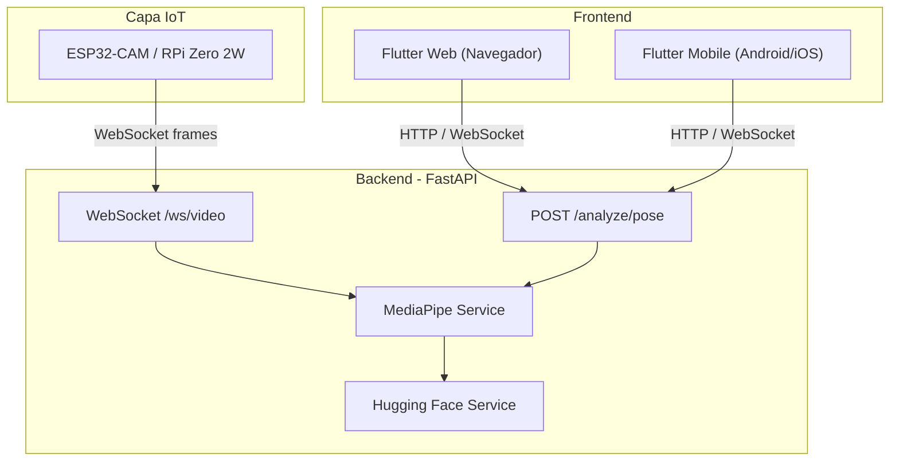

# Arquitectura del sistema

## Visión general

El **Bio-Motion Evaluator** sigue un diseño **web-first** y **cross-platform**:

- El **frontend** (Flutter) consume la API y puede operar en navegador y en dispositivos móviles con el mismo código base.
- El **backend** (FastAPI) centraliza la lógica, streaming por WebSocket y modelos de visión (MediaPipe, extensible con Hugging Face).
- Los **dispositivos IoT** (ESP32-CAM o Raspberry Pi Zero 2W) envían video comprimido (p. ej. JPEG) al backend.

## Diagrama

## Flujo de datos (resumen)

1. **Captura**: IoT o cámara del cliente obtiene frames.
2. **Transporte**: WebSocket binario o HTTP multipart según el caso.
3. **Inferencia**: MediaPipe Pose Landmarker en el backend; modelos HF opcionales para tareas de clasificación.
4. **Presentación**: Flutter muestra resultados y métricas al usuario.
