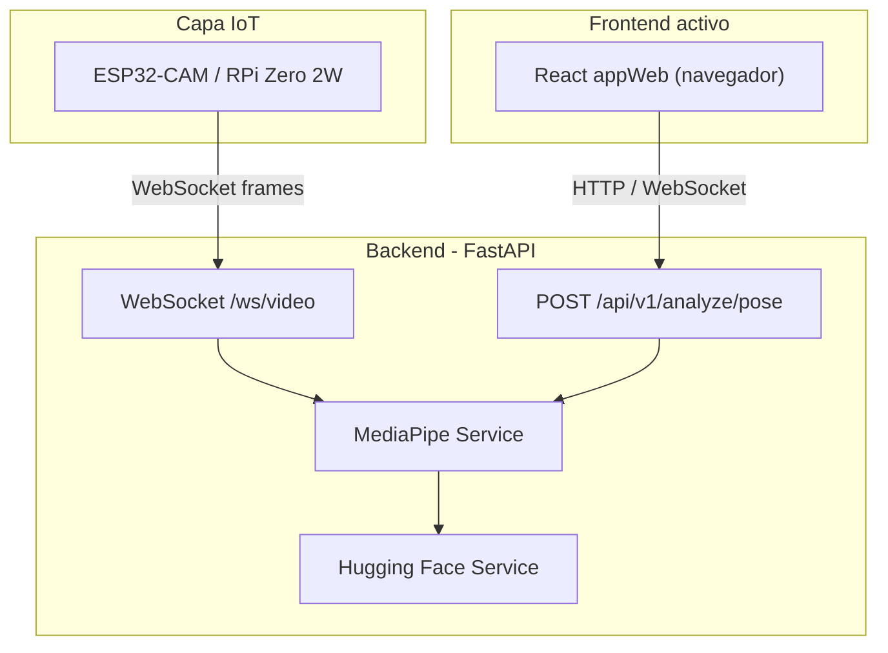

# Arquitectura del sistema

## Visión general

El **Bio-Motion Evaluator** sigue un diseño **web-first**:

- El **frontend operativo** es **React (`appWeb/`)**: análisis en vivo, análisis por vídeo, configuración y métricas en el navegador.
- La carpeta **`app/`** (Flutter) permanece como **código legado** del enfoque cross-platform inicial; **no** es el destino del desarrollo actual de la tesis.
- El **backend** (FastAPI) centraliza la lógica, streaming por WebSocket y modelos de visión (MediaPipe, extensible con Hugging Face).
- Los **dispositivos IoT** (ESP32-CAM o Raspberry Pi Zero 2W) envían video comprimido (p. ej. JPEG) al backend.

## Diagrama



## Flujo de datos (resumen)

1. **Captura**: IoT o cámara del cliente obtiene frames.
2. **Transporte**: WebSocket binario o HTTP multipart según el caso.
3. **Inferencia**: MediaPipe Pose Landmarker en el backend; modelos HF opcionales para tareas de clasificación.
4. **Goniometría**: cálculo del ángulo articular a partir de la pose estimada.
5. **Presentación**: **`appWeb/`** (React) muestra resultados y métricas al usuario.

> **Espacio de coordenadas (etapa 4).** El cálculo angular se realiza sobre los
> `world_landmarks` **métricos**, no sobre los landmarks normalizados que viajan en el
> payload. Los normalizados son anisótropos (`x` entre el ancho, `y` entre el alto) y
> deforman el ángulo hasta ~32° en vídeo 16:9. Ver
> [`spec/goniometria-espacio-de-coordenadas.md`](spec/goniometria-espacio-de-coordenadas.md).

### Evaluación experimental (`validacion/`)

Módulo independiente del tiempo de ejecución: no participa en el flujo de datos, sino
que **mide** el sistema para responder la pregunta de investigación del trabajo de grado.

- `validacion/experimentos/` — experimentos ejecutables y reproducibles: verificación
  geométrica del cálculo angular, sensibilidad a la oblicuidad de cámara, caracterización
  empírica sobre vídeo real y perfilado de latencia por etapas.
- `validacion/analisis/` — estadística de acuerdo (MAE, RMSE, sesgo, Bland-Altman,
  ICC(2,1), error por tramo angular) y exportación de series para comparación manual.
- `validacion/resultados/` — datos crudos en CSV, figuras e informes generados.

Protocolo de la validación física en
[`guias/protocolo_validacion_exactitud.md`](guias/protocolo_validacion_exactitud.md).

### Aprendizaje continuo (administración)

- **PostgreSQL** almacena `feature_samples` (vectores 32D curados) y `training_jobs` (métricas de entrenamiento).
- Recolección opcional durante inferencia WebSocket/REST cuando `AUTO_COLLECT_ENABLED` y umbral de confianza.
- **Celery** ejecuta `train_exercise_classifier`: RandomForest → ONNX, fusiona `vision/models/manifest.json`, opcional **push** a Hugging Face Hub.
- **React** expone rutas **`/dev/*`** (catálogo, dataset, entrenamiento, modelos) para desarrolladores; contrato en `docs/spec/dev-learning-api.md`.

---

## Arquitectura del panel de análisis en vivo

> **Nota:** esta subsección describe el panel **legado en Flutter** (`app/lib/.../live_analysis_screen.dart`). El desarrollo y la evolución de la UX de análisis en vivo deben hacerse en **`appWeb/`** (p. ej. `LiveAnalysisPage`, hooks de sesión WebSocket).

El panel inferior de `LiveAnalysisScreen` sigue un modelo **data-driven** para permitir múltiples tipos de ejercicio sin modificar los widgets de UI.

```
LiveAnalysisScreen (StatefulWidget)
│
│  _buildLiveMetrics(leftDeg, rightDeg) → List<LiveMetric>
│  ← punto de extensión por tipo de ejercicio
│
└─ LiveDashboardPanel (Dashboard + Module Tabs)
      ├─ TabBar: [MÉTRICAS] [LOG] [HISTÓRICO]
      ├─ MetricsPanel      ← recibe List<LiveMetric>, usa ListView
      ├─ LogPanel          ← recibe List<String>
      └─ HistoryPanel      ← recibe leftSeries / rightSeries
```

### Modelo `LiveMetric` (`core/models/live_metric.dart`)

Representa una métrica de movimiento de forma agnóstica al ejercicio:

| Campo | Tipo | Ejemplo |
|-------|------|---------|
| `label` | `String` | `"RODILLA IZQ."`, `"CADENCIA"` |
| `value` | `String` | `"127.3°"`, `"168 spm"` |
| `status` | `MetricStatus` | `good`, `warn`, `bad`, `neutral` |
| `sublabel` | `String?` | `"Objetivo: ≥ 130°"` |
| `icon` | `IconData?` | `Icons.fitness_center` |

### Extensibilidad

Para agregar un nuevo ejercicio (press banca, running, mancuerna…):
1. Implementar la lógica de cómputo de métricas en `live_analysis_screen.dart` dentro de `_buildLiveMetrics`.
2. Retornar una `List<LiveMetric>` con los datos del ejercicio.
3. Ningún widget de UI necesita modificarse.

---

## Convenciones de nomenclatura de widgets (live analysis)

| Widget | Responsabilidad |
|--------|----------------|
| `LiveAnalysisScreen` | Estado, cámara, WebSocket, construcción de `List<LiveMetric>` |
| `LiveDashboardPanel` | Orquestador del panel inferior (TabBar + TabBarView + CTA) |
| `MetricsPanel` | Tab MÉTRICAS: renderiza `List<LiveMetric>` con `ListView` |
| `LogPanel` | Tab LOG: muestra eventos frontend/backend |
| `HistoryPanel` | Tab HISTÓRICO: gráfica de series temporales |
| `CameraHUD` | Línea compacta de estado del servidor (frame, FPS, latencia) |
| `PoseOverlay` | `CustomPaint` de landmarks sobre `CameraPreview` |

