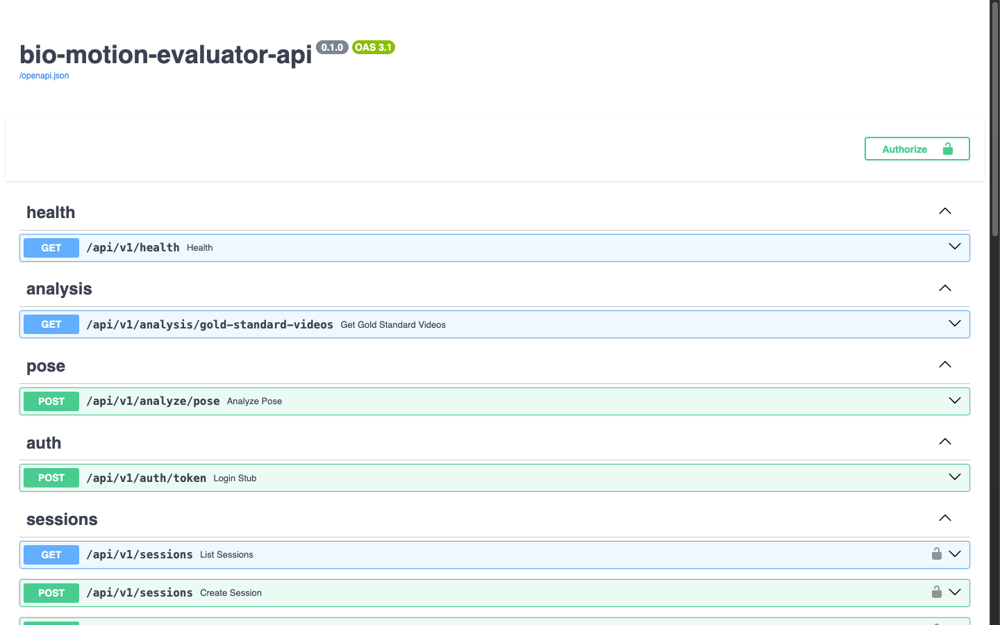
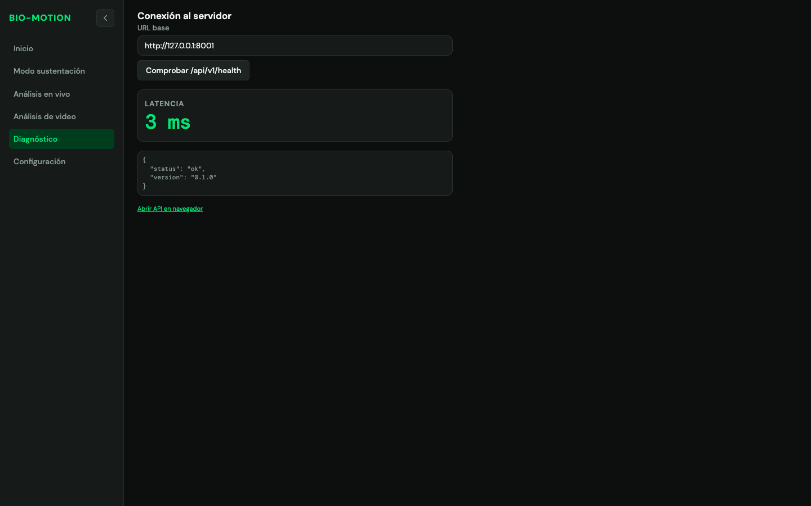

# Manual de instalación

| Campo | Valor |
|-------|-------|
| Sistema | Bio-Motion Evaluator |
| Versión del manual | 1.0 |
| Fecha | Octubre de 2026 |
| Dirigido a | Personal técnico que instala, opera o mantiene el sistema |
| Documento complementario | Manual de usuario (`manual_usuario.md`), para los evaluadores |

## 1. Introducción

### 1.1 Componentes

Bio-Motion Evaluator es una aplicación cliente-servidor. La inferencia de pose ocurre en el servidor; el navegador
solo captura imágenes y presenta resultados.

| Componente | Tecnología | Carpeta | Obligatorio |
|------------|------------|---------|-------------|
| Backend (API de análisis) | Python, FastAPI, Uvicorn, MediaPipe | `backend/` | Sí |
| Modelo de pose | MediaPipe Pose Landmarker (`.task`) | `backend/models/` | Sí |
| Cliente web | React 19, Vite 8, TypeScript | `appWeb/` | Sí |
| Persistencia | PostgreSQL + Alembic | `backend/alembic/` | **Opcional** |
| Cola de descargas | Redis + Celery | `backend/app/workers/` | **Opcional** |

Comunicación entre componentes:

| Canal | Ruta | Uso |
|--------|--------------|------------------------|
| REST | `/api/v1/health` | Estado del servicio |
| REST | `/api/v1/analysis/gold-standard-videos` | Lista de videos de referencia en el servidor |
| WebSocket | `/ws/video` | Análisis en vivo: el navegador envía JPEG y recibe ángulos y landmarks |
| WebSocket | `/ws/pose-stream` | Análisis de videos guardados en el servidor |
| REST | `/docs` | Documentación interactiva de la API (OpenAPI) |

### 1.2 Entorno de verificación

Este procedimiento se verificó en **macOS (Apple Silicon)** con Python 3.12.13, Node.js 26.6.0 y npm 11.18.0.
Los comandos para Windows y Linux siguen la guía `docs/guias/SETUP.md` del repositorio; donde difieren, se
indican por separado.

## 2. Requisitos

### 2.1 Hardware

No se ha definido un mínimo de hardware validado. Como referencia:

| Recurso | Valor de referencia |
|---------|---------------------|
| Procesador | La inferencia corre en **CPU** (no requiere GPU). Las mediciones de rendimiento del trabajo se hicieron en un Apple M5 |
| Disco | Aproximadamente 0,9 GB para el entorno virtual de Python, 350 MB para `node_modules` y 9,4 MB para el modelo de pose completo |
| Cámara | Cámara web en el equipo **cliente** (el navegador del evaluador) |
| Red | Cliente y servidor en el mismo equipo o en una red local de baja latencia |

### 2.2 Software

| Software | Versión | Observaciones |
|----------|---------|---------------|
| Sistema operativo | Windows 10/11, macOS o Linux | |
| Python | **3.12** | `docs/guias/SETUP.md` admite 3.10–3.12. Python 3.13 no está soportado por las ruedas de MediaPipe 0.10.x según esa guía |
| Node.js | **^20.19.0 o ≥ 22.12.0** | Requisito del paquete `vite` 8.0.3 fijado en `appWeb/package-lock.json` |
| npm | El incluido con Node.js | |
| Git | Reciente | |
| Navegador | Chrome, Edge, Firefox o Safari actualizado | Debe permitir el acceso a la cámara |
| PostgreSQL | 15 o superior | *Opcional* |
| Redis | 7.x | *Opcional* |

Dependencias principales del backend (`backend/requirements.txt`): `fastapi` 0.115, `uvicorn[standard]`,
`mediapipe` 0.10.x, `opencv-python-headless`, `numpy`, `onnxruntime` 1.20–1.21, `sqlalchemy`, `alembic`, `celery`,
`redis` y `yt-dlp`.

## 3. Obtener el código

1. Clone el repositorio o copie la carpeta entregada por el autor:

   ```bash
   git clone <URL-del-repositorio> bio-motion-evaluator
   cd bio-motion-evaluator
   ```

2. Verifique que la copia de trabajo está limpia:

   ```bash
   git status --short
   ```

3. Si aparecen cientos de archivos modificados sin haber tocado nada (finales de línea o tildes en nombres de
   archivo), normalice la copia:

   ```bash
   git config core.autocrlf false
   git config core.precomposeunicode true   # macOS
   git add --renormalize .
   ```

Estructura relevante:

```text
bio-motion-evaluator/
├── appWeb/            Cliente web (React + Vite)
├── backend/           API FastAPI, motor de visión y migraciones
│   ├── app/           Aplicación (configuración, rutas, workers)
│   ├── models/        Modelos de pose .task (se descargan)
│   ├── scripts/       download_models.py
│   └── vision/        Goniometría, clasificador y seguimiento de repeticiones
├── tests/             Pruebas pytest y tests/assets/videos (videos de referencia)
├── validacion/        Experimentos de exactitud y latencia
└── pytest.ini
```

## 4. Instalación del backend

### 4.1 Crear el entorno virtual

> **Cree el entorno virtual fuera de discos sincronizados o montados** (OneDrive, Google Drive, macFUSE, NTFS
> montado, unidades de red). Un entorno virtual tiene decenas de miles de archivos pequeños y esos montajes lo
> vuelven muy lento. Además, **un entorno creado en Windows no sirve en macOS ni en Linux**, y viceversa: hay que
> recrearlo en cada sistema.

**macOS / Linux:**

```bash
python3.12 -m venv ~/.venvs/biomotion
source ~/.venvs/biomotion/bin/activate
python -m pip install --upgrade pip
pip install -r backend/requirements.txt
```

**Windows (PowerShell):**

```powershell
py -3.12 -m venv $env:USERPROFILE\.venvs\biomotion
& $env:USERPROFILE\.venvs\biomotion\Scripts\Activate.ps1
python -m pip install --upgrade pip
pip install -r backend\requirements.txt
```

Si el repositorio está en un disco local normal, también puede crear el entorno en `backend/.venv`, como indica
`docs/guias/SETUP.md`. El atajo de Windows `scripts\start-dev-backend.ps1` espera el entorno en esa ubicación.

### 4.2 Descargar el modelo de pose

Desde la carpeta `backend/`, con el entorno virtual activo:

```bash
cd backend
python scripts/download_models.py          # descarga models/pose_landmarker_full.task
```

| Variante | Comando | Archivo | Uso |
|------------|----------------|------------------|----------|
| Completa (predeterminada) | `python scripts/download_models.py` | `models/pose_landmarker_full.task` | Mayor precisión |
| Ligera | `python scripts/download_models.py lite` | `models/pose_landmarker_lite.task` | Más fotogramas por segundo, menor precisión |

Si usa la variante ligera, defina `MEDIAPIPE_POSE_MODEL_PATH=models/pose_landmarker_lite.task` (sección 4.3). Si
el archivo ya existe, el script lo informa («Ya existe: …») y no lo descarga de nuevo.

### 4.3 Variables de entorno (opcional)

El backend funciona **sin archivo `.env`** con los valores predeterminados. Para cambiarlos, cree `backend/.env` a
partir de `backend/.env.example` y edite solo lo necesario. El archivo `.env` se lee desde el **directorio de
trabajo**, por eso el servidor debe iniciarse desde `backend/`.

Variables definidas en `backend/app/config.py` (los nombres no distinguen mayúsculas):

| Variable | Valor predeterminado | Uso |
|----------------------|------------------|----------------------------|
| `CORS_ORIGINS` | `*` | Orígenes permitidos, separados por comas. Con una lista, se permite además `localhost` y `127.0.0.1` en cualquier puerto |
| `MEDIAPIPE_POSE_MODEL_PATH` | `models/pose_landmarker_full.task` | Ruta del modelo de pose |
| `POSE_INFERENCE_STRIDE` | `1` | 1 = inferir cada fotograma; 2–3 = reutilizar la última pose en fotogramas intermedios |
| `POSE_LANDMARK_MIN_VISIBILITY_RESPONSE` | `0.5` | Visibilidad mínima de un landmark para incluirlo en la respuesta |
| `SERVER_PIPELINE_WARN_MS` | `300.0` | Umbral para registrar la advertencia `pose_slow` |
| `LOG_POSE_PIPELINE_TIMING` | `false` | Registra los tiempos del pipeline por fotograma |
| `FEATURE_FLAGS_JSON` | `{}` | Banderas del motor, por ejemplo `{"enable_onnx_classifier": false}` |
| `DATABASE_URL` | vacío | *Opcional*. Conexión a PostgreSQL (sección 7.1) |
| `JWT_SECRET` | `dev-insecure-change-me` | *Opcional*. **Debe cambiarse** si se habilitan cuentas |
| `JWT_ALGORITHM` | `HS256` | Algoritmo de firma de tokens |
| `ACCESS_TOKEN_EXPIRE_MINUTES` | `10080` (7 días) | Vigencia del token |
| `CELERY_BROKER_URL` | `redis://localhost:6379/0` | *Opcional*. Broker de Celery |
| `CELERY_RESULT_BACKEND` | `redis://localhost:6379/0` | *Opcional*. Resultados de Celery |
| `DOWNLOADS_DIR` | `data/downloads` | *Opcional*. Carpeta de videos descargados |

> No incluya credenciales reales en el repositorio ni en este manual. El archivo `.env` no debe versionarse.

### 4.4 Iniciar el backend

Desde `backend/`, con el entorno virtual activo:

```bash
cd backend
uvicorn app.main:app --host 127.0.0.1 --port 8000
```

Agregue `--reload` durante el desarrollo para reiniciar al cambiar el código. Salida esperada:

```text
INFO:     Started server process [...]
INFO:     Waiting for application startup.
INFO:app.main:Iniciando bio-motion-evaluator-api v0.1.0
INFO:     Application startup complete.
INFO:     Uvicorn running on http://127.0.0.1:8000 (Press CTRL+C to quit)
```

En Windows, desde la raíz del repositorio, existe el atajo `.\scripts\start-dev-backend.ps1` (requiere el entorno
en `backend\.venv`; usa `--host 0.0.0.0`, ver la sección 10).

### 4.5 Comprobar el backend

```bash
curl http://127.0.0.1:8000/api/v1/health
```

Respuesta esperada (HTTP 200):

```json
{"status":"ok","version":"0.1.0"}
```

La documentación interactiva queda en `http://127.0.0.1:8000/docs`.

{width=90%}

### 4.6 Videos de referencia (opcional)

La pantalla **Análisis de video** lista los archivos de `tests/assets/videos/`. Los videos **no se versionan**.

1. Copie los videos en `tests/assets/videos/`.
2. Use extensiones `.mp4`, `.mov`, `.avi`, `.mkv` o `.webm`.
3. Compruebe la lista:

   ```bash
   curl http://127.0.0.1:8000/api/v1/analysis/gold-standard-videos
   ```

   Respuesta esperada: `{"filenames":["..."]}`. Con la carpeta vacía: `{"filenames":[]}`.

> Los videos de personas son **datos personales** (Ley 1581 de 2012). Cuente con la autorización de las personas
> grabadas y restrinja el acceso a la carpeta.

## 5. Instalación del cliente web

### 5.1 Instalar dependencias

> **`node_modules` no es portable entre sistemas operativos.** Contiene binarios nativos (por ejemplo
> `@rolldown/binding-darwin-arm64` frente a `@rolldown/binding-win32-x64-msvc`). Si cambia de sistema, borre
> `node_modules` y ejecute `npm install` de nuevo.

```bash
cd appWeb
npm install
```

Para una instalación reproducible a partir del `package-lock.json` puede usar `npm ci`.

### 5.2 Servidor de desarrollo

```bash
cd appWeb
npm run dev
```

Abra `http://localhost:5173`. La raíz `/` redirige a la interfaz principal (`/sustentacion`, Portada). Si el
puerto 5173 está ocupado, Vite elige el siguiente libre y lo indica en la consola. Para fijar el puerto y fallar si está ocupado: `npm run dev -- --port 5173 --strictPort`.

> Inicie siempre el cliente con `npm run dev` (y compile con `npm run build`), no con `npx vite`: esos comandos
> ejecutan antes `scripts/copiar_manuales.mjs`, que copia los PDF de `docs/manuales/` a `appWeb/public/manuales/`
> para que la Portada los ofrezca como descarga. Después de regenerar un manual en PDF, vuelva a ejecutar
> `npm run dev` o `npm run build` (o `node scripts/copiar_manuales.mjs` desde `appWeb/`).

Rutas del cliente:

| Interfaz | Rutas |
|----------|-------|
| Principal (tema claro) | `/` (redirige a `/sustentacion`), `/sustentacion`, `/sustentacion/demo`, `/sustentacion/resultados` |
| Completa (tema oscuro, funciones avanzadas) | `/inicio`, `/live-analysis`, `/video-analysis`, `/backend-status`, `/settings/connection` |

El enlace **Interfaz completa →** de la interfaz principal lleva a `/inicio`; la opción **Modo sustentación** del
menú lateral regresa a la interfaz principal.

### 5.3 Compilación para producción

```bash
cd appWeb
npm run build        # copia los manuales y ejecuta tsc -b && vite build
```

El resultado queda en `appWeb/dist/` (`index.html`, `assets/`, iconos y `manuales/` con los dos PDF). La advertencia «Some chunks are larger than
500 kB after minification» es informativa y no impide la compilación.

Para revisar la compilación localmente:

```bash
npm run preview
```

Para publicarla, sirva `appWeb/dist/` con cualquier servidor de archivos estáticos (por ejemplo Nginx o Apache)
con estas condiciones:

1. **Redirección de rutas al `index.html`** (*SPA fallback*). La aplicación usa rutas del navegador como
   `/sustentacion/demo` o `/inicio`; sin esta regla, recargar esas páginas devuelve 404.
2. **HTTPS**, si el cliente se abre desde otro equipo distinto de `localhost` (sección 9.3).

### 5.4 Variables de compilación (opcional)

`appWeb/src/config/featureFlags.ts` lee estas variables **en el momento de compilar** (archivo `appWeb/.env.local`
o variables de entorno) y afectan a la interfaz completa. Sin ellas se muestran todas sus opciones.

| Variable | Efecto |
|----------|--------|
| `VITE_MVP_DEMO_MODE` | `true` activa el perfil de demostración: oculta opciones avanzadas y fija valores por defecto |
| `VITE_MVP_SHOW_SPRINT4` | Menús de cuenta, historial y descarga de video. Solo se muestran si además el backend responde en `POST /api/v1/auth/token` |
| `VITE_MVP_SHOW_3D` | Panel de pose 3D en Análisis de video |
| `VITE_MVP_SHOW_ADV_VIDEO` | Fuentes alternativas y opciones avanzadas en Análisis de video |
| `VITE_MVP_SHOW_LIVE_EXERCISE` | Selector manual de ejercicio en Análisis en vivo |
| `VITE_MVP_SHOW_REP_GOAL` | Campo de objetivo de repeticiones en Configuración |

La dirección del backend **no** se define con una variable de compilación: se configura en la interfaz (sección 6).

## 6. Conectar el cliente con el backend

La interfaz principal no tiene pantalla de configuración: la dirección se fija en la interfaz completa y la
usan ambas.

1. Abra el cliente en el navegador (se abre la Portada).
2. Haga clic en **Interfaz completa →** (o abra `/inicio`) y, en el menú lateral, haga clic en **Configuración**
   (ruta `/settings/connection`).
3. En **URL base del API**, escriba la dirección del backend, por ejemplo `http://127.0.0.1:8000`. El valor
   predeterminado es `http://localhost:8000`.
4. Haga clic en **Guardar**. Aparece «Guardado en localStorage.».
5. Abra **Diagnóstico** (ruta `/backend-status`) y confirme `"status": "ok"`.
6. Vuelva a la interfaz principal con **Modo sustentación** y haga una medición de prueba en **Demostración**.

Detalles técnicos:

- El valor se guarda en `localStorage` del navegador con la clave `bio_api_base`. Es propio de cada navegador y
  equipo.
- Si falta el esquema, se antepone `http://`; se eliminan las barras finales.
- Las rutas WebSocket se derivan de esa URL: `http://` → `ws://` y `https://` → `wss://`.
- Las pantallas de análisis leen la URL al abrirse; después de cambiarla, vuelva a abrir la pantalla.

{width=85%}

## 7. Componentes opcionales

> Esta sección **no es necesaria** para el análisis en vivo ni para el análisis de video. Sin estos componentes,
> la pantalla Inicio de la interfaz completa (`/inicio`) muestra «Persistencia no disponible en este entorno (PostgreSQL / auth). Las funciones de
> cuenta y descarga están ocultas.» y `POST /api/v1/auth/token` responde 503 con
> `{"detail":"DATABASE_URL not configured"}`. Es el comportamiento esperado.

### 7.1 PostgreSQL y migraciones Alembic (opcional)

Habilita usuarios, sesiones, métricas y trabajos de descarga.

1. Instale PostgreSQL 15 o superior y cree una base de datos y un usuario dedicados.
2. Defina `DATABASE_URL` en `backend/.env`, con este formato (valores de ejemplo, no reales):

   ```text
   DATABASE_URL=postgresql+asyncpg://<usuario>:<contraseña>@<host>:5432/<base_de_datos>
   ```

   El backend acepta `postgresql://`, `postgres://` o `postgresql+asyncpg://`; Alembic convierte la URL a su forma
   síncrona automáticamente.
3. Cambie `JWT_SECRET` por un valor aleatorio y largo.
4. Ejecute las migraciones desde `backend/`:

   ```bash
   cd backend
   alembic upgrade head
   ```

5. Reinicie el backend. La pantalla Inicio de la interfaz completa (`/inicio`) dejará de mostrar el aviso de persistencia.

### 7.2 Redis y Celery para la descarga de video (opcional)

Habilita la cola de descarga remota de videos (`yt-dlp`).

1. Inicie Redis 7. El repositorio incluye `backend/docker-compose.yml` con un servicio `redis`:

   ```bash
   cd backend
   docker compose up -d redis
   ```

2. Si Redis no está en `localhost:6379`, ajuste `CELERY_BROKER_URL` y `CELERY_RESULT_BACKEND`.
3. Inicie el worker desde `backend/`, con el entorno virtual activo:

   ```bash
   cd backend
   celery -A app.workers.celery_app worker --loglevel=info
   ```

   En Windows el worker usa automáticamente el pool `solo`.
4. La descarga remota también requiere PostgreSQL (sección 7.1).

> Antes de descargar videos de terceros, verifique los derechos de uso y la autorización de las personas que
> aparecen en ellos.

## 8. Lista de verificación

Marque cada punto después de la instalación.

| # | Verificación | Comando o acción | Resultado esperado |
|---|--------------|------------------|--------------------|
| 1 | Versión de Python | `python --version` (entorno activo) | `Python 3.12.x` |
| 2 | Versión de Node.js | `node --version` | `v20.19+` o `v22.12+` |
| 3 | Modelo de pose | Listar `backend/models/` | `pose_landmarker_full.task` (≈ 9,4 MB) |
| 4 | Salud del API | `curl http://127.0.0.1:8000/api/v1/health` | `{"status":"ok","version":"0.1.0"}` |
| 5 | Lista de videos | `curl http://127.0.0.1:8000/api/v1/analysis/gold-standard-videos` | `{"filenames":[...]}` |
| 6 | Cliente web | Abrir `http://localhost:5173` | Redirige a `/sustentacion` y muestra la **Portada** (tema claro) |
| 7 | Interfaz completa | Clic en **Interfaz completa →** (`/inicio`) | Pantalla Inicio con **Backend conectado** |
| 8 | Diagnóstico | Interfaz completa → **Diagnóstico** | `"status": "ok"` y latencia en verde |
| 9 | Medición en vivo | Portada → **Demostración** → **Conectar cámara** → **Iniciar medición** | Esqueleto sobre la persona, ángulos de ambas rodillas y asimetría |
| 10 | Pruebas automáticas | Ver abajo | `95 passed` |

Pruebas automáticas. `backend/requirements.txt` **no incluye** las dependencias de prueba; instálelas primero:

```bash
pip install pytest scipy matplotlib
```

Ejecute desde la **raíz del repositorio** (`pytest.ini` fija `pythonpath = backend` y `testpaths = tests`):

```bash
python -m pytest -q
```

Resultado esperado:

```text
........................................................................ [ 75%]
.......................                                                  [100%]
95 passed in 3.95s
```

El tiempo varía según el equipo.

## 9. Solución de problemas

### 9.1 Puertos ocupados

| Síntoma | Solución |
|---------|----------|
| Uvicorn termina con «address already in use» | Otro proceso usa el puerto. Identifíquelo (`lsof -i :8000` en macOS/Linux; `netstat -ano \| findstr :8000` en Windows) o inicie el backend en otro puerto (`--port 8001`) y actualice la URL en **Interfaz completa → Configuración** |
| Vite arranca en 5174 u otro puerto | El 5173 estaba ocupado. Use la dirección que indica la consola, o `--strictPort` para obligar un puerto |
| `npm run dev -- --strictPort` falla con «Port … is already in use» | Libere el puerto o elija otro |

Con `CORS_ORIGINS` en su valor predeterminado (`*`) cualquier puerto del cliente funciona. Si define una lista de
orígenes, `localhost` y `127.0.0.1` siguen permitidos en cualquier puerto; otros orígenes deben estar en la lista.

### 9.2 Entornos no portables entre sistemas operativos

| Síntoma | Causa | Solución |
|---------------|---------------|------------------|
| El entorno virtual no tiene `bin/` (macOS/Linux) o `Scripts\` (Windows) | Se creó en otro sistema operativo | Borre el entorno y créelo de nuevo en el sistema actual (sección 4.1) |
| `npm run build` o `npm run dev` fallan con `MODULE_NOT_FOUND` de `@rolldown/binding-…` | `node_modules` se instaló en otro sistema operativo | Borre `appWeb/node_modules` y ejecute `npm install` |
| La instalación o el arranque son muy lentos | El entorno está en un disco montado o sincronizado | Cree el entorno en un disco local (por ejemplo `~/.venvs/biomotion`) |

### 9.3 Permisos de cámara y HTTPS

- Los navegadores solo permiten la cámara en un **contexto seguro**: `http://localhost`, `http://127.0.0.1` o
  `https://`. Si el cliente se abre desde otro equipo con `http://<ip>:5173`, la cámara se bloquea y la pantalla
  muestra «Cámara: … Usa https o localhost y concede permisos.».
- Para uso en red, publique el cliente por **HTTPS** y el backend también por HTTPS, de modo que los WebSocket usen
  `wss://`. Una página HTTPS no puede conectarse a un backend `http://`/`ws://` (contenido mixto).
- Si el permiso se negó antes, restablézcalo en la configuración del sitio del navegador (icono del candado).
- En macOS, compruebe en **Configuración del Sistema → Privacidad y seguridad → Cámara** que el navegador tiene
  permiso.
- Solo una aplicación puede usar la cámara a la vez: cierre videollamadas u otras aplicaciones que la ocupen.

### 9.4 Advertencias conocidas del backend

**Clasificador ONNX (limitación conocida).** Al abrir la primera sesión de análisis, el registro muestra:

```text
WARNING:vision.exercise_classifier:Clasificador ONNX no disponible, usando heurístico:
[ONNXRuntimeError] ... Unsupported model IR version: 11, max supported IR version: 10
```

El modelo ONNX activo del clasificador de ejercicios se exportó con una versión de formato (IR 11) que
`onnxruntime` 1.21.1 no admite (máximo IR 10). El motor **continúa con el clasificador heurístico**, que es el
clasificador por defecto del sistema. **La medición de ángulos no depende del clasificador** y no se ve afectada.
Para omitir el intento de carga y la advertencia, defina en `backend/.env`:

```text
FEATURE_FLAGS_JSON={"enable_onnx_classifier": false}
```

**Advertencia `pose_slow` en el primer fotograma.** Una línea como
`WARNING:app.api.websocket.video:pose_slow frame=0 ... (warn>=300.0ms)` al iniciar una transmisión corresponde a la
inicialización del modelo. Solo requiere atención si se repite de forma continua.

**Mensajes de MediaPipe en `stderr`.** Líneas `I0000 ... gl_context.cc` al inicializar son informativas, no
errores.

### 9.5 Archivos AppleDouble `._*`

Al copiar el repositorio con macOS a discos que no son HFS/APFS (NTFS, exFAT, FAT32, unidades de red), macOS crea
archivos ocultos `._<nombre>` con metadatos. El `.gitignore` ya los ignora (`._*`), pero pueden confundir a
herramientas que recorren carpetas. Para eliminarlos:

```bash
# macOS
dot_clean -m <carpeta-del-repositorio>
# o bien (macOS / Linux)
find <carpeta-del-repositorio> -name '._*' -type f -delete
```

### 9.6 Otros problemas

| Síntoma | Solución |
|---------|----------|
| `pip install` falla al instalar `mediapipe` | Compruebe que usa Python 3.12 (no 3.13) |
| El backend no encuentra el modelo | Ejecute `python scripts/download_models.py` desde `backend/` y revise `MEDIAPIPE_POSE_MODEL_PATH` |
| Cambios en `backend/.env` no tienen efecto | Inicie Uvicorn desde `backend/`: el `.env` se lee del directorio de trabajo |
| `alembic upgrade head` falla con «DATABASE_URL is required…» | Defina `DATABASE_URL` en `backend/.env` |
| `pytest` falla con `ModuleNotFoundError: scipy` o `pytest` | Instale `pytest scipy matplotlib` (sección 8) |
| La lista de videos está vacía | Copie los videos en `tests/assets/videos/` (sección 4.6) |
| Recargar `/sustentacion/demo` o `/inicio` en producción devuelve 404 | Configure la redirección al `index.html` en el servidor estático (sección 5.3) |

## 10. Nota de seguridad

> **Toda configuración de despliegue en producción debe ser revisada y validada por el Oficial de Seguridad de la
> Información de la entidad antes de ponerse en funcionamiento**, de acuerdo con el Modelo de Seguridad y
> Privacidad de la Información (MSPI) de MinTIC y la norma ISO/IEC 27001.

Esta guía describe una instalación de desarrollo y demostración. Antes de un despliegue en producción, revise
como mínimo:

| Aspecto | Situación en la configuración de desarrollo | Qué revisar |
|------------|------------------------|------------------------|
| CORS | `CORS_ORIGINS=*` permite cualquier origen | Definir la lista exacta de orígenes autorizados |
| Exposición en red | `--host 0.0.0.0` (atajo de Windows y README) expone el API a toda la red | Publicar solo detrás de un proxy inverso y un firewall autorizados |
| Cifrado | HTTP y WebSocket sin cifrar (`ws://`) | Certificados HTTPS/WSS emitidos y gestionados según la política de la entidad |
| Secretos | `JWT_SECRET` tiene un valor de desarrollo inseguro | Secreto aleatorio, gestionado fuera del repositorio |
| Base de datos | Credenciales en `DATABASE_URL` | Usuario con privilegios mínimos, contraseña robusta y conexión cifrada |
| Documentación de la API | `/docs` es público | Restringir el acceso en producción |
| Datos personales | Imágenes y videos de personas (Ley 1581 de 2012) | Autorización de los titulares, control de acceso a `tests/assets/videos/` y a `DOWNLOADS_DIR`, y política de retención |
| Dependencias | Versiones fijadas por rangos en `requirements.txt` y `package-lock.json` | Revisión de vulnerabilidades antes de publicar |

Este manual **no incluye credenciales reales**. Los valores entre `< >` son marcadores que el personal autorizado
debe reemplazar en el entorno, nunca en el repositorio.
