# Manual de usuario

| Campo | Valor |
|-------|-------|
| Sistema | Bio-Motion Evaluator |
| Versión del manual | 1.0 |
| Fecha | Octubre de 2026 |
| Dirigido a | Evaluadores (personal de fisioterapia y de educación física) sin formación técnica |
| Documento complementario | Manual de instalación (`manual_instalacion.md`), para el personal técnico |

## 1. Propósito y alcance

### 1.1 Qué hace el sistema

Bio-Motion Evaluator mide el **ángulo de flexión de la rodilla** a partir de la imagen de una cámara, sin sensores
pegados al cuerpo. El navegador captura la imagen, un servidor estima la postura del cuerpo (modelo de pose
MediaPipe) y la pantalla devuelve los resultados en tiempo real.

El sistema entrega:

- El **ángulo de flexión de la rodilla izquierda y de la rodilla derecha**, en grados, fotograma a fotograma.
- La **asimetría bilateral**: la diferencia, en grados, entre el ángulo de ambas rodillas.
- Un **esqueleto superpuesto** sobre la imagen, para comprobar que el sistema ve bien a la persona.
- En la interfaz completa, además: clasificación del ejercicio, fase del movimiento, conteo de repeticiones y
  análisis de videos pregrabados con descarga de datos en CSV.

Convención de medida: **0° equivale a la rodilla completamente extendida**; el valor crece a medida que la rodilla
se flexiona.

### 1.2 Qué NO es el sistema

> **Importante.** Bio-Motion Evaluator es un prototipo de un trabajo de grado. **No es un dispositivo médico
> certificado** y no reemplaza la valoración clínica ni la goniometría manual.

- La **validación de la exactitud del ángulo de flexión de rodilla** frente a un método de referencia de medición
  angular se **ejecutó** con video-goniometría manual (Tracker), según un protocolo preregistrado, y su resultado es
  **no concluyente según el criterio preregistrado**: el error del propio comparador manual (3,07°) quedó por
  encima del umbral exigido (3,0°). Las cifras frente a Tracker (concordancia ICC 0,978; error medio de 8,1°) son
  **solo descriptivas**. Por eso el sistema **no declara una exactitud clínica**.
- La **exactitud de la asimetría bilateral no está validada**: en el plano sagital la pierna más lejana a la cámara
  queda parcialmente oculta, y la validación prevista se hace solo sobre la pierna más cercana.
- Diferencias de asimetría por debajo de **5°** no se distinguen del ruido propio del estimador; no deben
  interpretarse como una asimetría real.
- Los colores de los ángulos (verde, amarillo, rojo) son **orientativos** para el ejercicio de referencia; no son
  un diagnóstico.

### 1.3 Las dos interfaces

El sistema tiene dos interfaces. Este manual sigue ese orden.

| Interfaz | Aspecto | Para qué sirve | Capítulos |
|----------|---------|----------------|-----------|
| **Interfaz principal** | Clara, con menú superior **Inicio · Demostración · Resultados** | La medición en vivo de la rodilla y la consulta de resultados. Es la que se abre al entrar al sistema | 4 a 7 |
| **Interfaz completa** (funciones avanzadas) | Oscura, con menú lateral | Lo que la principal no incluye: análisis de video, diagnóstico de la conexión y configuración de la dirección del servidor | 8 |

## 2. Requisitos para el uso

### 2.1 Equipo y navegador

- Un computador con un **navegador actualizado** (Google Chrome, Microsoft Edge, Mozilla Firefox o Safari).
- Una **cámara web** conectada al computador (integrada o externa).
- La **dirección del sistema** que le entregue el personal técnico (por ejemplo, `http://localhost:5173`).
- El **servidor de análisis encendido**.

> El navegador solo permite usar la cámara cuando la dirección es `localhost` o empieza por `https://`. Si el
> navegador no ofrece la cámara, consulte al personal técnico.

### 2.2 Condiciones de grabación

Las mediciones solo son interpretables si se cumplen estas condiciones. Revíselas **antes** de cada sesión.

| Condición | Qué hacer |
|-----------|-----------|
| Una sola persona | Solo la persona evaluada debe aparecer en la imagen. |
| Plano sagital (de perfil) | La persona se ubica **de lado** respecto a la cámara, de modo que la cámara vea la pierna desde el costado. La desviación respecto al perfil puro no debe superar **20°**. |
| Altura de la cámara | La cámara va **a la altura de la rodilla**, sobre un trípode o una superficie estable. **No sostenga la cámara en la mano.** |
| Distancia | Aproximadamente **3 m** entre la cámara y la persona (entre 2,7 m y 3,0 m). Marque la distancia en el piso con cinta. |
| Encuadre | **Cuerpo entero** visible: de la cabeza a los pies, sin cortar los pies. |
| Iluminación | Luz difusa y uniforme. **Evite el contraluz**: ni ventanas ni lámparas detrás de la persona. |
| Ropa | **Ropa ajustada** (pantalón corto o licra), de un color que contraste con el fondo. Evite ropa holgada que oculte la rodilla. |
| Fondo | Liso, sin patrones, y sin otras personas u objetos en movimiento. |
| Calzado | Descalzo o con calzado ajustado y sin plataforma. |

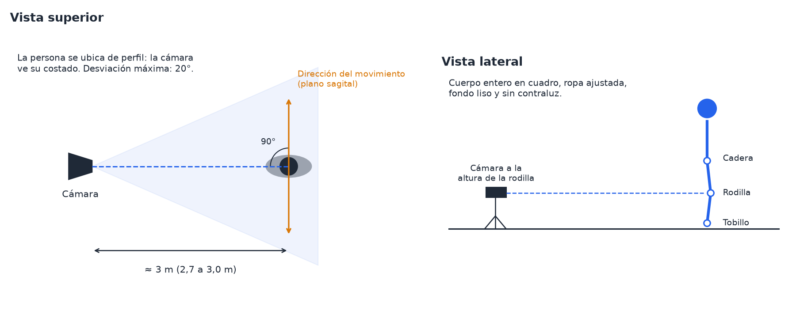{width=85%}

## 3. Primeros pasos

### 3.1 Abrir el sistema

1. Abra el navegador.
2. Escriba la dirección del sistema que le entregó el personal técnico, por ejemplo `http://localhost:5173`.
3. El sistema abre la **Portada** de la interfaz principal (la dirección cambia sola a `/sustentacion`).

### 3.2 Moverse por la interfaz principal

El menú superior tiene tres opciones:

| Opción | Ruta | Contenido |
|--------|------|-----------|
| **Inicio** | `/sustentacion` | Portada: identidad del trabajo y pregunta de investigación |
| **Demostración** | `/sustentacion/demo` | Medición de la rodilla en vivo con la cámara |
| **Resultados** | `/sustentacion/resultados` | Cifras medidas en el trabajo, resultado de la validación externa y lo que no se midió |

En la esquina superior derecha, el enlace **Interfaz completa →** abre las funciones avanzadas (capítulo 8).

### 3.3 Antes de la primera medición: la dirección del servidor

La interfaz principal se conecta al servidor en la dirección guardada en este navegador. Si nadie la ha cambiado,
usa `http://localhost:8000`.

- Si el personal técnico instaló el servidor en esa dirección, no tiene que hacer nada.
- Si le indicaron **otra dirección o puerto**, configúrela una sola vez en **Interfaz completa → Configuración**
  (sección 8.3).

## 4. Portada

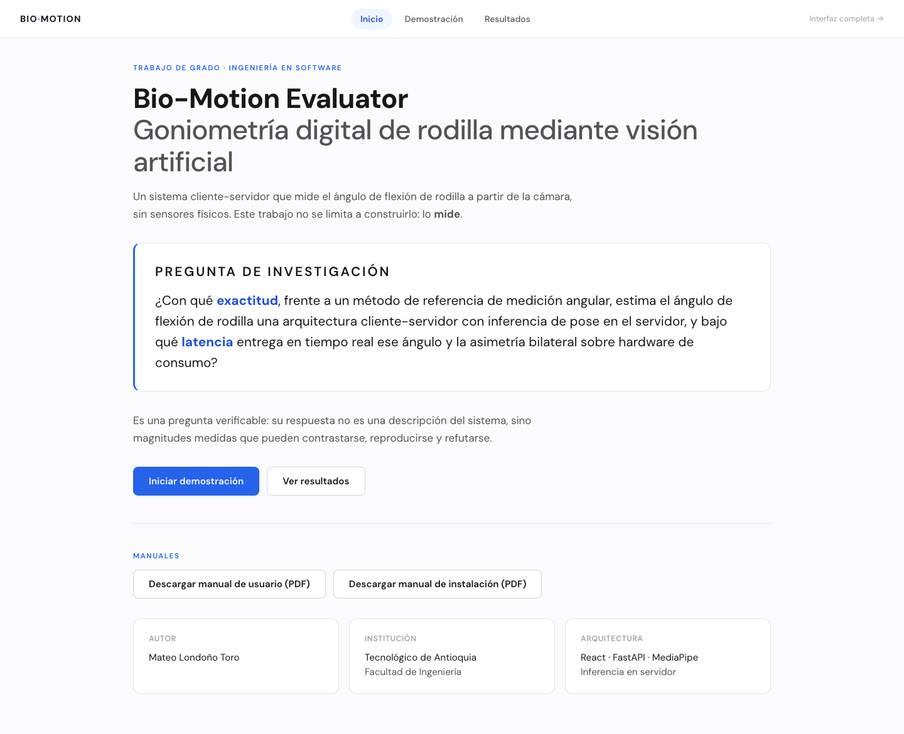{width=95%}

1. Lea la identidad del trabajo y la pregunta de investigación.
2. Haga clic en **Iniciar demostración** para medir (capítulo 5).
3. Haga clic en **Ver resultados** para consultar las cifras del trabajo (capítulo 6).
4. En la sección **Manuales**, haga clic en **Descargar manual de usuario (PDF)** o en **Descargar manual de
   instalación (PDF)** para guardar una copia de los manuales.

## 5. Demostración: medición en vivo

Esta es la pantalla principal de medición. Muestra la imagen de la cámara con el esqueleto y, a la derecha, los
ángulos de ambas rodillas y la asimetría.

### 5.1 Preparar la medición

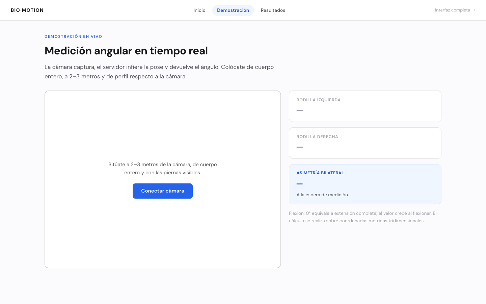{width=95%}

1. En el menú superior, haga clic en **Demostración**.
2. Ubique a la persona **de perfil** respecto a la cámara, de cuerpo entero y con las piernas visibles (sección 2.2).
3. Haga clic en **Conectar cámara**.
4. Si el navegador pregunta, haga clic en **Permitir** para dar acceso a la cámara.
5. Compruebe que la imagen aparece en el recuadro. La imagen se muestra **en espejo**, como un reflejo.

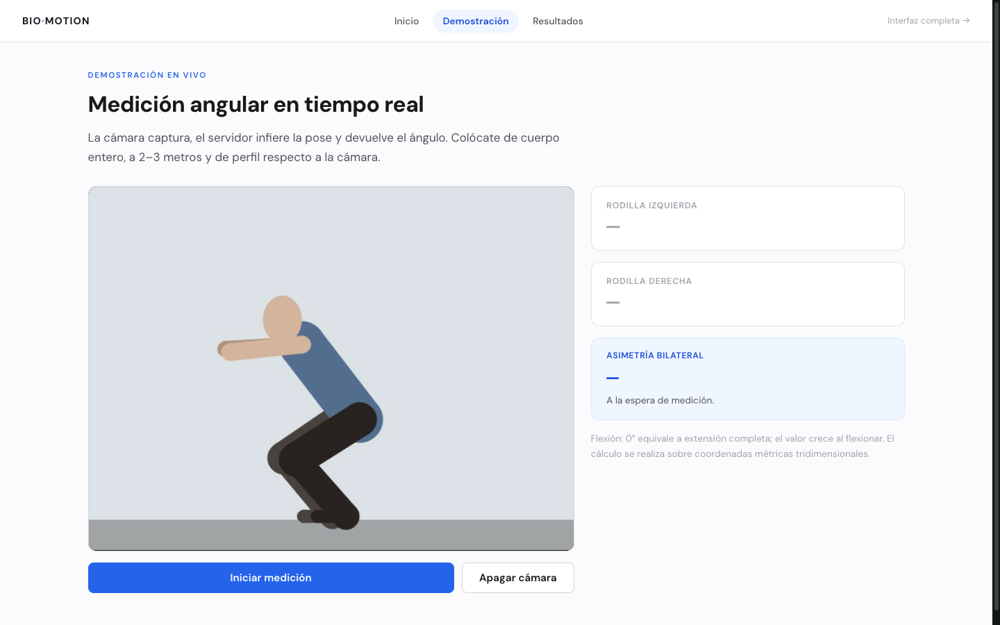{width=95%}

### 5.2 Medir

1. Haga clic en **Iniciar medición**. El borde del recuadro se resalta.
2. Pida a la persona que haga el movimiento (por ejemplo, una sentadilla).
3. Compruebe que el **esqueleto** coincide con el cuerpo, sobre todo en cadera, rodilla y tobillo.
4. Lea a la derecha la **Rodilla izquierda**, la **Rodilla derecha** y la **Asimetría bilateral**.
5. Para terminar, haga clic en **Detener medición**.
6. Para liberar la cámara, haga clic en **Apagar cámara**. Este botón solo se activa cuando la medición está
   detenida.

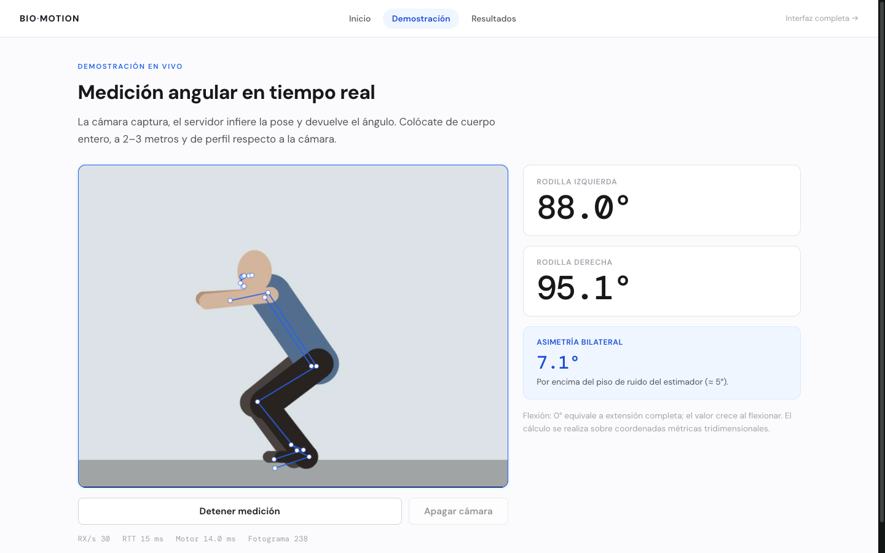{width=95%}

### 5.3 Qué muestra la pantalla

| Elemento | Significado |
|----------|-------------|
| **Rodilla izquierda** / **Rodilla derecha** | Ángulo de flexión en grados. «—» indica que aún no hay datos de esa rodilla |
| **Asimetría bilateral** | Diferencia absoluta entre ambas rodillas, en grados |
| Mensaje bajo la asimetría | «A la espera de medición.», «Dentro del piso de ruido medido (≈ 5°): no es interpretable.» o «Por encima del piso de ruido del estimador (≈ 5°).» |
| Esqueleto azul | Postura estimada por el modelo sobre la imagen |
| Línea inferior | **RX/s** (resultados por segundo), **RTT** (tiempo de ida y vuelta al servidor, en ms), **Motor** (tiempo de cálculo del servidor, en ms) y **Fotograma** |

Si el sistema reconoce automáticamente una sentadilla o una zancada, los recuadros de las rodillas toman color
(verde, amarillo o rojo; sección 7.2). Si no la reconoce, se muestran sin color. En esta pantalla no hay selector
de ejercicio.

### 5.4 Si algo falla

- Si aparece un mensaje en rojo al **Conectar cámara**, revise el permiso de la cámara del navegador.
- Si aparece «No se pudo conectar: …» al **Iniciar medición**, el servidor no responde en la dirección configurada.
  Abra **Interfaz completa → Diagnóstico** (sección 8.4).
- Si las lecturas siguen en «—» durante la medición, el sistema no ve las piernas: corrija el encuadre, la luz o
  la distancia.

## 6. Resultados

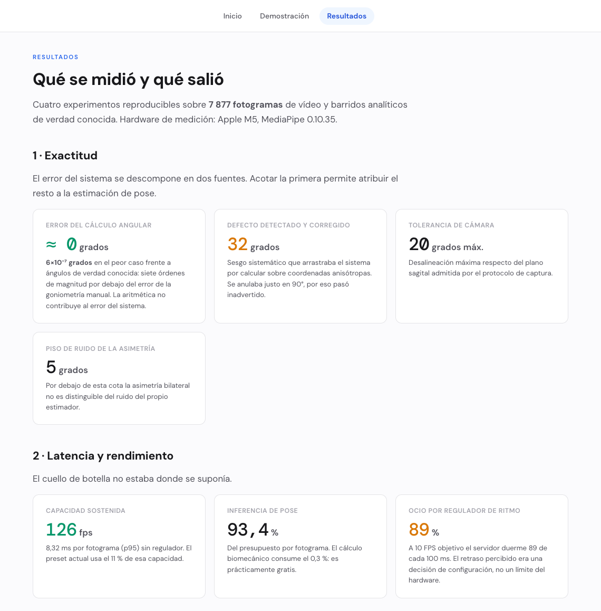{width=85%}

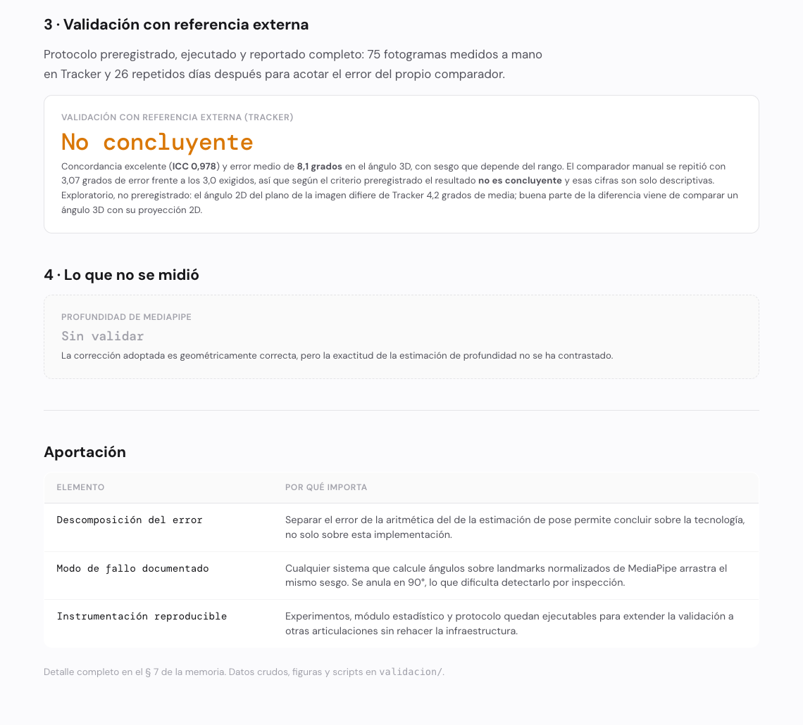{width=85%}

1. En el menú superior, haga clic en **Resultados**.
2. Desplácese hacia abajo para leer las cuatro secciones: **Exactitud**, **Latencia y rendimiento**, **Validación
   con referencia externa** y **Lo que no se midió**.
3. Tenga en cuenta la sección **Validación con referencia externa**: la comparación con video-goniometría manual en
   Tracker se ejecutó y su resultado es **no concluyente según el criterio preregistrado**, porque el comparador
   manual no alcanzó la resolución exigida (3,07° frente a 3,0°). Sus cifras (ICC 0,978; error medio de 8,1° en el
   ángulo 3D) son **solo descriptivas**, y el análisis del ángulo 2D (4,2°) es exploratorio, no preregistrado. Por eso
   el sistema no afirma una exactitud clínica; la asimetría bilateral tampoco está validada.

Esta vista es de solo lectura: no depende de la cámara ni de una medición.

## 7. Cómo leer los resultados

### 7.1 Ángulo de flexión

- **0°**: rodilla completamente extendida (pierna recta).
- El valor **aumenta** al doblar la rodilla. En una sentadilla profunda puede superar los 100°.
- El ángulo se calcula entre el muslo y la pierna (cadera, rodilla y tobillo) usando coordenadas
  tridimensionales que entrega el modelo de pose.
- **Izquierda** y **derecha** se refieren a las piernas de la persona evaluada, según el modelo de pose, no a los
  lados de la pantalla. Recuerde que la imagen se muestra en espejo.

### 7.2 Colores de los ángulos

El color depende del ejercicio reconocido (o fijado, en la interfaz completa).

**Sentadilla (squat):**

| Color | Rango de flexión | Mensaje en la interfaz completa |
|-------|------------------|---------------------------------|
| Verde | 80° a 100° | «Rango óptimo (80–100°) ✓» |
| Amarillo | 60° a 79° | «Ajusta: poca profundidad» |
| Amarillo | 101° a 120° | «Ajusta: mucha profundidad» |
| Rojo | Fuera de los rangos anteriores | «Fuera de rango seguro» |

Durante la subida y la bajada es normal ver valores en rojo: el color se refiere a la profundidad del fondo de la
sentadilla.

**Zancada (lunge):** la rodilla con mayor flexión se toma como **delantera** y la otra como **trasera**.

| Rodilla | Verde | Amarillo |
|---------|-------|----------|
| Delantera | 50° a 90° | 40° a 49° o 91° a 100° |
| Trasera | 0° a 45° | 46° a 65° |

Si ambas rodillas difieren menos de 5°, la zancada no se puede evaluar.

**Sin clasificar u otro ejercicio:** el ángulo se muestra sin color, como valor de referencia.

### 7.3 Asimetría

- **Asimetría bilateral (Demostración):** diferencia absoluta entre rodillas, en grados. Por debajo de 5° no es
  interpretable.
- **Alerta `asymmetry_high` (interfaz completa):** aparece durante una sentadilla cuando la diferencia entre
  rodillas supera el 18 % del ángulo mayor.
- En el plano sagital la pierna más lejana a la cámara queda parcialmente oculta, por lo que su ángulo es menos
  confiable. Tenga en cuenta esta limitación al comparar ambos lados.

### 7.4 Esqueleto superpuesto

- El esqueleto une los puntos del cuerpo que estima el modelo (hombros, codos, muñecas, caderas, rodillas, tobillos
  y pies).
- Si el esqueleto **no coincide** con el cuerpo, especialmente en la rodilla, **no use esa medición**. Corrija la
  iluminación, el encuadre o la ropa y repita.
- Solo se dibujan los puntos que el modelo ve con suficiente seguridad; un punto que falta indica una parte del
  cuerpo poco visible.

## 8. Interfaz completa (funciones avanzadas)

La interfaz completa reúne las funciones que la interfaz principal no incluye. Úsela cuando necesite:

- Analizar **videos pregrabados** guardados en el servidor.
- Comprobar la **conexión** con el servidor (**Diagnóstico**).
- Cambiar la **dirección del servidor** (**Configuración → Conexión**), si no es la predeterminada `:8000`.
- Ver la clasificación del ejercicio, la fase y el conteo de repeticiones durante la medición en vivo.

### 8.1 Entrar y salir

1. En la interfaz principal, haga clic en **Interfaz completa →** (esquina superior derecha). Se abre la pantalla
   **Inicio** de la interfaz completa (ruta `/inicio`).
2. Use el menú lateral: **Inicio**, **Modo sustentación**, **Análisis en vivo**, **Análisis de video**,
   **Diagnóstico** y **Configuración**.
3. Para volver a la interfaz principal, haga clic en **Modo sustentación**.
4. Para ocultar el menú lateral, haga clic en la flecha **‹** junto a «BIO-MOTION»; para mostrarlo, en la flecha
   **›** del borde izquierdo.

### 8.2 Inicio de la interfaz completa

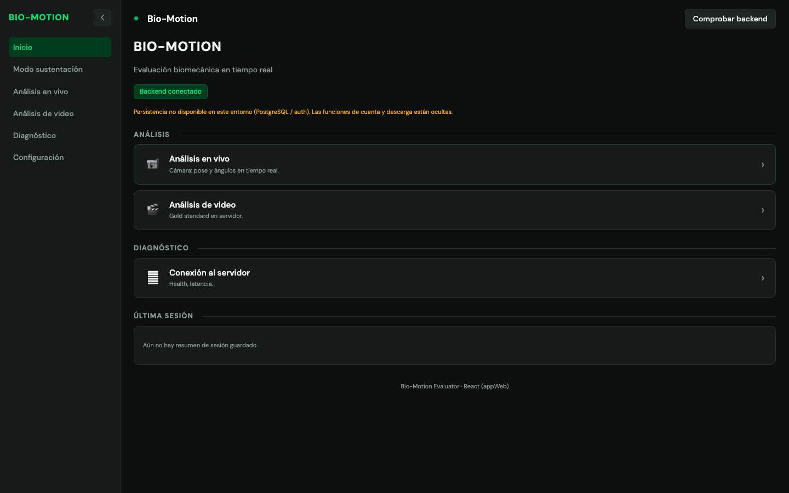{width=95%}

1. Revise la etiqueta de estado: **Backend conectado** (verde) indica que el servidor responde. Si no responde,
   aparece «Verifica el servidor en …» con el enlace **Ir al diagnóstico**.
2. Para repetir la comprobación, haga clic en **Comprobar backend**. El sistema también la repite sola cada 30
   segundos.
3. Use las tarjetas para entrar a **Análisis en vivo**, **Análisis de video** o **Conexión al servidor**.
4. El recuadro **Última sesión** muestra el último fotograma registrado en un análisis de video (fotograma y ángulos
   izquierdo «L» y derecho «R»).

> **Aviso «Persistencia no disponible (PostgreSQL / auth)…».** Significa que este equipo no tiene instalado el
> módulo opcional de cuentas, historial de sesiones y descarga remota de videos. **La medición funciona con
> normalidad.** Este manual no cubre esas funciones opcionales.

### 8.3 Configuración → Conexión

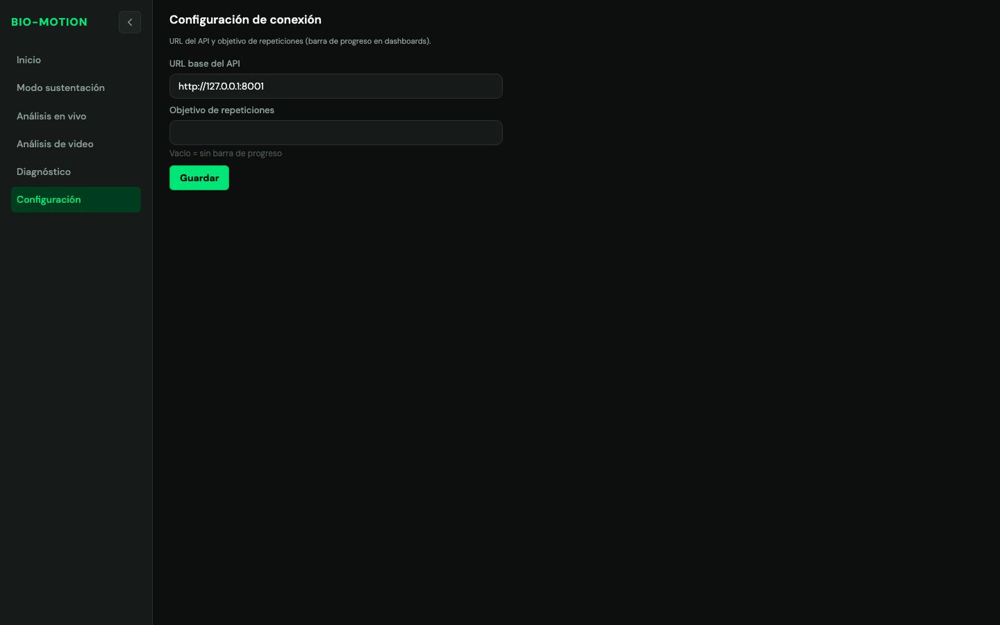{width=95%}

Use esta pantalla cuando el servidor **no** esté en la dirección predeterminada `http://localhost:8000`.

1. En el menú lateral, haga clic en **Configuración**.
2. En **URL base del API**, escriba la dirección del servidor que le entregó el personal técnico.
3. En **Objetivo de repeticiones**, escriba un número si quiere ver un anillo de progreso en el análisis en vivo de
   la interfaz completa. Déjelo vacío si no lo necesita.
4. Haga clic en **Guardar**. Aparece el aviso «Guardado en localStorage.».
5. Vuelva a abrir la pantalla de medición para que tome la nueva dirección. La interfaz principal usa esta misma
   dirección.

> La configuración se guarda **en este navegador y en este equipo**. Si cambia de navegador o de computador,
> debe configurarla otra vez.

### 8.4 Diagnóstico

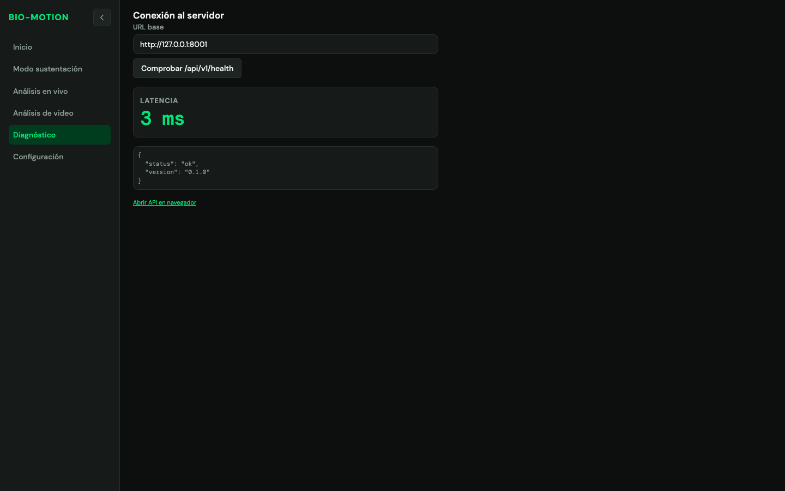{width=95%}

1. En el menú lateral, haga clic en **Diagnóstico**. La comprobación se hace sola al abrir la pantalla.
2. Revise el recuadro **Latencia**: verde si es menor de 100 ms, amarillo entre 100 ms y 499 ms, rojo desde 500 ms.
3. Revise la respuesta del servidor. Si funciona, muestra `"status": "ok"` y la versión.
4. Si aparece un error en rojo, el servidor no respondió en 5 segundos o la dirección es incorrecta. Avise al
   personal técnico.
5. Para probar otra dirección sin guardarla, escríbala en **URL base** y haga clic en **Comprobar
   /api/v1/health**. Para guardarla, use **Configuración** (sección 8.3).

### 8.5 Análisis de video

Use esta pantalla para analizar **videos pregrabados** que el personal técnico haya copiado en el servidor.

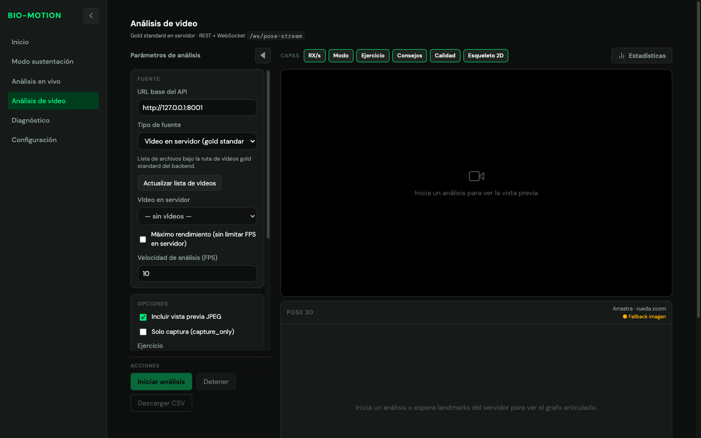{width=95%}

**Preparar el análisis**

1. En el menú lateral, haga clic en **Análisis de video**.
2. En el panel **Parámetros de análisis**, tarjeta **Fuente**, compruebe la **URL base del API**.
3. En **Tipo de fuente**, deje **Vídeo en servidor (gold standard)**.
4. Haga clic en **Actualizar lista de vídeos**.
5. En **Vídeo en servidor**, elija el archivo que quiere analizar.
6. En **Velocidad de análisis (FPS)**, deje `10` o escriba un valor entre `0.5` y `60`.

Si la lista muestra «— sin vídeos —», pida al personal técnico que copie los videos en el servidor.

| Opción | Efecto |
|--------|--------|
| Máximo rendimiento | El servidor procesa los fotogramas tan rápido como pueda, sin limitar los FPS |
| Incluir vista previa JPEG | Muestra la imagen del video procesada por el servidor |
| Solo captura | Solo extrae la pose, sin clasificar el ejercicio ni contar repeticiones |
| Ejercicio | Automático, o una etiqueta fija (idle, squat, lunge) |
| Vista solo esqueleto | Oculta la imagen del video y deja solo el esqueleto. **Útil para proteger la identidad de la persona grabada** |
| Calidad de preview | FPS y calidad de la imagen de vista previa |

Los tipos de fuente **Webcam del servidor** y **Webcam de este equipo** existen para pruebas técnicas. Para medir
con la cámara, use la **Demostración** de la interfaz principal.

**Ejecutar el análisis**

1. Haga clic en **Iniciar análisis**. El botón solo se activa si eligió un video.
2. Observe la vista previa con el esqueleto y el panel inferior de métricas.
3. Para detener antes de que termine, haga clic en **Detener**.
4. Al terminar aparece el mensaje «Análisis completado — puedes iniciar otro» y la ventana **Resumen del
   análisis**.
5. Para guardar los ángulos de cada fotograma, haga clic en **Descargar CSV**. Se descarga
   `bio_motion_frames.csv`.

**Capas y estadísticas**

1. Use los botones de **Capas** para mostrar u ocultar sobre el video: **RX/s**, **Modo**, **Ejercicio**,
   **Consejos**, **Calidad** y **Esqueleto 2D**.
2. Haga clic en **Estadísticas** para ver el tiempo de procesamiento del servidor («Pipeline»), el fotograma
   actual y la barra de **Progreso del vídeo**.
3. Haga clic en **◀** para ocultar el panel y ampliar la vista; para recuperarlo, en **Mostrar parámetros**.
4. El panel **Pose 3D** muestra el esqueleto en tres dimensiones: arrástrelo para girarlo y use la rueda del ratón
   para acercar o alejar.

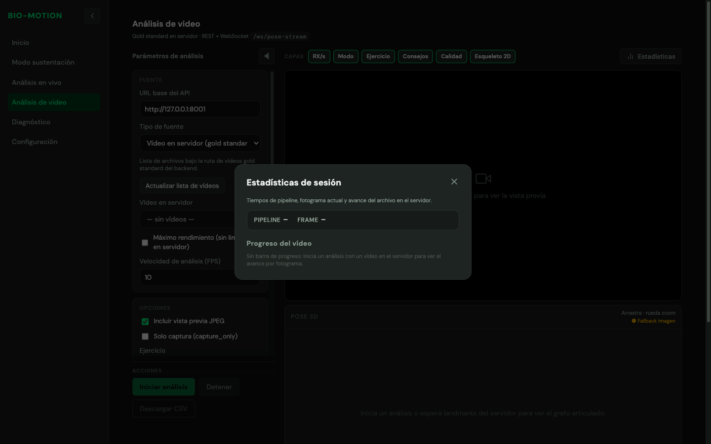{width=80%}

**Resumen del análisis**

| Dato | Significado |
|------|-------------|
| Mejor ángulo logrado | Mayor flexión alcanzada y en qué rodilla |
| Mensaje de simetría | Compara las medias de ambas rodillas; «Buena simetría» si difieren menos de 5° |
| Calidad ROM bilateral | Porcentaje de fotogramas en que **ambas** rodillas estuvieron en el rango verde. 70 % o más: verde; de 40 % a 69 %: amarillo; menos de 40 %: rojo |
| Motor (último fotograma) | Ejercicio, repeticiones, fase y alertas del último fotograma |
| Medias por lado | Promedio del ángulo de cada rodilla |
| Frames procesados | Fotogramas analizados y cuántos tuvieron ambas rodillas detectadas |
| Detalles por frame | Mínimo y máximo de cada rodilla y el fotograma en que ocurrieron |

**Archivo CSV** (`bio_motion_frames.csv`, una fila por fotograma):

| Columna | Contenido |
|---------|-----------|
| `frame` | Número de fotograma |
| `left_knee_flexion_deg` | Flexión de la rodilla izquierda, en grados |
| `right_knee_flexion_deg` | Flexión de la rodilla derecha, en grados |
| `pose_ok` | Indica si se detectó la pose en ese fotograma |

### 8.6 Análisis en vivo (interfaz completa)

Es una versión técnica de la Demostración: mide con la cámara y añade la clasificación del ejercicio, la fase, el
conteo de repeticiones y alertas de calidad. Para el uso habitual, prefiera la **Demostración** (capítulo 5).

> **Advertencia.** Los consejos que aparecen sobre la imagen en esta pantalla («Posición de frente a la cámara»,
> «Hombro, codo y muñeca visibles»…) son genéricos y **contradicen el protocolo de medición de rodilla**. Ignórelos
> y siga las condiciones de la sección 2.2: **de perfil y de cuerpo entero**.

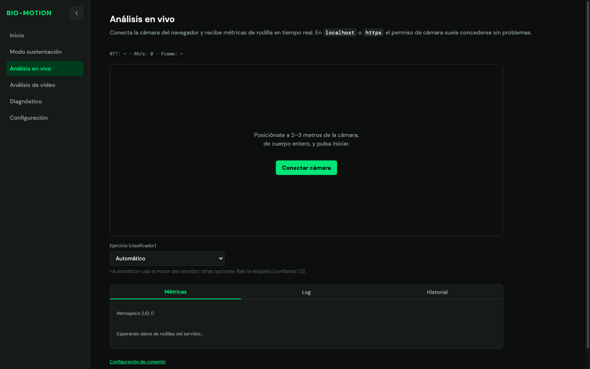{width=95%}

1. Opcional: en **Ejercicio (clasificador)** elija **squat** (sentadilla) o **lunge** (zancada) para fijar la etiqueta;
   deje **Automático** para que el servidor la reconozca. Cámbielo antes de transmitir.
2. Haga clic en **Conectar cámara** y luego en **Iniciar transmisión**.
3. Lea los valores en el panel **Métricas**: ejercicio y confianza, **Fase / reps** con la **Cuenta** de
   repeticiones, y **Rodilla izq.** / **Rodilla der.** con color y mensaje (sección 7.2).
4. La pestaña **Historial** muestra una gráfica con los últimos 30 valores; la pestaña **Log** permanece vacía en
   esta pantalla.
5. Para terminar, haga clic en **DETENER** y luego en **Apagar cámara**.

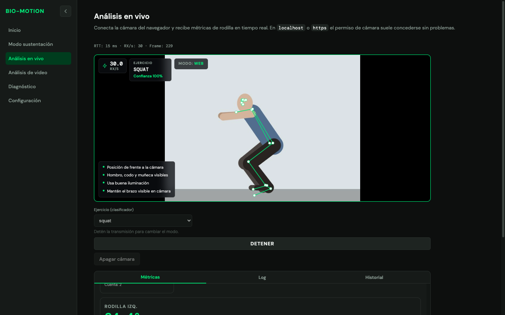{width=95%}

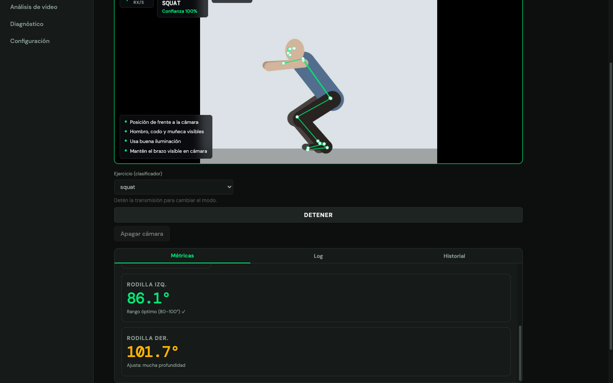{width=95%}

Fases del movimiento en la sentadilla:

| Fase | Significado |
|------|-------------|
| `idle` | En reposo o sin movimiento reconocido |
| `eccentric` | Fase de bajada |
| `concentric` | Fase de subida |

El sistema cuenta una repetición cuando la persona baja (flexión de 55° o más), llega al fondo (80° o más) y vuelve
a extender la rodilla (35° o menos).

## 9. Buenas prácticas

1. Revise las condiciones de grabación (sección 2.2) antes de cada sesión.
2. Haga una medición de prueba en **Demostración** antes de llamar a la persona evaluada; si falla, revise
   **Interfaz completa → Diagnóstico**.
3. Mantenga la cámara fija durante toda la sesión. No la mueva entre repeticiones.
4. Pida a la persona que se quede quieta 2 o 3 segundos al inicio, de perfil y de cuerpo entero.
5. Verifique visualmente el esqueleto antes de anotar un valor.
6. No interprete asimetrías menores de 5°.
7. Use los resultados como apoyo; la decisión clínica es del profesional.
8. **Proteja los datos personales** (Ley 1581 de 2012): pida el consentimiento de la persona antes de grabarla, no
   comparta capturas en las que se le pueda reconocer y use **Vista solo esqueleto** cuando proyecte videos.
9. Al terminar, haga clic en **Detener medición** y luego en **Apagar cámara**.

## 10. Problemas frecuentes y soluciones

| Problema | Causa probable | Solución |
|------------------|------------------|----------------------|
| «No se pudo conectar: …» al iniciar la medición | El servidor está apagado o la dirección es incorrecta | Abra **Interfaz completa → Diagnóstico**. Si hay error, revise la dirección en **Configuración** o avise al personal técnico |
| Mensaje «Cámara: … Usa https o localhost y concede permisos.» | El navegador bloqueó la cámara o la dirección no es segura | Permita la cámara en el candado de la barra de direcciones. Si la dirección no es `localhost` ni `https`, avise al personal técnico |
| La cámara está en uso | Otra aplicación (videollamada) usa la cámara | Cierre la otra aplicación y haga clic de nuevo en **Conectar cámara** |
| Las lecturas siguen en «—» durante la medición | El sistema no ve las piernas | Aleje a la persona hasta que se vea de cuerpo entero, mejore la luz y retire el contraluz |
| El esqueleto salta o se deforma | Ropa holgada, fondo con patrones o poca luz | Use ropa ajustada, un fondo liso y luz uniforme |
| Los recuadros de las rodillas no toman color | El ejercicio no se reconoció | Es normal; los ángulos siguen siendo válidos como referencia |
| Aviso «Persistencia no disponible (PostgreSQL / auth)…» en la interfaz completa | El módulo opcional de cuentas no está instalado | No requiere acción |
| No cambió la dirección del servidor después de guardarla | La pantalla de medición ya estaba abierta | Vuelva a abrir la pantalla de medición |
| La lista de videos muestra «— sin vídeos —» | No hay videos copiados en el servidor | Pida al personal técnico que copie los videos |
| **Iniciar análisis** está deshabilitado | No hay un video elegido o los FPS no son válidos | Elija un video y escriba un FPS entre 0.5 y 60 |
| **Descargar CSV** está deshabilitado | Aún no hay fotogramas registrados | Ejecute un análisis primero |
| Latencia en rojo (500 ms o más) | Red lenta o servidor ocupado | Use una red cableada o avise al personal técnico |

## 11. Glosario

| Término | Definición |
|---------|------------|
| Ángulo de flexión de rodilla | 180° menos el ángulo interno formado por cadera, rodilla y tobillo. 0° es la extensión completa |
| Asimetría bilateral | Diferencia absoluta, en grados, entre la flexión de la rodilla izquierda y la derecha |
| `asymmetry_high` | Alerta de calidad: en sentadilla, la diferencia entre rodillas supera el 18 % del ángulo mayor |
| Backend / servidor / API | Programa que recibe las imágenes, estima la pose y calcula los ángulos |
| Confianza | Seguridad (0 % a 100 %) con la que el sistema reconoce el ejercicio |
| CSV | Archivo de texto con datos separados por comas que se abre en una hoja de cálculo |
| Esqueleto | Dibujo de líneas y puntos que representa la postura estimada |
| Fotograma (frame) | Cada una de las imágenes que componen un video |
| FPS | Fotogramas por segundo |
| Gold standard | Video pregrabado de referencia, guardado en el servidor |
| Interfaz completa | Interfaz oscura con menú lateral (ruta `/inicio`) que reúne las funciones avanzadas |
| Interfaz principal | Interfaz clara (ruta `/sustentacion`) con Portada, Demostración y Resultados |
| Latencia | Tiempo que tarda el servidor en responder, en milisegundos |
| MediaPipe | Biblioteca de visión artificial que estima la posición de 33 puntos del cuerpo |
| Piso de ruido | Variación propia del estimador (≈ 5°); diferencias menores no son interpretables |
| Plano sagital | Plano que divide el cuerpo en izquierda y derecha; la cámara lo ve cuando la persona está de perfil |
| `rom_low` | Alerta de calidad: en la bajada de la sentadilla no se alcanzó la profundidad esperada |
| ROM | Rango de movimiento (*range of motion*) |
| RTT | Tiempo de ida y vuelta de un fotograma entre el navegador y el servidor |
| RX/s | Resultados recibidos del servidor por segundo |
