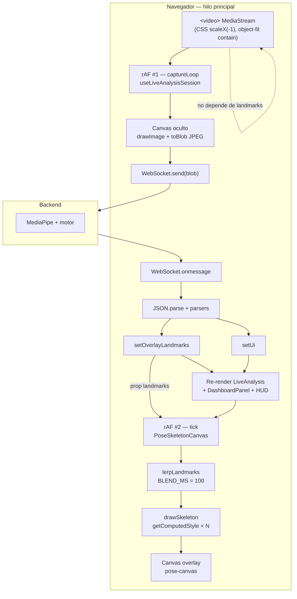

# Diagnóstico: inestabilidad del overlay en análisis en vivo

## Meta

| Campo | Valor |
|-------|--------|
| **Estado** | Mitigado en código (2026-05-25); validación Performance en máquina del evaluador recomendada |
| **Alcance** | Cliente `appWeb` — ruta `/live-analysis`, separación overlay/motor, interpolación `smoothMotion` |
| **Última revisión** | 2026-05-25 |
| **Relacionado** | [`live-camera-analysis.md`](live-camera-analysis.md), [`websocket-pose-stream.md`](websocket-pose-stream.md) |
| **Trazabilidad código** | `useLiveAnalysisSession.ts`, `PoseSkeletonCanvas.tsx`, `landmarkInterpolation.ts`, `LiveAnalysis.tsx` |

## Resumen

Tras implementar la **separación overlay / motor** (landmarks en `overlayLandmarks` + métricas en `ui`) y el **overlay a ~60 FPS** con interpolación (`smoothMotion`), el sistema puede mostrar **saltos de FPS percibidos**, **tilde del preview** y **esqueleto inestable**. Este documento recoge el estado actual del código, el modelo de ejecución (dos bucles `requestAnimationFrame`, doble `setState` por mensaje WebSocket), hipótesis de causa raíz y procedimientos para cerrar el diagnóstico con DevTools.

**Conclusión anticipada (revisión de código):** los síntomas encajan con **contención del hilo principal** (captura JPEG + React + pintura canvas) y con **reinicio del bucle de overlay** cuando cambia la prop `landmarks`, más un **blend de 100 ms** que suele interrumpirse antes de completarse si el servidor entrega ~8–20 poses/s.

---

## Tabla de contenidos

1. [Arquitectura actual](#1-arquitectura-actual)
2. [Respuestas de arquitectura (preguntas clave)](#2-respuestas-de-arquitectura-preguntas-clave)
3. [Código fuente completo](#3-código-fuente-completo)
4. [Integración en `LiveAnalysis.tsx`](#4-integración-en-liveanalysistsx)
5. [Comportamiento observable — hipótesis y checklist](#5-comportamiento-observable--hipótesis-y-checklist)
6. [Métricas DevTools — guía paso a paso](#6-métricas-devtools--guía-paso-a-paso)
7. [Análisis de causas probables](#7-análisis-de-causas-probables)
8. [Matriz de discriminación de hipótesis](#8-matriz-de-discriminación-de-hipótesis)
9. [Mitigaciones propuestas (sin implementar)](#9-mitigaciones-propuestas-sin-implementar)
10. [Plantilla de registro de prueba manual](#10-plantilla-de-registro-de-prueba-manual)

---

## 1. Arquitectura actual

### 1.1 Tres caminos en el cliente

| Camino | Responsable | Ritmo típico | Actualización de UI React |
|--------|-------------|--------------|---------------------------|
| **Captura → WebSocket** | `useLiveAnalysisSession` → `captureLoop` (rAF) → `sendOneFrame` → `toBlob` JPEG | ~60 intentos/s (pestaña visible); envíos efectivos limitados por backpressure | No directa en cada frame; solo flags internos (`blobPendingRef`, `rttQueueRef`) |
| **Motor (servidor)** | Backend `/ws/video` + MediaPipe | Respuesta JSON asíncrona **~8–20/s** (RX/s) | `setUi` en cada `onmessage` |
| **Overlay (esqueleto 2D)** | `PoseSkeletonCanvas` + `smoothMotion` | rAF propio **~60 FPS** + `lerpLandmarks` | `setOverlayLandmarks` en cada `onmessage` con landmarks |

### 1.2 Diagrama de flujo



### 1.3 Constantes relevantes

| Constante | Archivo | Valor | Efecto |
|-----------|---------|-------|--------|
| `MAX_IN_FLIGHT` | `useLiveAnalysisSession.ts` | `3` | No envía JPEG si hay ≥3 RTT pendientes |
| `JPEG_QUALITY` | idem | `0.6` | Tamaño de payload |
| `MAX_SERIES` | idem | `30` | Copia de arrays en cada RX con ambas rodillas |
| `BLEND_MS` | `PoseSkeletonCanvas.tsx` | `100` | Duración objetivo del blend entre poses |
| `MIN_VIS` | idem | `0.4` | Landmarks con visibilidad baja no se dibujan |
| HUD `displayRxPerSec` | hook | intervalo **1000 ms** | Contador de respuestas JSON/s, no FPS de captura ni de overlay |

### 1.4 Separación overlay / motor (diseño intencional)

- **`overlayLandmarks`**: estado React dedicado solo al esqueleto.
- **`ui`**: métricas, ejercicio, reps, series de ángulos, RTT, pipeline, RX/s.
- En **`onmessage`**, si llegan landmarks válidos se llama **`setOverlayLandmarks`** y **siempre** **`setUi`** → **dos commits React por cada frame JSON del servidor** (cuando hay landmarks).

El `<video>` de cámara **no** recibe landmarks como estado; su fluidez depende del compositor/GPU salvo que el hilo principal esté bloqueado.

---

## 2. Respuestas de arquitectura (preguntas clave)

### 2.1 ¿`PoseSkeletonCanvas` tiene su propio `requestAnimationFrame`?

**Sí**, cuando `smoothMotion={true}`:

- Un `useEffect` arranca `tick()` que encadena `requestAnimationFrame` indefinidamente.
- En cada tick: calcula `eased`, llama `lerpLandmarks`, luego `paint()` → `drawSkeleton`.

**No comparte** el identificador ni el callback del rAF del hook de sesión.

### 2.2 ¿Comparte el rAF del hook?

**No.** El hook define **`captureLoop`**:

```typescript
const captureLoop = () => {
  if (wsRef.current?.readyState === WebSocket.OPEN) {
    sendOneFrame();
  }
  captureRafRef.current = requestAnimationFrame(captureLoop);
};
```

Ese bucle solo intenta capturar/enviar JPEG; no pinta el esqueleto.

**Implicación:** con pestaña visible pueden coexistir **~120 callbacks rAF/s** (60 captura + 60 pintura), más trabajo async de `toBlob` y mensajes WS.

### 2.3 ¿`overlayLandmarks` es prop directa o ref?

| Aspecto | Implementación actual |
|---------|------------------------|
| Almacenamiento | `useState<LandmarkMap[] \| null>` en el hook |
| Consumo | Prop **`landmarks={overlayLandmarks}`** en `PoseSkeletonCanvas` |
| Ref interno en canvas | `targetRef`, `fromRef`, `displayRef` solo para interpolación, **no** sustituyen el estado del hook |

**No** se usa el patrón “ref + imperativo sin re-render” para landmarks entrantes del servidor.

### 2.4 ¿Se actualiza con `setState` en cada `onmessage`?

**Sí**, cuando `parseLandmarksJson` devuelve un array:

```typescript
if (landmarks != null) {
  setOverlayLandmarks(landmarks);
}
setUi((p) => { /* ... */ });
```

Además, el segundo `useEffect` de `PoseSkeletonCanvas` declara dependencia **`[smoothMotion, landmarks]`**, por lo que **cada nueva referencia de array** del padre:

1. Ejecuta cleanup: `cancelAnimationFrame(rafId)`.
2. Vuelve a registrar un bucle rAF nuevo.

Esto es independiente de si el contenido numérico de los landmarks cambió poco: React compara la **referencia** del array devuelto por el parser en cada mensaje.

---

## 3. Código fuente completo

> Rutas relativas al repositorio. Si el código diverge, priorizar el archivo en disco y actualizar este spec.

### 3.1 `appWeb/src/hooks/useLiveAnalysisSession.ts` (377 líneas)

<details>
<summary>Ver código completo</summary>

```typescript
import { useCallback, useEffect, useRef, useState } from 'react';
import { statusForKneeFlexionInContext } from '../lib/angleFormatter';
import {
  parseDeg,
  parseFrameIndex,
  parseKneesMap,
  parseLandmarksJson,
  parseQualityFlags,
  pipelineTotalMs,
  poseWsErrorMessage,
  type LandmarkMap,
} from '../lib/poseWsPayload';
import { buildVideoWebSocketUri, normalizeApiBaseUrl } from '../lib/wsUri';

const MAX_SERIES = 30;
/** Máximo de JPEG enviados sin respuesta JSON aún (backpressure). */
const MAX_IN_FLIGHT = 3;
const JPEG_QUALITY = 0.6;

export interface LiveAnalysisUiState {
  cameraOn: boolean;
  transmitting: boolean;
  error: string | null;
  knees: Record<string, unknown> | null;
  frameIndex: number;
  exerciseLabel: string;
  exerciseConfidence: number;
  repPhase: string;
  repCount: number;
  qualityFlags: string[];
  leftDeg: number | null;
  rightDeg: number | null;
  leftSeries: number[];
  rightSeries: number[];
  displayRxPerSec: number;
  serverRttMs: number | null;
  serverPipelineTotalMs: number | null;
}

const initialLive = (): Omit<LiveAnalysisUiState, 'cameraOn'> => ({
  transmitting: false,
  error: null,
  knees: null,
  frameIndex: -1,
  exerciseLabel: 'unknown',
  exerciseConfidence: 0,
  repPhase: 'idle',
  repCount: 0,
  qualityFlags: [],
  leftDeg: null,
  rightDeg: null,
  leftSeries: [],
  rightSeries: [],
  displayRxPerSec: 0,
  serverRttMs: null,
  serverPipelineTotalMs: null,
});

export function useLiveAnalysisSession(
  apiBase: string,
  captureOnly = true,
  forcedExerciseLabel: string | null = null,
) {
  const [ui, setUi] = useState<LiveAnalysisUiState>(() => ({
    cameraOn: false,
    ...initialLive(),
  }));
  const videoRef = useRef<HTMLVideoElement>(null);
  const streamRef = useRef<MediaStream | null>(null);
  const canvasRef = useRef<HTMLCanvasElement | null>(null);
  const wsRef = useRef<WebSocket | null>(null);
  const captureRafRef = useRef<number | null>(null);
  const fpsTimerRef = useRef<ReturnType<typeof setInterval> | null>(null);
  const rxCountRef = useRef(0);
  const rttQueueRef = useRef<number[]>([]);
  const blobPendingRef = useRef(false);
  const lastLRef = useRef<number | null>(null);
  const lastRRef = useRef<number | null>(null);
  const [videoContentAspect, setVideoContentAspect] = useState<number | null>(null);
  /** Solo overlay (cámara); el motor actualiza métricas en `ui` por otro canal. */
  const [overlayLandmarks, setOverlayLandmarks] = useState<LandmarkMap[] | null>(null);

  const ensureCanvas = () => {
    if (!canvasRef.current) canvasRef.current = document.createElement('canvas');
    return canvasRef.current;
  };

  const stopTimers = useCallback(() => {
    if (captureRafRef.current != null) {
      cancelAnimationFrame(captureRafRef.current);
      captureRafRef.current = null;
    }
    if (fpsTimerRef.current) {
      clearInterval(fpsTimerRef.current);
      fpsTimerRef.current = null;
    }
    blobPendingRef.current = false;
    rxCountRef.current = 0;
  }, []);

  const syncVideoAspect = useCallback(() => {
    const v = videoRef.current;
    if (!v || v.videoWidth < 2 || v.videoHeight < 2) return;
    setVideoContentAspect(v.videoWidth / v.videoHeight);
  }, []);

  const stopCamera = useCallback(() => {
    streamRef.current?.getTracks().forEach((t) => t.stop());
    streamRef.current = null;
    const v = videoRef.current;
    if (v) {
      v.onloadedmetadata = null;
      v.srcObject = null;
    }
    setVideoContentAspect(null);
    setUi((p) => ({ ...p, cameraOn: false }));
  }, []);

  const startCamera = useCallback(async () => {
    setUi((p) => ({ ...p, error: null }));
    try {
      const stream = await navigator.mediaDevices.getUserMedia({
        video: { facingMode: 'user', width: { ideal: 640 }, height: { ideal: 480 } },
        audio: false,
      });
      streamRef.current = stream;
      const v = videoRef.current;
      if (v) {
        v.srcObject = stream;
        v.onloadedmetadata = () => syncVideoAspect();
        await v.play();
        syncVideoAspect();
      }
      setUi((p) => ({ ...p, cameraOn: true }));
    } catch (e) {
      setUi((p) => ({
        ...p,
        error: `Cámara: ${e}. Usa https o localhost y concede permisos.`,
        cameraOn: false,
      }));
    }
  }, [syncVideoAspect]);

  const resetStreamState = useCallback(() => {
    stopTimers();
    rttQueueRef.current = [];
    lastLRef.current = null;
    lastRRef.current = null;
    setOverlayLandmarks(null);
    setUi((p) => ({
      ...p,
      ...initialLive(),
      cameraOn: p.cameraOn,
    }));
  }, [stopTimers]);

  const stopTransmit = useCallback(() => {
    const ws = wsRef.current;
    wsRef.current = null;
    if (ws && (ws.readyState === WebSocket.OPEN || ws.readyState === WebSocket.CONNECTING)) {
      try {
        ws.close();
      } catch {
        /* noop */
      }
    }
    resetStreamState();
  }, [resetStreamState]);

  const sendOneFrame = useCallback(() => {
    const ws = wsRef.current;
    const v = videoRef.current;
    if (!ws || ws.readyState !== WebSocket.OPEN || !v || v.readyState < 2) return;
    if (rttQueueRef.current.length >= MAX_IN_FLIGHT || blobPendingRef.current) return;

    const canvas = ensureCanvas();
    const w = v.videoWidth;
    const h = v.videoHeight;
    if (w < 2 || h < 2) return;
    canvas.width = w;
    canvas.height = h;
    const ctx = canvas.getContext('2d');
    if (!ctx) return;
    // JPEG sin espejar: mismas coordenadas que el frame del <video>; el espejo es solo visual (CSS) + overlay (mirrorHorizontal).
    ctx.drawImage(v, 0, 0, w, h);
    blobPendingRef.current = true;
    canvas.toBlob(
      (blob) => {
        blobPendingRef.current = false;
        if (!blob || !wsRef.current || wsRef.current.readyState !== WebSocket.OPEN) return;
        rttQueueRef.current.push(performance.now());
        wsRef.current.send(blob);
      },
      'image/jpeg',
      JPEG_QUALITY,
    );
  }, []);

  const startTransmit = useCallback(async () => {
    const v = videoRef.current;
    if (!v || !streamRef.current) {
      setUi((p) => ({ ...p, error: 'Conecta la cámara primero.' }));
      return;
    }

    const url = buildVideoWebSocketUri(normalizeApiBaseUrl(apiBase));
    const ws = new WebSocket(url);

    try {
      await new Promise<void>((resolve, reject) => {
        const t = window.setTimeout(() => reject(new Error('timeout conexión')), 8000);
        ws.onopen = () => {
          clearTimeout(t);
          resolve();
        };
        ws.onerror = () => {
          clearTimeout(t);
          reject(new Error('WebSocket'));
        };
      });
    } catch (e) {
      setUi((p) => ({ ...p, error: `No se pudo conectar: ${e}` }));
      try {
        ws.close();
      } catch {
        /* noop */
      }
      return;
    }

    ws.binaryType = 'arraybuffer';
    const init: Record<string, unknown> = { analyze_pose: true, capture_only: captureOnly };
    const forced = (forcedExerciseLabel ?? '').trim().toLowerCase();
    if (forced) init.forced_exercise_label = forced;
    ws.send(JSON.stringify(init));
    wsRef.current = ws;

    setUi((p) => ({
      ...p,
      ...initialLive(),
      cameraOn: p.cameraOn,
      transmitting: true,
      error: null,
    }));
    lastLRef.current = null;
    lastRRef.current = null;
    rttQueueRef.current = [];
    rxCountRef.current = 0;
    stopTimers();

    fpsTimerRef.current = setInterval(() => {
      const n = rxCountRef.current;
      rxCountRef.current = 0;
      setUi((p) => (p.transmitting ? { ...p, displayRxPerSec: n } : p));
    }, 1000);

    const captureLoop = () => {
      if (wsRef.current?.readyState === WebSocket.OPEN) {
        sendOneFrame();
      }
      captureRafRef.current = requestAnimationFrame(captureLoop);
    };
    captureRafRef.current = requestAnimationFrame(captureLoop);

    ws.onmessage = (ev) => {
      if (typeof ev.data !== 'string') return;
      let map: Record<string, unknown>;
      try {
        map = JSON.parse(ev.data) as Record<string, unknown>;
      } catch {
        return;
      }
      const err = poseWsErrorMessage(map);
      if (err != null) {
        setUi((p) => ({ ...p, error: err }));
        stopTransmit();
        return;
      }

      let rtt: number | null = null;
      if (rttQueueRef.current.length > 0) {
        const t0 = rttQueueRef.current.shift()!;
        rtt = Math.round(performance.now() - t0);
      }
      rxCountRef.current++;

      const landmarks = parseLandmarksJson(map.landmarks);
      const knees = parseKneesMap(map.knees);
      const frameIndex = parseFrameIndex(map.frame_index);
      const exerciseLabel = typeof map.exercise_label === 'string' ? map.exercise_label : 'unknown';
      const exerciseConfidence =
        typeof map.exercise_confidence === 'number' ? map.exercise_confidence : 0;
      const repPhase = typeof map.rep_phase === 'string' ? map.rep_phase : 'idle';
      const repCount = typeof map.rep_count === 'number' ? Math.trunc(map.rep_count) : 0;
      const qualityFlags = parseQualityFlags(map.quality_flags);
      const pipeMs = pipelineTotalMs(map);
      const leftDeg = parseDeg(knees?.left_knee_flexion_angle_deg);
      const rightDeg = parseDeg(knees?.right_knee_flexion_angle_deg);

      if (landmarks != null) {
        setOverlayLandmarks(landmarks);
      }

      setUi((p) => {
        const next: LiveAnalysisUiState = {
          ...p,
          serverRttMs: rtt ?? p.serverRttMs,
          serverPipelineTotalMs: pipeMs ?? p.serverPipelineTotalMs,
          frameIndex,
          exerciseLabel,
          exerciseConfidence,
          repPhase,
          repCount,
          qualityFlags,
          leftDeg,
          rightDeg,
        };
        if (knees != null) {
          next.knees = knees;
        }
        if (leftDeg != null) lastLRef.current = leftDeg;
        if (rightDeg != null) lastRRef.current = rightDeg;
        if (lastLRef.current != null && lastRRef.current != null) {
          const ls = [...p.leftSeries, lastLRef.current];
          const rs = [...p.rightSeries, lastRRef.current];
          while (ls.length > MAX_SERIES) ls.shift();
          while (rs.length > MAX_SERIES) rs.shift();
          next.leftSeries = ls;
          next.rightSeries = rs;
        }
        return next;
      });
    };

    ws.onclose = () => {
      if (wsRef.current !== ws) return;
      wsRef.current = null;
      stopTimers();
      rttQueueRef.current = [];
      setUi((p) => ({
        ...p,
        ...initialLive(),
        cameraOn: p.cameraOn,
      }));
    };
  }, [apiBase, captureOnly, forcedExerciseLabel, sendOneFrame, stopTimers, stopTransmit]);

  useEffect(() => {
    return () => {
      const w = wsRef.current;
      wsRef.current = null;
      w?.close();
      stopTimers();
      streamRef.current?.getTracks().forEach((t) => t.stop());
    };
  }, [stopTimers]);

  return {
    ui,
    overlayLandmarks,
    videoRef,
    videoContentAspect,
    startCamera,
    stopCamera,
    startTransmit,
    stopTransmit,
    statusForLeft: (ex: string) =>
      ui.leftDeg != null
        ? statusForKneeFlexionInContext(ui.leftDeg, true, ex, ui.rightDeg)
        : ('neutral' as const),
    statusForRight: (ex: string) =>
      ui.rightDeg != null
        ? statusForKneeFlexionInContext(ui.rightDeg, false, ex, ui.leftDeg)
        : ('neutral' as const),
  };
}
```

</details>

**Fragmentos críticos (referencia rápida):**

| Líneas aprox. | Qué hace |
|---------------|----------|
| 81 | `useState` para `overlayLandmarks` |
| 170–197 | `sendOneFrame`: `drawImage` + `toBlob` async |
| 251–255 | `setInterval` 1 s → `displayRxPerSec` |
| 257–263 | `captureLoop` con rAF |
| 300–332 | Doble actualización en `onmessage` |
| 323–329 | Copia `leftSeries` / `rightSeries` en cada RX |

### 3.2 `appWeb/src/components/PoseSkeletonCanvas.tsx` (219 líneas)

<details>
<summary>Ver código completo</summary>

```typescript
import { useEffect, useRef } from 'react';
import { lerpLandmarks } from '../lib/landmarkInterpolation';
import { POSE_CONNECTIONS } from '../lib/poseTopology';
import type { LandmarkMap } from '../lib/poseWsPayload';

const MIN_VIS = 0.4;
/** Duración de blend entre poses del servidor (~10–20 RX/s → ~50–100 ms entre muestras). */
const BLEND_MS = 100;

function cssVar(name: string, fallback: string): string {
  if (typeof document === 'undefined') return fallback;
  const v = getComputedStyle(document.documentElement).getPropertyValue(name).trim();
  return v || fallback;
}

function hexToRgba(hex: string, alpha: number): string {
  const m = /^#?([0-9a-f]{6})$/i.exec(hex.trim());
  if (!m) return hex;
  const n = parseInt(m[1], 16);
  const r = (n >> 16) & 255;
  const g = (n >> 8) & 255;
  const b = n & 255;
  return `rgba(${r},${g},${b},${alpha})`;
}

/** Rectángulo donde vive el vídeo con ``object-fit: contain`` (width/height del contenido). */
function videoContentRect(
  cw: number,
  ch: number,
  aspectWidthOverHeight: number | null | undefined,
): { ox: number; oy: number; dw: number; dh: number } {
  if (
    aspectWidthOverHeight == null ||
    !Number.isFinite(aspectWidthOverHeight) ||
    aspectWidthOverHeight <= 0
  ) {
    return { ox: 0, oy: 0, dw: cw, dh: ch };
  }
  const ar = aspectWidthOverHeight;
  if (cw / ch > ar) {
    const dh = ch;
    const dw = dh * ar;
    return { ox: (cw - dw) / 2, oy: 0, dw, dh };
  }
  const dw = cw;
  const dh = dw / ar;
  return { ox: 0, oy: (ch - dh) / 2, dw, dh };
}

function landmarkPoint(
  lm: LandmarkMap,
  ox: number,
  oy: number,
  dw: number,
  dh: number,
  mirror: boolean,
): { x: number; y: number } | null {
  const i = lm.index;
  if (typeof i !== 'number') return null;
  const vis = lm.visibility;
  if (typeof vis === 'number' && vis < MIN_VIS) return null;
  const x = lm.x;
  const y = lm.y;
  if (typeof x !== 'number' || typeof y !== 'number') return null;
  const nx = mirror ? 1 - x : x;
  return { x: ox + nx * dw, y: oy + y * dh };
}

function drawSkeleton(
  canvas: HTMLCanvasElement,
  wrap: HTMLDivElement,
  lm: LandmarkMap[] | null,
  mirror: boolean,
  contentAspect: number | null | undefined,
) {
  const dpr = window.devicePixelRatio || 1;
  const { clientWidth: cw, clientHeight: ch } = wrap;
  if (cw < 2 || ch < 2) return;

  canvas.width = Math.round(cw * dpr);
  canvas.height = Math.round(ch * dpr);
  canvas.style.width = `${cw}px`;
  canvas.style.height = `${ch}px`;

  const ctx = canvas.getContext('2d');
  if (!ctx) return;
  ctx.setTransform(dpr, 0, 0, dpr, 0, 0);
  ctx.clearRect(0, 0, cw, ch);

  if (!lm || lm.length === 0) return;

  const { ox, oy, dw, dh } = videoContentRect(cw, ch, contentAspect);

  const points = new Map<number, { x: number; y: number }>();
  for (const m of lm) {
    const i = m.index;
    if (typeof i !== 'number') continue;
    const p = landmarkPoint(m, ox, oy, dw, dh, mirror);
    if (p) points.set(i, p);
  }

  const lineRgb = cssVar('--bm-skeleton-line', '#00e676');
  ctx.strokeStyle = lineRgb.startsWith('#') ? hexToRgba(lineRgb, 0.85) : lineRgb;
  ctx.lineWidth = 2;
  ctx.lineCap = 'round';
  for (const [a, b] of POSE_CONNECTIONS) {
    const pa = points.get(a);
    const pb = points.get(b);
    if (!pa || !pb) continue;
    ctx.beginPath();
    ctx.moveTo(pa.x, pa.y);
    ctx.lineTo(pb.x, pb.y);
    ctx.stroke();
  }

  ctx.fillStyle = cssVar('--bm-skeleton-joint', '#ffffff');
  ctx.strokeStyle = hexToRgba(cssVar('--bm-skeleton-joint-border', '#00e676'), 0.35);
  for (const p of points.values()) {
    ctx.beginPath();
    ctx.arc(p.x, p.y, 3.5, 0, Math.PI * 2);
    ctx.fill();
    ctx.stroke();
  }
}

export function PoseSkeletonCanvas({
  landmarks,
  mirrorHorizontal = false,
  contentAspect,
  smoothMotion = false,
}: {
  landmarks: LandmarkMap[] | null;
  mirrorHorizontal?: boolean;
  contentAspect?: number | null;
  smoothMotion?: boolean;
}) {
  const canvasRef = useRef<HTMLCanvasElement>(null);
  const wrapRef = useRef<HTMLDivElement>(null);
  const targetRef = useRef<LandmarkMap[] | null>(null);
  const fromRef = useRef<LandmarkMap[] | null>(null);
  const displayRef = useRef<LandmarkMap[] | null>(null);
  const blendStartRef = useRef(0);
  const mirrorRef = useRef(mirrorHorizontal);
  const aspectRef = useRef(contentAspect);

  mirrorRef.current = mirrorHorizontal;
  aspectRef.current = contentAspect;

  useEffect(() => {
    if (!smoothMotion) {
      displayRef.current = landmarks;
      const canvas = canvasRef.current;
      const wrap = wrapRef.current;
      if (canvas && wrap) drawSkeleton(canvas, wrap, landmarks, mirrorRef.current, aspectRef.current);
      return;
    }

    if (!landmarks || landmarks.length === 0) {
      targetRef.current = null;
      fromRef.current = null;
      displayRef.current = null;
      const canvas = canvasRef.current;
      const wrap = wrapRef.current;
      if (canvas && wrap) drawSkeleton(canvas, wrap, null, mirrorRef.current, aspectRef.current);
      return;
    }

    fromRef.current = displayRef.current ?? landmarks;
    targetRef.current = landmarks;
    blendStartRef.current = performance.now();
  }, [landmarks, smoothMotion]);

  useEffect(() => {
    const canvas = canvasRef.current;
    const wrap = wrapRef.current;
    if (!canvas || !wrap) return;

    const paint = (lm: LandmarkMap[] | null) => {
      drawSkeleton(canvas, wrap, lm, mirrorRef.current, aspectRef.current);
    };

    if (!smoothMotion) {
      paint(landmarks);
      const ro = new ResizeObserver(() => paint(landmarks));
      ro.observe(wrap);
      return () => ro.disconnect();
    }

    let rafId = 0;
    const tick = () => {
      const target = targetRef.current;
      if (target && target.length > 0) {
        const elapsed = performance.now() - blendStartRef.current;
        const linear = Math.min(1, elapsed / BLEND_MS);
        const eased = linear * (2 - linear);
        displayRef.current = lerpLandmarks(fromRef.current, target, eased);
      }
      paint(displayRef.current);
      rafId = requestAnimationFrame(tick);
    };
    rafId = requestAnimationFrame(tick);

    const ro = new ResizeObserver(() => paint(displayRef.current));
    ro.observe(wrap);
    return () => {
      cancelAnimationFrame(rafId);
      ro.disconnect();
    };
  }, [smoothMotion, landmarks]);

  return (
    <div ref={wrapRef} className="pose-canvas-wrap">
      <canvas ref={canvasRef} className="pose-canvas" aria-hidden />
    </div>
  );
}
```

</details>

Puntos de costo:

| Función / bloque | Costo potencial |
|------------------|-----------------|
| `cssVar()` | `getComputedStyle(document.documentElement)` en **cada** `drawSkeleton` (líneas y articulaciones) |
| `drawSkeleton` | Reasigna `canvas.width` / `canvas.height` cada pintura → realloc buffer |
| `useEffect` `[landmarks, smoothMotion]` | Reinicia blend (`blendStartRef`) |
| `useEffect` `[smoothMotion, landmarks]` | **Reinicia rAF** al cambiar `landmarks` |
| `tick` + `lerpLandmarks` | Allocación de objetos ~60/s |

### 3.3 `appWeb/src/lib/landmarkInterpolation.ts` (45 líneas)

```typescript
import type { LandmarkMap } from './poseWsPayload';

function lerpNum(a: unknown, b: unknown, t: number): number | undefined {
  const na = typeof a === 'number' ? a : Number(a);
  const nb = typeof b === 'number' ? b : Number(b);
  if (Number.isNaN(na) || Number.isNaN(nb)) return typeof b === 'number' ? b : undefined;
  return na + (nb - na) * t;
}

/** Interpola landmarks por `index` entre dos poses (t ∈ [0, 1]). */
export function lerpLandmarks(
  from: LandmarkMap[] | null,
  to: LandmarkMap[] | null,
  t: number,
): LandmarkMap[] | null {
  if (!to || to.length === 0) return null;
  const clamped = Math.max(0, Math.min(1, t));
  if (!from || from.length === 0 || clamped >= 1) {
    return to.map((m) => ({ ...m }));
  }

  const fromByIndex = new Map<number, LandmarkMap>();
  for (const m of from) {
    const i = m.index;
    if (typeof i === 'number') fromByIndex.set(i, m);
  }

  return to.map((tgt) => {
    const i = tgt.index;
    if (typeof i !== 'number') return { ...tgt };
    const src = fromByIndex.get(i);
    if (!src) return { ...tgt };
    const out: LandmarkMap = { ...tgt };
    const x = lerpNum(src.x, tgt.x, clamped);
    const y = lerpNum(src.y, tgt.y, clamped);
    const z = lerpNum(src.z, tgt.z, clamped);
    const vis = lerpNum(src.visibility, tgt.visibility, clamped);
    if (x != null) out.x = x;
    if (y != null) out.y = y;
    if (z != null) out.z = z;
    if (vis != null) out.visibility = vis;
    return out;
  });
}
```

- Con `t >= 1` devuelve copia de `to` (`to.map((m) => ({ ...m }))`).
- Con `t < 1` construye un `Map` y un array nuevo por landmark.

A **60 FPS** esto genera presión de **GC** si el blend no se estabiliza.

### 3.4 Relación temporal blend vs servidor

Con **RX/s = R**, el intervalo medio entre poses nuevas es **1000/R ms**:

| RX/s | Intervalo medio | vs `BLEND_MS = 100` |
|------|-----------------|---------------------|
| 8 | 125 ms | Nueva pose **antes** de completar blend |
| 10 | 100 ms | Borde: blend y RX coinciden |
| 15 | 67 ms | Blend reiniciado ~1,5 veces antes de t=1 |
| 20 | 50 ms | Blend reiniciado ~2 veces antes de t=1 |

Easing usado: `eased = linear * (2 - linear)` (ease-out cuadrático suave).

Al llegar un mensaje WS, el primer `useEffect` hace:

```typescript
fromRef.current = displayRef.current ?? landmarks;
targetRef.current = landmarks;
blendStartRef.current = performance.now();
```

Si `displayRef` estaba a mitad de blend, el nuevo `from` es la pose **interpolada actual**, no la pose anterior del servidor → comportamiento correcto en teoría, pero el **reinicio del segundo `useEffect`** por cambio de `landmarks` puede cancelar frames de animación y producir micro-saltos visibles.

---

## 4. Integración en `LiveAnalysis.tsx`

Fragmentos relevantes del archivo completo (`appWeb/src/pages/LiveAnalysis/LiveAnalysis.tsx`, 207 líneas).

### 4.1 Hook y métricas en caption

```tsx
const {
  ui,
  overlayLandmarks,
  videoRef,
  videoContentAspect,
  startCamera,
  stopCamera,
  startTransmit,
  stopTransmit,
  statusForLeft,
  statusForRight,
} = useLiveAnalysisSession(apiBase, false, forcedLabel);

// ...

<p className="bm-caption bm-mono">
  RTT: {ui.serverRttMs != null ? `${ui.serverRttMs} ms` : '—'} · RX/s: {ui.displayRxPerSec} · Frame:{' '}
  {ui.frameIndex >= 0 ? ui.frameIndex : '—'}
</p>
```

### 4.2 Preview: video, overlay, HUD

```tsx
<div className="preview-stack" style={{ aspectRatio: '4/3', maxHeight: 420, /* ... */ }}>
  <video
    ref={videoRef}
    playsInline
    muted
    autoPlay
    style={{
      position: 'absolute',
      inset: 0,
      width: '100%',
      height: '100%',
      objectFit: 'contain',
      transform: 'scaleX(-1)',
      display: ui.cameraOn ? 'block' : 'none',
    }}
  />
  {ui.transmitting && (
    <PoseSkeletonCanvas
      landmarks={overlayLandmarks}
      mirrorHorizontal={true}
      contentAspect={videoContentAspect}
      smoothMotion
    />
  )}
  <VideoPreviewOverlays
    visible={ui.cameraOn}
    hudSections={{ exercise: ui.transmitting }}
    modeLabel="WEB"
    rxPerSec={ui.transmitting ? ui.displayRxPerSec : 0}
    rateSuffix="RX/s"
    bullets={LIVE_POSE_TIPS}
    qualityFlags={ui.transmitting ? ui.qualityFlags : []}
    exerciseLabel={ex}
    exerciseConfidence={ui.exerciseConfidence}
  />
</div>
```

### 4.3 Panel de métricas (también re-renderiza con `setUi`)

```tsx
<DashboardPanel
  running={ui.transmitting}
  captureOnly={false}
  targetRepGoal={targetRepGoal}
  exerciseLabel={ex}
  leftDeg={ui.leftDeg}
  rightDeg={ui.rightDeg}
  displayRxPerSec={ui.displayRxPerSec}
  leftSeries={ui.leftSeries}
  rightSeries={ui.rightSeries}
  /* ... */
/>
```

**Observaciones de integración:**

- El overlay solo se monta si `ui.transmitting` → primer frame de transmisión puede no tener landmarks aún.
- `mirrorHorizontal={true}` alinea con JPEG **sin espejar** y video con `scaleX(-1)`.
- `DashboardPanel` recibe `ui` completo y se re-renderiza en cada `setUi`.
- Caption superior: `RTT`, `RX/s`, `frameIndex` — también en cada `setUi`.

---

## 5. Comportamiento observable — hipótesis y checklist

Completar en prueba real (sustentación / desarrollo). Las columnas **Hipótesis (código)** son predicciones; **Observado** queda para el evaluador.

### 5.1 ¿Dónde ocurre el tilde?

| Síntoma | Hipótesis (código) | Cómo aislar |
|---------|-------------------|-------------|
| Solo esqueleto | Re-render + reinicio rAF + blend cortado; video en capa aparte | DevTools: ocultar canvas con CSS temporalmente; video debería seguir fluido |
| Solo video | Saturación main thread (`toBlob`, React) | Misma prueba inversa: `smoothMotion={false}` o sin montar overlay |
| Ambos | Contención global del hilo principal | Performance: long tasks coincidentes con ambos |

**Observado:** _____________________

### 5.2 ¿Saltos periódicos o aleatorios?

| Patrón | Origen posible |
|--------|----------------|
| Cada ~1 s | Normal en **RX/s** del HUD (entero, `setInterval` 1000 ms) |
| Cada ~50–125 ms | Llegada de frames WS (~8–20/s) + reinicio blend |
| Cada ~16 ms (60 Hz) | Menos probable como “salto” visible; sería jitter de frame pacing |
| Aleatorio | RTT variable, GC, picos de `toBlob` |

**Observado:** _____________________

### 5.3 ¿HUD RX/s estable?

- **RX/s** en UI: valor entero actualizado **una vez por segundo**; puede pasar de 8 a 15 de golpe sin ser bug.
- **RTT** y ángulos: actualizados en **cada** `setUi` (~8–20/s) → pueden verse más “nerviosos” que RX/s.

**Observado:** _____________________

### 5.4 ¿Desde el primer frame o tras calentamiento?

| Fase | Qué esperar |
|------|-------------|
| Inicio transmisión | Overlay monta; primeros JSON pueden no traer landmarks |
| 30–60 s | Más presión GC por `lerpLandmarks` y series `leftSeries`/`rightSeries` |
| Pestaña en background | rAF pausado → menos envíos y menos pintura |

**Observado:** _____________________

### 5.5 ¿Movimiento lento vs rápido?

- **Rápido:** mayor delta entre poses consecutivas → blend reiniciado con saltos geométricos más visibles.
- **Lento:** poses más parecidas → interpolación más estable si no reinicia el efecto rAF.

**Observado:** _____________________

---

## 6. Métricas DevTools — guía paso a paso

### 6.1 Requisitos previos

1. Backend levantado con `/ws/video` operativo.
2. `appWeb` en `localhost` o `https` (permiso cámara).
3. Pestaña **activa** (rAF pausado en background).
4. Cerrar extensiones pesadas si se busca línea base.

### 6.2 Performance (5 s de análisis en vivo)

1. Abrir DevTools → **Performance**.
2. Opcional: activar **Screenshots** y **Memory**.
3. Pulgar **Record**, iniciar o continuar transmisión, moverse frente a cámara **5 s**, detener.
4. Revisar:

| Señal | Qué buscar | Interpretación si aparece |
|-------|------------|---------------------------|
| **Long tasks** (barras rojas >50 ms) | Frecuencia y stack | `toBlob`, `JSON.parse`, React commit, `drawImage`, `lerpLandmarks` |
| **Main** thread busy | % tiempo en Scripting | >70% sostenido → sensación de tilde |
| **FPS** chart | Caídas bajo 30 | Correlacionar con long tasks |
| **Raster / Paint** | Picos altos | `drawSkeleton` + resize canvas |

**Anotar:**

- Número de long tasks en 5 s: _______
- Intervalo medio entre ellas: _______
- Stack dominante (primer frame útil): _______

### 6.3 Forced reflow / layout thrashing

En el mismo perfil o en **Performance insights**:

- Filtrar eventos **Layout** / **Recalculate style**.
- Si el stack incluye `getComputedStyle` desde `cssVar` en `drawSkeleton` → **hasta 4 lecturas de estilo por frame** a 60 FPS (línea + relleno articulaciones × borde).

**¿Aparece Forced reflow?** Sí / No — detalle: _______

### 6.4 Console

Durante 30 s de transmisión:

| Tipo | Acción |
|------|--------|
| **Errors** | Copiar mensaje completo |
| **Warnings** | WS, React strict mode, permisos |
| **Verbose** | Opcional: log temporal de `frameIndex` si se añade en dev |

**Errores/warnings:** _______

### 6.5 React DevTools (opcional)

- **Highlight updates when components render**.
- Observar si `LiveAnalysis`, `DashboardPanel` y `PoseSkeletonCanvas` parpadean ~8–20/s.
- Si parpadean al ritmo WS → confirma hipótesis de re-render por `setState`.

---

## 7. Análisis de causas probables

### 7.1 Causa A — Doble `setState` por mensaje WebSocket

**Mecanismo:** cada JSON válido → `setOverlayLandmarks` + `setUi` → hasta **2 commits** React; el árbol incluye panel de métricas con series que copian arrays.

**Síntoma esperado:** esqueleto + números del panel “a tirones”; CPU en Scripting.

**Severidad estimada:** Alta.

### 7.2 Causa B — Reinicio del rAF del overlay (`landmarks` en deps)

**Mecanismo:**

```typescript
}, [smoothMotion, landmarks]);
```

Cleanup cancela el frame pendiente; nuevo efecto arranca otro bucle.

**Síntoma esperado:** micro-pausas o saltos del esqueleto sincronizados con RX, no con el reloj de pantalla.

**Severidad estimada:** Alta.

### 7.3 Causa C — Blend interrumpido (100 ms vs 8–20 RX/s)

**Mecanismo:** nueva pose antes de `t = 1`; easing reiniciado.

**Síntoma esperado:** esqueleto “persigue” poses discretas del servidor con inercia irregular.

**Severidad estimada:** Media–Alta.

### 7.4 Causa D — Contención con rAF de captura + `toBlob`

**Mecanismo:** ~60 intentos/s de captura; cada uno puede disparar encode JPEG en canvas oculto; compite con 60 paints/s del overlay.

**Síntoma esperado:** video y overlay degradan juntos; long tasks en encode.

**Severidad estimada:** Media (depende de hardware).

### 7.5 Causa E — `getComputedStyle` en hot path

**Mecanismo:** lectura de variables CSS del documento en cada `drawSkeleton`.

**Síntoma esperado:** reflow/style recalc en perfil; costo fijo ~60/s.

**Severidad estimada:** Baja–Media.

### 7.6 Causa F — Presión de GC (`lerpLandmarks` + series)

**Mecanismo:** miles de objetos pequeños por segundo.

**Síntoma esperado:** empeora tras 30–60 s; long tasks cortas periódicas (GC).

**Severidad estimada:** Media.

---

## 8. Matriz de discriminación de hipótesis

| Hipótesis | Prueba mínima | Si se confirma |
|-----------|---------------|----------------|
| **A** Re-render React | React Highlight updates; o pasar landmarks por **ref** sin `setOverlayLandmarks` (rama dev) | `useRef` + batch; memoizar panel |
| **B** Reinicio rAF | Quitar `landmarks` de deps del efecto de pintura; solo actualizar refs en efecto corto | Un solo rAF por montaje |
| **C** Blend | Subir `BLEND_MS` a 150–200 en dev; o throttle de targets a 30 Hz | Ajustar duración vs RX/s medido |
| **D** Captura | Throttle temporal `sendOneFrame` a 20 Hz | Desacoplar captura de rAF pantalla |
| **E** cssVar | Cachear colores al montar | Eliminar `getComputedStyle` del tick |
| **F** GC | Performance → Memory; grabar 60 s | Pool de objetos o interpolar in-place |

---

## 9. Mitigaciones propuestas (sin implementar)

Orden sugerido por impacto / riesgo:

1. **Overlay imperativo:** `overlayLandmarksRef` actualizado en `onmessage`; **sin** `setOverlayLandmarks`; el canvas lee ref en su rAF.
2. **rAF estable:** efecto de pintura con deps `[]` o solo `[smoothMotion]`; efecto separado solo actualiza `targetRef` / `blendStartRef`.
3. **Batch métricas:** `setUi` a 10–15 Hz o `startTransition` para series; landmarks fuera del commit crítico.
4. **Cache estilos** en `PoseSkeletonCanvas` (montaje / theme change).
5. **Captura desacoplada:** `setInterval(50)` o rAF con `lastCaptureMs` en lugar de 60 intentos/s de `toBlob`.
6. **Ajuste `BLEND_MS`** según RX/s medido en demo: `BLEND_MS ≈ (1000 / RX_s) * 1.2`.

Cada cambio debe validarse contra [`live-camera-analysis.md`](live-camera-analysis.md) y prueba manual HU-03.

---

## 10. Plantilla de registro de prueba manual

Copiar y rellenar tras sesión en laboratorio:

```markdown
### Sesión de diagnóstico overlay — YYYY-MM-DD

- **Máquina / navegador:** 
- **RX/s típico (HUD):** 
- **RTT típico (ms):** 
- **Tilde en:** video / esqueleto / ambos
- **Saltos:** periódicos (cada ___ ms) / aleatorios
- **Desde inicio o tras ___ s:** 
- **Lento vs rápido:** diferencia sí / no
- **Long tasks en 5 s:** cantidad ___ ; stack ___
- **Forced reflow:** sí / no
- **Console errors:** 
- **Conclusión:** causa A / B / C / D / E / F (combinación)
- **Siguiente paso:** 
```

---

## Implementación (índice de archivos)

| Pieza | Ruta |
|-------|------|
| Hook sesión | `appWeb/src/hooks/useLiveAnalysisSession.ts` |
| Overlay 2D | `appWeb/src/components/PoseSkeletonCanvas.tsx` |
| Interpolación | `appWeb/src/lib/landmarkInterpolation.ts` |
| Página | `appWeb/src/pages/LiveAnalysis/LiveAnalysis.tsx` |
| Spec funcional | `docs/spec/live-camera-analysis.md` |

---

## Incidencias y decisiones (registro)

| ID | Tema | Estado |
|----|------|--------|
| INC-OVERLAY-001 | Doble rAF (captura + pintura) en misma pestaña | **Mitigado:** `CAPTURE_HZ=30`, rAF overlay deps `[smoothMotion]` |
| INC-OVERLAY-002 | `landmarks` en deps reinicia rAF de `PoseSkeletonCanvas` | **Mitigado:** detección en `tick` + `landmarksRef` |
| INC-OVERLAY-003 | `setOverlayLandmarks` + `setUi` por RX | **Mitigado:** `overlayLandmarksRef`, solo `setUi` |
| INC-OVERLAY-004 | `BLEND_MS` vs intervalo real del servidor | **Mitigado:** `adaptiveBlendMsRef` |

### Verificación post-fix (pendiente en laboratorio)

Completar plantilla §10 tras prueba en `/live-analysis` con DevTools Performance (5 s) y caso 6 reconexión del spec [`live-camera-analysis.md`](live-camera-analysis.md).

---

## Próxima revisión

Actualizar este documento cuando:

1. Se rellene la plantilla §10 con datos Performance reales.
2. Se implemente un parche de mitigación (referenciar commit y actualizar tabla INC-*).
3. Cambie el contrato o constantes en `live-camera-analysis.md`.
