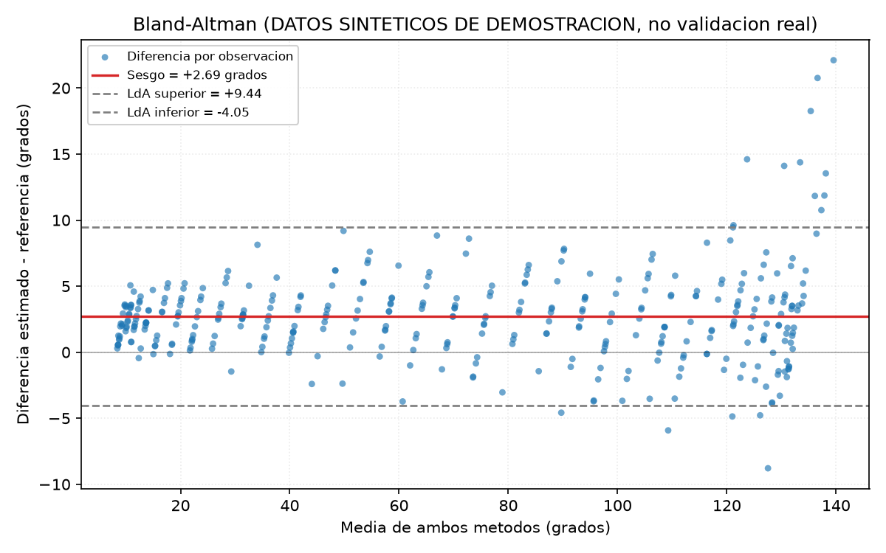

# Ejemplo de salida del instrumento de acuerdo (DATOS SINTÉTICOS)

> **AVISO. ESTOS NO SON RESULTADOS DE VALIDACIÓN REAL.**
>
> Las dos series comparadas en este documento fueron **generadas por computador**
> con parámetros de error conocidos e inyectados a propósito. No proceden de
> ningún goniómetro, de ninguna medición en Kinovea ni de ningún sujeto humano.
>
> El único objetivo de este archivo es demostrar que el módulo
> `validacion/analisis/acuerdo.py` funciona de punta a punta y que recupera los
> parámetros que se le inyectaron. **No debe citarse en la memoria como evidencia
> de la exactitud del sistema Bio-Motion Evaluator.** Los resultados reales se
> producirán con este mismo instrumento cuando se ejecute el protocolo de
> validación física con el método de referencia.

## 1. Qué se está demostrando

Se comparan dos series angulares sintéticas de sentadilla: una que hace de
**método de referencia** y otra que hace de **sistema estimado**, degradada con
errores conocidos. Si el instrumento es correcto, debe devolver esos mismos
errores. La comparación entre lo inyectado y lo recuperado es la verificación.

## 2. Datos sintéticos generados

- Semilla de reproducibilidad: `numpy.random.default_rng(42)`.
- Frecuencia de muestreo simulada: 25 Hz.
- 6 repeticiones de 2.6 s (390 muestras en total).
- Rango angular de referencia: 8 a 132 grados de flexión.
- Sesgo inyectado: +2.5 grados (el sistema sobreestima).
- Ruido gaussiano heterocedástico: sigma de 1.4 grados en extensión hasta 4.4 grados en flexión máxima.
- 6 valores atípicos de +14 grados (pérdidas puntuales de seguimiento).
- 8 fotogramas sin detección (NaN), que el módulo debe descartar.

## 3. Verificación: parámetro inyectado frente a parámetro recuperado

| Parámetro | Inyectado | Recuperado por el módulo |
| --- | --- | --- |
| Sesgo (grados) | +2.50 | +2.69 |
| Desviación estándar de las diferencias (grados) | ~2.90 (media del sigma variable) | 3.44 |
| Fotogramas descartados | 8 | 8 |
| Pares analizados | 382 | 382 |

La desviación recuperada supera ligeramente la media del sigma inyectado porque los
valores atípicos añaden dispersión; esa misma separación se observa entre MAE y RMSE.

## 4. Resultado completo del análisis

### Acuerdo entre serie de referencia y serie estimada (sintéticas)

| Métrica | Valor |
| --- | --- |
| Pares analizados (n) | 382 |
| Pares descartados (sin dato) | 8 |
| MAE (grados) | 3.31 |
| RMSE (grados) | 4.37 |
| Sesgo (grados) | +2.69 |
| IC 95 % del sesgo (grados) | [+2.35, +3.04] |
| Desviación estándar de las diferencias (grados) | 3.44 |
| Límites de acuerdo 95 % (grados) | [-4.05, +9.44] |
| ICC(2,1) | 0.995 (IC 95 % [0.979, 0.998]) |
| Interpretación ICC (Koo y Li 2016) | excelente |
| r de Pearson | 0.997 (p < 1e-300) |

#### Error por tramo angular de referencia

| Tramo (grados) | n | MAE | RMSE | Sesgo | Desv. tipica de las diferencias |
| --- | --- | --- | --- | --- | --- |
| [0, 30) | 99 | 2.48 | 2.88 | +2.46 | 1.51 |
| [30, 60) | 69 | 3.08 | 3.68 | +2.88 | 2.32 |
| [60, 90) | 59 | 3.41 | 4.08 | +2.88 | 2.91 |
| [90, 120) | 72 | 3.32 | 4.26 | +2.16 | 3.70 |
| [120, 180] | 83 | 4.40 | 6.25 | +3.15 | 5.43 |

## 5. Lectura del desglose por tramo

El ruido se inyectó creciente con el ángulo y los valores atípicos se situaron en
flexión profunda. El desglose lo detecta: la desviación típica de las diferencias
crece de forma monótona desde el tramo de extensión hasta el de flexión máxima, y
el RMSE hace lo mismo. El MAE muestra la tendencia de forma menos nítida porque
está dominado por el sesgo constante, que actúa igual en todo el rango; por eso el
instrumento reporta las tres métricas juntas y no solo el MAE.

Este es exactamente el tipo de hallazgo que el instrumento debe hacer visible sobre
los datos reales: el error de una estimación de pose monocular no tiene por qué ser
uniforme a lo largo del recorrido articular.

## 6. Figura de Bland-Altman



La nube muestra el sesgo positivo constante, el abanico de dispersión que se abre
hacia ángulos altos (heterocedasticidad) y los valores atípicos que sobrepasan el
límite superior de acuerdo, concentrados en la zona de flexión profunda.

## 7. Reproducción

```bash
cd "<raiz del repositorio>"
python validacion/analisis/demostracion_sintetica.py
```

La semilla es fija, de modo que la ejecución reproduce exactamente estos números.
