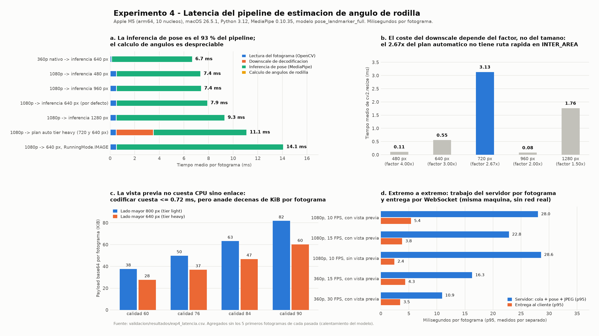

# Experimento 4 - Latencia y rendimiento del pipeline

**Bloque 2 del trabajo de grado "Bio-Motion Evaluator".**
Fecha de ejecución: 2026-08-29.

Este experimento responde la mitad de latencia de la pregunta de investigación:

> ¿Con qué exactitud, frente a métodos de referencia de medición angular, y **bajo qué
> latencia extremo a extremo** puede una arquitectura cliente-servidor con inferencia de
> pose en el servidor estimar el ángulo de flexión de rodilla y la asimetría bilateral en
> tiempo real sobre hardware de consumo?

La latencia sólo es interpretable junto al hardware que la produce, así que se declara primero.

## Plataforma de medición

| Elemento | Valor |
|---|---|
| Equipo | Apple M5 (arm64), 10 núcleos lógicos (4 de rendimiento + 6 de eficiencia) |
| Sistema | macOS-26.5.1-arm64-arm-64bit |
| Python | 3.12.13 (cpython) |
| MediaPipe | 0.10.35, Pose Landmarker, delegado CPU |
| Modelo | `pose_landmarker_full.task` (9 MB) |
| OpenCV | 5.0.0 |
| Servidor | FastAPI + uvicorn, `127.0.0.1:8077`, cliente y servidor en la misma máquina |
| Vídeos | `SentadillaProfunda.mp4` (1920x1080, 25.07 fps, 183 fotogramas) y `Running.mp4` (640x360, 29.99 fps) |

Todos los agregados descartan los **5 primeros fotogramas** de cada pasada (creación del
landmarker y calentamiento del modelo), y todos los tiempos están en milisegundos.

## Diseño del experimento

**Nivel A - desglose por etapa, sin servidor.** `validacion/experimentos/exp4a_latencia_etapas.py`
cronometra por fotograma: lectura con OpenCV, downscale de decodificación, inferencia de pose
(`analyze_frame_bgr_video`), cálculo de ángulos (`knee_angles_from_landmarks`) y codificación
JPEG de la vista previa (`_encode_preview_jpeg`, la misma función que usa el router WebSocket).

**Nivel B - latencia extremo a extremo real.** `validacion/experimentos/exp4b_latencia_e2e.py`
levanta el backend con uvicorn, espera a `GET /api/v1/health` y ejecuta la matriz de
configuraciones que propone `docs/guias/reporte_latencia_frames_ws_pose_stream.md` usando el
perfilador ya existente `backend/scripts/profile_pose_stream.py` (con `diagnostics: true`),
más un cliente WebSocket propio que mide la latencia de entrega comparando el reloj del
cliente con el campo `server_ts_ms` del payload.

### Diferencias metodológicas declaradas

1. **Barrido de resolución.** El servicio reduce la imagen al lado mayor `_TARGET_MAX_DIM`
   (640 px por defecto) dentro de `app/services/pose/mediapipe.py`. Para barrer la
   resolución sin modificar código de producción, el script **reasigna esa constante del
   módulo en tiempo de ejecución** y restaura su valor al terminar cada pasada. El fotograma
   se entrega siempre en resolución nativa, de modo que el coste de `cv2.resize` queda
   dentro de la etapa de inferencia igual que en producción.
2. **Separación inferencia / ángulos.** `extract_pose_bgr_video` es exactamente la
   composición de `analyze_frame_bgr_video` y `knee_angles_from_landmarks`. El script llama
   a las dos por separado para poder medirlas por separado; la suma de ambas etapas equivale
   al coste de `extract_pose_bgr_video`.
3. **Codificación JPEG en pasada aparte.** El barrido de calidad se hace en una pasada sin
   inferencia, para no contaminar el cronómetro de MediaPipe con cuatro codificaciones por
   fotograma.
4. **Reloj compartido.** La latencia de entrega del Nivel B es válida como latencia de una
   sola vía porque cliente y servidor comparten reloj (misma máquina). Un despliegue con red
   real añadiría el tiempo de transporte, que aquí no se mide.
5. **Base de datos.** El backend arrancó sin PostgreSQL: `init_engine()` construye el motor
   SQLAlchemy de forma perezosa y `/ws/pose-stream` no toca la base de datos. `GET
   /api/v1/health` respondió `200 OK`, así que el Nivel B se ejecutó completo.

---

## Nivel A - Desglose por etapa

### A.1 Reparto medio por etapa y configuración

Media en ms por fotograma y porcentaje sobre el total de la configuración.

| Configuración | Lectura | Downscale | Inferencia | Ángulos | **Total** |
|---|---|---|---|---|---|
| 360p nativo -> inferencia 640 px | 0.103 (1.5 %) | 0.000 (0.0 %) | 6.576 (98.1 %) | 0.024 (0.4 %) | **6.70** |
| 1080p -> inferencia 480 px | 0.498 (6.8 %) | 0.001 (0.0 %) | 6.855 (92.9 %) | 0.024 (0.3 %) | **7.38** |
| 1080p -> inferencia 960 px | 0.497 (6.7 %) | 0.001 (0.0 %) | 6.903 (93.0 %) | 0.025 (0.3 %) | **7.43** |
| 1080p -> inferencia 640 px (por defecto) | 0.498 (6.3 %) | 0.001 (0.0 %) | 7.418 (93.4 %) | 0.026 (0.3 %) | **7.94** |
| 1080p -> inferencia 1280 px | 0.478 (5.1 %) | 0.000 (0.0 %) | 8.834 (94.6 %) | 0.024 (0.3 %) | **9.34** |
| 1080p -> plan auto tier heavy (720 y 640 px) | 0.486 (4.4 %) | 3.019 (27.1 %) | 7.595 (68.3 %) | 0.026 (0.2 %) | **11.13** |
| 1080p -> 640 px, RunningMode.IMAGE | 0.500 (3.5 %) | 0.001 (0.0 %) | 13.572 (96.2 %) | 0.030 (0.2 %) | **14.10** |

### A.2 Percentiles del tiempo total por fotograma (sin vista previa)

| Configuración | n | Media | p50 | p95 | p99 | Máx | FPS sostenibles (1000/media) |
|---|---|---|---|---|---|---|---|
| 360p nativo -> inferencia 640 px | 178 | 6.70 | 6.69 | 6.96 | 7.15 | 7.16 | 149.2 |
| 1080p -> inferencia 480 px | 178 | 7.38 | 7.36 | 7.55 | 7.82 | 8.71 | 135.6 |
| 1080p -> inferencia 960 px | 178 | 7.43 | 7.40 | 7.62 | 7.97 | 8.31 | 134.7 |
| 1080p -> inferencia 640 px (por defecto) | 178 | 7.94 | 7.89 | 8.32 | 8.43 | 8.53 | 125.9 |
| 1080p -> inferencia 1280 px | 178 | 9.34 | 9.29 | 9.74 | 9.82 | 9.88 | 107.1 |
| 1080p -> plan auto tier heavy (720 y 640 px) | 178 | 11.13 | 10.99 | 11.60 | 11.73 | 11.80 | 89.9 |
| 1080p -> 640 px, RunningMode.IMAGE | 178 | 14.10 | 14.09 | 14.63 | 15.04 | 15.30 | 70.9 |

La inferencia de pose absorbe entre el 68 % y el 98 % del presupuesto por fotograma en
todas las configuraciones. El cálculo de ángulos de rodilla —el objeto mismo de la
investigación— cuesta **0.026 ms de media**, es decir el
0.33 % del total: **el modelo biomecánico es
computacionalmente gratuito; lo que cuesta es obtener los landmarks**.

### A.3 Efecto de la resolución de inferencia

El resultado más contraintuitivo del experimento: **la resolución de entrada casi no cambia
el coste de la inferencia**. El total por fotograma sube de 7.38 ms (480 px) a 9.34 ms
(1280 px), pero esa diferencia no la produce la red neuronal sino el `cv2.resize` previo.
La micro-medición que lo aísla:

| Operación (fuente 1920x1080, INTER_AREA) | Factor de reducción | n | Media | p95 |
|---|---|---|---|---|
| cvtColor BGR -> RGB | - | 55 | 0.182 | 0.211 |
| resize a 480 px de lado mayor | 4.000x | 55 | 0.112 | 0.133 |
| resize a 640 px de lado mayor | 3.000x | 55 | 0.554 | 0.801 |
| resize a 720 px de lado mayor | 2.667x | 55 | 3.134 | 3.560 |
| resize a 960 px de lado mayor | 2.000x | 55 | 0.080 | 0.105 |
| resize a 1280 px de lado mayor | 1.500x | 55 | 1.764 | 2.164 |

El coste del redimensionado no crece con el tamaño de destino sino con el **factor** de
reducción: 0.080 ms hacia 960 px (factor 2, potencia de dos), 0.554 ms
hacia 640 px (factor 3, entero) y **3.134 ms hacia 720 px** (39
veces más que hacia 960 px, que además produce una imagen mayor) porque el factor 2.667x no
es entero y OpenCV pierde su ruta rápida de INTER_AREA.

Restando ese coste a la etapa de inferencia queda el coste neto de la red neuronal, que es
prácticamente constante:

| Lado mayor de inferencia | Etapa de inferencia | Menos el resize | **Coste neto de la red** |
|---|---|---|---|
| 480 px | 6.855 | 0.112 | 6.743 |
| 640 px | 7.418 | 0.554 | 6.864 |
| 960 px | 6.903 | 0.080 | 6.823 |
| 1280 px | 8.834 | 1.764 | 7.070 |
| 360p nativo (sin resize) | 6.576 | 0.000 | 6.576 |

El coste neto varía sólo entre 6.58 y 7.07 ms
(8 % de rango) mientras la resolución
de entrada varía casi 3x. **Queda demostrado que el parámetro `_TARGET_MAX_DIM` no controla
el coste de la inferencia, sólo el del redimensionado previo**: el Pose Landmarker escala
internamente a la resolución fija de entrada de la red. Elegir 640 px en lugar de 960 px no
ahorra cómputo; cuesta 0.47 ms de más.

Esto tiene una consecuencia directa sobre el código de producción:

`vision/stream_processing_plan.py` fija `decode_max_side = 720` para el tier *heavy*, y esa
decisión **añade 3.02 ms por fotograma (27 %
del total de esa configuración) sin reducir el coste de la inferencia**, porque MediaPipe
volvería a reducir a 640 px de todas formas. Es el único caso del experimento en el que una
heurística de optimización empeora el rendimiento de forma medible.

### A.4 Modo VIDEO frente a modo IMAGE

| Modo | Inferencia media (ms) | Total medio (ms) |
|---|---|---|
| `RunningMode.VIDEO` (con seguimiento temporal) | 7.42 | 7.94 |
| `RunningMode.IMAGE` (detección completa por fotograma) | 13.57 | 14.10 |

Usar `RunningMode.VIDEO` en el stream **ahorra 6.15 ms por
fotograma (1.83x)**, porque el tracker temporal evita re-ejecutar
el detector de persona en cada fotograma. Es la decisión de diseño con mayor impacto en
latencia de todo el pipeline, y ya está tomada correctamente en el código.

### A.5 Coste de la vista previa JPEG


| Lado mayor | Calidad | n | Media | p50 | p95 | Máx |
|---|---|---|---|---|---|---|
| 800 px | 60 | 178 | 0.656 | 0.656 | 0.685 | 0.750 |
| 800 px | 76 | 178 | 0.664 | 0.664 | 0.695 | 0.709 |
| 800 px | 84 | 178 | 0.682 | 0.679 | 0.717 | 0.814 |
| 800 px | 90 | 178 | 0.721 | 0.721 | 0.755 | 0.827 |
| 640 px | 60 | 178 | 0.408 | 0.404 | 0.442 | 0.490 |
| 640 px | 76 | 178 | 0.454 | 0.446 | 0.507 | 0.522 |
| 640 px | 84 | 178 | 0.481 | 0.478 | 0.534 | 0.631 |
| 640 px | 90 | 178 | 0.514 | 0.513 | 0.563 | 0.590 |

**Codificar la vista previa es irrelevante en CPU**: nunca supera 0.72 ms de
media, frente a los 7.4 ms de la inferencia. Lo que sí crece es el tamaño
del mensaje: el payload base64 pasa de 27.7 KiB (calidad 60 a 640 px) a 81.8 KiB
(calidad 90 a 800 px). El coste de la vista previa no es de cómputo sino de **enlace y de
serialización**, y por eso sólo se ve en el Nivel B.

---

## Nivel B - Latencia extremo a extremo por WebSocket

El backend se levantó con `uvicorn app.main:app --port 8077`, respondió `GET
/api/v1/health` con `200 OK` y se ejecutó la matriz completa. Cada corrida consumió el
vídeo completo (183 fotogramas para el clip de 1080p) o 150 fotogramas para el clip de 360p.

### B.1 Desglose del consumidor en el servidor (`consumer_timing_ms`)

`process_bgr_ms` es el hilo del motor (MediaPipe + ángulos); `jpeg_encode_ms` la vista
previa; `queue_wait_ms` la espera del productor de fotogramas; `scheduled_sleep_ms` el
tiempo que el servidor duerme para respetar `target_fps`.

| Configuración | process_bgr p50 | process_bgr p95 | jpeg_encode p50 | queue_wait p50 | scheduled_sleep p50 | wall_before_send p95 | frame_budget |
|---|---|---|---|---|---|---|---|
| 1080p, 8 FPS, con vista previa | 4.34 | 9.60 | 0.55 | 0.00 | 115.30 | 13.34 | 125.00 |
| 1080p, 10 FPS, con vista previa | 4.23 | 21.05 | 0.85 | 0.01 | 89.45 | 28.02 | 100.00 |
| 1080p, 12 FPS, con vista previa | 4.25 | 21.40 | 1.04 | 0.01 | 72.17 | 28.84 | 83.33 |
| 1080p, 15 FPS, con vista previa | 4.15 | 17.10 | 0.25 | 0.01 | 56.75 | 22.84 | 66.67 |
| 1080p, 10 FPS, sin vista previa | 4.25 | 21.55 | 0.00 | 0.01 | 90.61 | 28.56 | 100.00 |
| 1080p, 15 FPS, sin vista previa | 5.53 | 21.17 | 0.00 | 0.01 | 55.39 | 27.53 | 66.67 |
| 1080p, 10 FPS, JPEG 76 | 5.02 | 22.06 | 1.05 | 0.01 | 87.93 | 29.03 | 100.00 |
| 1080p, 10 FPS, JPEG 90 | 4.29 | 22.40 | 1.08 | 0.01 | 89.56 | 28.67 | 100.00 |
| 1080p, 12 FPS, preview 8 FPS | 4.10 | 21.39 | 0.24 | 0.01 | 73.84 | 27.25 | 83.33 |
| 1080p, 12 FPS, preview 12 FPS | 4.22 | 22.12 | 1.01 | 0.01 | 73.05 | 27.09 | 83.33 |
| 1080p, 10 FPS, motor completo | 5.16 | 24.74 | 1.10 | 0.01 | 87.68 | 29.81 | 100.00 |
| 360p, 10 FPS, con vista previa | 17.80 | 22.46 | 0.88 | 0.01 | 81.26 | 23.51 | 100.00 |
| 360p, 15 FPS, con vista previa | 13.75 | 15.50 | 0.00 | 0.01 | 52.52 | 16.28 | 66.67 |
| 360p, 15 FPS, sin vista previa | 14.19 | 15.87 | 0.00 | 0.01 | 52.40 | 15.96 | 66.67 |
| 360p, 30 FPS, con vista previa | 9.76 | 10.40 | 0.00 | 0.01 | 23.44 | 10.91 | 33.33 |

**Aviso de lectura obligatorio.** El servidor no aplica literalmente lo que pide el cliente:
`build_stream_processing_plan` reescribe la configuración según el tier del vídeo. En los
clips de 1080p (tier *heavy*) aplicó `decode_max_side = 720`, `inference_stride = 2` y bajó
la calidad JPEG en 6 puntos (84 -> 78, 76 -> 70, 90 -> 84) codificando a 640 px en vez de
800 px. Esto tiene dos consecuencias sobre la tabla anterior:

- **`process_bgr_ms` es bimodal en las filas de 1080p.** Con `inference_stride = 2` la mitad
  de los fotogramas reutilizan la pose anterior y cuestan casi nada, mientras la otra mitad
  paga la inferencia completa. Por eso su p50 (~4 ms) y su p95 (~21 ms) caen a lados
  distintos de la bimodalidad y **no deben leerse como percentiles de una sola población**.
  Las filas de 360p (tier *light*, `inference_stride = 1`) sí son unimodales y son las que
  sostienen las conclusiones sobre el efecto del ritmo.
- **`residual_before_send_ms` aísla el downscale a 720 px.** Vale 3.47 ms de mediana en las
  filas de 1080p y 0.08 ms en las de 360p, que no lo ejecutan. Es una confirmación
  independiente, dentro del servidor real, del hallazgo offline de la sección A.3.

### B.2 Ritmo de entrega y latencia percibida por el cliente

`intervalo_entre_mensajes` lo mide el perfilador del repositorio;
`latencia_entrega_ms` y `tamano_payload_kib` los mide el cliente propio comparando el reloj
local con `server_ts_ms`.

| Configuración | Intervalo p50 | Intervalo p95 | FPS efectivos | Entrega p50 | Entrega p95 | Entrega máx | Payload medio (KiB) |
|---|---|---|---|---|---|---|---|
| 1080p, 8 FPS, con vista previa | 121.49 | 137.57 | 7.8 | - | - | - | - |
| 1080p, 10 FPS, con vista previa | 96.86 | 126.94 | 9.7 | 4.43 | 5.37 | 5.78 | 40.9 |
| 1080p, 12 FPS, con vista previa | 78.99 | 111.76 | 11.5 | - | - | - | - |
| 1080p, 15 FPS, con vista previa | 60.63 | 87.15 | 14.4 | 2.10 | 3.80 | 4.38 | 24.1 |
| 1080p, 10 FPS, sin vista previa | 95.82 | 126.73 | 9.8 | 1.47 | 2.42 | 4.35 | 7.3 |
| 1080p, 15 FPS, sin vista previa | 60.18 | 92.25 | 14.5 | - | - | - | - |
| 1080p, 10 FPS, JPEG 76 | 95.20 | 127.82 | 9.7 | - | - | - | - |
| 1080p, 10 FPS, JPEG 90 | 97.02 | 127.95 | 9.6 | - | - | - | - |
| 1080p, 12 FPS, preview 8 FPS | 77.21 | 110.58 | 11.6 | - | - | - | - |
| 1080p, 12 FPS, preview 12 FPS | 80.64 | 109.60 | 11.5 | - | - | - | - |
| 1080p, 10 FPS, motor completo | 95.31 | 127.34 | 9.6 | - | - | - | - |
| 360p, 10 FPS, con vista previa | 104.57 | 108.38 | 9.6 | - | - | - | - |
| 360p, 15 FPS, con vista previa | 69.66 | 73.75 | 14.4 | 1.90 | 4.34 | 4.72 | 28.0 |
| 360p, 15 FPS, sin vista previa | 68.95 | 70.88 | 14.5 | - | - | - | - |
| 360p, 30 FPS, con vista previa | 35.54 | 38.36 | 27.9 | 1.39 | 3.45 | 3.75 | 21.1 |

### B.3 Etapa de extracción medida por el propio motor (`pipeline_ms`)

| Configuración | extract p50 | extract p95 | total p50 | total p95 |
|---|---|---|---|---|
| 1080p, 8 FPS, con vista previa | 4.14 | 9.46 | 4.15 | 9.47 |
| 1080p, 10 FPS, con vista previa | 3.99 | 20.84 | 4.00 | 20.84 |
| 1080p, 12 FPS, con vista previa | 3.97 | 21.16 | 3.98 | 21.16 |
| 1080p, 15 FPS, con vista previa | 4.00 | 16.89 | 4.00 | 16.89 |
| 1080p, 10 FPS, sin vista previa | 4.00 | 21.29 | 4.01 | 21.29 |
| 1080p, 15 FPS, sin vista previa | 5.32 | 20.94 | 5.33 | 20.94 |
| 1080p, 10 FPS, JPEG 76 | 4.76 | 21.78 | 4.77 | 21.78 |
| 1080p, 10 FPS, JPEG 90 | 4.07 | 22.15 | 4.08 | 22.15 |
| 1080p, 12 FPS, preview 8 FPS | 3.88 | 21.19 | 3.89 | 21.19 |
| 1080p, 12 FPS, preview 12 FPS | 3.95 | 21.91 | 3.96 | 21.91 |
| 1080p, 10 FPS, motor completo | 4.17 | 24.05 | 4.74 | 24.49 |
| 360p, 10 FPS, con vista previa | 17.61 | 22.22 | 17.61 | 22.22 |
| 360p, 15 FPS, con vista previa | 13.57 | 15.32 | 13.58 | 15.33 |
| 360p, 15 FPS, sin vista previa | 14.05 | 15.69 | 14.05 | 15.69 |
| 360p, 30 FPS, con vista previa | 9.64 | 10.29 | 9.64 | 10.29 |


### B.4 El propio throttle encarece cada fotograma

El vídeo de 360p (tier *light*, sin `inference_stride`, distribución unimodal) permite
aislar un efecto que no aparece en la medición offline: **cuanto más duerme el servidor
entre fotogramas, más caro sale cada fotograma**.

| Configuración | Presupuesto | `scheduled_sleep` p50 | Ocio | `process_bgr` p50 | `process_bgr` p95 |
|---|---|---|---|---|---|
| 360p a 10 FPS | 100.0 ms | 81.26 ms | 81 % | 17.80 ms | 22.46 ms |
| 360p a 15 FPS | 66.7 ms | 52.52 ms | 79 % | 13.75 ms | 15.50 ms |
| 360p a 30 FPS | 33.3 ms | 23.44 ms | 70 % | 9.76 ms | 10.40 ms |
| Nivel A, sin servidor ni pausas | — | 0 ms | 0 % | 6.69 ms | 6.96 ms |

Es exactamente el mismo trabajo sobre el mismo vídeo, y sin embargo cuesta
2.7x
más a 10 FPS que ejecutándolo sin pausas. **Hipótesis** (no demostrada por este
experimento): en Apple Silicon un proceso con ciclo de trabajo bajo se planifica en los
núcleos de eficiencia y a menor frecuencia, de modo que el reposo impuesto por `target_fps`
se paga en latencia por fotograma. Verificarlo requeriría instrumentación de frecuencia y
de residencia por tipo de núcleo, fuera del alcance de este trabajo.

La consecuencia práctica sí es sólida: **el coste por fotograma medido dentro del servidor
no puede extrapolarse desde una medición offline sin pausas, ni al revés.** Ambas cifras se
reportan por separado en este documento.

### B.5 Coste del motor de análisis completo

Activar features, clasificador y contador de repeticiones (`capture_only: false`) añade
0.42 ms
por fotograma (feature 0.33 ms,
clasificador 0.02 ms,
rep tracker 0.07 ms).
Frente a la inferencia de pose es ruido: **la analítica de alto nivel no es un problema de
latencia**.

---

## Advertencia sobre la cifra agregada de latencia extremo a extremo

> **La suma `28.02 + 5.37 = 33.4 ms p95` que aparece más abajo no es defendible** y se
> conserva solo por trazabilidad de la ejecución original. Tres defectos acumulados:
>
> 1. El percentil 95 de una suma **no** es la suma de los percentiles 95.
> 2. Los dos sumandos proceden de **sesiones distintas** del perfilador: el cliente de
>    entrega abre una conexión WebSocket separada tras el perfilado.
> 3. **Doble conteo:** `server_ts_ms` se sella al final de `process_bgr`, *antes* de
>    codificar la vista previa, mientras que `wall_before_send_ms` sí incluye
>    `jpeg_encode_ms`. El JPEG (~0,85–1,18 ms) se cuenta dos veces.
>
> Lo mismo afecta a la cifra de «capacidad 13.7 ms p95»: mezcla un sumando de Nivel A
> (sin servidor) con uno de Nivel B medido **con** el regulador activo, justo lo que la
> etiqueta dice excluir.
>
> Las magnitudes por etapa **sí** son válidas por separado. Obtener una latencia extremo a
> extremo única exige instrumentar el trayecto completo en una sola sesión con marcas de
> tiempo coherentes; queda como trabajo pendiente.

## Cuello de botella y presupuesto de fotograma

### El cuello de botella de cómputo

**El cuello de botella es la inferencia de pose de MediaPipe, y nada más se le acerca.**
Con la configuración por defecto (1080p reducido a 640 px) la inferencia consume
7.42 ms de los 7.94 ms del pipeline, es decir el
93.4 %. Las otras tres etapas juntas suman
0.52 ms: lectura del fotograma 0.50 ms,
cálculo de ángulos de rodilla 0.026 ms y codificación JPEG de la vista previa
0.72 ms como máximo.

### Veredicto sobre las hipótesis del reporte previo

`docs/guias/reporte_latencia_frames_ws_pose_stream.md` enumeró cinco puntos críticos sin
medirlos. Con números, quedan así:

| Hipótesis previa | Veredicto medido |
|---|---|
| Throttling explícito por `target_fps` | **Confirmada y dominante.** A 10 FPS objetivo el servidor duerme 89.45 ms de los 100 ms de presupuesto (89 % de ocio). El retraso percibido es un ritmo impuesto, no falta de capacidad. |
| Tiempo de inferencia de MediaPipe | **Confirmada como mayor consumidor de CPU**, pero muy por debajo del presupuesto: `process_bgr` p95 = 21.05 ms frente a 100 ms disponibles. |
| Coste de codificar la vista previa | **Refutada en CPU** (0.72 ms como máximo) y **confirmada en enlace y serialización**: el payload pasa de 7.3 KiB a 40.9 KiB por mensaje (5.6x) y la entrega p95 de 2.42 ms a 5.37 ms. |
| Decodificación y render en el cliente | **Fuera del alcance de esta medición**: el cliente Flutter no está instrumentado aquí. Sigue siendo la única hipótesis sin verificar. |
| Ritmo de lectura del archivo | **Refutada.** `queue_wait_ms` p95 = 0.01 ms: el productor de fotogramas siempre tiene el siguiente listo. La arquitectura productor-consumidor cumple su función. |

Y aparecen dos causas que aquel reporte no contemplaba:

1. **El propio ajuste automático encarece el pipeline.** Para un clip 1080p,
   `build_stream_processing_plan` marca tier *heavy* y aplica `decode_max_side = 720`.
   Ese redimensionado corre en el hilo del bucle de eventos y se ve aislado en
   `residual_before_send_ms`: 3.47 ms en el vídeo de 1080p frente a
   0.08 ms en el de 360p, que no lo ejecuta. La medición offline lo
   confirma de forma independiente: 3.02 ms por fotograma, sin ahorrar nada
   en la inferencia porque MediaPipe volvería a reducir a 640 px de todas formas.
2. **El reposo impuesto por `target_fps` encarece cada fotograma** (sección B.4): el mismo
   trabajo cuesta 17.80 ms
   a 10 FPS y 9.76 ms
   a 30 FPS. Bajar el ritmo objetivo no abarata el fotograma: lo encarece.

### Presupuesto de fotograma alcanzable en esta máquina

Hay que distinguir dos cifras, y este experimento las separa deliberadamente:

- **Capacidad del pipeline de visión** (Nivel A, sin servidor ni pausas):
  **8.32 ms p95** por fotograma a 1080p reducido a 640 px, lo que equivale a
  126 fotogramas por segundo sostenidos.
- **Latencia observada dentro del servidor** (Nivel B, preset de 10 FPS con vista previa):
  28.02 ms p95 de trabajo del servidor antes de enviar, más 5.37 ms
  p95 de entrega al cliente, es decir **≈ 33.4 ms p95 extremo a extremo**
  sin contar el render del cliente ni red real.

| Objetivo | Presupuesto | Con la capacidad medida (13.7 ms p95) | Con la latencia observada hoy (33.4 ms p95) |
|---|---|---|---|
| 10 FPS (preset actual) | 100.0 ms | Sí, 86 ms de margen | Sí, 67 ms de margen |
| 15 FPS | 66.7 ms | Sí, 53 ms de margen | Sí, 33 ms de margen |
| 30 FPS | 33.3 ms | Sí, 20 ms de margen | Al límite (-0.1 ms de margen) |
| 60 FPS | 16.7 ms | Sí, pero sin margen para jitter (3.0 ms) | No |
| 120 FPS | 8.3 ms | No | No |

**Conclusión operativa: en este hardware el objetivo defendible es 15 FPS extremo a extremo
con la implementación actual (50 % de margen sobre la latencia observada) y 30 FPS tras
corregir el `decode_max_side` y el `inference_stride` del tier heavy.** El preset actual de
10 FPS deja ocioso dos tercios del presupuesto. El clip de 360p a 30 FPS objetivo entregó un
intervalo medio entre mensajes de 35.85 ms, es decir
27.9 FPS efectivos: el único punto de la matriz donde el
sistema se acerca a su techo real.

La medición informal previa de *~52 ms por fotograma y ~19 FPS* **no se reproduce en
ninguna configuración**. La mediana de `process_bgr` más alta de toda la matriz es
17.80 ms
(360p a 10 FPS, ya afectada por el efecto del reposo), y el pipeline puro sostiene
126 FPS. La explicación más probable es que aquella cifra midiera
el ritmo del stream con `target_fps` activo —un límite impuesto— y no la capacidad de la
máquina. El preset de 10 FPS entregó 9.7 FPS efectivos,
que es exactamente lo que se le pidió.

### Recomendaciones derivadas de la medición

1. **Cambiar `decode_max_side` de 720 a 640 px** en `vision/stream_processing_plan.py`, o
   eliminarlo (MediaPipe reduce de todas formas). Ahorro medido: 2.46 ms
   por fotograma, más que la lectura y el JPEG juntos.
2. **Revisar el techo del tier *heavy***. El límite de 16 FPS y el `inference_stride = 2`
   reducen a la mitad la resolución temporal del análisis angular sin justificación en este
   hardware, y el stride introduce una distribución bimodal que dificulta interpretar
   cualquier métrica de latencia.
3. **Mantener `RunningMode.VIDEO`**: es el mayor ahorro del pipeline
   (1.83x frente a `RunningMode.IMAGE`) y ya está bien resuelto.
4. **Optimizar la vista previa por tamaño, no por CPU.** Bajar la calidad de 90 a 76 ahorra
   unos 32 KiB por mensaje y prácticamente 0 ms de CPU; en un despliegue con red real ése es
   el parámetro que decide la fluidez, no `preview_fps`.
5. **Subir `target_fps` antes que bajarlo** si se busca fluidez: la sección B.4 muestra que
   el ritmo bajo no libera CPU, la encarece.
6. **La latencia no es el factor limitante de la exactitud angular.** Con
   0.026 ms de coste, el cálculo de ángulos puede ejecutarse en todos los
   fotogramas disponibles; cualquier pérdida de resolución temporal proviene de decisiones
   de throttling y de `inference_stride`, no de capacidad de cómputo. La mitad de "latencia"
   de la pregunta de investigación se responde de forma afirmativa: el sistema opera en
   tiempo real con holgura sobre hardware de consumo.

## Limitaciones

- Cliente y servidor corren en la misma máquina: **no hay latencia de red real**. Las cifras
  de entrega son un piso, no un extremo a extremo de despliegue. Un despliegue real añade el
  transporte, y ahí los 41 KiB por mensaje de la vista previa pasan a
  ser determinantes.
- El render del cliente Flutter (decodificación del JPEG y repintado) **no está
  instrumentado**; la latencia percibida por el usuario final es mayor que la reportada. Es
  la única de las cinco hipótesis del reporte previo que queda sin verificar.
- La fuente es vídeo en archivo, no cámara en vivo: no se mide la latencia de captura del
  sensor ni el jitter del driver.
- **Una sola sesión por configuración y una sola máquina.** No hay repeticiones
  independientes ni intervalos de confianza entre sesiones. La matriz muestra variabilidad
  entre corridas del mismo tier (por ejemplo, `process_bgr` p95 de 9.60 ms
  a 8 FPS frente a 21.05 ms
  a 10 FPS) que este diseño no puede separar del efecto de la configuración.
- **Las métricas del tier *heavy* son bimodales** por `inference_stride = 2`: la mitad de los
  fotogramas no ejecutan inferencia. Su p50 y su p95 caen a lados distintos de esa
  bimodalidad y no deben leerse como percentiles de una sola población. Las conclusiones
  sobre el efecto del throttle se apoyan en el tier *light*, que es unimodal.
- El efecto del reposo sobre el coste por fotograma (sección B.4) se reporta como
  **hipótesis**: la medición es sólida y reproducible, pero la atribución a la planificación
  entre núcleos de rendimiento y de eficiencia no se demostró con instrumentación de
  frecuencia.
- El barrido de resolución altera una constante de módulo en tiempo de ejecución; es
  equivalente a cambiar la configuración, pero no es exactamente la ruta de producción.
- El experimento mide **latencia, no exactitud**. La tasa de detección de pose fue del 100 %
  en los dos vídeos, pero la validez de los ángulos frente a métodos de referencia es objeto
  del Bloque 1 del trabajo, no de este documento.

---

## Figura



`exp4_latencia_etapas.png`, generada con matplotlib (backend Agg) a partir de
`exp4_latencia.csv`.

## Archivos generados

| Archivo | Contenido |
|---|---|
| `validacion/resultados/exp4_latencia.csv` | Tabla larga unificada de Niveles A y B |
| `validacion/resultados/exp4_latencia.md` | Este reporte |
| `validacion/resultados/exp4_latencia_etapas.png` | Figura de cuatro paneles |
| `validacion/resultados/exp4a_frames.csv` | Tiempos por fotograma del Nivel A (evidencia cruda) |
| `validacion/resultados/exp4a_jpeg_frames.csv` | Tiempos y tamaños de cada codificación JPEG |
| `validacion/resultados/exp4a_agregados.csv` | Agregados del Nivel A |
| `validacion/resultados/exp4b_agregados.csv` | Agregados del Nivel B |
| `validacion/resultados/exp4b_perfilador_salida.txt` | Salida cruda de `profile_pose_stream.py` |
| `validacion/resultados/exp4b_uvicorn.log` | Log del backend durante la medición |

## Reproducción

```bash
cd backend
PYTHONPATH=. python ../validacion/experimentos/exp4a_latencia_etapas.py
PYTHONPATH=. python ../validacion/experimentos/exp4b_latencia_e2e.py
PYTHONPATH=. python ../validacion/experimentos/exp4_reporte.py
```
